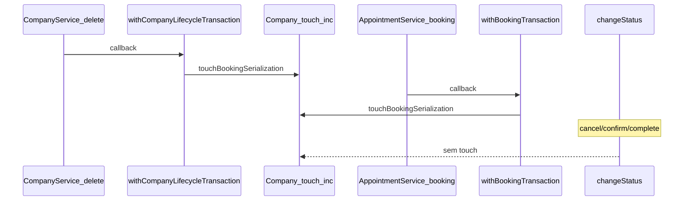

# Auditoria técnica B2.4 — Exclusão segura de empresas e concorrência

**Data:** 2026-11-20  
**Âmbito:** Leitura e análise (sem alterações de implementação)  
**Branch observada:** `feat/company-safe-soft-delete` (estado local do workspace)  
**Auditor:** Agente Cursor (pedido Weidson)

---

## 1. Objetivo e escopo

Auditoria da implementação **B2.4** (robustez transacional) no contexto da política **B2** (soft delete seguro de empresas e serialização com operações de agendamento). Objetivos:

- Verificar conformidade com regras de negócio aprovadas (gate de agendamentos, HTTP 409, soft delete, empresa inativa).
- Avaliar mecanismos de concorrência (`bookingSerializationVersion`, transações, retries).
- Comparar `withCompanyLifecycleTransaction` com `withBookingTransaction` após correções B2.4.
- Rever testes (comportamento real, não apenas “verde”).
- Executar validação automatizada segura (sem `GW3_TEST_MONGO_URI` externo).

**Fora do escopo:** correções de código, commits, alteração de dependências.

---

## 2. Ficheiros analisados

### Produção — ciclo de vida da empresa

| Ficheiro | Papel |
|----------|--------|
| `server/src/modules/companies/routes/CompanyRoutes.ts` | Rota `DELETE /:id` e middlewares |
| `server/src/modules/companies/controllers/CompanyController.ts` | `delete` → `CompanyService.delete` |
| `server/src/modules/companies/services/CompanyService.ts` | Política de delete, `referenceNow`, activate/deactivate |
| `server/src/modules/companies/services/company-lifecycle-transaction.ts` | Transação + retries B2.4 |
| `server/src/modules/companies/repositories/CompanyRepository.ts` | `touchBookingSerialization`, `softDelete`, queries `deletedAt: null` |
| `server/src/modules/companies/models/Company.model.ts` | Schema, índices, `toJSON` |

### Produção — agendamentos

| Ficheiro | Papel |
|----------|--------|
| `server/src/modules/appointments/services/AppointmentService.ts` | Create, createPublic, reschedule, `changeStatus` |
| `server/src/modules/appointments/services/appointment-booking-transaction.ts` | Transação de reserva (referência) |
| `server/src/modules/appointments/repositories/AppointmentRepository.ts` | `hasOpenAppointmentsForCompany`, escritas |
| `server/src/modules/appointments/models/Appointment.model.ts` | Índice parcial gate soft delete |
| `server/src/modules/appointments/routes/PublicAppointmentRoutes.ts` | Rotas públicas |

### Serialização auxiliar (não Company)

| Ficheiro | Papel |
|----------|--------|
| `server/src/modules/users/repositories/UserRepository.ts` | `touchBookingSerialization` (`$set updatedAt`) |
| `server/src/modules/Clients/repositories/ClientRepository.ts` | Idem |

### Testes

| Ficheiro | Papel |
|----------|--------|
| `server/tests/unit/companies/company-lifecycle-transaction.test.ts` | 11 cenários de retry |
| `server/tests/unit/companies/CompanyService.delete-referenceNow.test.ts` | `referenceNow` entre retries |
| `server/tests/unit/companies/CompanyService.soft-delete-policy.test.ts` | Política delete (mock) |
| `server/tests/unit/appointments/appointment-booking-transaction.test.ts` | Regressão booking txn |
| `server/tests/unit/appointments/AppointmentRepository.open-for-company-delete.test.ts` | Contrato da query |
| `server/tests/integration/companies/company-open-appointments-gate.mongo.test.ts` | Matriz do gate |
| `server/tests/integration/companies/company-soft-delete-policy.mongo.test.ts` | Mongo política delete |
| `server/tests/integration/companies/company-delete-booking-concurrency.mongo.test.ts` | CDB |
| `server/tests/integration/companies/company-delete-reschedule-concurrency.mongo.test.ts` | CDR |
| `server/tests/integration/routes/multi-tenant-companies.routes.test.ts` | HTTP DELETE, 409, inativa |

### Documentação de tarefa

| Ficheiro | Papel |
|----------|--------|
| `docs/tasks/B2.4-robustez-transacoes-mongodb.md` | Registo das alterações B2.4 |

---

## 3. Arquitetura e fluxo de execução

### 3.1 Rota DELETE

```
DELETE /api/companies/:id
  → AuthMiddleware.authenticate
  → validateObjectId("id")
  → PasswordChangeMiddleware.requirePasswordChangeCompleted
  → hasPermission(Permission.COMPANY_DELETE)
  → CompanyController.delete
  → CompanyService.delete(id, req.user.companyId)
```

**Evidência:** `CompanyRoutes.ts` linhas 56–62 — **não** inclui `RequireOperationalCompanyMiddleware` (presente em PATCH update, linha 49).

### 3.2 Fluxo transacional do delete

Dentro de `withCompanyLifecycleTransaction`:

1. `referenceNow = new Date()` (por execução do callback).
2. `touchBookingSerialization` (empresa, sessão).
3. `hasOpenAppointmentsForCompany(id, referenceNow, { session })`.
4. Segundo `touchBookingSerialization`.
5. Segundo `hasOpen` na sessão.
6. Terceiro e quarto `hasOpen` **sem** sessão (`hasOpenCommitted`).
7. `softDelete(id, session)`.

O commit passa por `commitWithUnknownResultRetries` (até 8 tentativas, backoff 5–50 ms entre Unknown).

### 3.3 Fluxo de reserva (create / reschedule)

Dentro de `withBookingTransaction`:

1. `assertCompanyBookableForBooking` → `CompanyRepository.touchBookingSerialization`.
2. Touches em User/Client (serialização por funcionário/cliente).
3. Validações de disponibilidade e conflitos.
4. `assertCompanyLiveForBooking` (leitura majority fora do snapshot imediato).
5. Segundo par `assertCompanyLive` + `assertCompanyBookable`.
6. `create` / `updateInCompany`.

### 3.4 Diagrama de serialização na empresa



---

## 4. Regras de negócio verificadas

| Regra | Estado | Evidência |
|-------|--------|-----------|
| Bloqueio com SCHEDULED/CONFIRMED, `deletedAt: null`, `endAt > now` (UTC servidor) | **Conforme** | `AppointmentRepository.hasOpenAppointmentsForCompany` (L531–553); testes gate Mongo |
| Agendamentos com `endAt <= now` não bloqueiam | **Conforme** | Gate mongo `CONFIRMED já terminado` → `false` |
| CANCELLED / COMPLETED / NO_SHOW não bloqueiam | **Conforme** | Gate mongo + query `$in` apenas SCHEDULED/CONFIRMED |
| HTTP 409 + código `COMPANY_DELETE_BLOCKED_OPEN_APPOINTMENTS` | **Conforme** | `CompanyService.delete` L269–275; rota integration L295–305 |
| Soft delete: `deletedAt` + `isActive: false`, sem cascata | **Conforme** | `CompanyRepository.softDelete` L193–197; mongo policy conta appointments preservados |
| Empresa inativa pode ser eliminada se gate OK | **Conforme** | Unit soft-delete-policy L104–108; rota integration L308–319 |
| Não restaurar empresa eliminada | **Conforme** | `findById` / `activate` / `update` filtram `deletedAt: null`; segunda delete → 404 |

---

## 5. Auditoria de transações e retry

### 5.1 `withCompanyLifecycleTransaction` (pós-B2.4)

| Aspecto | Comportamento observado | Alinhado B2.4? |
|---------|-------------------------|----------------|
| `UnknownTransactionCommitResult` no commit | Retry **só** `commitTransaction`, mesma sessão, **sem** reexecutar callback | **Sim** — `commitWithUnknownResultRetries` L162–191 |
| Backoff entre retries de commit Unknown | `computeLifecycleTransactionBackoffMs` + delay | **Sim** |
| `Unknown` no erro de callback/commit integral | **Não** tratado como transitório (`isRetryable...` L76–77) | **Sim** |
| `TransientTransactionError` / código 112 | Nova sessão, callback reexecutado, até `COMPANY_LIFECYCLE_MAX_ATTEMPTS = 4` | **Sim** |
| `AppError` | Sem retry (L67–69, teste L201–210) | **Sim** |
| `abortTransaction` falha | Erro original preservado (teste L223–237) | **Sim** |
| `endSession` falha | Log + erro primário preservado (teste L239–257) | **Sim** |
| Unknown esgotado no commit | Propaga; callback executado 1× (teste L122–147) | **Sim** |

### 5.2 Comparação com `withBookingTransaction`

| Parâmetro | Lifecycle | Booking |
|-----------|-----------|---------|
| Tentativas integrais | 4 | 8 (`BOOKING_TRANSACTION_MAX_ATTEMPTS`) |
| Tentativas commit Unknown | 8 (`LIFECYCLE_COMMIT_MAX_ATTEMPTS`) | 8 (mesmo constante) |
| Backoff commit Unknown | Sim | Sim + `logCommitRetry` |
| `AppError` sem retry | Sim | Sim |

**Observação (BAIXO):** lifecycle não regista cada retry intermédio de commit (apenas exhausted); booking regista `logCommitRetry`.

### 5.3 `referenceNow` em `CompanyService.delete`

- **Implementação:** `new Date()` no **início** do callback (L255), não antes de `withCompanyLifecycleTransaction`.
- **Por tentativa:** mesmo instante reutilizado nas 4 chamadas `hasOpen` dentro da tentativa (teste soft-delete-policy L192–202).
- **Entre retries integrais:** novo instante na segunda sessão (teste `CompanyService.delete-referenceNow.test.ts`).

**Nota de validação:** na 1.ª execução em lote de 5 ficheiros unitários, `delete-referenceNow` falhou (T2 não aplicado); na 2.ª execução **51/51 OK** — possível **flakiness** por interferência de `vi.useFakeTimers` entre ficheiros (ver secção 10).

---

## 6. Auditoria de serialização e concorrência

### 6.1 Caminhos que tocam `Company.bookingSerializationVersion`

| Operação | Usa `CompanyRepository.touchBookingSerialization`? | Transação |
|----------|---------------------------------------------------|-----------|
| `CompanyService.delete` | Sim (2×) | `withCompanyLifecycleTransaction` |
| `AppointmentService` create (admin) | Sim | `withBookingTransaction` |
| `AppointmentService.createPublic` | Sim (via create interno) | `withBookingTransaction` |
| `persistReschedule` / `update` / `updatePublicByToken` | Sim | `withBookingTransaction` |
| `cancel` / `confirm` / `complete` / `markAsNoShow` | **Não** | Nenhuma |
| Soft delete de appointment | **Não** | Nenhuma |
| `cancelOverdueScheduled` (batch) | **Não** | Nenhuma |

User/Client usam `$set: { updatedAt }` — serialização **no documento User/Client**, não na Company. Conflito de escrita com delete concentra-se no documento **Company** via `$inc` (L177–180).

### 6.2 Cenários obrigatórios C1–C7

| ID | Cenário | Mecanismo | Resultado esperado | Cobertura |
|----|---------|-----------|-------------------|-----------|
| **C1** | Create admin vs delete | Ambos `$inc` Company na transação | Invariante: não existe empresa eliminada com open futuros | CDB-01 (6 iterações), invariante L167–169 |
| **C2** | Reagendamento histórico → futuro vs delete | `persistReschedule` + touch Company | Idem | CDR-01, CDR-02 |
| **C3** | Create público vs delete | Mesmo pipeline booking | Idem | CDB-02 |
| **C4** | Empresa inativa | Delete sem middleware operacional; touch exige `deletedAt: null` | Delete permitido sem open | Unit + rota HTTP (mock) |
| **C5** | Transitório / 112 | Retry integral nova sessão + backoff | Sucesso ou erro após 4 tentativas | `company-lifecycle-transaction.test.ts` |
| **C6** | Unknown no commit | Retry commit só, callback 1× | Sem duplo soft delete no mesmo sucesso lógico | Testes lifecycle L97–120, L122–147 |
| **C7** | Alteração de estado vs delete | **Sem** touch Company | Cancel/complete removem bloqueio sem serializar; **não** criam novos futuros | **Sem teste de concorrência dedicado** |

**Análise C7:** Uma corrida `cancel` paralela a `delete` pode fazer o delete passar o gate após o cancel comitar — comportamento **desejável** (último bloqueio removido). Não há caminho de `changeStatus` que **introduza** novo agendamento futuro bloqueante sem passar por create/reschedule (serializados). Risco residual: janela entre `assertCompanyLiveForBooking` e persistência de reserva (já documentado em B2.1), não específico de B2.4.

**Análise pós-delete:** CDR-03 / CDR-03b verificam update após empresa eliminada → 404.

---

## 7. Auditoria de consultas e filtros

### 7.1 `hasOpenAppointmentsForCompany`

```typescript
// AppointmentRepository.ts ~536-543
{
  companyId,
  deletedAt: null,
  status: { $in: [SCHEDULED, CONFIRMED] },
  endAt: { $gt: now },
}
```

- **Session:** encadeamento `.session(options.session)` quando fornecido — teste unitário + integração.
- **Índice:** parcial `companyId + status + endAt` com mesmo filtro de status/deletedAt (Appointment.model L244–256).
- **Multi-tenant:** `companyId` obrigatório na query; teste “outra empresa”.

### 7.2 Leituras fora da transação no delete

As duas chamadas `hasOpen` sem `session` (L303–322) observam escritas **já comitadas** por transações concorrentes (ex.: create que perdeu o conflito de escrita na Company mas ainda não visível no snapshot da sessão de delete). **Duplicação:** dois blocos idênticos consecutivos — não altera semântica, mas redundante (BAIXO).

### 7.3 Filtros empresa eliminada

`touchBookingSerialization` e `softDelete` exigem `deletedAt: null`. Após soft delete, novas reservas falham em `touchBookingSerialization` → `COMPANY_NOT_FOUND`.

---

## 8. Auditoria de rotas e middlewares

| Verificação | Resultado |
|-------------|-----------|
| Autenticação no DELETE | Sim |
| `COMPANY_DELETE` | Sim |
| Sem middleware operacional no DELETE | Sim — permite inativa |
| Validação ObjectId | Sim |
| Password change gate | Sim |
| Tenant `ensureTenant` no serviço | Sim |
| 409 com `code` no body | Sim (teste de rota) |

`CompanyController.delete` devolve 200 com mensagem de sucesso; erros propagam via `AppError` global.

---

## 9. Auditoria dos testes

### 9.1 Pontos fortes

- **Lifecycle txn:** cobertura explícita Unknown/commit/callback/112/AppError/abort/endSession/exhausted — superior ao estado pré-B2.3.
- **Ordem delete:** teste mock valida sequência touch → hasOpen(session) → touch → hasOpen(session) → hasOpen×2 → softDelete.
- **Gate:** matriz Mongo abrangente (futuro, em curso, estados finais, soft-deleted appointment).
- **Concorrência:** CDB/CDR com `Promise.allSettled`, timers falsos, 6 iterações em cenários críticos.

### 9.2 Lacunas

| Lacuna | Severidade sugerida |
|--------|---------------------|
| Concorrência delete vs `cancel`/`confirm` | MÉDIO (cobertura) |
| Mongo integration empresa **inativa** delete | MÉDIO (só unit + rota mock) |
| `delete-referenceNow` instável em lote Vitest | MÉDIO (fiabilidade CI) |
| Retry integral reexecuta `softDelete` em mock após abort — sem assert idempotência mongo | BAIXO |
| `multi-tenant-companies.routes.test` mock repositories — não exercita transação real | Risco conhecido de testes de rota |

---

## 10. Resultados da validação

Ambiente: Windows local, `GW3_TEST_MONGO_URI` **não** definido (MongoMemoryReplSet).

| Comando | Exit | Resultado |
|---------|------|-----------|
| `npm run test -- tests/unit/companies/company-lifecycle-transaction.test.ts tests/unit/companies/CompanyService.delete-referenceNow.test.ts tests/unit/companies/CompanyService.soft-delete-policy.test.ts tests/unit/appointments/appointment-booking-transaction.test.ts tests/unit/appointments/AppointmentRepository.open-for-company-delete.test.ts` | 0 (2ª execução) | **51 passed** (1ª execução: **50 passed, 1 failed** — `delete-referenceNow`) |
| `npm run test -- tests/integration/companies/company-delete-booking-concurrency.mongo.test.ts ... --maxWorkers=1` (4 ficheiros) | 0 | **41 passed** |
| `npm run typecheck` | 0 | Sem erros |
| `npm run build` | 0 | Compilação OK |

**Não executado:** suíte completa `npm run test` do monólito server; `GW3_TEST_MONGO_URI` externo (evitar ambiente partilhado).

**Dependência operacional:** testes mongo de concorrência requerem `--maxWorkers=1` para estabilidade (observação histórica do projeto).

---

## 11. Problemas confirmados

### 11.1 MÉDIO — Alterações de estado sem serialização na Company

- **Ficheiro:** `server/src/modules/appointments/services/AppointmentService.ts`
- **Método:** `changeStatus` (L1441–1502) — `cancel`, `confirm`, `complete`, `markAsNoShow`
- **Comportamento:** `updateStatusInCompany` / `updateStatus` sem `touchBookingSerialization` na empresa.
- **Problema:** Operações que alteram campos do gate (`status`) não participam do mutex `$inc` na Company com o delete.
- **Impacto:** Corridas com delete não violam o invariante “empresa eliminada + novo futuro” (create/reschedule continuam serializados). Pode haver decisões de delete baseadas em estado que muda concurrentemente sem write conflict na Company — em geral favorece delete quando cancela remove bloqueio; não cria bloqueios novos.
- **Recomendação (futuro):** incluir touch Company em transação para transições que afetam o gate, ou teste de concorrência documentando comportamento aceite.

### 11.2 MÉDIO — Teste `referenceNow` flaky em lote

- **Ficheiro:** `server/tests/unit/companies/CompanyService.delete-referenceNow.test.ts`
- **Problema:** Falha intermitente ao correr com outros testes que usam fake timers.
- **Impacto:** CI pode falhar esporadicamente.
- **Recomendação:** isolar timers (`isolate: true` no Vitest) ou `afterEach` garantido em todos os ficheiros da pasta.

### 11.3 BAIXO — Duplicação `hasOpenCommitted` em `CompanyService.delete`

- **Linhas:** ~303–331 — dois blocos idênticos.
- **Impacto:** Manutenção; custo extra de 2 queries.
- **Recomendação:** consolidar num único check (fora do escopo B2.4 audit fix).

### 11.4 BAIXO — Assimetria de tentativas integrais (4 vs 8)

- **Lifecycle:** `COMPANY_LIFECYCLE_MAX_ATTEMPTS = 4`
- **Booking:** `BOOKING_TRANSACTION_MAX_ATTEMPTS = 8`
- **Impacto:** Delete pode desistir mais cedo sob contenção prolongada; não incorrecto funcionalmente.
- **Recomendação:** alinhar ou documentar decisão de produto.

---

## 12. Riscos e limitações

1. **Janela live-check → persist** em reservas (B2.1): mitigada por re-touch e leituras live, não eliminada.
2. **Unknown commit esgotado:** estado Mongo ambíguo; cliente deve tratar como erro — não há retry integral (correcto por desenho).
3. **Retry integral do delete:** reexecuta callback incluindo verificações `hasOpen` com novo `referenceNow` — correcto; `softDelete` só corre após checks na tentativa bem-sucedida.
4. **Testes de rota** com mocks não substituem prova transacional mongo.
5. **Auditoria não executou** PR completo nem ambiente de réplica multi-nó.

---

## 13. Melhorias recomendadas (etapa futura)

1. Teste mongo: delete paralelo com `cancel` em appointment bloqueante.
2. Teste mongo: empresa inativa sem open → delete bem-sucedido.
3. Logging simétrico retry commit em lifecycle (`logCommitRetry`).
4. Consolidar blocos duplicados `hasOpenCommitted`.
5. Avaliar `touchBookingSerialization` em User/Client migrar para contador (consistência B2.2; impacto marginal no delete).

---

## 14. Pontos implementados correctamente

- Política de gate e 409 conforme especificação.
- Soft delete sem cascata; `activate`/`update` não reactivam eliminadas.
- Rota DELETE adequada para empresa inativa.
- B2.4: Unknown → commit-only na mesma sessão com backoff; transitório/112 → retry integral; `AppError` sem retry.
- `referenceNow` dentro do callback; testes dedicados.
- Serialização `$inc` na Company para delete vs create/reschedule.
- Índice parcial alinhado ao gate.
- Cobertura CDB/CDR e gate mongo sólida.

---

## 15. Conclusão executiva

| Pergunta | Resposta |
|----------|----------|
| B2.4 funcionalmente correcto? | **Sim**, no âmbito auditado (transações + delete + gate). |
| Delete e booking protegidos contra concorrência crítica? | **Sim** para create/reschedule vs delete (serialização Company + testes mongo). |
| Serialização em todos os caminhos relevantes para **criar** bloqueios? | **Sim** (create/reschedule). **Não** em mudanças de estado (impacto limitado). |
| Retries/transações correctos pós-B2.4? | **Sim**, alinhados ao booking para Unknown/commit; diferença intencional em max tentativas integrais. |
| Falhas que impedem concluir B2.4? | **Nenhuma crítica** identificada. |
| Correções obrigatórias antes de aprovação humana? | Nenhuma funcional **crítica**; recomenda-se endereçar flakiness do teste `referenceNow` antes de CI estrito. |
| Melhorias para etapa futura? | C7 test coverage, deduplicação hasOpen, logging, tentativas integrais. |

### Recomendação final

**APROVADO COM RESSALVAS**

Sem defeitos críticos de multi-tenant, soft delete ou concorrência create/reschedule vs delete. Ressalvas: serialização ausente em `changeStatus`, teste unitário flaky em lote, lacunas de cobertura mongo (inativa, cancel paralelo).

---

## 16. Auditoria complementar — validação das ressalvas

**Data complementar:** 2026-11-20  
**Âmbito:** Leitura, análise e testes seguros (sem alteração de código).  
**Critério Ponto A acordado:** Alinhamento com `withBookingTransaction` — mesma sessão, callback uma vez, limite de tentativas; backoff entre commits Unknown **aceite** se idêntico em lifecycle e booking.

### 16.1 Ponto A — `UnknownTransactionCommitResult`

#### Conclusão

O tratamento de Unknown em **lifecycle** está **alinhado** com o critério acordado e com **booking**. Existe **backoff** entre tentativas de `commitTransaction` em Unknown; lifecycle e booking implementam o mesmo padrão (diferença: booking regista `logCommitRetry`, lifecycle não).

Relativamente ao texto do briefing complementar que pedia **zero** backoff entre commits Unknown: o **código não cumpre** esse critério estrito; cumpre o critério de **paridade com booking**. O ficheiro [`B2.4-robustez-transacoes-mongodb.md`](../tasks/B2.4-robustez-transacoes-mongodb.md) §7 contém redação contraditória (“não entre Unknown” vs “jitter em `commitWithUnknownResultRetries`”); o comportamento real segue a segunda parte (há jitter antes do próximo commit).

#### Evidências (comportamento real)

| Verificação | Lifecycle | Booking |
|-------------|-----------|---------|
| Backoff entre commits Unknown | **Sim** — `computeLifecycleTransactionBackoffMs` + `delayForLifecycleTransactionRetry` em `commitWithUnknownResultRetries` (aprox. L181–184 em `company-lifecycle-transaction.ts`) | **Sim** — L233–240 em `appointment-booking-transaction.ts` |
| Mesma sessão | **Sim** — loop recebe `session: ClientSession` sem `startSession` novo | **Sim** |
| Transação permanece aberta | **Sim** — `operation` e `commitWithUnknownResultRetries` ocorrem após `startTransaction()` (L206–236) sem novo `startTransaction` entre retries Unknown | **Sim** |
| Callback uma vez por sucesso lógico | **Sim** — `result = await operation(session)` antes do commit; Unknown só reentra no loop de commit | **Sim** |
| Limite máximo commits Unknown | **8** — `LIFECYCLE_COMMIT_MAX_ATTEMPTS` | **8** — `BOOKING_TRANSACTION_MAX_ATTEMPTS` |
| Unknown dispara retry integral | **Não** — L240–241 propaga Unknown; `isRetryableLifecycleTransactionError` exclui Unknown (L76–77) | Idem no booking |

**Testes unitários:** `company-lifecycle-transaction.test.ts` — “retries commit only on Unknown… without re-running the callback” (1 callback, 2 commits, 1 sessão); “propagates after exhausting commit retries” (`commitTransaction` chamado `LIFECYCLE_COMMIT_MAX_ATTEMPTS` vezes). `appointment-booking-transaction.test.ts` — cenários equivalentes.

#### Risco

**BAIXO** funcional (paridade com booking). **MÉDIO** documental se aprovação humana exigir “zero backoff” estrito em Unknown.

#### Recomendação (sem implementação)

- Clarificar §7 em `B2.4-robustez-transacoes-mongodb.md`.
- Opcional: logging de commit retry em lifecycle para simetria com booking.
- Opcional: se produto exigir zero backoff só em Unknown, alterar **ambos** os helpers em conjunto.

---

### 16.2 Ponto B — Concorrência nas alterações de estado

#### Conclusão

**Nenhuma** transição exposta em `AppointmentService.changeStatus` transforma um agendamento **não bloqueante** num **novo** bloqueio no sentido do gate. As transições que **reduzem** o gate (`cancel`, `complete`, `markAsNoShow`) não usam serialização na Company; o risco de concorrência com `CompanyService.delete` é **baixo** e não permite criar agendamentos futuros bloqueantes em empresa já eliminada (isso continua a depender de create/reschedule, cobertos por CDB/CDR).

#### Evidências — transições permitidas

Porta única: `changeStatus` (`AppointmentService.ts` L1441–1502) — rejeita origem não listada com `STATUS_TRANSITION_NOT_ALLOWED` (L1466–1470).

| API | Origem (`allowedCurrentStatuses`) | Destino | Altera `endAt`? | Tx Mongo | `touchBookingSerialization` |
|-----|-----------------------------------|---------|-----------------|----------|------------------------------|
| `confirm` | `SCHEDULED` | `CONFIRMED` | Não | Não | Não |
| `complete` | `CONFIRMED` | `COMPLETED` | Não | Não | Não |
| `cancel` | `SCHEDULED`, `CONFIRMED` | `CANCELLED` | Não | Não | Não |
| `markAsNoShow` | `CONFIRMED` | `NO_SHOW` | Não | Não | Não |

`confirm` adicional: se `startAt < now` → 400 `APPOINTMENT_CONFIRM_START_PASSED` (L1517–1523).  
Escrita: `AppointmentRepository.updateStatusInCompany` — apenas `{ status }` (L264–267).

#### Respostas objectivas

1. **Transições permitidas:** apenas as quatro linhas da tabela.
2. **CANCELLED → CONFIRMED:** **Impossível** — nenhum método inclui `CANCELLED` em `allowedCurrentStatuses`.
3. **COMPLETED / NO_SHOW → SCHEDULED ou CONFIRMED:** **Impossível** — sem callers.
4. **Nova condição bloqueante só via status:** **Não** — `confirm` exige `SCHEDULED` (se já `endAt > now`, já bloqueava); não há reopen de estados finais.
5. **Transação MongoDB em changeStatus:** **Não**.
6. **Serialização Company:** **Não**.
7. **Simultâneo com delete:** `confirm` mantém conjunto bloqueante; `cancel`/`complete`/`no_show` **tiram** do gate (pode facilitar delete). Não há touch na Company → sem write conflict com `$inc` do delete; decisão de delete baseia-se em leituras `hasOpen` (incl. fora de sessão).
8. **Empresa eliminada + novo bloqueio por transição de estado:** **Não demonstrável** pelo código; novos futuros bloqueantes vêm de create/reschedule (com `touchBookingSerialization` e `deletedAt: null`).

**Outros escritores de `status`:** `cancelOverdueScheduled` (L555–569) — `SCHEDULED` com `startAt < now` → `CANCELLED` (tende a **não** aumentar bloqueios).

**Situação inversa (cancel/conclusão vs delete):** se o último bloqueio é removido entre `hasOpenCommitted` e `softDelete`, o delete pode prosseguir — **coerente** com a regra “não eliminar com open appointments” no instante da decisão.

#### Risco

**BAIXO** para violação do invariante “empresa eliminada com appointment open futuro” via **apenas** changeStatus. **MÉDIO** em **cobertura de teste** (corrida delete vs cancel não automatizada).

#### Recomendação (sem implementação)

- Teste mongo opcional delete ‖ cancel.
- Não é obrigatório envolver changeStatus em `touchBookingSerialization` salvo decisão de produto para serializar todas as mutações que alteram o gate.

---

### 16.3 Ponto C — Instabilidade `CompanyService.delete-referenceNow.test.ts`

#### Conclusão

A instabilidade **reproduzida na auditoria original** (1 falha em 51 testes no primeiro lote) é **intermitente**. A **causa raiz** comprovada por análise estática do teste + código de produção é uma **corrida no próprio teste**, não vazamento comprovado de fake timers entre ficheiros.

#### Mecanismo (evidência de código)

- Teste: `vi.useFakeTimers({ toFake: ["Date"] })` (L92) — **não** simula `setTimeout`.
- Mock: primeiro `commitTransaction` falha com `TransientTransactionError` (L24–28) → `withCompanyLifecycleTransaction` faz **retry integral** com backoff real via `delayForLifecycleTransactionRetry` (`setTimeout`, L251–252 em `company-lifecycle-transaction.ts`).
- Sequência (L118–122): `deletePromise` → `await vi.runAllTimersAsync()` (não avança timers reais) → `vi.setSystemTime(T2)` → `await deletePromise`.
- Se a 2.ª execução do callback (`referenceNow = new Date()`) ocorrer **antes** de `setSystemTime(T2)`, a asserção `secondAttemptTimes[0] === T2` **falha**.

**Timers noutros testes da pasta companies:** `company-lifecycle-transaction.test.ts` e `CompanyService.soft-delete-policy.test.ts` usam `afterEach(() => vi.useRealTimers())` onde aplicável; não foi observado estado partilhado de mocks `mongoose` entre workers (Vitest `vitest.config.ts` sem `fileParallelism: false`).

#### Execuções registadas (2026-11-20, `GW3_TEST_MONGO_URI` não definido)

| Comando | Exit | Resultado |
|---------|------|-----------|
| `npm run test -- tests/unit/companies/CompanyService.delete-referenceNow.test.ts` | 0 | **1/1** passed |
| Lote 5 ficheiros B2.4 (repetido 3×) | 0 | **51/51** passed em cada corrida |
| `npm run test -- tests/unit/companies/ --sequence` | — | **Não suportado** (Vitest 4.1.11: flag `--sequence` inválida) |

**Histórico:** na auditoria B2.4 inicial, o mesmo lote registou **50/51** (1 falha em `delete-referenceNow`); nesta complementar, **0 falhas em 3 lotes** — confirma natureza **flake** dependente de timing.

#### Risco

**MÉDIO** para CI (falso negativo esporádico). **Nenhum** risco funcional em produção.

#### Recomendação (sem implementação)

- Usar `vi.useFakeTimers()` completo no describe e `runWithTimers` como em `company-lifecycle-transaction.test.ts`, ou aguardar explicitamente o backoff real antes de `setSystemTime(T2)`.
- Considerar `describe(..., { isolate: true })` se o Vitest da equipa suportar.

---

### 16.4 Conclusão complementar obrigatória

| # | Pergunta | Resposta |
|---|----------|----------|
| 1 | Unknown alinhado com requisito B2.4 (critério paridade booking)? | **Sim** — mesma sessão, callback 1×, limite 8, backoff como booking. |
| 2 | Transições de estado podem introduzir **novos** agendamentos bloqueantes? | **Não** — só mutam `status`; não reabrem estados finais. |
| 3 | Risco de concorrência entre essas transições e exclusão? | **Baixo** — sem novo bloqueio; cancel/conclusão podem remover bloqueio durante delete. |
| 4 | Causa comprovada da instabilidade do teste? | **Corrida Date fake vs `setTimeout` real** no retry integral do mock de commit; flake intermitente (reproduzido 1× na auditoria anterior, 0× em 3 lotes aqui). |
| 5 | Alteração obrigatória antes da aprovação final? | **Nenhuma** em código de produção. **Recomendável** (não bloqueante) corrigir ou endurecer o teste `referenceNow` antes de CI estrito. |

### 16.5 Recomendação final (pós-complementar)

**APROVADO COM RESSALVAS**

- **Produção B2.4:** mantém-se adequado para aprovação funcional sob o critério Unknown = paridade booking.
- **Ressalvas residuais:** teste `referenceNow` estruturalmente frágil; documentação §7 B2.4 contraditória; cobertura mongo cancel ‖ delete opcional.

Nenhuma correção foi implementada nesta complementar; aguarda revisão humana.

---

*Fim do relatório — auditoria read-only; nenhum ficheiro de produção foi alterado (apenas actualização deste relatório).*