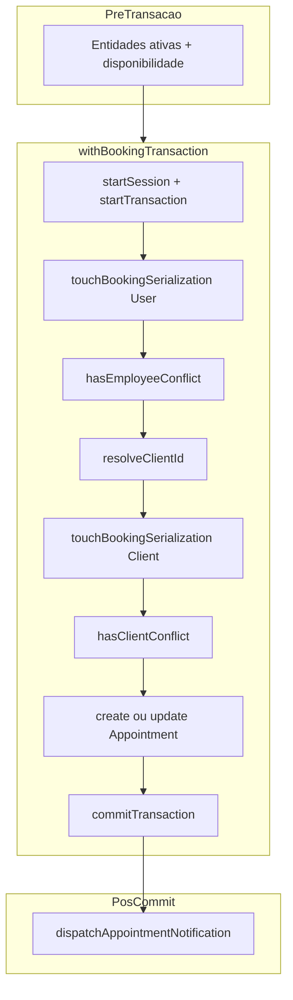

# Auditoria técnica — WriteConflict no agendamento concorrente (ACC-03)

**Data:** 2026-11-09  
**Âmbito:** Somente leitura no código; **único artefacto escrito:** este relatório.  
**Referências:** [schedulerpro-gw-3-double-booking.md](../reports/schedulerpro-gw-3-double-booking.md), suite `GW-3 appointment booking concurrency (ACC-01–07)`.

---

## 1. Resumo executivo

O erro `MongoServerError` **WriteConflict (código 112)** com label **`TransientTransactionError`** no teste **ACC-03** (*adjacent intervals allow two active appointments*) origina-se no mecanismo **GW-3 de serialização**: `UserRepository.touchBookingSerialization()` faz `findOneAndUpdate` no documento do **funcionário** no início de cada transação de reserva. Duas criações paralelas para o **mesmo `employeeId`** disputam a escrita do **mesmo documento `User`**, mesmo quando os intervalos são **apenas adjacentes** e a regra de negócio permitiria dois agendamentos.

**Não é**, na origem, uma falha da regra `hasEmployeeConflict` (sobreposição de horário): intervalos contíguos (`endAt` de A = `startAt` de B) **não** satisfazem `endAt > startAt` / `startAt < endAt` na query de conflito.

**É** uma falha de **superfície de erro**: se `withBookingTransaction` esgota as **4 tentativas** sem conseguir commit (corrida simétrica, sem backoff), o `MongoServerError` propaga-se até `Promise.all` no ACC-03, que espera **duas resoluções bem-sucedidas**, não um 409 de negócio.

| Classificação | Conclusão |
| --- | --- |
| **Causa confirmada (design + código)** | Contenção intencional no `User` via `touchBookingSerialization`; WriteConflict 112 é efeito esperado entre transações concorrentes no mesmo employee. |
| **Causa provável da falha do teste (CI/local intermitente)** | Esgotamento de `MAX_ATTEMPTS` (4) em `withBookingTransaction` quando várias transações colidem repetidamente no touch, **sem jitter/backoff**. |
| **Hipótese descartada como causa primária** | Rejeição 409 por sobreposição de slots adjacentes. |

Nesta máquina (09/11/2026): suite ACC **7/7** verde; ACC-03 isolado **5/5** verdes — o problema permanece **reproduzível por desenho** e reportado em CI/GitHub Actions; a passagem local não invalida o diagnóstico.

**Recomendação:** manter serialização GW-3; endurecer **reintento da transação completa** (mais tentativas + backoff/jitter; opcionalmente métricas). **Não** remover `touchBookingSerialization` sem substituto equivalente.

---

## 2. Estado inicial do Git

Auditoria executada em:

| Campo | Valor |
| --- | --- |
| Branch | `feature/dashboard-active-clients-kpi` |
| HEAD (short) | `ea7e6a4` |
| Tracking | `origin/feature/dashboard-active-clients-kpi` (up to date) |
| Working tree | **clean** — `nothing to commit, working tree clean` |
| Último commit (subject) | `adicionar card de KPI de clientes ativos` |

Nenhuma operação Git de escrita foi executada durante a auditoria.

---

## 3. Descrição do erro e localização

### 3.1 Mensagem típica

```text
MongoServerError: Caused by :: Write conflict during plan execution and yielding is disabled.
code: 112
codeName: WriteConflict
errorLabels: [ 'TransientTransactionError' ]
```

### 3.2 Stack trace reportado

O ponto de escrita imediato:

```text
Collection.findOneAndUpdate
UserRepository.touchBookingSerialization
server/src/modules/users/repositories/UserRepository.ts (~363)
```

### 3.3 Teste que expõe o problema

Ficheiro: [`server/tests/integration/appointments/appointment-booking-concurrency.test.ts`](../../server/tests/integration/appointments/appointment-booking-concurrency.test.ts)

Caso **ACC-03** (L276–311): `Promise.all` com duas chamadas a `AppointmentService.create`, mesmo `employeeId`, clientes diferentes, `startB = endAt(startA)`; assert final `countOverlappingEmployee === 2`.

Diferente de ACC-01/02: o teste **não** admite rejeição — qualquer `MongoServerError` não tratado falha o caso.

---

## 4. Arquitetura e fluxo transacional identificado

### 4.1 Entrada HTTP (admin)

[`AppointmentController.create`](../../server/src/modules/appointments/controllers/AppointmentController.ts) (L31–36) → `AppointmentService.create(req.body, companyId)`.

### 4.2 `AppointmentService.create` (fora da transação)

[`AppointmentService.ts`](../../server/src/modules/appointments/services/AppointmentService.ts) L466–501:

1. `requireActiveClient`
2. `PublicBookingEligibility.requireActiveService`
3. `PublicBookingEligibility.requireActiveEmployee`
4. `schedule({ ... resolveClientId: () => ObjectId(dto.clientId), ... })`

Fluxo público: `createPublic` (L577+) e reagendamento `update` / `updatePublicByToken` convergem no mesmo protocolo transaccional (`schedule` / `persistReschedule`).

### 4.3 Disponibilidade semanal (fora da transação)

`ensureEmployeeAvailabilityOnly` → `AvailabilityService.ensureEmployeeAvailable` (mocked nos testes ACC).

### 4.4 Wrapper transacional centralizado

Único helper de reserva: [`appointment-booking-transaction.ts`](../../server/src/modules/appointments/services/appointment-booking-transaction.ts) — `withBookingTransaction(operation)`.



### 4.5 Ordem dentro da transação (create)

[`schedule`](../../server/src/modules/appointments/services/AppointmentService.ts) L327–407:

| Passo | Operação |
| --- | --- |
| 1 | `userRepository.touchBookingSerialization(employeeId, companyId, session)` |
| 2 | `appointmentRepository.hasEmployeeConflict(..., { session })` → 409 se true |
| 3 | `clientId = await resolveClientId(session)` |
| 4 | `clientRepository.touchBookingSerialization(clientId, companyId, session)` |
| 5 | `hasClientConflict(..., { session })` → 409 se true |
| 6 | `appointmentRepository.create(payload, { session })` |
| 7 | `commitTransaction` (no wrapper) |

Reagendamento: [`persistReschedule`](../../server/src/modules/appointments/services/AppointmentService.ts) L196–270 — mesma ordem com `excludeAppointmentId` e `update`.

### 4.6 Repositório de agendamentos

`hasEmployeeConflict` / `hasClientConflict`: [`AppointmentRepository.ts`](../../server/src/modules/appointments/repositories/AppointmentRepository.ts) L189–227 e L276+ — `findOne` com sobreposição:

- `startAt: { $lt: endAt }`
- `endAt: { $gt: startAt }`

Status activos: `scheduled`, `confirmed`; `deletedAt: null`. Leituras com `.session(session)` quando em transação.

Índice parcial CANON-016 no modelo `Appointment` — **optimização de query**, não garantia de exclusão de intervalos (documentado em GW-3 §12.3).

---

## 5. Análise de `touchBookingSerialization()`

### 5.1 Implementação User

[`UserRepository.ts`](../../server/src/modules/users/repositories/UserRepository.ts) L355–372:

```typescript
const updated = await User.findOneAndUpdate(
  { _id: id, companyId, deletedAt: null },
  { $set: { updatedAt: new Date() } },
  { session, new: false },
);
```

Comentário no código: *«Serializa reservas concorrentes que partilham o mesmo funcionário.»*

- **Filtros:** `_id`, `companyId`, `deletedAt: null` (multi-tenant + soft delete).
- **Operador:** `$set` em `updatedAt` — escrita mínima para forçar exclusão mútua transaccional no documento.
- **Sessão:** participa na transação MongoDB (`ClientSession`).
- **Índices User:** `_id` é chave primária; índices auxiliares (`companyId`, etc.) em [`User.model.ts`](../../server/src/modules/users/models/User.model.ts) L275–298 — **não** há índice dedicado a «lock de reserva»; o alvo é o documento do funcionário por PK.

### 5.2 Implementação Client

[`ClientRepository.ts`](../../server/src/modules/Clients/repositories/ClientRepository.ts) L130–142 — mesmo padrão para serializar reservas que partilham o **mesmo cliente** (relevante para ACC-07).

### 5.3 Respostas às questões obrigatórias

1. **Que garantia pretende oferecer?**  
   Sob isolamento snapshot, duas transações podem ambas ver «sem conflito» e inserir appointments em documentos **diferentes**. O touch no `User`/`Client` força **contenção de escrita** no mesmo documento; numa falha/reintento, a transação seguinte vê o appointment já commitado e `has*Conflict` devolve **409** (desenho GW-3 §12.1).

2. **Por que atualizar o User durante a criação?**  
   Para ancorar a serialização no recurso partilhado (funcionário), não no documento de appointment que ainda não existe.

3. **Funciona como serialização entre operações concorrentes?**  
   **Sim**, por efeito colateral de transações multi-documento no MongoDB: duas txs que alteram o mesmo doc geram abort/WriteConflict; o wrapper reexecuta a transação completa.

4. **Quais operações disputam a mesma escrita?**  
   Qualquer par de `create`/`persistReschedule` que use o mesmo `employeeId` (e, após resolução do cliente, o mesmo `clientId`) na mesma empresa, dentro de transações sobrepostas no tempo.

5. **O conflito pode ocorrer sem sobreposição de horários?**  
   **Sim (confirmado).** ACC-03 usa slots adjacentes; ainda assim ambas chamam `touchBookingSerialization` no **mesmo** `User`. WriteConflict ocorre na **serialização**, não na validação de intervalo.

### 5.4 Consequências de remover o mecanismo

Sem touch (ou sem equivalente), volta a janela clássica snapshot-only: duas reservas no mesmo slot podem commitar — **quebra GW-3 / overbooking**. Não recomendável sem substituto.

---

## 6. Tratamento atual de `TransientTransactionError`

Ficheiro: [`appointment-booking-transaction.ts`](../../server/src/modules/appointments/services/appointment-booking-transaction.ts)

| Pergunta | Resposta |
| --- | --- |
| A transação inteira é repetida? | **Sim** — o callback `operation(session)` corre de novo em nova sessão. |
| Tratamento do label `TransientTransactionError`? | **Sim** — via `hasErrorLabel("TransientTransactionError")` e código **112**. |
| Retry da operação vs transação? | **Transação completa** (start → operation → commit). |
| Limites / loops infinitos? | `MAX_ATTEMPTS = 4`; após a 4.ª falha reintentável, `throw error`. |
| Transitório vs definitivo? | `AppError` 409 não é código 112 — **não** reintenta (correcto). Erros não classificados como reintentáveis propagam imediatamente. |

**Lacunas observadas:**

- **Sem backoff/jitter** entre tentativas — em corrida simétrica (ACC-03), duas txs podem colidir no touch em todas as tentativas.
- **Sem testes unitários** dedicados a `withBookingTransaction` (apenas mocks nos testes de `AppointmentService`).
- Paralelo em [`company-lifecycle-transaction.ts`](../../server/src/modules/companies/services/company-lifecycle-transaction.ts) — mesma política de 4 tentativas; `isTransientTransactionError` usa também `errorLabels` em array (ligeira divergência de implementação).

---

## 7. Análise dos testes ACC-01 a ACC-07

Infra: `MongoMemoryReplSet` (count: 1) ou `GW3_TEST_MONGO_URI`; `AvailabilityService` e notificações mockados; `Appointment.syncIndexes()` no `beforeAll`.

| ID | Requisições concorrentes | Resultado esperado | Garantia | Contenção GW-3 |
| --- | --- | --- | --- | --- |
| **ACC-01** | 2× `create` — mesmo employee, **mesmo** slot | 1 fulfilled + 1 rejected **409**; count overlap = 1 | Anti–double-booking mesmo intervalo | Mesmo `User`; possivelmente clientes distintos (só touch client em docs diferentes) |
| **ACC-02** | 2× `create` — overlap 15 min | Idem ACC-01 | Anti–overlap parcial | Mesmo `User` |
| **ACC-03** | 2× `create` — **adjacentes**, mesmo employee | **Ambas OK**; count = 2 | Slots contíguos permitidos | **Mesmo `User`** → WriteConflict transitório possível; teste falha se MongoError escapa |
| **ACC-04** | Sequencial + `update` / `updatePublicByToken` para slot ocupado | 409; count inalterado | Reagendamento não ocupa slot taken | Touches em updates dentro de tx |
| **ACC-05** | Cancel depois rebook (sequencial) | 2× sucesso; count = 1 activo | Cancelado não bloqueia | Menos contenção paralela |
| **ACC-06** | 2× `create` — **companyId** diferente, mesmo instante | 2× sucesso | Isolamento multi-tenant | **Users diferentes** — sem contenção cruzada |
| **ACC-07** | 2× `create` — **mesmo client**, employees distintos, overlap | 1 OK + 1×409 | Cliente não com dois slots sobrepostos | Touches em `User` distintos; **mesmo `Client`** após resolve |

Helpers: `expectOneSuccessOneConflict` (L160–173) valida `AppError` CONFLICT; `countOverlappingEmployee` (L142–158) replica a lógica de sobreposição dos testes.

### ACC-03 — serialização vs disponibilidade

| Tipo de falha | Sintoma | ACC-03 |
| --- | --- | --- |
| Disponibilidade (overlap) | `AppError` 409 | **Não esperado** para adjacentes |
| Serialização / retry | `MongoServerError` 112 | **Esperado sob contenção**; deve ser **absorvido** por `withBookingTransaction` |

---

## 8. Causa confirmada vs hipóteses

| Afirmação | Evidência |
| --- | --- |
| **Confirmado:** WriteConflict origina em `touchBookingSerialization` no `User` | Stack trace do utilizador; implementação L363–367; ordem em `schedule` L328–332 |
| **Confirmado:** Adjacentes não violam `hasEmployeeConflict` | Query estrita `endAt > startAt` (L207–208); ACC-03 assert count=2 alinha com regra |
| **Confirmado:** GW-3 documenta contenção intencional no User | [schedulerpro-gw-3-double-booking.md](../reports/schedulerpro-gw-3-double-booking.md) §12.1 |
| **Provável (falha intermitente do teste):** 4 tentativas sem backoff insuficientes sob corrida simétrica | Código `MAX_ATTEMPTS = 4`, retry imediato; ACC-03 é o único caso paralelo que exige **2** commits com **mesmo** employee |
| **Não confirmado nesta sessão:** reprodução local do 112 | 7/7 + 5× ACC-03 verdes em 09/11/2026 — sugere **flakiness** dependente de timing/CI |

---

## 9. Alternativas de correção e riscos

| ID | Alternativa | Causa tratada | Segurança overbooking | ACC-03 | Concorrência | Complexidade | Riscos |
| --- | --- | --- | --- | --- | --- | --- | --- |
| **A** | Aumentar `MAX_ATTEMPTS` + **backoff/jitter** em `withBookingTransaction` | Esgotamento de retries no touch | Mantém touch → **sim** | Permite adjacentes após retries | Melhor sob carga simétrica | Baixa | Latência maior em pico |
| **B** | Coleção `BookingLock` (`companyId`+`employeeId` / `clientId`) em vez de mutar `User`/`Client` | Contenção explícita | **Sim** se mantido no protocolo | **Sim** | Granular | Média | Novo modelo, migração, disciplina em todos os caminhos |
| **C** | Ordenação global de locks (ex. sempre employee antes de client) | Deadlock | Parcial | Não remove colisão no primeiro touch | Igual no touch simultâneo | Baixa | Benefício limitado |
| **D** | Remover `touchBookingSerialization` | — | **Não** — regressão snapshot | Pode passar teste erradamente | Pior | Baixa aparente | **Inaceitável** para GW-3 |
| **E** | Índice/constraint de intervalo no Mongo | Overbooking estrutural | Mongo não tem exclusão de intervalos nativa | — | — | Alta / inviável | Falso sentido de segurança |
| **F** | Alterar ACC-03 (sequencializar ou aceitar MongoError) | Flakiness de CI | **Não** valida corrida real | Mascara problema | Fraca | Baixa | **Discutível** só como último recurso |

---

## 10. Recomendação técnica

1. **Manter** `touchBookingSerialization` em User e Client até existir mecanismo equivalente de contenção (GW-3).
2. **Implementar (futuro)** melhoria em **A**: mais tentativas (ex. 8–12), backoff exponencial com jitter curto (5–50 ms), logging/métrica em falha final 112.
3. **Opcional (médio prazo)** avaliar **B** se mutar `User.updatedAt` for indesejável operacionalmente — manter touch Client para ACC-07.
4. **Adicionar** testes unitários de `isRetryableTransactionError` + integração mínima que simule contenção (difícil sem Mongo; pode ser teste de contrato do retry).
5. **Não** enfraquecer `hasEmployeeConflict` nem remover serialização (**D**).

---

## 11. Ficheiros analisados

| Caminho | Notas |
| --- | --- |
| [`server/tests/integration/appointments/appointment-booking-concurrency.test.ts`](../../server/tests/integration/appointments/appointment-booking-concurrency.test.ts) | ACC-01–07 |
| [`server/src/modules/appointments/services/appointment-booking-transaction.ts`](../../server/src/modules/appointments/services/appointment-booking-transaction.ts) | Retry tx L3–66 |
| [`server/src/modules/appointments/services/AppointmentService.ts`](../../server/src/modules/appointments/services/AppointmentService.ts) | `schedule` L284–416, `persistReschedule` L178–270, `create` L466+ |
| [`server/src/modules/users/repositories/UserRepository.ts`](../../server/src/modules/users/repositories/UserRepository.ts) | `touchBookingSerialization` L358–372 |
| [`server/src/modules/Clients/repositories/ClientRepository.ts`](../../server/src/modules/Clients/repositories/ClientRepository.ts) | `touchBookingSerialization` L133–142 |
| [`server/src/modules/appointments/repositories/AppointmentRepository.ts`](../../server/src/modules/appointments/repositories/AppointmentRepository.ts) | `hasEmployeeConflict` L189–227 |
| [`server/src/modules/appointments/controllers/AppointmentController.ts`](../../server/src/modules/appointments/controllers/AppointmentController.ts) | `create` L31–36 |
| [`server/src/modules/companies/services/company-lifecycle-transaction.ts`](../../server/src/modules/companies/services/company-lifecycle-transaction.ts) | Padrão retry paralelo |
| [`server/src/modules/users/models/User.model.ts`](../../server/src/modules/users/models/User.model.ts) | Índices L275–298 |
| [`docs/reports/schedulerpro-gw-3-double-booking.md`](../reports/schedulerpro-gw-3-double-booking.md) | §12.1–12.2 desenho serialização |

---

## 12. Próximos passos sugeridos (implementação futura)

1. Branch dedicada (ex. `fix/gw-3-booking-tx-retry`).
2. Alterar apenas [`appointment-booking-transaction.ts`](../../server/src/modules/appointments/services/appointment-booking-transaction.ts): constantes configuráveis, `sleep` com jitter, log estruturado em falha final.
3. Testes: ficheiro `appointment-booking-transaction.test.ts` para classificação de erros; reexecutar suite ACC completa em CI ≥ N vezes se possível.
4. Monitorização em produção: contador de `WriteConflict` / abandono após max retries no path de reserva.
5. Revisão humana antes de merge — sem alterar expectativas ACC salvo evidência de teste incorrecto.

---

## Resultados dos testes executados nesta auditoria

| Comando | Exit | Resultado |
| --- | --- | --- |
| `cd server && npm run test -- tests/integration/appointments/appointment-booking-concurrency.test.ts` | 0 | **7 passed** (Vitest 4.1.11, ~13 s) |
| `… -t "ACC-03"` × 5 execuções sequenciais | 0 | **5 passed** (~7–9 s cada) |
| `vitest --repeat=10` | — | **Não suportado** nesta versão CLI (`Unknown option --repeat`) |

---

## Declaração de alterações no repositório

- **Código de aplicação, testes, configs e dependências:** não modificados.
- **Git:** nenhum commit, push ou alteração de branch.
- **Ficheiro criado:** este relatório em `docs/audits/appointment-booking-write-conflict-audit.md`.
