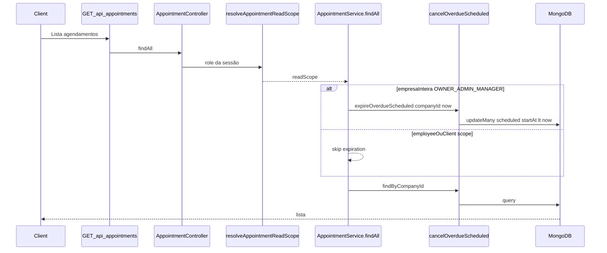

# Auditoria — Expiração automática de agendamentos

**Data:** 11/11/2026  
**Tipo:** Somente leitura — nenhum ficheiro de implementação (`server/`, `client/`, configs) alterado. Nenhuma dependência instalada.  
**Âmbito:** Backend (mecanismo actual de “expiração” / cancelamento de `scheduled` vencidos), testes, infraestrutura existente e proposta de evolução **sem implementação**.

**Veredicto sumário:** No SchedulerPro, **não existe status `expired`**. O comportamento actual equivale a **cancelar automaticamente** agendamentos com status `scheduled` cujo **`startAt` já passou**, via `AppointmentRepository.cancelOverdueScheduled`. A expiração **não é periódica**: só corre como **efeito colateral** de `GET /api/appointments` quando o escopo de leitura é **empresa inteira** (OWNER, ADMIN, MANAGER). Não há cron, worker nem fila dedicados. O precedente arquitectural mais próximo para um job automático é o **`ReminderScheduler`** (`setInterval` no mesmo processo Node).

---

## Estado Git — início

| Item | Valor |
|------|--------|
| Branch | `develop` |
| HEAD | `a605931149b42b353822a78b01ac5dc26909d92d` |
| Tracking | `develop...origin/develop` |
| Staged | Nenhum |
| Unstaged | Nenhum |
| Untracked | Nenhum (working tree limpa) |

**Operações Git de escrita:** não executadas.

---

## 1. Objectivo

Documentar como os agendamentos “vencidos” são tratados hoje, que regras o código aplica, que riscos existem (HTTP-coupled, roles, timezone, concorrência) e como evoluir para um mecanismo **automático e independente de requisições HTTP**, preservando multi-tenant e regras actuais salvo decisão explícita de produto.

---

## 2. Ficheiros analisados

### Núcleo da expiração (implementação)

| Ficheiro | Responsabilidade |
|----------|------------------|
| [`server/src/constants/appointment-status.ts`](../../server/src/constants/appointment-status.ts) | Estados possíveis (`scheduled`, `confirmed`, …) — **sem** `expired` |
| [`server/src/modules/appointments/repositories/AppointmentRepository.ts`](../../server/src/modules/appointments/repositories/AppointmentRepository.ts) | `cancelOverdueScheduled` — `updateMany` MongoDB |
| [`server/src/modules/appointments/services/AppointmentService.ts`](../../server/src/modules/appointments/services/AppointmentService.ts) | `findAll` (side-effect), `expireOverdueScheduled` (delegação) |
| [`server/src/modules/appointments/controllers/AppointmentController.ts`](../../server/src/modules/appointments/controllers/AppointmentController.ts) | `GET /` → `findAll` |
| [`server/src/modules/appointments/routes/AppointmentRoutes.ts`](../../server/src/modules/appointments/routes/AppointmentRoutes.ts) | Rota autenticada de listagem |
| [`server/src/modules/appointments/utils/appointment-read-scope.ts`](../../server/src/modules/appointments/utils/appointment-read-scope.ts) | Escopo por role; `isCompanyWideAppointmentReadScope` |
| [`server/src/modules/appointments/models/Appointment.model.ts`](../../server/src/modules/appointments/models/Appointment.model.ts) | Campos `startAt`, `endAt`, `status`, `deletedAt`; `timestamps: true` no schema |

### Contexto (não executa expiração global)

| Ficheiro | Nota |
|----------|------|
| [`server/src/modules/appointments/services/AppointmentService.ts`](../../server/src/modules/appointments/services/AppointmentService.ts) — `findMine`, `findById` | Listagens sem `expireOverdueScheduled` |
| [`server/src/modules/dashboard/`](../../server/src/modules/dashboard/) | Sem chamada a expiração (documentado em relatórios internos) |
| [`server/src/modules/reports/`](../../server/src/modules/reports/) | Comentários de leitura; sem mutação de status vencido |
| [`client/src/api/endpoints/appointments.api.ts`](../../client/src/api/endpoints/appointments.api.ts) | Cliente HTTP apenas; sem lógica local de expiração |

### Infraestrutura de jobs (referência)

| Ficheiro | Responsabilidade |
|----------|------------------|
| [`server/src/server.ts`](../../server/src/server.ts) | Boot: DB → `ReminderScheduler.start()` → HTTP; shutdown graceful |
| [`server/src/modules/reminders/scheduler/ReminderScheduler.ts`](../../server/src/modules/reminders/scheduler/ReminderScheduler.ts) | `setInterval` + execução imediata; anti-overlap na mesma instância |
| [`server/src/modules/reminders/services/ReminderService.ts`](../../server/src/modules/reminders/services/ReminderService.ts) | Lembretes; padrão de `now` injectável, lease atómico, timezone para **formato** |
| [`server/src/modules/reminders/index.ts`](../../server/src/modules/reminders/index.ts) | Intervalos e tolerâncias dos lembretes |
| [`server/src/config/env.ts`](../../server/src/config/env.ts) | Variáveis Redis (não usadas em jobs de appointments) |
| [`server/package.json`](../../server/package.json) | `ioredis` presente; **sem** BullMQ / node-cron |

### Testes relacionados

| Ficheiro | Foco |
|----------|------|
| [`server/tests/unit/appointments/AppointmentService.test.ts`](../../server/tests/unit/appointments/AppointmentService.test.ts) | Disparo por escopo de listagem |
| [`server/tests/integration/routes/appointment-visibility.routes.test.ts`](../../server/tests/integration/routes/appointment-visibility.routes.test.ts) | O6 + HTTP `GET /api/appointments` |
| [`server/tests/integration/availability-appointment.routes.test.ts`](../../server/tests/integration/availability-appointment.routes.test.ts) | Lista chama `cancelOverdueScheduled` |
| [`server/tests/unit/notifications/AppointmentNotificationDispatch.test.ts`](../../server/tests/unit/notifications/AppointmentNotificationDispatch.test.ts) | Sem notificação na expiração |
| [`server/tests/unit/reminders/ReminderScheduler.test.ts`](../../server/tests/unit/reminders/ReminderScheduler.test.ts) | Padrão de scheduler in-process |

### Documentação cruzada

| Documento | Relevância |
|-----------|------------|
| [`docs/tasks/o6-appointment-visibility-by-role.md`](../tasks/o6-appointment-visibility-by-role.md) | Expiração só em escopo empresa; gap EMPLOYEE |
| [`docs/audits/roadmap-audit-post-o6.md`](roadmap-audit-post-o6.md) | Prioridade job de expiração |
| [`docs/audits/appointment-visibility-by-role-audit.md`](appointment-visibility-by-role-audit.md) | Riscos de side-effect em read |

---

## 3. Funcionamento actual da expiração

### 3.1 Nomenclatura

- O código e comentários usam **“cancelar scheduled vencidos”** / `cancelOverdueScheduled` / `expireOverdueScheduled`.
- **Não há** transição para um estado `EXPIRED` no enum [`AppointmentStatus`](../../server/src/constants/appointment-status.ts).
- Efeito prático: **`scheduled` → `cancelled`** quando `startAt < now`.

### 3.2 Fluxo (único gatilho em produção)



| Passo | Detalhe |
|-------|---------|
| Rota | `GET /api/appointments` — [`AppointmentRoutes.ts`](../../server/src/modules/appointments/routes/AppointmentRoutes.ts) L54–62 |
| `companyId` | Sempre da sessão (`req.user.companyId`) — multi-tenant |
| `now` | `new Date()` por omissão em `findAll` ([`AppointmentService.ts`](../../server/src/modules/appointments/services/AppointmentService.ts) L725); injectável em testes |
| Condição | `isCompanyWideAppointmentReadScope(readScope)` === verdadeiro ([`appointment-read-scope.ts`](../../server/src/modules/appointments/utils/appointment-read-scope.ts) L42–46) |
| Persistência | [`cancelOverdueScheduled`](../../server/src/modules/appointments/repositories/AppointmentRepository.ts) L527–541 |

### 3.3 Query MongoDB

```text
Filtro:
  companyId: <tenant>
  deletedAt: null
  status: "scheduled"
  startAt: { $lt: now }

Update:
  { $set: { status: "cancelled" } }
```

- **`endAt` não é usado** na expiração.
- **Sem margem de tolerância** (comparar imediatamente assim que `startAt` &lt; `now`).
- Agendamentos **futuros** não são afectados.

### 3.4 O que **não** dispara expiração

| Entrada | Motivo |
|---------|--------|
| `GET /api/appointments` como **EMPLOYEE** | `readScope.employeeId` → não é escopo empresa inteira |
| `GET /api/appointments` como **CLIENT** | `readScope.clientId` |
| `GET /api/appointments/mine` (`findMine`) | Não chama `expireOverdueScheduled` |
| `GET /api/appointments/:id` | Apenas leitura |
| Dashboard / relatórios | Sem integração com `expireOverdueScheduled` |
| Frontend | Sem código de expiração; apenas consome API |
| Arranque do servidor | Só `ReminderScheduler`, não appointments |

### 3.5 Execução periódica automática

**Não existe** para agendamentos vencidos. Não há duplicação da lógica `updateMany` noutro módulo; a implementação canónica está só no repositório + entrada via `findAll` / `expireOverdueScheduled` público no service.

### 3.6 Redis / MongoDB

| Recurso | Uso na expiração actual |
|---------|-------------------------|
| **MongoDB** | **Sim** — única dependência da operação (`Appointment.updateMany`) |
| **Redis** | **Não** — variáveis em `env`; cliente não ligado a este fluxo |

---

## 4. Regras de negócio encontradas

*(Apenas o que o código e testes demonstram; sem suposições de produto não codificadas.)*

| Pergunta | Resposta no código |
|----------|-------------------|
| Quais estados podem ser “expirados”? | Apenas **`scheduled`** |
| Quais são preservados? | `confirmed`, `completed`, `cancelled`, `no-show` (comentários no repositório; teste unitário mantém `confirmed` vencido na listagem) |
| `startAt` vs `endAt`? | **`startAt`** exclusivamente |
| Margem de tolerância? | **Nenhuma** documentada no repositório |
| Agendamentos futuros afectados? | **Não** (`startAt` deve ser &lt; `now`) |
| Concluídos / cancelados ignorados? | **Sim** (filtro por status) |
| Regra por role? | Expiração global da empresa só quando a listagem tem escopo empresa (**OWNER, ADMIN, MANAGER** em `GET /`). **EMPLOYEE** e **CLIENT** não disparam expiração global ao listar |
| Isolamento multi-tenant? | **Sim** — `companyId` obrigatório no filtro |
| Notificações (e-mail / `NotificationDispatcher`)? | **Não** na expiração automática — teste explícito |
| Soft delete | `deletedAt: null` no filtro — registos eliminados não são alterados |

**Não definido explicitamente no código de expiração:**

- Política para empresas **inactivas** (`isActive: false`): rotas autenticadas usam `requireOperationalCompany`; a expiração não corre se o middleware bloquear antes — não há job que expire em background para empresas paradas.
- Se **`confirmed`** com `startAt` no passado deveria ser cancelado automaticamente — **hoje não é** (permanecem).
- Novo estado semântico “expirado” vs “cancelado” — **não existe**.

**Criação / reagendamento (contexto temporal):** [`AppointmentService.schedule`](../../server/src/modules/appointments/services/AppointmentService.ts) e fluxos de update rejeitam movimentos para o **passado** em operações explícitas do utilizador; isso é independente do bulk `cancelOverdueScheduled`.

**Portal público:** comentário em cancelamento público indica coerência com `cancelOverdueScheduled` — cancelamento manual de vencidos não depende de o job já ter corrido ([`AppointmentService.ts`](../../server/src/modules/appointments/services/AppointmentService.ts) ~L1377–1381).

---

## 5. Datas e fusos horários

### Armazenamento

- [`Appointment.model.ts`](../../server/src/modules/appointments/models/Appointment.model.ts): `startAt` e `endAt` como `Date` (BSON UTC no MongoDB).
- Schema com `timestamps: true` (`createdAt` / `updatedAt` em operações que passam pelos hooks habituais).

### Comparação na expiração

- `now` = relógio do **servidor** (`Date` JavaScript, instante UTC interno).
- Comparação **`startAt < now`** em UTC absoluto.
- **`company.timezone` não participa** do critério de expiração (diferente dos lembretes, que usam timezone para **texto** no e-mail — [`ReminderService.ts`](../../server/src/modules/reminders/services/ReminderService.ts)).

### Referências fixas a `Europe/Lisbon`

- **Não encontradas** no caminho `cancelOverdueScheduled` / `expireOverdueScheduled`.

### Riscos de fuso e DST

| Risco | Avaliação |
|-------|-----------|
| Empresas em fusos diferentes com `startAt` gravado como instante correcto | Comportamento **consistente** (comparação de instantes) |
| UI/envio que interprete “hora local” sem converter para instante na gravação | Risco **indirecto** na criação, não na regra de expiração em si — fora do âmbito desta query, mas relevante para QA |
| Horário de verão | Não afecta comparação `Date` vs `Date` se `startAt` for instante absoluto |

---

## 6. Concorrência e idempotência

| Cenário | Comportamento observado |
|---------|-------------------------|
| Duas requisições `GET` empresa listam ao mesmo tempo | Ambas chamam `updateMany` com o mesmo filtro — **idempotente** para já cancelados |
| Duas instâncias da API | Mesmo padrão; trabalho duplicado possível, **sem corrupção** de estado (mesmo resultado final) |
| `updateMany` vs `confirm`/`cancel` manual simultâneo | **Sem transação**; última escrita Mongo prevalece; não há `version` ou lease na expiração |
| Utilizador altera status durante `updateMany` | Documentos que deixem de ser `scheduled` antes do update **não** são alterados pelo bulk |
| Processo interrompido (futuro job multi-empresa) | Possível progresso parcial por empresa se iterar tenants sem checkpoint global |
| Idempotência | Reexecutar `cancelOverdueScheduled` é seguro |

**Nota sobre `updatedAt`:** o `$set` do bulk cancel só inclui `status`. Middleware `timestamps` do Mongoose **tipicamente não actualiza** `updatedAt` em `updateMany` — possível **lacuna de auditoria** em relatórios que dependam de `updatedAt` para cancelamentos automáticos.

**Contraste com lembretes:** [`claimReminderLease`](../../server/src/modules/appointments/repositories/AppointmentRepository.ts) usa trava atómica; expiração **não** usa mecanismo equivalente.

---

## 7. Infraestrutura disponível

| Mecanismo | Disponível? | Notas |
|-----------|-------------|--------|
| Job in-process (`setInterval`) | **Sim** | `ReminderScheduler` — run na boot + intervalo 60s |
| Graceful shutdown | **Sim** | `ReminderScheduler.stop()` em SIGINT/SIGTERM ([`server.ts`](../../server/src/server.ts)) |
| Logger (`Logger.system` / `Logger.error`) | **Sim** | Usado no scheduler de lembretes |
| Redis / filas | **Parcial** | Dependência `ioredis`; **sem** integração activa em `src/` para jobs |
| BullMQ / node-cron | **Não** | Ausentes em `package.json` |
| Worker process separado | **Não** | Um único `server.ts` inicia HTTP + reminder job |
| Anti-overlap | **Por instância** | Flag `running` no `ReminderScheduler`; **não** é lock distribuído |

**Integração natural sugerida (sem implementar):** segundo scheduler no mesmo ciclo de vida que `ReminderScheduler`, chamando lógica já existente em `AppointmentService.expireOverdueScheduled` ou extraindo um serviço fino multi-empresa.

---

## 8. Testes existentes e lacunas

### Cobertura actual

| Área | Ficheiro | Cenário |
|------|----------|---------|
| Service — dispara em listagem empresa | `AppointmentService.test.ts` | `cancelOverdueScheduled` chamado com `companyId` + `now` |
| Service — não dispara com `clientId` / `employeeId` | `AppointmentService.test.ts` | Escopo restrito |
| Service — `confirmed` vencido não alterado na listagem | `AppointmentService.test.ts` | Mantém status |
| HTTP O6 — OWNER/ADMIN/MANAGER | `appointment-visibility.routes.test.ts` | Espera chamada ao repositório |
| HTTP — EMPLOYEE / CLIENT | `appointment-visibility.routes.test.ts` | **Não** chama expiração |
| Integração lista | `availability-appointment.routes.test.ts` | Mock verifica chamada |
| Notificações | `AppointmentNotificationDispatch.test.ts` | Expiração **sem** `dispatchAppointmentEvent` |
| Scheduler (referência) | `ReminderScheduler.test.ts` | Overlap, erros, intervalo |

### Lacunas

- **Sem teste de integração Mongo real** para `cancelOverdueScheduled` (assert em `modifiedCount` e estado persistido).
- **Sem teste de concorrência** expiração vs `confirm` / `cancel` manual.
- **Sem testes** de job periódico de expiração (componente ainda inexistente).
- **Sem testes de timezone** na expiração (regra não usa timezone — opcional).
- **Gap O6:** `scheduled` vencidos atribuídos a EMPLOYEE podem persistir até listagem empresa-wide ou job futuro ([`o6-appointment-visibility-by-role.md`](../tasks/o6-appointment-visibility-by-role.md)).

### Limitações ambientais

- Como noutras auditorias do repo, suites Vitest podem falhar localmente antes de executar testes; esta auditoria **não** alterou config nem executou `npm test` como critério de entrega (foco em leitura de código).

---

## 9. Riscos identificados

1. **Dependência de tráfego HTTP** — Empresas sem utilizador OWNER/ADMIN/MANAGER a listar agendamentos podem acumular `scheduled` vencidos indefinidamente.
2. **Mutação oculta em GET** — Viola expectativa REST; dificulta cache, observabilidade e depuração (“quem cancelou?”).
3. **Desalinhamento dashboard/relatórios** — Contagens podem incluir `scheduled` vencidos até alguém dispare listagem empresa.
4. **EMPLOYEE** — Agenda escopada não expira os próprios vencidos via listagem.
5. **Cancelamento silencioso** — Sem notificação nem rasto explícito de “auto-expiração”.
6. **`confirmed` no passado** — Permanecem; pode confundir métricas e previsões.
7. **Multi-instância futura** — Job sem leader election → `updateMany` redundante (baixo risco de dados, custo de DB).
8. **`updatedAt`** — Possível não actualização em bulk cancel.

---

## 10. Alternativas arquitecturais

### A. Scheduler in-process (estilo `ReminderScheduler`)

| | |
|---|---|
| **Vantagens** | Alinhado ao repo; reutiliza `expireOverdueScheduled`; `Logger` + shutdown existentes; sem nova infra |
| **Desvantagens** | N instâncias = N loops; não expira se **nenhum** processo estiver activo (mesmo problema actual, mitigado por frequência) |
| **Infra** | Nenhuma adicional |
| **Multi-instância** | Idempotente em DB; trabalho duplicável |
| **Falhas** | Padrão try/catch + log; próxima tick retoma |
| **Manutenção** | Baixa |

### B. Manter side-effect em `findAll` (híbrido)

| | |
|---|---|
| **Vantagens** | Catch-up imediato quando alguém lista; zero regressão até job estável |
| **Desvantagens** | Mantém anti-padrão GET mutável; duplica caminho com job |
| **Decisão** | Produto + observabilidade |

### C. Worker separado (outro processo Node)

| | |
|---|---|
| **Vantagens** | Isola carga do HTTP |
| **Desvantagens** | Segundo deploy, partilha de secrets/DB, mais ops |
| **Infra** | Pipeline + hosting extra |

### D. BullMQ + Redis

| | |
|---|---|
| **Vantagens** | Filas, retries, single consumer possível |
| **Desvantagens** | Redis hoje não usado em jobs; complexidade alta para `updateMany` idempotente |
| **Infra** | Redis operacional obrigatório |

### E. Cron externo (K8s CronJob / systemd + HTTP)

| | |
|---|---|
| **Vantagens** | Scheduler fora da app |
| **Desvantagens** | Endpoint interno autenticado ou script com credenciais; menos coeso com `server.ts` |

---

## 11. Recomendação técnica fundamentada

1. **Implementar primeiro a opção A**: `AppointmentExpirationScheduler` (ou nome equivalente) espelhando [`ReminderScheduler`](../../server/src/modules/reminders/scheduler/ReminderScheduler.ts):
   - `start()` em [`server.ts`](../../server/src/server.ts) após DB; `stop()` no shutdown.
   - Serviço que, para cada empresa activa (`isActive`, `deletedAt: null`), invoque `expireOverdueScheduled(companyId, now)` e registe `modifiedCount` via `Logger.system`.
   - Intervalo configurável (constante em módulo dedicado, como `REMINDER_JOB_INTERVAL_MS`).
2. **Reutilizar** [`AppointmentRepository.cancelOverdueScheduled`](../../server/src/modules/appointments/repositories/AppointmentRepository.ts) — não duplicar query.
3. **Testes:** espelhar `ReminderScheduler.test.ts`; acrescentar integração Mongo para o repositório; opcionalmente teste de service multi-empresa com mocks de `CompanyRepository`.
4. **Não remover** o side-effect em `findAll` até o job estar em produção estável **e** produto decidir (opção B como ponte).
5. **Não introduzir** BullMQ/Redis só para expiração enquanto `updateMany` por tenant for suficiente.
6. Preservar: multi-tenant, filtro `companyId`, regra `scheduled` + `startAt`, sem notificação **até** decisão explícita.

---

## 12. Questões que precisam de decisão antes da implementação

| # | Questão |
|---|---------|
| Q1 | Incluir **`confirmed`** com `startAt` passado no auto-cancel? |
| Q2 | Disparar **`APPOINTMENT_CANCELLED`** / e-mail em expiração automática? |
| Q3 | Expirar no escopo **`employeeId`** (apenas agendamentos do próprio funcionário)? |
| Q4 | Remover efeito colateral de **`GET /api/appointments`** após job estável? |
| Q5 | Processar empresas **inactivas** ou só operacionais? |
| Q6 | Introduzir **tolerância** após `startAt` (ex.: 15 min) antes de cancelar? |
| Q7 | Actualizar **`updatedAt`** (e eventualmente `cancelledAt` / motivo) no bulk? |
| Q8 | Novo status **`expired`** vs manter **`cancelled`**? |

---

## 13. Handoff — implementação em etapas pequenas (não iniciadas)

| Etapa | Entrega | Testes |
|-------|---------|--------|
| **E1** | `AppointmentExpirationScheduler` + registo em `server.ts` (start/stop); delegação a um método `processOverdueForAllCompanies(now?)` | Unit scheduler (overlap, erro não derruba processo) |
| **E2** | Serviço que lista IDs de empresas elegíveis, soma `modifiedCount`, logs estruturados | Unit com mocks de company + appointment repository |
| **E3** | Teste integração Mongo: seed `scheduled` vencido → `cancelOverdueScheduled` → assert `cancelled` | `mongodb-memory-server` (padrão repo) |
| **E4 (opcional)** | Escopo employee, notificações, remoção do side-effect em `findAll`, campos de auditoria | Só após respostas Q1–Q8 |

**Não avançar E4 sem autorização explícita de produto.**

---

## Estado Git — fim

| Item | Valor |
|------|--------|
| Branch | `develop` |
| HEAD | `a605931149b42b353822a78b01ac5dc26909d92d` |
| Tracking | `develop...origin/develop` |
| Staged / unstaged em código | Nenhum |
| Untracked | `docs/audits/appointment-expiration-audit.md` (única adição desta auditoria) |
| Git write | Não executado |

---

## Referências rápidas para outra IA

- **Método canónico de persistência:** `AppointmentRepository.cancelOverdueScheduled(companyId, now)`.
- **Gatilho actual:** `AppointmentService.findAll` → `isCompanyWideAppointmentReadScope`.
- **Roles que disparam via HTTP:** OWNER, ADMIN, MANAGER em `GET /api/appointments`.
- **Precedente de job:** `ReminderScheduler` + `server.ts`.
- **Estado alvo da regra actual:** `cancelled`, não `expired`.
