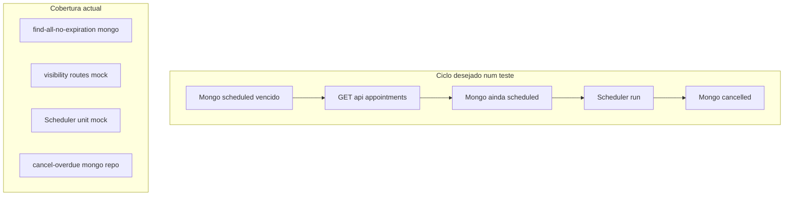

# Auditoria final de aprovação — Appointment Expiration E4

**Data:** 11/11/2026  
**Referência de código:** branch `develop`, HEAD `a605931149b42b353822a78b01ac5dc26909d92d` (sem commit nesta auditoria)  
**Implementação auditada:** [E4 — Remover efeito colateral do GET](../tasks/appointment-expiration-e4-remove-get-side-effect.md)  
**Escopo:** Validação read-only (inspeção de código e testes). **Nenhuma** alteração de produção, testes ou operações git write.

---

## Resumo executivo

| Verificação | Resultado |
|-------------|-----------|
| Remoção do side-effect em `findAll` / GET | **Evidenciado** |
| RBAC e escopos de leitura (OWNER–EMPLOYEE) | **Evidenciado** (HTTP; sem Mongo por papel) |
| Scheduler como único motor de expiração automática | **Evidenciado** (código + testes unitários) |
| Ciclo completo em **um** teste (Mongo → GET → intacto → scheduler → `cancelled`) | **Não evidenciado** |

**Parecer final:** **PENDENTE DE VALIDAÇÃO** (critério do ciclo de cinco passos num único teste não satisfeito). Os objetivos específicos de E4 (GET sem mutação) estão cobertos por testes e código separados.

---

## 1. Critério principal — sequência de cinco passos

Sequência solicitada:

| # | Passo |
|---|--------|
| 1 | Agendamento vencido existe no MongoDB com status `scheduled` |
| 2 | `GET /api/appointments` é executado |
| 3 | O documento continua `scheduled` no MongoDB |
| 4 | `AppointmentExpirationScheduler` executa a rotina |
| 5 | O documento passa para `cancelled` |

### Conclusão

**Não existe um único teste** que comprove os cinco passos em sequência.

### Evidências parciais (testes separados)

| Passos cobertos | Ficheiro de teste | O que comprova | Limitação |
|-----------------|-------------------|----------------|-----------|
| 1 + 3 (sem HTTP GET) | [`server/tests/integration/appointments/find-all-no-expiration.mongo.test.ts`](../../server/tests/integration/appointments/find-all-no-expiration.mongo.test.ts) | Seed Mongo `scheduled` vencido; `AppointmentService.findAll`; `findById` continua `scheduled` | Usa **service**, não `GET /api/appointments` |
| 2 + (3 apenas na resposta mock) | [`server/tests/integration/routes/appointment-visibility.routes.test.ts`](../../server/tests/integration/routes/appointment-visibility.routes.test.ts) | Caso `"GET não altera scheduled vencido..."`; `cancelOverdueScheduled` **not called**; JSON `scheduled` | Repositório **mockado**; sem leitura pós-GET no Mongo |
| 2 + ausência de expiração | [`server/tests/integration/availability-appointment.routes.test.ts`](../../server/tests/integration/availability-appointment.routes.test.ts) | `"não cancela scheduled vencidos ao listar appointments"` | Só mock do repositório |
| 4 | [`server/tests/unit/appointments/AppointmentExpirationScheduler.test.ts`](../../server/tests/unit/appointments/AppointmentExpirationScheduler.test.ts) | `run()` / `start()` invoca `processOverdueForAllCompanies` (mock) | **Sem Mongo**; sem GET |
| 5 | [`server/tests/integration/appointments/cancel-overdue-scheduled.mongo.test.ts`](../../server/tests/integration/appointments/cancel-overdue-scheduled.mongo.test.ts) | `AppointmentRepository.cancelOverdueScheduled` direto; assert `cancelled` | **Não** passa pelo scheduler nem HTTP |

**Tipo de cobertura:** apenas testes **parcelares**; encadeamento lógico possível em produção, não automatizado de ponta a ponta.

---

## 2. Permissões e escopos de leitura

**Fonte principal:** [`server/tests/integration/routes/appointment-visibility.routes.test.ts`](../../server/tests/integration/routes/appointment-visibility.routes.test.ts) — bloco `listagem GET /api/appointments`.

| Papel | Evidência | Escopo comprovado |
|-------|-----------|-------------------|
| **OWNER** | `it.each` L212–226 | `findByCompanyId(company, {}, undefined)`; `cancelOverdueScheduled` **not called** |
| **ADMIN** | Idem | Empresa inteira |
| **MANAGER** | Idem | Empresa inteira |
| **EMPLOYEE** | L248–301 | `employeeId` da sessão; ignora `employeeId`/`companyId` na query; filtros `startAt`/`endAt` |
| CLIENT (extra) | L304–316 | `clientId` na sessão; sem expiração na listagem |

**Complemento unitário:** [`server/tests/unit/appointments/AppointmentService.test.ts`](../../server/tests/unit/appointments/AppointmentService.test.ts) — listagem com escopo empresa **não** chama `cancelOverdueScheduled` (E4); escopos cliente e funcionário já assertavam `not.toHaveBeenCalled`.

**Lacuna:** nenhum teste de integração Mongo que exercite GET ou `findAll` **por papel** (OWNER vs EMPLOYEE) com persistência real.

---

## 3. Ausência de efeitos colaterais na leitura

### `AppointmentService.findAll()`

[`server/src/modules/appointments/services/AppointmentService.ts`](../../server/src/modules/appointments/services/AppointmentService.ts) (aprox. L720–736):

- Apenas `findByCompanyId` + `AppointmentMapper.toResponse`.
- Parâmetro `now` mantido na assinatura; `void now` — não usado para expiração.
- **Não** chama `expireOverdueScheduled`, `cancelOverdueScheduled` nem `AppointmentExpirationService`.

### `GET /api/appointments`

[`server/src/modules/appointments/controllers/AppointmentController.ts`](../../server/src/modules/appointments/controllers/AppointmentController.ts):

- Importa somente `AppointmentService`.
- `findAll` delega a `appointmentService.findAll` — **sem** `AppointmentExpirationService`.

### Outros fluxos de leitura

Inspeção (`grep` em `server/src`):

- `processOverdueForAllCompanies` / `cancelOverdueScheduled` em uso automático: só [`AppointmentExpirationService.ts`](../../server/src/modules/appointments/services/AppointmentExpirationService.ts) e [`AppointmentExpirationScheduler.ts`](../../server/src/modules/appointments/scheduler/AppointmentExpirationScheduler.ts).
- `findById`, `findMine`: sem chamadas de expiração no service.

### Método residual

`expireOverdueScheduled` permanece público em `AppointmentService` (aprox. L747–751) como delegação ao repositório. **Sem chamadores** noutros ficheiros em `server/` — não participa do fluxo GET; API órfã (limpeza opcional futura).

### Testes que sustentam ausência de side-effect

| Ficheiro | Assert |
|----------|--------|
| `AppointmentService.test.ts` | `cancelOverdueScheduled` **not** chamado em `findAll` (escopo empresa) |
| `appointment-visibility.routes.test.ts` | OWNER/ADMIN/MANAGER e caso overdue HTTP |
| `availability-appointment.routes.test.ts` | GET lista sem `cancelOverdueScheduled` |
| `AppointmentNotificationDispatch.test.ts` | Listagem sem expiração nem notificações |

---

## 4. Scheduler e encerramento E2.1

### Cadeia em produção (código)

| Etapa | Ficheiro | Evidência |
|-------|----------|-----------|
| Arranque | [`server/src/server.ts`](../../server/src/server.ts) L39 | `AppointmentExpirationScheduler.start()` após `Database.connect()` |
| Rodada | [`AppointmentExpirationScheduler.ts`](../../server/src/modules/appointments/scheduler/AppointmentExpirationScheduler.ts) L120 | `this.service.processOverdueForAllCompanies()` |
| Multi-empresa | [`AppointmentExpirationService.ts`](../../server/src/modules/appointments/services/AppointmentExpirationService.ts) L51 | `cancelOverdueScheduled(companyId, now)` por empresa ativa |

### Shutdown E2.1

[`server/src/server.ts`](../../server/src/server.ts) L58–77:

1. `await AppointmentExpirationScheduler.stop()`  
2. `server.close()`  
3. `await ReminderScheduler.stop()`  
4. `await Database.disconnect()`

[`AppointmentExpirationScheduler.ts`](../../server/src/modules/appointments/scheduler/AppointmentExpirationScheduler.ts): `stopping`, `inFlight`, `stop()` aguarda execução em curso (E2.1).

### Testes

| Suíte | Cobertura |
|-------|-----------|
| `AppointmentExpirationScheduler.test.ts` | `stop()` await, bloqueio pós-`stop`, overlap, erros |
| `AppointmentExpirationService.test.ts` | Empresas ativas, contagens, falha por empresa |

**Lacuna:** nenhum teste integra **scheduler real + Mongo + documento `cancelled`** após passo sem expiração na listagem.

---

## 5. Lacunas consolidadas

| ID | Lacuna | Impacto na auditoria |
|----|--------|----------------------|
| L1 | Sem teste único dos 5 passos | Parecer **PENDENTE** para ciclo E2E |
| L2 | GET + persistência Mongo não unificados | Prova forte no service (`find-all-no-expiration`); GET só com mock |
| L3 | Scheduler + Mongo | E3 no repositório; scheduler com mocks |
| L4 | RBAC + Mongo na listagem | RBAC bem coberto em rotas HTTP mock |
| L5 | `expireOverdueScheduled` órfão | Sem side-effect em leitura; dívida de API |

---

## 6. Parecer final

### PENDENTE DE VALIDAÇÃO

**Motivo principal:** o critério explícito da sequência **Mongo → GET → permanece `scheduled` → scheduler → `cancelled` num único teste** **não** está satisfeito. A suíte actual prova cada preocupação de E4 de forma **fragmentada**, com qualidade adequada para remoção do side-effect do GET.

### Evidência favorável aos objetivos de E4 (entrega)

| Objetivo E4 | Status |
|-------------|--------|
| GET não executa expiração | Comprovado (código + testes) |
| Scheduler permanece responsável | Comprovado (código + testes unitários) |
| E3 regressão do repositório | Mantido (ficheiro inalterado na auditoria) |
| RBAC / escopos na listagem | Comprovado (testes O6) |

Para **APROVADA** no sentido do **ciclo completo de cinco passos**, seria necessário um teste de integração ponta-a-ponta (fora do âmbito desta auditoria e não criado aqui).

---

## 7. Segurança Git

Nenhum commit, push, pull, merge, rebase, stash, reset, clean, checkout ou switch foi executado na elaboração deste relatório.

---

## Referências

- [Auditoria inicial — appointment expiration](appointment-expiration-audit.md)
- [E1](../tasks/appointment-expiration-e1-multi-company-service.md) · [E2](../tasks/appointment-expiration-e2-scheduler.md) · [E2.1](../tasks/appointment-expiration-e2-1-shutdown-hardening.md) · [E3](../tasks/appointment-expiration-e3-mongodb-integration-tests.md) · [E4](../tasks/appointment-expiration-e4-remove-get-side-effect.md)
