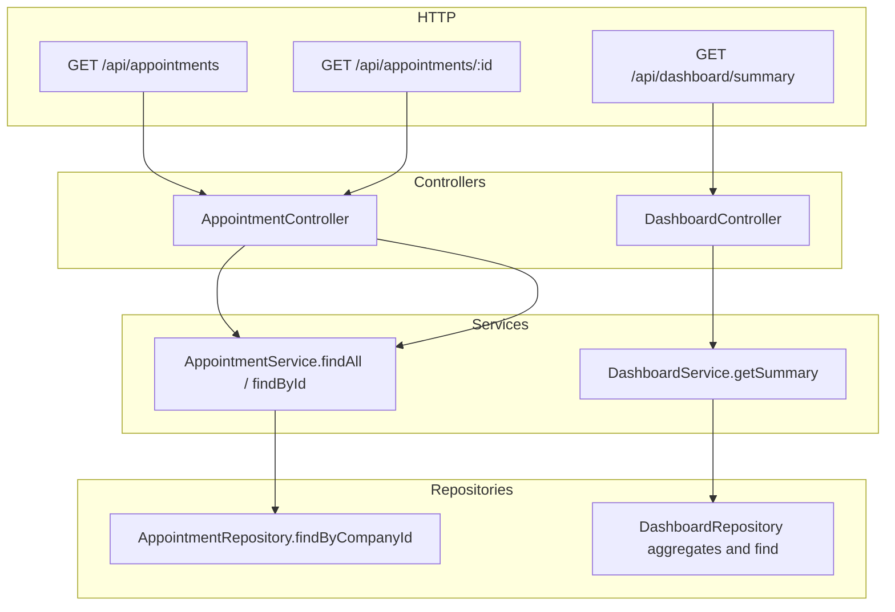

# SchedulerPro — O6: Auditoria de Visibilidade de Agendamentos por Perfil

**Data:** 2026-11-10  
**Objetivo:** Mapear endpoints e queries que devolvem agendamentos (ou derivados) e definir estratégia para **EMPLOYEE** ver apenas agendamentos com `employeeId === req.user.userId`, mantendo **OWNER / ADMIN / MANAGER** com visão da empresa inteira. **Sem implementação nesta fase.**

**Referências:** [dashboard-o5-refresh-audit.md](./dashboard-o5-refresh-audit.md), [schedulerpro-dashboard-functional-evolution-audit.md](../reports/schedulerpro-dashboard-functional-evolution-audit.md) (O6 bloqueado à data da auditoria funcional).

---

## 1. Estado inicial Git

| Campo | Valor |
| --- | --- |
| Branch | `develop` |
| HEAD | `9b435f9d0fb6677e426533592a1b7c68a887812a` |
| Tracking | `develop...origin/develop` |
| Working tree | **Limpo** (sem staged, unstaged ou untracked) |
| Último commit (resumo) | Merge PR #134 — Dashboard O5 (`feature/dashboard-auto-refresh`) |

**Facto:** `develop` inclui O5 (refresh automático do Dashboard). O1, O2 e integrações anteriores estão na linha `develop` (commits anteriores ao merge do dashboard). Nenhuma ficheiro foi alterado nesta auditoria.

---

## 2. Contexto de autenticação e tenant

### 2.1 `req.user` (após [`auth.middleware.ts`](../../server/src/middlewares/auth.middleware.ts) L108–114)

| Campo | Origem |
| --- | --- |
| `userId` | `user._id.toString()` — identificador do utilizador autenticado |
| `companyId` | `user.companyId.toString()` — **única fonte de tenant** nas rotas staff |
| `role` | `user.role` (`Role` enum) |
| `clientId` | Opcional; apenas contas `CLIENT` |
| `sessionId` | Sessão server-side |

**Não existe** `employeeId` em `req.user`. Para O6, o vínculo funcionário ↔ agendamento usa **`req.user.userId`** contra o campo do documento.

### 2.2 Campo do agendamento

[`Appointment.model.ts`](../../server/src/modules/appointments/models/Appointment.model.ts) L32, L107:

- `employeeId: Types.ObjectId` — profissional atribuído (referência a **User** com role de staff, tipicamente `EMPLOYEE`).
- `companyId`, `clientId`, `startAt`, `endAt`, `status`, `deletedAt`, etc.

Índice composto inclui `employeeId` (L229).

### 2.3 Escopo actual semelhante (CLIENT)

[`AppointmentController.findAll`](../../server/src/modules/appointments/controllers/AppointmentController.ts) L52–55: só `CLIENT` recebe `clientScope` via `req.user.clientId`. **Staff (incluindo EMPLOYEE) não tem escopo por funcionário.**

[`AppointmentRepository.findByCompanyId`](../../server/src/modules/appointments/repositories/AppointmentRepository.ts) L96–108: filtro opcional **`clientId`** apenas; **sem** parâmetro `employeeId` para leitura.

---

## 3. RBAC relevante

[`server/src/constants/rbac.ts`](../../server/src/constants/rbac.ts):

| Role | `APPOINTMENT_READ` | Notas |
| --- | --- | --- |
| OWNER | Sim | |
| ADMIN | Sim | |
| MANAGER | Sim | |
| EMPLOYEE | Sim | **Mesma permissão de leitura que gestores** |
| CLIENT | Sim (portal) | Escopo via `/appointments/mine`, não `GET /appointments` |

Relatórios: [`ReportRoutes.ts`](../../server/src/modules/reports/routes/ReportRoutes.ts) L37 — **`authorize(OWNER, ADMIN, MANAGER)` apenas** — EMPLOYEE **403** (já alinhado a visão gestão).

Dashboard: [`DashboardRoutes.ts`](../../server/src/modules/dashboard/routes/DashboardRoutes.ts) L20 — **EMPLOYEE permitido** com `APPOINTMENT_READ`.

---

## 4. Inventário de endpoints (dados de agendamentos)

### 4.1 Staff autenticado — módulo Appointments

Prefixo API: `/api/appointments` ([`routes/index.ts`](../../server/src/routes/index.ts) L41).

| Método | Rota | Guards (resumo) | Controller → Service | `companyId` | Filtro funcionário | EMPLOYEE hoje |
| --- | --- | --- | --- | --- | --- | --- |
| GET | `/` | Auth, operacional, `APPOINTMENT_READ` | `findAll` → `findAll` → `findByCompanyId` | `req.user.companyId` | **Não** | **Vê toda a empresa** |
| GET | `/mine` | Auth, `Role.CLIENT` | `findMine` → `findByCompanyId` + `clientId` | sessão | N/A (cliente) | 403 |
| GET | `/:id` | Auth, `APPOINTMENT_READ` | `findById` | sessão | Só `clientScope` se CLIENT | **Vê qualquer id do tenant** |
| POST | `/` | `APPOINTMENT_CREATE` | `create` | sessão | body `employeeId` (negócio) | Pode criar para outros |
| PATCH | `/:id` | `APPOINTMENT_UPDATE` | `update` / status | sessão | Sem check atribuição | Pode alterar de outros |
| DELETE | `/:id` | `APPOINTMENT_DELETE` | `delete` | sessão | Sem check atribuição | Pode apagar de outros |
| PATCH | `/:id/confirm\|complete\|cancel\|no-show` | `APPOINTMENT_UPDATE` | status | sessão | Idem | Idem |

**Query `GET /`:** apenas `startAt`, `endAt` ([`list-appointments.validator.ts`](../../server/src/modules/appointments/validators/list-appointments.validator.ts)) — **não** aceita `employeeId` / `companyId` do cliente para escopo (correto para tenant; falta escopo derivado do role).

**Frontend:** [`appointments.api.ts`](../../client/src/api/endpoints/appointments.api.ts) — `getAppointments({ startAt, endAt })` sem `employeeId`; agenda via [`useAppointmentsSchedule.ts`](../../client/src/hooks/useAppointmentsSchedule.ts).

### 4.2 Dashboard

| Método | Rota | Guards | Controller → Service → Repository |
| --- | --- | --- | --- |
| GET | `/api/dashboard/summary` | Auth, operacional, OWNER\|ADMIN\|MANAGER\|**EMPLOYEE**, `APPOINTMENT_READ` | `DashboardController.getSummary` → `DashboardService.getSummary` → `DashboardRepository` |

**Dados derivados de agendamentos:**

| Campo resposta | Repositório | Filtro actual |
| --- | --- | --- |
| `period.byStatus`, `period.total` | `findStatusCounts` — aggregate `$match` `companyId` + intervalo `startAt` | Só empresa |
| `todayAppointments` | `findAppointmentsInPeriod` | Só empresa; service exclui `cancelled` na lista |
| `upcomingAppointments` | `findUpcoming` — `companyId`, statuses scheduled/confirmed | Só empresa |
| `activeClientsCount` | `Client.countDocuments` por empresa | **Não** é agendamento; conta **todos** clientes activos da empresa |

**Teste existente:** [`dashboard.routes.test.ts`](../../server/tests/integration/routes/dashboard.routes.test.ts) L135–147 — EMPLOYEE **200** no summary (com mocks).

**Impacto O6:** KPIs O1/O2 e listas do dia devem usar o **mesmo** escopo `employeeId` para EMPLOYEE, senão KPI «Hoje» e `period.total` divergem. `activeClientsCount` é decisão de produto (manter global, omitir ou redefinir).

### 4.3 Relatórios

Prefixo `/api/reports` — **EMPLOYEE bloqueado** na rota.

Agregações em [`ReportRepository.ts`](../../server/src/modules/reports/repositories/ReportRepository.ts): `buildBaseMatch(companyId, range)` em todas as pipelines (`findStatusCounts`, revenue, top services, employees ranking, clients, cancellations).

**O6 leitura:** sem alteração obrigatória para EMPLOYEE nos relatórios (já inacessíveis). Validar que permanece assim.

### 4.4 Notificações

`GET /api/notifications` — EMPLOYEE permitido; notificações filtradas por **`userId` do destinatário**, não listagem directa de agendamentos. Metadados podem referir `appointmentId`; auditoria: não substitui política de leitura de appointments, mas mensagens podem mencionar marcações de terceiros se o dispatcher enviar a todos — **fora do núcleo O6** (verificar `NotificationDispatcher` numa fase posterior se necessário).

### 4.5 Público / convidado (referência)

| Prefixo | Dados appointments | Auth |
| --- | --- | --- |
| `/api/public/companies/:companyId/appointments` | Criação pública | Token / companyId na URL + validações |
| `/api/public/appointments/:token` | GET/PATCH/DELETE por token hash | Sem JWT staff |
| `/api/public/...` booking | Slots; usa `findBlockingForEmployee` | Público |

**Fora do escopo O6 staff**, mas confirma que `employeeId` em rotas públicas é **dado de marcação**, não escopo de sessão staff.

### 4.6 Interno (jobs)

[`AppointmentRepository.findUpcomingForReminders`](../../server/src/modules/appointments/repositories/AppointmentRepository.ts) L331–347 — global cross-tenant; job interno. **Não** exposto em HTTP staff.

---

## 5. Fluxo por camadas (leitura staff)



**Lacuna O6:** nenhuma camada aplica `employeeId` derivado de `req.user.userId` para `Role.EMPLOYEE`.

---

## 6. Queries MongoDB afectadas por O6

| Local | Método / pipeline | Filtros actuais | Alteração O6 |
| --- | --- | --- | --- |
| [`AppointmentRepository.findByCompanyId`](../../server/src/modules/appointments/repositories/AppointmentRepository.ts) | `find` | `companyId`, `deletedAt`, opcional `clientId`, janela datas | Adicionar `employeeId` quando escopo staff-employee |
| [`AppointmentRepository.findById`](../../server/src/modules/appointments/repositories/AppointmentRepository.ts) | `findOne` | `_id`, `deletedAt` | Validação pós-load no service (como `clientScope`) |
| [`DashboardRepository.buildStartAtRangeMatch`](../../server/src/modules/dashboard/repositories/DashboardRepository.ts) | `$match` / `find` | `companyId`, `deletedAt`, `startAt` range | Incluir `employeeId` opcional em todas as queries de appointment |
| [`DashboardRepository.findUpcoming`](../../server/src/modules/dashboard/repositories/DashboardRepository.ts) | `find` | `companyId`, status, `startAt >= now` | Idem |
| [`ReportRepository.buildBaseMatch`](../../server/src/modules/reports/repositories/ReportRepository.ts) | agregações | `companyId` | Só se EMPLOYEE ganhar acesso no futuro |
| `hasEmployeeConflict` / `findBlockingForEmployee` | conflitos / disponibilidade | `companyId` + `employeeId` explícito do negócio | **Não** misturar com escopo de leitura |

**Manipulação cliente:** listagem staff **não** expõe `employeeId` na query — risco actual é **ausência** de filtro, não spoofing de query (EMPLOYEE obtém dados sem enviar `employeeId`).

**Risco IDOR:** `GET /appointments/:id` com outro `_id` do mesmo `companyId` devolve 200 para EMPLOYEE.

**Multi-tenant:** `findById` valida `companyId` no service (L757–758); falha de tenant → 404. **Correcto.**

---

## 7. Comportamento lateral relevante

### 7.1 `expireOverdueScheduled`

Em [`AppointmentService.findAll`](../../server/src/modules/appointments/services/AppointmentService.ts) L718–719, quando **não** há `clientScope`, corre cancelamento global da empresa antes da listagem.

**Risco O6:** EMPLOYEE com listagem escopada não deve cancelar agendamentos **de outros** ao consultar a agenda. Avaliar: não correr expiração global quando `employeeScope` presente, ou extrair job dedicado.

### 7.2 Mutações (escopo além da leitura O6)

`update`, `confirm`, `complete`, `cancel`, `delete` validam principalmente **tenant** (`companyId`), não `appointment.employeeId === req.user.userId`.

**Recomendação:** alinhar **escrita** com **leitura** numa entrega O6+ ou O6 estendido (política única `assertAppointmentAccess`).

---

## 8. Dashboard vs O1 / O2 / O5

| Bloco UI | Fonte | Com EMPLOYEE hoje |
| --- | --- | --- |
| KPI Hoje | `todayAppointments.length` | Todos do dia na empresa |
| Pendentes / Confirmados | `period.byStatus` | Agregação empresa |
| Clientes activos O1 | `activeClientsCount` | **Empresa inteira** |
| Distribuição O2 | `period.byStatus` | Empresa inteira |
| Agendas | listas summary | Empresa inteira |
| O5 refresh | Re-fetch mesmo endpoint | Sem alteração de contrato; **só dados filtrados no backend** |

**Consistência:** único `GET /summary` com escopo aplicado no **service/repository** evita divergência frontend.

---

## 9. Riscos de segurança

| Risco | Severidade | Situação actual |
| --- | --- | --- |
| EMPLOYEE vê agendamentos de colegas | **Alta** (requisito O6) | Confirmado |
| EMPLOYEE abre `GET /:id` alheio | **Alta** | 404 só se outro tenant |
| Query `employeeId` forjado | Baixa | Query não existe; risco é falta de filtro server-side |
| `companyId` na query/body | Baixa | Ignorado; tenant = sessão (testado no dashboard) |
| Agregações sem tenant | Baixa | Dashboard/Reports usam `companyId` |
| `activeClientsCount` vaza dimensão empresa | Média (produto) | Contagem global |
| Expiração global ao listar | Média | Side-effect cross-employee |

---

## 10. Estratégia técnica recomendada (implementação futura)

### 10.1 Centralizar escopo de leitura

Criar utilitário, por exemplo:

[`server/src/modules/appointments/utils/appointment-read-scope.ts`](../../server/src/modules/appointments/utils/appointment-read-scope.ts) (caminho sugerido)

```typescript
// Pseudocódigo — não implementado
export interface AppointmentReadScope {
  companyId: string;
  clientId?: string;   // Role.CLIENT
  employeeId?: string; // Role.EMPLOYEE → req.user.userId
}

export function resolveAppointmentReadScope(user: RequestUser): AppointmentReadScope {
  const companyId = user.companyId;
  if (user.role === Role.CLIENT) return { companyId, clientId: user.clientId };
  if (user.role === Role.EMPLOYEE) return { companyId, employeeId: user.userId };
  return { companyId }; // OWNER, ADMIN, MANAGER
}
```

**Regras:**

- **Nunca** ler `employeeId` / `companyId` de query/body para **autorização**.
- Filtros funcionais de calendário (ex. escolher profissional na UI para OWNER) são **outra feature**; para EMPLOYEE, forçar sempre `userId`.

### 10.2 Aplicar em services (ponto único de negócio)

1. **`AppointmentService.findAll` / `findById`** — aceitar `AppointmentReadScope` ou derivar do controller a partir de `req.user`.
2. **`findById`** — após load, se `scope.employeeId` e `appointment.employeeId !== scope.employeeId` → 404 (espelhar `clientScope`).
3. **`DashboardService.getSummary`** — passar scope ao repositório; todas as queries de `Appointment` incluem `employeeId` quando definido.
4. **Repository** — estender `findByCompanyId` → `findByCompanyId(companyId, range, { clientId?, employeeId? })` ou objeto scope; actualizar `buildStartAtRangeMatch` no dashboard com parâmetro opcional.

### 10.3 Controllers

- `AppointmentController.findAll` / `findById`: passar scope resolvido (substituir só `clientScope` por objecto unificado).
- `DashboardController.getSummary`: passar `req.user` ou scope para o service.

### 10.4 O que não alterar nesta entrega

- Contrato JSON de `DashboardSummary` (sem novos campos obrigatórios).
- Relatórios (EMPLOYEE continua 403).
- Rotas públicas.
- Frontend como fonte de autorização (opcional: ocultar filtro de profissional para EMPLOYEE — **UX**, não segurança).

### 10.5 `activeClientsCount`

| Opção | Prós |
| --- | --- |
| A. Manter contagem empresa para EMPLOYEE | Simples; pode ser acceptável operacionalmente |
| B. Omitir KPI (null/0 + UI) para EMPLOYEE | Evita métrica não alinhada |
| C. Contar clientes distintos só nos agendamentos do EMPLOYEE | Alinhado mas novo aggregate |

**Decisão de produto** antes de implementar O6.

---

## 11. Testes existentes e plano proposto

### 11.1 Existentes (relevantes)

| Ficheiro | Cobertura actual O6 |
| --- | --- |
| [`availability-appointment.routes.test.ts`](../../server/tests/integration/availability-appointment.routes.test.ts) | CRUD appointments como OWNER (mocks) |
| [`dashboard.routes.test.ts`](../../server/tests/integration/routes/dashboard.routes.test.ts) | EMPLOYEE **acessa** summary; **não** testa isolamento |
| [`AppointmentService.test.ts`](../../server/tests/unit/appointments/AppointmentService.test.ts) | Negócio; sem role EMPLOYEE scope |
| Frontend `DashboardPage.test.tsx` | O1/O2/O5; sem RBAC EMPLOYEE |

**Lacuna:** nenhum teste que prove EMPLOYEE restrito a `userId`.

### 11.2 Proposta (novo ficheiro sugerido)

[`server/tests/integration/routes/appointment-visibility.routes.test.ts`](../../server/tests/integration/routes/appointment-visibility.routes.test.ts)

Fixtures: empresa A, employee1, employee2, appointments com `employeeId` distintos.

| # | Caso | Tipo |
| --- | --- | --- |
| 1 | OWNER lista todos da empresa | Integração |
| 2 | ADMIN idem | Integração |
| 3 | MANAGER idem | Integração |
| 4 | EMPLOYEE lista só `employeeId === userId` | Integração |
| 5 | EMPLOYEE `GET /:id` próprio → 200 | Integração |
| 6 | EMPLOYEE `GET /:id` de colega → 404 | Segurança |
| 7 | EMPLOYEE sem `?employeeId=` extra na query (assert chamada repo) | Integração |
| 8 | Dashboard summary EMPLOYEE: contagens só próprios | Integração |
| 9 | `period.byStatus` / listas coherentes | Integração |
| 10 | Paginação/data filters mantidos no subconjunto | Integração |
| 11 | Outro `companyId` inexistente → 404 | Segurança |
| 12 | CLIENT continua `/mine` inalterado | Regressão |
| 13 | OWNER dashboard inalterado (regressão O1/O2) | Integração |
| 14 | Relatórios EMPLOYEE 403 | Regressão |
| 15 | `expireOverdueScheduled` não afecta outros (se política adoptada) | Unit/service |

**Frontend (opcional pós-backend):** testes de agenda EMPLOYEE com mock API filtrado — **não substitui** testes server.

---

## 12. Critérios de aceitação O6

1. OWNER, ADMIN, MANAGER: leitura de agendamentos cobre **toda** a empresa (`companyId` da sessão).
2. EMPLOYEE: qualquer leitura staff de agendamentos inclui **`employeeId = req.user.userId`** nas queries MongoDB relevantes.
3. EMPLOYEE: `GET /appointments/:id` de agendamento de outro funcionário da mesma empresa → **404** (ou 403 consistente com CLIENT).
4. Nenhum endpoint staff aceita `companyId` / `employeeId` do cliente como âmbito de autorização.
5. `GET /api/dashboard/summary` para EMPLOYEE: `todayAppointments`, `upcomingAppointments`, `period.byStatus`, `period.total` reflectem **apenas** o escopo do EMPLOYEE.
6. Decisão documentada para `activeClientsCount` em EMPLOYEE.
7. CLIENT: `/appointments/mine` e escopo `clientId` **sem regressão**.
8. Relatórios: EMPLOYEE continua sem acesso (salvo mudança explícita de produto).
9. Isolamento multi-empresa mantido em todos os cenários.
10. Testes de integração cobrindo itens 1–9 e regressões dashboard (O1/O2) e O5 (mesmo endpoint, payload filtrado).

---

## 13. Ficheiros prováveis na implementação

| Ficheiro | Alteração |
| --- | --- |
| **Novo** `server/src/modules/appointments/utils/appointment-read-scope.ts` | Resolver scope |
| [`AppointmentController.ts`](../../server/src/modules/appointments/controllers/AppointmentController.ts) | Passar scope |
| [`AppointmentService.ts`](../../server/src/modules/appointments/services/AppointmentService.ts) | `findAll`, `findById`, expiração |
| [`AppointmentRepository.ts`](../../server/src/modules/appointments/repositories/AppointmentRepository.ts) | Filtro `employeeId` opcional |
| [`DashboardController.ts`](../../server/src/modules/dashboard/controllers/DashboardController.ts) | Passar `req.user` |
| [`DashboardService.ts`](../../server/src/modules/dashboard/services/DashboardService.ts) | Propagar scope |
| [`DashboardRepository.ts`](../../server/src/modules/dashboard/repositories/DashboardRepository.ts) | `$match` + `find` |
| **Novo** `server/tests/integration/routes/appointment-visibility.routes.test.ts` | Cobertura O6 |
| [`DashboardRepository.test.ts`](../../server/tests/unit/dashboard/DashboardRepository.test.ts) | Match com `employeeId` |
| Docs `docs/reports/schedulerpro-dashboard-o6-*.md` | Pós-implementação |
| Frontend (opcional) | Esconder filtros; **não** substitui backend |

**Não obrigatório na O6 leitura:** `ReportRepository`, rotas públicas, GW-3, O5 hook.

---

## 14. Contexto para outra IA

- Campo de atribuição: **`appointment.employeeId`**; identidade staff: **`req.user.userId`** (não inventar `req.user.employeeId`).
- Padrão a replicar: escopo **CLIENT** já existente em `findByCompanyId` + `findById`.
- Dashboard **único** endpoint para KPIs — filtrar no backend mantém O1/O2/O5 coerentes.
- HEAD de referência desta auditoria: **`9b435f9`** em `develop`, working tree limpo.
- Implementação **não autorizada** até aprovação deste relatório.

---

## Veredicto

**AUDITORIA CONCLUÍDA**

- Lacuna principal confirmada: **EMPLOYEE com `APPOINTMENT_READ` vê e acede a todos os agendamentos do tenant** (listagem, detalhe, dashboard).
- Estratégia recomendada: **scope centralizado** + extensão de repositórios + testes de integração dedicados.
- Nenhum código foi alterado nesta tarefa.
