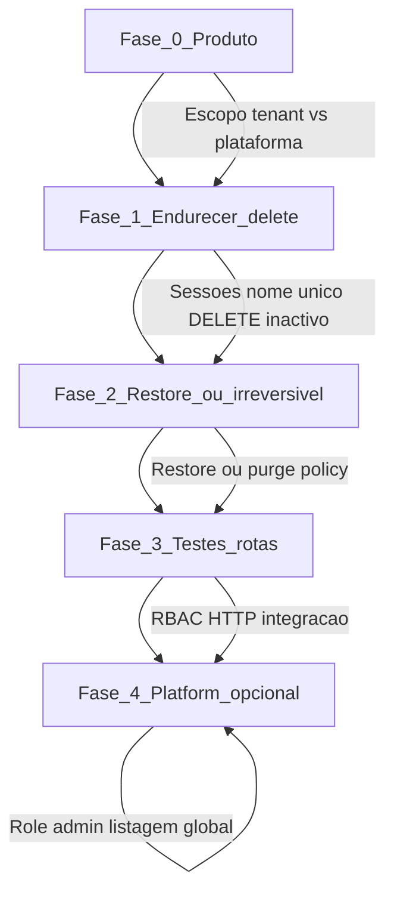

# Auditoria — Company Management (Backend)

**Data:** 11/11/2026  
**Tipo:** Somente leitura — nenhum ficheiro de implementação (`server/`, `client/`) alterado.  
**Branch analisada:** `develop` @ `8fd5f0a108515abd8a81ddcfbace18c44fd0a9d1`  
**Montagem HTTP:** [`server/src/routes/index.ts`](../../server/src/routes/index.ts) — prefixo `/api/companies`

**Veredicto sumário:** O SchedulerPro implementa **gestão da própria empresa (tenant)** — leitura, actualização, logo, activação/desactivação e **soft delete** via `deletedAt`. Não existe consola de **plataforma** (listar todas as empresas, paginação, criar empresa fora do registo). **Soft delete já está implementado** — não deve ser reescrito. Falta sobretudo **restauro pós soft delete**, política clara pós-delete (sessões/dados) e testes de rota para CRUD/delete.

---

## Estado Git no início da auditoria

| Item | Valor |
|------|--------|
| Branch | `develop` |
| HEAD | `8fd5f0a108515abd8a81ddcfbace18c44fd0a9d1` |
| Tracking | `develop...origin/develop` |
| Staged / unstaged | Nenhuma alteração reportada (`git diff` / `git diff --cached` vazios) |
| Untracked | Não listados no `git status -sb` condensado (working tree limpa) |

**Operações Git de escrita:** não executadas.

---

## 1. Resumo executivo

O módulo **Company** está estruturado de forma consistente (model → repository → service → controller → routes), com isolamento **single-tenant**: o utilizador só opera sobre a empresa cujo `companyId` coincide com o `:id` da rota (semântica 404 para IDOR).

| Dimensão | Conclusão |
|----------|-----------|
| Soft delete | **Implementado** — campo `deletedAt`, `CompanyRepository.softDelete`, `DELETE /api/companies/:id` |
| Desactivação (`isActive`) | **Implementada** — distinta do soft delete; integrada com suspensão de staff |
| Restaurar empresa (soft delete) | **Ausente** — sem método no repositório nem rota |
| Criar empresa (módulo Company) | **Parcial** — `CompanyRepository.create` + registo em `AuthService`; `CompanyService.create()` vazio; sem `POST /companies` |
| Listar empresas | **Limitado** — `GET /` devolve 0–1 registo (próprio tenant); sem filtros/paginação |
| RBAC | OWNER com lifecycle completo; ADMIN read/update (+ logo); demais roles sem permissões COMPANY_* |
| Testes | Suíte unitária rica (8 ficheiros); **sem** integração dedicada ao router Company; execução local falhou por ambiente Vitest (ver secção 9) |
| Build | `npm run build` (tsc) **OK** nesta máquina |

**Gestão de Empresas “produto”:** o backend já suporta a **página Empresa** do tenant (perfil, timezone, logo, activar/desactivar, eliminar). O que **não** existe é back-office multi-tenant nem fluxos de recuperação após eliminação lógica.

---

## 2. Estrutura actual do módulo Company

```
server/src/modules/companies/
├── controllers/CompanyController.ts
├── dto/CreateCompany.dto.ts, UpdateCompany.dto.ts
├── mappers/CompanyMapper.ts
├── models/Company.model.ts
├── repositories/CompanyRepository.ts
├── routes/CompanyRoutes.ts
├── services/
│   ├── CompanyService.ts
│   └── company-lifecycle-transaction.ts
├── types.ts
└── validators/create-company.validator.ts, update-company.validator.ts
```

**Responsabilidades:**

| Camada | Ficheiro | Função |
|--------|----------|--------|
| Persistência | [`CompanyRepository.ts`](../../server/src/modules/companies/repositories/CompanyRepository.ts) | CRUD físico; **todas** as queries filtram `deletedAt: null` (excepto soft delete que define a data) |
| Regras | [`CompanyService.ts`](../../server/src/modules/companies/services/CompanyService.ts) | Tenant (`ensureTenant`), validação timezone, logo via `imageProvider`, lifecycle activate/deactivate/delete |
| HTTP | [`CompanyController.ts`](../../server/src/modules/companies/controllers/CompanyController.ts) | Delega com `req.user!.companyId` |
| Rotas | [`CompanyRoutes.ts`](../../server/src/modules/companies/routes/CompanyRoutes.ts) | Auth + password change + permissions + `requireOperationalCompany` onde aplicável |
| Resposta API | [`CompanyMapper.ts`](../../server/src/modules/companies/mappers/CompanyMapper.ts) | Expõe `id`, `name`, `timezone`, `isActive`, `logo`, timestamps — **omite** `deletedAt` |

**Criação fora do módulo HTTP Company:** [`AuthService.createCompany`](../../server/src/modules/auth/services/AuthService.ts) chama `CompanyRepository.create` dentro da transação de `POST /api/auth/register`. O validador [`create-company.validator.ts`](../../server/src/modules/companies/validators/create-company.validator.ts) existe mas **não** está ligado a `CompanyRoutes`.

---

## 3. Funcionalidades já implementadas

| Funcionalidade | Evidência |
|----------------|-----------|
| Consultar própria empresa | `GET /api/companies/:id` → `CompanyService.findById` + `CompanyRepository.findById` |
| Listar (tenant) | `GET /api/companies/` → `findAll(companyId)` — array com a empresa do token |
| Actualizar nome/timezone | `PATCH /api/companies/:id` + `updateCompanyValidator` |
| Upload/remover logo | `POST/DELETE /api/companies/:id/logo` → `updateLogo` / `removeLogo` |
| Desactivar empresa | `PATCH /api/companies/:id/deactivate` + transacção + `UserRepository.suspendActiveNonOwnerStaffForCompanyDeactivation` |
| Activar empresa | `PATCH /api/companies/:id/activate` + `UserRepository.restoreUsersSuspendedByCompanyDeactivation` |
| Soft delete | `DELETE /api/companies/:id` → `CompanyRepository.softDelete` |
| Isolamento multi-tenant | `CompanyService.ensureTenant` — `id !== companyId` → 404 antes de tocar no DB |
| Empresa inactiva — auth | [`assertUserMayAuthenticateAgainstCompany`](../../server/src/modules/auth/utils/assert-company-active-for-auth.ts): OWNER entra; staff bloqueado |
| Empresa inactiva — operações | [`RequireOperationalCompanyMiddleware`](../../server/src/middlewares/require-operational-company.middleware.ts): 403 em mutações montadas |
| Público / booking | [`PublicBookingEligibility.requireActiveCompany`](../../server/src/modules/public-booking/services/PublicBookingEligibility.ts): eliminada → 404 (`findById`); inactiva → 400 |

### Matriz de endpoints

Base: `/api/companies`. Middlewares comuns: `AuthMiddleware.authenticate`, `PasswordChangeMiddleware.requirePasswordChangeCompleted`, `validateObjectId("id")` (rotas com `:id`).

| Método | Path | Permission | `requireOperationalCompany` | Service |
|--------|------|------------|-----------------------------|---------|
| GET | `/` | `COMPANY_READ` | Não | `findAll` |
| GET | `/:id` | `COMPANY_READ` | Não | `findById` |
| PATCH | `/:id` | `COMPANY_UPDATE` | **Sim** | `update` |
| DELETE | `/:id` | `COMPANY_DELETE` | **Sim** | `delete` → `softDelete` |
| PATCH | `/:id/activate` | `COMPANY_ACTIVATE` | Não | `activate` |
| PATCH | `/:id/deactivate` | `COMPANY_DEACTIVATE` | **Sim** | `deactivate` |
| POST | `/:id/logo` | `COMPANY_UPDATE` | **Sim** | `updateLogo` |
| DELETE | `/:id/logo` | `COMPANY_UPDATE` | **Sim** | `removeLogo` |

**Contexto `companyId`:** sempre `req.user!.companyId` no controller — nunca aceita tenant do body.

---

## 4. Funcionalidades parcialmente implementadas

| Item | Situação | Evidência |
|------|----------|-----------|
| Criar empresa | Repository + registo auth OK; serviço HTTP Company vazio | `CompanyService.create() {}`; sem rota POST |
| Listar empresas | Endpoint existe mas não é listagem administrativa | `findAll` filtra `_id: companyId`; sem paginação, ordenação ou filtros |
| Validador create-company | Definido, não usado em CompanyRoutes | `create-company.validator.ts` só relevante para auth/register |
| Gestão completa pós soft delete | Eliminação lógica sem política de sessões/users | `delete` só chama `softDelete`; sem transacção lifecycle |

---

## 5. Funcionalidades ausentes

| Funcionalidade | Notas |
|----------------|-------|
| Restaurar empresa (`deletedAt` → `null`) | Sem método no repository; sem rota |
| `POST /api/companies` (staff) | Criação canal único: registo público |
| Listagem global / multi-tenant | Não há role “platform admin” nem queries sem filtro de tenant |
| Paginação, pesquisa por nome | Não aplicável ao modelo actual de listagem |
| Hard delete / purge | Não implementado |
| Invalidação de sessões no soft delete | `AuthMiddleware` continua a validar sessão até `findById` falhar (empresa eliminada → 404) |
| Testes de integração do router Company | Apenas testes unitários com router isolado (logo, lifecycle RBAC) |

---

## 6. Auditoria detalhada do Soft Delete

### 6.1 Campo e schema

- Campo: `deletedAt?: Date | null`, default `null` — [`Company.model.ts`](../../server/src/modules/companies/models/Company.model.ts) (linhas 33, 104–107).
- Índice: `{ deletedAt: 1 }`.
- Separado de **`isActive`** (desactivação operacional sem eliminar o registo).

### 6.2 Onde é definido e consultado

| Operação | Comportamento |
|----------|----------------|
| Leituras | `findOne` / `find` com `{ deletedAt: null }` |
| Updates, activate, deactivate, updateLogo | `findOneAndUpdate` com filtro `deletedAt: null` |
| `softDelete` | `findOneAndUpdate({ _id, deletedAt: null }, { deletedAt: new Date() })` |

**Bypass do model:** grep em `server/src` — chamadas directas a `Company.find*` existem **apenas** em [`CompanyRepository.ts`](../../server/src/modules/companies/repositories/CompanyRepository.ts). Testes de integração podem usar o model directamente (ex.: concurrency), não a API Company.

### 6.3 Endpoint e autorização

- Rota: `DELETE /api/companies/:id` — [`CompanyRoutes.ts`](../../server/src/modules/companies/routes/CompanyRoutes.ts).
- Permissão: `COMPANY_DELETE` — **somente** `Role.OWNER` em [`rbac.ts`](../../server/src/constants/rbac.ts).
- Tenant: `CompanyService.delete` → `ensureTenant` + `findById` + `softDelete`.

### 6.4 Exclusão das consultas normais

Empresa com `deletedAt` definido:

- Não aparece em `findById`, `findAll`, `findByName`.
- Mutações e logo falham como “não encontrada” (404).
- [`CompanyService.logo.test.ts`](../../server/tests/unit/companies/CompanyService.logo.test.ts) cobre explicitamente soft-deleted → 404.

### 6.5 Restauração

**Não existe** `restore`, `undelete`, nem update que limpe `deletedAt`. “Reactivar” (`PATCH .../activate`) só altera `isActive` em registos **não** soft-deleted.

### 6.6 Dados relacionados

Soft delete **não** remove nem desactiva em cascata:

- Utilizadores, agendamentos, serviços, etc. permanecem na base com o mesmo `companyId`.
- Desactivação (`deactivate`) **sim** suspende staff (flag `companyDeactivationSuspended`) — mecanismo **independente** do soft delete.

### 6.7 Autenticação e APIs após soft delete

Fluxo [`auth.middleware.ts`](../../server/src/middlewares/auth.middleware.ts):

1. `CompanyRepository.findById(user.companyId)` → `null` se soft-deleted.
2. `assertUserMayAuthenticateAgainstCompany` → `COMPANY_NOT_FOUND` (404).

Efeito: **nenhum** role (incluindo OWNER) mantém sessão API utilizável após soft delete. Sessões Mongo podem continuar válidas até expirarem, mas cada pedido autenticado falha ao carregar a empresa.

### 6.8 APIs públicas

`PublicBookingEligibility.requireActiveCompany` usa `findById` → empresa eliminada comporta-se como **404** (`COMPANY_NOT_FOUND`), alinhado com comentário no ficheiro (linhas 78–80).

### 6.9 Edge case: DELETE com empresa desactivada

`DELETE` inclui `RequireOperationalCompanyMiddleware`. Empresa `isActive: false` → **403** `COMPANY_INACTIVE_OPERATION` **antes** do controller.

Consequência: OWNER **não** pode soft-deletar uma empresa desactivada sem **primeiro** `PATCH .../activate` (activate não usa o middleware operacional). Documentado como inconsistência de UX/segurança de baixo risco, mas real.

### 6.10 Nome único global

Schema: `name` com `unique: true` (e `lowercase: true`). Registo usa `findByName` (só não eliminados). Empresa soft-deleted **mantém** o nome na coleção — **novo registo com o mesmo nome pode falhar** por índice único MongoDB até purge ou restore com outro nome.

---

## 7. Auditoria de RBAC e isolamento multi-empresa

### 7.1 Permissões COMPANY_* por role

Fonte: [`RolePermissions`](../../server/src/constants/rbac.ts).

| Role | READ | UPDATE | DELETE | ACTIVATE | DEACTIVATE |
|------|------|--------|--------|----------|------------|
| OWNER | Sim | Sim | Sim | Sim | Sim |
| ADMIN | Sim | Sim | Não | Não | Não |
| MANAGER | Não | Não | Não | Não | Não |
| EMPLOYEE | Não | Não | Não | Não | Não |
| CLIENT | Não | Não | Não | Não | Não |

Middleware: [`hasPermission`](../../server/src/middlewares/permission.middleware.ts) — sem `req.user` → 401; sem permissão → 403 `USER_NOT_PREVILEGES`.

### 7.2 IDOR / cross-tenant

Defesa em profundidade no **serviço** (não só no path):

```41:45:server/src/modules/companies/services/CompanyService.ts
  private ensureTenant(id: string, companyId: string): void {
    this.ensureValidId(id);
    if (id !== companyId) {
      throw new AppError(HttpMessages.COMPANY_NOT_FOUND, HttpStatus.NOT_FOUND);
```

- Outro `:id` → 404 sem consultar outro tenant (em alguns fluxos `findById` nem é chamado).
- Testes: [`CompanyService.isolation.test.ts`](../../server/tests/unit/companies/CompanyService.isolation.test.ts) — find/update/delete/activate/deactivate cross-tenant.

**Risco residual:** baixo para Company API; outros módulos usam `companyId` do token + repositórios com filtro de tenant (padrão do projeto).

### 7.3 OWNER com empresa desactivada

- **Login / authenticate:** permitido — `assertUserMayAuthenticateAgainstCompany`.
- **Rotas sem `requireOperationalCompany`:** `GET`, `GET :id`, `PATCH :id/activate` — OWNER consulta e reactiva.
- **Rotas com middleware operacional:** bloqueadas com 403 para todos os roles.

### 7.4 Evidência em testes de rota

| Ficheiro | Cobertura RBAC |
|----------|----------------|
| [`CompanyRoutes.lifecycle-rbac.test.ts`](../../server/tests/unit/companies/CompanyRoutes.lifecycle-rbac.test.ts) | activate/deactivate — OWNER vs ADMIN/MANAGER |
| [`company-logo.routes.test.ts`](../../server/tests/unit/companies/company-logo.routes.test.ts) | logo — OWNER/ADMIN vs outros |
| *Ausente* | GET/PATCH/DELETE CRUD na rota real |

---

## 8. Testes existentes e lacunas de cobertura

### 8.1 Inventário (8 ficheiros em `server/tests/unit/companies/`)

| Ficheiro | Foco | Casos (aprox.) |
|----------|------|----------------|
| `CompanyRepository.test.ts` | Filtro `deletedAt`, softDelete, activate/deactivate | 8 |
| `CompanyService.behavior.test.ts` | timezone, soft-deleted, tenant, fluxo CRUD service | 4 |
| `CompanyService.isolation.test.ts` | Multi-tenant em todas as mutações | 11 |
| `CompanyService.lifecycle.test.ts` | Transacção deactivate/activate + users | 4 |
| `CompanyService.logo.test.ts` | Cloudinary, tenant, soft-delete, idempotência | 18+ |
| `CompanyMapper.logo.test.ts` | Projeção logo na resposta | 4 |
| `CompanyRoutes.lifecycle-rbac.test.ts` | RBAC rotas activate/deactivate | 4 |
| `company-logo.routes.test.ts` | RBAC + upload limits rotas logo | 15+ |

**Relacionados (fora da pasta companies):**

- [`require-operational-company.middleware.test.ts`](../../server/tests/unit/middlewares/require-operational-company.middleware.test.ts)
- [`assert-company-active-for-auth.test.ts`](../../server/tests/unit/auth/assert-company-active-for-auth.test.ts)
- [`UserRepository.company-lifecycle.test.ts`](../../server/tests/unit/users/UserRepository.company-lifecycle.test.ts)

**Integração:** não há `*companies*.routes.test.ts` em `server/tests/integration/`. Company aparece como mock/fixture em testes de outros domínios.

### 8.2 Lacunas

- DELETE na rota: RBAC (só OWNER) e interacção com `requireOperationalCompany`.
- Soft delete end-to-end (HTTP + auth bloqueado).
- Restaurar empresa (funcionalidade inexistente).
- Registo + nome duplicado com empresa soft-deleted (índice único).
- `CompanyService.create()` stub (sem teste de contrato HTTP).

### 8.3 Testes incompletos

Nenhum ficheiro está estruturalmente incompleto; a lacuna é de **cenários** e **camada integração**, não de suites a meio.

---

## 9. Resultado dos testes e build

### 9.1 `npm run build`

Executado em `server/`:

```text
> scheduler-api@1.0.0 build
> tsc
```

**Resultado:** exit code **0** (sem erros TypeScript).

### 9.2 Testes Vitest (ambiente local da auditoria)

Comandos tentados:

```bash
npm test -- companies
npm test -- tests/unit/companies
npm test -- tests/unit/companies/CompanyRepository.test.ts
npm test -- tests/unit/auth/assert-company-active-for-auth.test.ts ...
```

**Resultado:** falha de **suíte** (0 testes executados), não de asserções de negócio.

| Erro típico | Ficheiros afectados |
|-------------|---------------------|
| `Vitest failed to find the runner` | CompanyService.*, CompanyRoutes.*, company-logo.routes |
| `TypeError: Cannot read properties of undefined (reading 'config')` | CompanyRepository, assert-company-active, require-operational-company, UserRepository.company-lifecycle |

**Interpretação:** problema de **runtime Vitest/v4.1.11** neste ambiente Windows (transform/import antes de `describe`), não evidência de regressão no código Company. O relatório baseia-se em **leitura estática** dos testes e no histórico do repositório (CI). Recomenda-se reexecutar na pipeline ou num ambiente onde a suíte completa já passa (ex.: referências anteriores a 1367 testes no projecto).

**Não foram alterados** ficheiros de teste ou configuração para forçar passagem.

---

## 10. Riscos e problemas encontrados

| ID | Severidade | Descrição |
|----|------------|-----------|
| R1 | Média | Soft delete sem invalidação explícita de sessões; falha só no `authenticate` |
| R2 | Média | Dados órfãos: agendamentos/utilizadores permanecem após delete; sem política documentada |
| R3 | Média | Índice `unique` em `name` + soft delete impede reutilizar nome sem purge |
| R4 | Baixa | DELETE bloqueado se `isActive === false` (exige reactivar antes) |
| R5 | Baixa | `CompanyService.create()` vazio — risco de confusão em futuras features |
| R6 | Info | `findAll` rotulado “todas as empresas” mas só devolve o tenant — naming/expectativa API |
| R7 | Info | Lacuna de testes de rota para DELETE/GET/PATCH e cenário empresa inactiva + delete |

---

## 11. Recomendações por prioridade

### P0 — decisão de produto

1. Definir se **Gestão de Empresas** inclui back-office multi-tenant ou só auto-gestão (estado actual). Evitar implementar listagem global sem role dedicada.
2. Política pós **soft delete**: retenção, direito ao apagamento, impacto em booking público e RGPD.

### P1 — completude e segurança

3. **Não** duplicar soft delete; se necessário, acrescentar apenas `restore` (OWNER, transacção, auditoria) **ou** documentar que delete é irreversível.
4. Ajustar `DELETE` vs empresa inactiva: remover `requireOperationalCompany` do delete **ou** permitir delete quando inactiva (só OWNER).
5. No soft delete: considerar transacção com `SessionService.revokeAllForCompany` e mensagem clara ao cliente.
6. Tratar nome único: índice parcial `unique` com `deletedAt: null` **ou** fluxo de restore.

### P2 — qualidade

7. Testes de rota: matriz RBAC para GET/PATCH/DELETE (espelhar lifecycle-rbac).
8. Teste integração: authenticate após soft delete → 404.
9. Remover ou implementar `CompanyService.create()`; ligar `create-company.validator` ao canal correcto.
10. Revalidar Vitest local/CI para garantir execução dos ~68 casos unitários Company.

---

## 12. Roadmap sugerido para implementação



| Fase | Entrega | Depende de |
|------|---------|------------|
| 0 | Documento de escopo Gestão Empresas (UI + API) | Stakeholder |
| 1 | Política pós-delete; correcção DELETE+`isActive`; índice nome | P0 |
| 2 | `PATCH .../restore` **ou** purge definitivo + mensagens HTTP | Decisão P0 |
| 3 | Testes router + smoke auth pós-delete | Fase 1 |
| 4 | Só se necessário: role platform, `GET /companies` paginado, `POST /companies` interno | Produto |

---

## Apêndice A — Integrações com outros módulos

Consumidores de `CompanyRepository` (validação tenant / timezone / estado):

- **Auth:** registo, `authenticate` (empresa activa / existe).
- **Appointments, Services, Users, Availability, AvailabilityException, Reminders, Notifications, ClientInvites:** `findById(companyId)` antes de operações — empresa eliminada → 404 nos fluxos que validam.
- **Public booking / appointments:** `PublicBookingEligibility` — 404 eliminada, 400 inactiva.

Nenhum destes módulos expõe gestão Company; dependem do estado consistente da empresa no MongoDB.

---

## Apêndice B — Referência rápida Soft Delete vs Desactivar

| | `isActive: false` | `deletedAt` preenchido |
|--|-------------------|-------------------------|
| OWNER autentica? | Sim | Não (404 empresa) |
| Staff autentica? | Não (403) | Não |
| Booking público | 400 inactiva | 404 |
| Dados filhos | Preservados | Preservados |
| Staff users | Suspensos (flag) | Não alterados pelo delete |
| Reversível via API | `PATCH .../activate` | **Sem endpoint** |

---

*Fim do relatório. Única alteração no repositório: criação deste ficheiro em `docs/audits/`.*
