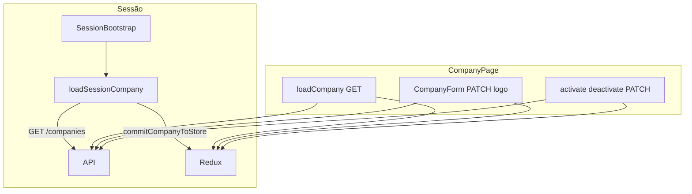
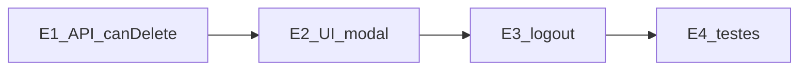

# Auditoria — Company Management (Frontend)

**Data:** 11/11/2026  
**Tipo:** Somente leitura — nenhum ficheiro de implementação (`client/`, `server/`) alterado.  
**Branch analisada:** `develop` @ `8fd5f0a108515abd8a81ddcfbace18c44fd0a9d1`  
**Contexto backend:** [`company-management-backend-audit.md`](company-management-backend-audit.md)

**Veredicto sumário:** A **Gestão da Própria Empresa** no frontend está **largamente implementada** — rota `/company`, página com formulário (nome, timezone, logo), link público de agendamento, activação/desactivação (OWNER) e sincronização Redux. O que **falta de facto** é sobretudo o **soft delete** (`DELETE /api/companies/:id`, `COMPANY_DELETE`, só OWNER), incluindo cliente HTTP, permissão UX e fluxo pós-eliminacao (logout). Não é necessário reconstruir a página do zero.

---

## Estado Git no início da auditoria

| Item | Valor |
|------|--------|
| Branch | `develop` |
| HEAD | `8fd5f0a108515abd8a81ddcfbace18c44fd0a9d1` |
| Tracking | `develop...origin/develop` |
| Staged / unstaged | Nenhuma alteração em ficheiros tracked |
| Untracked | `docs/audits/company-management-backend-audit.md` |

**Operações Git de escrita:** não executadas.

---

## 1. Estrutura actual

### 1.1 Stack e organização

| Camada | Tecnologia |
|--------|------------|
| UI | React 19, TypeScript |
| Routing | React Router 7 (`ProtectedRoute`, `AppLayout`, `GuestRoute`) |
| Estado global | Redux Toolkit (`auth` + `company` slices; **sem RTK thunks** para empresa) |
| HTTP | Axios (`apiClient`, cookies, refresh partilhado) |
| Estilos | Bootstrap 5 + CSS em [`client/src/index.css`](../../client/src/index.css) (ex.: `.company-public-booking-link`, `.company-form-logo-uploader`) |
| Build/test | Vite 7, Vitest |

### 1.2 Árvore relevante (módulo Company)

```
client/src/
├── pages/company/
│   ├── CompanyPage.tsx
│   ├── CompanyPage.test.tsx
│   └── CompanyPage.logo.test.tsx
├── components/company/
│   ├── CompanyForm.tsx (+ .test.tsx, .logo.test.tsx)
│   ├── CompanyInactiveNotice.tsx (+ .test.tsx)
│   └── StaffCompanySuspendedView.tsx
├── api/endpoints/company.api.ts (+ .test.ts)
├── types/company.ts
├── config/companyPermissions.ts (+ .test.ts)
├── config/menu.ts                    # item "Empresa" → /company
├── store/
│   ├── slices/companySlice.ts (+ .test.ts)
│   └── companySessionSync.ts (+ .test.ts)
├── app/
│   ├── loadSessionCompany.ts (+ .test.ts)
│   └── SessionBootstrap.tsx          # GET /companies no boot
├── routes/AppRoutes.tsx              # Route path="/company"
└── components/layout/
    ├── AppLayout.tsx                 # avisos empresa inactiva / staff suspensa
    └── Sidebar.tsx                   # logo + nome workspace do slice
```

### 1.3 Fluxo de dados (resumo)



---

## 2. Páginas e componentes existentes

### 2.1 Rotas

| Rota | Componente | Protecção |
|------|------------|-----------|
| `/company` | [`CompanyPage`](../../client/src/pages/company/CompanyPage.tsx) | `ProtectedRoute` → `AppLayout`; RBAC **na página** (`getCompanyAbilities`) |
| `/register` | [`RegisterPage`](../../client/src/pages/RegisterPage.tsx) | Criação de empresa no registo (não é gestão pós-login) |

[`AppRoutes.tsx`](../../client/src/routes/AppRoutes.tsx) linha 86: `<Route path="/company" element={<CompanyPage />} />`.

### 2.2 CompanyPage

Responsabilidades ([`CompanyPage.tsx`](../../client/src/pages/company/CompanyPage.tsx)):

- `PageHeader` — título "Empresa"
- Card **Informações da empresa** — link público (`getPublicBookingUrl`), copiar/abrir; formulário ou perfil só leitura
- Card **Estado operacional** — badge Ativa/Inativa; desactivar (modal) / reactivar (OWNER)
- Estados: `LoadingState`, `ErrorState` + retry, mensagens de sucesso/erro

### 2.3 CompanyForm

[`CompanyForm.tsx`](../../client/src/components/company/CompanyForm.tsx):

- `ImageUploader` — upload/remoção logo (`companyApi.uploadCompanyLogo` / `removeCompanyLogo`)
- Campos nome + `TimezonePicker` (IANA, alinhado ao backend)
- Validação cliente: nome 3–120, timezone obrigatório e válido
- Submit → `PATCH /companies/:id`

### 2.4 Componentes de contexto global

| Componente | Uso |
|------------|-----|
| [`CompanyInactiveNotice`](../../client/src/components/company/CompanyInactiveNotice.tsx) | Banner global em `AppLayout` quando `!company.isActive` e role OWNER/ADMIN |
| [`StaffCompanySuspendedView`](../../client/src/components/company/StaffCompanySuspendedView.tsx) | Bloqueia conteúdo principal para MANAGER/EMPLOYEE suspensos por desactivação |
| [`CompanyReadOnlyProfile`](../../client/src/pages/company/CompanyPage.tsx) (inline) | Avatar + dl nome/timezone quando edição desligada |

### 2.5 Navegação

[`config/menu.ts`](../../client/src/config/menu.ts): item **Empresa** (`/company`) apenas para roles `OWNER` e `ADMIN`.

[`Sidebar.tsx`](../../client/src/components/layout/Sidebar.tsx): grupo "Gestão"; `ImageAvatar` + `selectWorkspaceDisplayName` no cabeçalho da sidebar.

---

## 3. Estado das funcionalidades Company

| Funcionalidade | Estado | Evidência |
|----------------|--------|-----------|
| Página perfil da empresa | **Implementada** | `/company` → `CompanyPage` |
| Formulário de edição | **Implementado** | `CompanyForm` (OWNER/ADMIN com empresa activa) |
| Nome | **Implementado** | Input + validação + PATCH |
| Timezone | **Implementado** | `TimezonePicker` + PATCH |
| Logo — upload, preview, remoção | **Implementado** | `ImageUploader`; URLs Cloudinary via backend (`StoredImage`) |
| Estado ativo/inativo (UI) | **Implementado** | Badges; nota no link público quando inactiva |
| Activar empresa | **Implementado** | OWNER — `activateCompany` |
| Desactivar empresa | **Implementado** | OWNER — modal `DestructiveConfirmModal` + `deactivateCompany` |
| Soft delete | **Ausente** | Sem UI, sem `companyApi.deleteCompany`, sem `canDelete` |
| Integração `/api/companies` | **Parcial** | Todos os endpoints excepto `DELETE /:id` |
| Criar empresa (admin) | **Fora da página** | `RegisterPage` + `POST /auth/register` |

### 3.1 Comportamento com empresa inactiva

- **OWNER:** `CompanyInactiveNotice` global (`AppLayout`); na página, formulário substituído por read-only; secção lifecycle com reactivar ([`canEditProfile = canUpdate && company?.isActive`](../../client/src/pages/company/CompanyPage.tsx)).
- **ADMIN:** read-only + aviso global; **sem** acções lifecycle ([`CompanyPage.test.tsx`](../../client/src/pages/company/CompanyPage.test.tsx) — "does not show lifecycle actions for ADMIN").
- **MANAGER/EMPLOYEE:** sem item de menu; deep-link `/company` → alerta sem chamar API.

### 3.2 Link público de agendamento

Construído com [`getPublicBookingUrl(company.id, env.appUrl)`](../../client/src/pages/company/CompanyPage.tsx); testes cobrem cópia clipboard e `target="_blank"`.

---

## 4. Estado da integração API

Fonte: [`company.api.ts`](../../client/src/api/endpoints/company.api.ts). Base: `apiClient` (`env.apiUrl`, `withCredentials: true`).

| Backend (auditoria backend) | Método frontend | HTTP | Consumidor |
|-----------------------------|-----------------|------|------------|
| `GET /api/companies` | `getCompany()` | GET `/companies` | `CompanyPage.loadCompany`, `loadSessionCompany` |
| `GET /api/companies/:id` | — (usa lista) | — | Backend devolve 0–1 item em GET `/`; FE usa `data[0]` |
| `PATCH /api/companies/:id` | `updateCompany(id, payload)` | PATCH | `CompanyForm` |
| `POST /api/companies/:id/logo` | `uploadCompanyLogo(id, file)` | POST multipart `logo` | `CompanyForm` |
| `DELETE /api/companies/:id/logo` | `removeCompanyLogo(id)` | DELETE | `CompanyForm` |
| `PATCH .../activate` | `activateCompany(id)` | PATCH | `CompanyPage` |
| `PATCH .../deactivate` | `deactivateCompany(id)` | PATCH | `CompanyPage` |
| `DELETE /api/companies/:id` (soft delete) | **Não existe** | — | — |

### 4.1 Payloads e respostas

- Tipos: [`types/company.ts`](../../client/src/types/company.ts) — espelha `CompanyMapper` (`id`, `name`, `timezone`, `logo`, `isActive`, timestamps).
- `UpdateCompanyPayload`: apenas `name?`, `timezone?` (logo só pelos endpoints de logo).
- Resposta padrão: `ApiResponse<T>`; mutações usam `response.data` como `Company`.
- **Id:** sempre `company.id` da sessão (mesmo valor que `auth.user.companyId` após login).

### 4.2 Tratamento de erros

- [`getApiError`](../../client/src/api/errors.ts) + [`getFriendlyErrorMessage`](../../client/src/api/errors.ts) nas páginas e formulário.
- Códigos empresa: `COMPANY_INACTIVE_OPERATION`, `COMPANY_INACTIVE_ACCESS` → mensagens amigáveis.
- Staff suspensa: `USER_SUSPENDED_BY_COMPANY_DEACTIVATION` → `StaffCompanySuspendedView` via flag em `authSlice` (interceptors em [`apiClient.ts`](../../client/src/api/apiClient.ts)).
- Testes: [`errors.test.ts`](../../client/src/api/errors.test.ts), `CompanyPage.test.tsx` (403/validação).

### 4.3 Actualização após operações

| Operação | Estado local `CompanyPage` | Redux |
|----------|----------------------------|-------|
| Load | `setCompanyData` | `commitCompanyToStore` |
| PATCH nome/TZ | `applyCompanyUpdate` | `commitCompanyToStore` |
| Logo | `handleLogoChanged` | `commitCompanyToStore` |
| Activate/deactivate | `applyCompanyUpdate` | `commitCompanyToStore` |

`commitCompanyToStore` ([`companySessionSync.ts`](../../client/src/store/companySessionSync.ts)): `setCompany` + `setUserCompanyName` + `setUserCompanyTimezone` — alinha sidebar e calendário.

---

## 5. Estado do Redux

### 5.1 Slice `company`

[`companySlice.ts`](../../client/src/store/slices/companySlice.ts):

- Estado: `{ company: Company | null }`
- Reducers: `setCompany`, `clearCompany`, `patchCompanyName`
- Selectors: `selectCompany`, `selectCompanyTimezone`, `selectWorkspaceDisplayName`, `resolveEffectiveCompanyTimezone`

**Sem async thunks** — toda a IO é feita nos componentes ou em `loadSessionCompany`.

### 5.2 Sincronização com auth

- `auth.user` inclui `companyName`, `companyTimezone` (identificação quando slice vazio — roles sem `COMPANY_READ`).
- Bootstrap: [`loadSessionCompany`](../../client/src/app/loadSessionCompany.ts) só chama API se `getCompanyAbilities(role).canView` e não `mustChangePassword`.
- Logout / refresh: `clearCompany` em [`Navbar`](../../client/src/components/layout/Navbar.tsx), falha de sessão, etc.
- `reconcileCompanySliceWithSession` limpa slice se `loaded.id !== session.companyId`.

### 5.3 Consumidores do slice (fora da página Empresa)

Timezone efectivo: agendamentos, calendário, portal, relatórios (`selectCompanyTimezone`).

`selectCompany`: páginas que dependem de empresa carregada (ex.: disponibilidade).

---

## 6. RBAC no frontend

### 6.1 Fonte de verdade UX

[`getCompanyAbilities`](../../client/src/config/companyPermissions.ts) espelha [`server/src/constants/rbac.ts`](../../server/src/constants/rbac.ts):

| Ability | OWNER | ADMIN | MANAGER | EMPLOYEE | CLIENT |
|---------|-------|-------|---------|----------|--------|
| `canView` | sim | sim | não | não | não |
| `canUpdate` | sim | sim | não | não | não |
| `canActivate` | sim | não | não | não | não |
| `canDeactivate` | sim | não | não | não | não |
| `canDelete` | **não definido** | — | — | — | — |

Comentário no ficheiro: *"Este é apenas UX. A autorização real continua no backend."*

### 6.2 Onde se aplica

| Camada | Comportamento |
|--------|----------------|
| Menu | `MENU_ITEMS` — `/company` só OWNER/ADMIN |
| `CompanyPage` | `!canView` → alerta, **sem** `getCompany()` |
| Formulário | Renderizado só se `canEditProfile` (update + activa) |
| Lifecycle buttons | `canActivate` / `canDeactivate` (OWNER) |
| Router | `AppLayout` redirecciona CLIENT fora de rotas staff; **não** bloqueia MANAGER em `/company` — a página bloqueia |
| API | 403 do backend se alguém forçar pedido (ex.: ADMIN em activate) |

### 6.3 Respostas HTTP

- **401:** refresh via `apiClient`; expiração → login.
- **403:** mensagem amigável (`USER_NOT_PREVILEGES`, empresa inactiva, etc.).
- **404:** empresa não encontrada na listagem vazia → "Empresa não encontrada." no load.

Testes RBAC: [`companyPermissions.test.ts`](../../client/src/config/companyPermissions.test.ts), [`CompanyPage.test.tsx`](../../client/src/pages/company/CompanyPage.test.tsx), [`AppRoutes.test.tsx`](../../client/src/routes/AppRoutes.test.tsx) (MANAGER/EMPLOYEE/CLIENT).

---

## 7. Lacunas identificadas

| ID | Lacuna | Impacto |
|----|--------|---------|
| L1 | **Soft delete** — sem API client, permissão, UI, fluxo logout | OWNER não pode eliminar empresa pela UI |
| L2 | `companyPermissions` não inclui `COMPANY_DELETE` | Inconsistência documental com backend |
| L3 | `DELETE` com empresa inactiva bloqueado no backend (`requireOperationalCompany`) | Quando L1 for feito, UX deve exigir reactivar ou remover middleware (decisão backend) |
| L4 | Duplo `GET /companies` (bootstrap + entrada na página) | Rede extra; aceitável, optimizável com cache do slice |
| L5 | Rota `/company` sem guard de role no router | Deep-link MANAGER/EMPLOYEE mostra alerta — OK, mas não é 404 |
| L6 | `CompanyInactiveNotice` só no layout global, não duplicado na página | Testado como intencional (`CompanyPage.test` inactive UX) |
| L7 | Sem thunks Redux | Mais lógica duplicada se novas features; não bloqueia entrega |

**Não são lacunas para gestão do próprio tenant:** listagem multi-empresa, criar empresa na área autenticada (registo cobre onboarding).

---

## 8. Componentes reutilizáveis

| Componente | Papel na futura gestão |
|------------|-------------------------|
| [`DestructiveConfirmModal`](../../client/src/components/common/DestructiveConfirmModal.tsx) | Soft delete (já usado em desactivar) |
| [`ImageUploader`](../../client/src/components/common/ImageUploader.tsx) | Logo (padrão clients/employees) |
| [`TimezonePicker`](../../client/src/components/common/TimezonePicker.tsx) | Registo + empresa |
| [`ImageAvatar`](../../client/src/components/common/ImageAvatar.tsx) | Preview logo sidebar e read-only |
| [`PageHeader`](../../client/src/components/common/PageHeader.tsx) | Cabeçalho consistente |
| [`LoadingState`](../../client/src/components/common/LoadingState.tsx) / [`ErrorState`](../../client/src/components/common/ErrorState.tsx) | Padrão de página |
| [`getApiError`](../../client/src/api/errors.ts) / mensagens empresa | Erros 403 inactiva |

Padrão de página admin: card Bootstrap + alertas + botões `btn-outline-danger` / `btn-primary`.

---

## 9. Riscos e inconsistências

| Risco | Descrição | Mitigação actual / futura |
|-------|-----------|---------------------------|
| R1 | Ocultar botões ≠ segurança | Backend 403; testes de API |
| R2 | Soft delete futuro sem logout | Após delete, empresa 404 no auth — FE deve `clearCredentials` + redirect login |
| R3 | ADMIN pode ver empresa inactiva mas não reactivar | Alinhado ao backend; copy no `CompanyInactiveNotice` |
| R4 | Estado local + Redux podem divergir brevemente | Sempre `commitCompanyToStore` após sucesso |
| R5 | MANAGER sem empresa no slice | `companyTimezone` na sessão; calendário usa fallback em `selectCompanyTimezone` |
| R6 | Eliminar com empresa inactiva | Backend 403 até reactivar — documentar na UI da zona perigosa |

---

## 10. Proposta de estrutura da página

**Base:** manter a estrutura actual de [`CompanyPage`](../../client/src/pages/company/CompanyPage.tsx) (dois cards + modal). **Não** redesenhar do zero.

### 10.1 Layout proposto (evolutivo)

```
┌─ PageHeader: Empresa ─────────────────────────────┐
├─ Card: Informações da empresa ─────────────────────┤
│  • Link público (readonly + Copiar + Abrir)         │
│  • CompanyForm OU CompanyReadOnlyProfile            │
├─ Card: Estado operacional ─────────────────────────┤
│  • Badge Ativa/Inativa                              │
│  • Desactivar (OWNER, activa) / Reactivar (OWNER)   │
├─ Card: Zona perigosa (NOVO — só OWNER, activa) ────┤
│  • Texto de impacto (irreversível, sessão, dados)   │
│  • Botão "Eliminar empresa" → DestructiveConfirmModal│
│  • DELETE /companies/:id → logout                   │
└────────────────────────────────────────────────────┘
```

### 10.2 Regras UX alinhadas ao backend

- Zona perigosa visível apenas `canDelete` (novo) **e** `company.isActive === true` (ou permitir após reactivar, conforme decisão backend).
- Após delete bem-sucedido: limpar `company` + auth, navegar para `/login` com mensagem.
- ADMIN: sem zona perigosa; sem lifecycle.

### 10.3 Ficheiros a tocar na implementação (referência futura)

- `company.api.ts` — `deleteCompany(id)`
- `companyPermissions.ts` — `canDelete`
- `CompanyPage.tsx` — secção + handler + logout
- Testes espelhando lifecycle existente

---

## 11. Roadmap de implementação por etapas

| Etapa | Objectivo | Entregáveis | Depende de |
|-------|-----------|-------------|------------|
| **E1** | Contrato HTTP delete | `deleteCompany`, testes em `company.api.test.ts`, `canDelete` + testes permissions | Backend `DELETE` estável |
| **E2** | UI soft delete | Card "Zona perigosa", modal, erros 403/404, só OWNER empresa activa | E1 |
| **E3** | Pós-delete | `clearCompany`, `clearCredentials` (ou logout API), redirect login, mensagem | E2 |
| **E4** | Qualidade | Testes `CompanyPage` (OWNER vs ADMIN, sucesso/falha/cancel); regressão logo/lifecycle | E2–E3 |
| **E5** | Polish (opcional) | Reduzir duplo GET usando slice hidratado; copy sobre delete com empresa inactiva; docs utilizador | — |

**Fora de escopo:** consola multi-tenant, criar empresa fora do registo, restaurar soft-deleted (backend sem endpoint).



---

## Apêndice A — Validação executada nesta auditoria

### Testes (`client/`)

```bash
npm test -- company
```

**Resultado:** 10 ficheiros de teste, **0 testes executados**, falha de suíte (ambiente).

| Erro | Ficheiros afectados (filtro `company`) |
|------|----------------------------------------|
| `TypeError: Cannot read properties of undefined (reading 'config')` | Ex.: `CompanyPage.test.tsx`, `companySlice.test.ts` |
| `Vitest failed to find the runner` | Ex.: `CompanyPage.logo.test.tsx` |

Ficheiros inventariados no filtro `company`:

- `api/endpoints/company.api.test.ts`
- `config/companyPermissions.test.ts`
- `store/slices/companySlice.test.ts`
- `store/companySessionSync.test.ts`
- `app/loadSessionCompany.test.ts`
- `components/company/CompanyForm.test.tsx`, `CompanyForm.logo.test.tsx`, `CompanyInactiveNotice.test.tsx`
- `pages/company/CompanyPage.test.tsx`, `CompanyPage.logo.test.tsx`

**Interpretação:** falha de runtime Vitest neste ambiente Windows; o inventário estático dos testes (ex.: ~25+ casos em `CompanyPage.test.tsx` lifecycle/RBAC) permanece válido. Reexecutar na CI ou localmente após corrigir ambiente.

### Build

```bash
npm run build
```

**Resultado:** exit code **0** (`tsc -b && vite build`).

---

## Apêndice B — O que já existe vs o que falta desenvolver

| Já existe (não repetir trabalho) | Falta desenvolver |
|----------------------------------|-------------------|
| Página `/company`, menu OWNER/ADMIN | Soft delete completo (API + RBAC UX + UI + logout) |
| Edição nome/timezone/logo | Secção "Zona perigosa" e testes associados |
| Activar/desactivar OWNER + modal | Ajuste UX delete com empresa inactiva (alinhado backend) |
| Redux sync + bootstrap GET /companies | Opcional: evitar segundo GET na página |
| Testes extensivos (código-fonte) | Executar suíte com sucesso no ambiente/CI |
| Tratamento empresa inactiva / staff suspensa | — |

---

*Fim do relatório. Única alteração no repositório: criação deste ficheiro em `docs/audits/` (além do untracked pré-existente da auditoria backend).*
