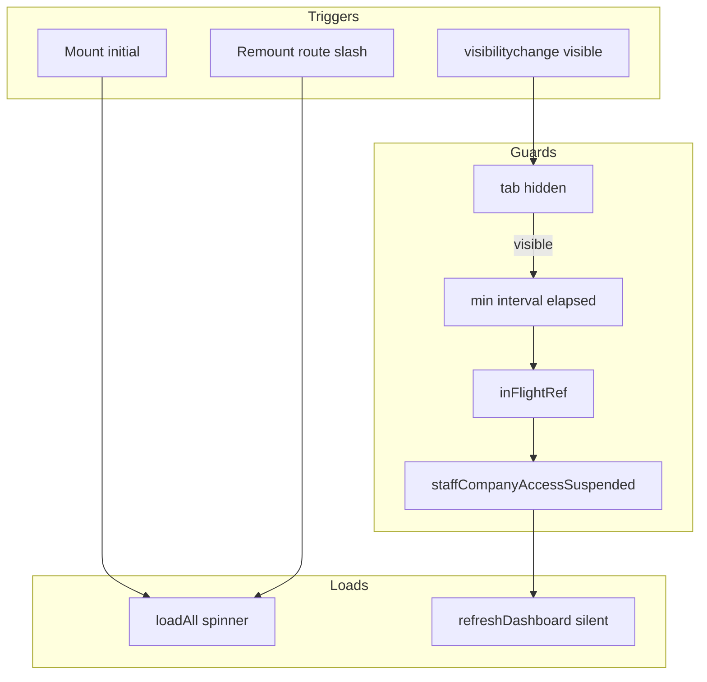

# SchedulerPro — Dashboard O5: Auditoria de Atualização (Refresh)

**Data:** 2026-11-10  
**Objetivo:** Definir estratégia para actualizar o Dashboard ao regressar à rota, ao voltar à aba visível e após alterações na agenda — **sem implementação nesta fase**.  
**Referências:** [schedulerpro-dashboard-functional-evolution-audit.md](../reports/schedulerpro-dashboard-functional-evolution-audit.md) (O5), [schedulerpro-dashboard-o2-status-distribution.md](../reports/schedulerpro-dashboard-o2-status-distribution.md), [dashboard-o2-status-distribution-audit.md](./dashboard-o2-status-distribution-audit.md).

---

## 1. Estado inicial Git

| Campo | Valor |
| --- | --- |
| Branch | `develop` |
| HEAD (short) | `8203a41` |
| Working tree | Limpo (`## develop...origin/develop`) |
| Operações Git de escrita | Nenhuma nesta auditoria |

**Contexto funcional:** O1 (Clientes ativos) e O2 (Distribuição por estado) integrados em [`DashboardPage.tsx`](../../client/src/pages/dashboard/DashboardPage.tsx).

---

## 2. Ficheiros analisados

| Ficheiro | Linhas / tema |
| --- | --- |
| [`client/src/pages/dashboard/DashboardPage.tsx`](../../client/src/pages/dashboard/DashboardPage.tsx) | L37–157: estado, `loadSummary`, `loadRelated`, `loadAll`, `useEffect` inicial |
| [`client/src/pages/dashboard/DashboardStatusDistribution.tsx`](../../client/src/pages/dashboard/DashboardStatusDistribution.tsx) | Dados só via props; sem fetch |
| [`client/src/pages/dashboard/DashboardAppointments.tsx`](../../client/src/pages/dashboard/DashboardAppointments.tsx) | Listas derivadas do summary + maps related |
| [`client/src/routes/AppRoutes.tsx`](../../client/src/routes/AppRoutes.tsx) | L78–79: `DashboardPage` em `/` dentro de `AppLayout` |
| [`client/src/components/layout/AppLayout.tsx`](../../client/src/components/layout/AppLayout.tsx) | L176: `<Outlet />` — uma rota activa; L66–68: reset sidebar em `location.pathname` |
| [`client/src/main.tsx`](../../client/src/main.tsx) | L10–15: `StrictMode` activo (dev: efeitos duplos) |
| [`client/src/api/endpoints/dashboard.api.ts`](../../client/src/api/endpoints/dashboard.api.ts) | `getSummary` |
| [`client/src/pages/appointments/AppointmentsPage.tsx`](../../client/src/pages/appointments/AppointmentsPage.tsx) | CRUD + mudanças de estado via API; sem sinalização ao Dashboard |
| [`client/src/hooks/useAppointmentsSchedule.ts`](../../client/src/hooks/useAppointmentsSchedule.ts) | Calendário: fetch local |
| [`client/src/hooks/useMatchMedia.ts`](../../client/src/hooks/useMatchMedia.ts) | Padrão de listener com cleanup |
| [`client/src/pages/dashboard/DashboardPage.test.tsx`](../../client/src/pages/dashboard/DashboardPage.test.tsx) | 34+ casos; retry, erros, O2 — **sem** refresh / visibility |
| Procura `visibilitychange` em `client/src/**` | **Nenhuma ocorrência** (só dependências em `node_modules`) |

---

## 3. Estado actual da implementação

### 3.1 Ciclo de vida e roteamento

**Facto:** O Dashboard **não permanece montado** ao navegar para outra rota staff (`/appointments`, `/clients`, etc.).

- [`AppRoutes.tsx`](../../client/src/routes/AppRoutes.tsx) usa rotas irmãs sob `AppLayout` → React Router renderiza apenas o elemento da rota actual no `Outlet`.
- Ao sair de `/`, `DashboardPage` **desmonta**; todo o `useState` local (summary, related, erros) é descartado.
- Ao regressar a `/`, ocorre **novo mount** → `useEffect` (L155–157) chama `loadAll()` de novo.

**Implicação:** O cenário «alterar agendamentos em `/appointments` e voltar ao Dashboard via menu/sidebar» **já refresca** no mount, desde que a navegação desmonte a página (comportamento actual).

**Lacunas:**

| Cenário | Comportamento actual |
| --- | --- |
| Utilizador **permanece** em `/` e muda de aba do browser (outra app) | Dados **não** actualizam ao voltar (sem `visibilitychange`) |
| Utilizador em `/` durante longo período sem navegar | Dados podem ficar stale (próximos agendamentos usam `now` do servidor na última chamada) |
| `staffCompanyAccessSuspended` | `loadAll` retorna cedo (L129–130) sem ajustar `isLoading` se chamado após mount inicial — edge case RBAC |
| React `StrictMode` (dev) | `useEffect` pode disparar **duas** vezes → duas chamadas `getSummary` no primeiro mount em desenvolvimento |

**Cache / preservação:** Não há RTK Query, `sessionStorage`, nem slice Redux para o summary. Única «cache» é estado local enquanto o componente estiver montado.

### 3.2 Acionamento do carregamento inicial

```text
mount DashboardPage
  → useEffect([loadAll])
    → loadAll()
        → setIsLoading(true); clear errors
        → await loadSummary()  → dashboardApi.getSummary(...)
        → on failure: setLoadError; setIsLoading(false); return (skip related)
        → await loadRelated()  → clients, services, employees (condicional)
        → setIsLoading(false)
```

**Dependências de `loadAll`** (L153): `loadSummary`, `loadRelated`, `staffCompanyAccessSuspended`, `companyIsActive`.

**Recargas automáticas adicionais** quando qualquer dependência muda (ex.: `timezone` via `todayRange` → novo `loadSummary` → novo `loadAll` → **reload completo com spinner**).

### 3.3 Visibilidade do navegador

**Facto:** Não existe listener `document.visibilitychange` nem `pageshow` no código da aplicação (`client/src`).

RTK em `node_modules` implementa `setupListeners` para refetch em APIs RTK Query, mas **o Dashboard não usa RTK Query**.

Padrão reutilizável mais próximo: [`useMatchMedia.ts`](../../client/src/hooks/useMatchMedia.ts) — `addEventListener` + cleanup no `useEffect`.

### 3.4 Carregamentos simultâneos e concorrência

| Aspeto | Estado actual |
| --- | --- |
| Mutex / in-flight guard | **Inexistente** — várias chamadas a `loadAll()` podem correr em paralelo |
| AbortController | **Não** — resposta HTTP mais lenta pode chegar depois e **sobrescrever** dados mais recentes (`setSummary`, `setClients`, …) |
| Identificador de geração (request id) | **Não** |
| `loadSummary` + `loadRelated` | Sequenciais dentro de um `loadAll`; **podem** sobrepor-se se dois `loadAll` paralelos |
| UX em refresh | `loadAll` sempre faz `setIsLoading(true)` → **substitui UI por spinner** (perde KPIs O1, O2 e agendas durante o refresh) |
| Erro no refresh com dados já mostrados | Não há modo «silent refresh»; reutilizar `loadAll` em background pode limpar erros (L133) ou forçar ecrã de erro se summary falhar |

**Facto:** O retry do `ErrorState` (L214) chama o mesmo `loadAll()` — comportamento coerente com carga inicial, mas não adequado para refresh silencioso.

### 3.5 Alterações nos agendamentos (outras páginas)

| Acção | Onde | Comunicação com Dashboard |
| --- | --- | --- |
| Criar / editar / apagar | `AppointmentsPage` + modais | Apenas `appointmentsApi` + refetch local do calendário |
| Confirmar / concluir / cancelar / no-show | `AppointmentsPage` L187+ | Idem |
| Público / portal | outras rotas | Sem ligação ao staff Dashboard |

**Facto:** Não há `CustomEvent`, `BroadcastChannel`, flags Redux globais de «dados sujos», nem invalidação cruzada.

**Resolução sem estado global:** Suficiente para O5 combinar (a) **re-fetch no remount** da rota `/` (já existe) com (b) **re-fetch em `visibilitychange`** quando `pathname === '/'` e (c) opcionalmente **`useLocation` + revalidação** se no futuro o Dashboard deixar de desmontar.

---

## 4. Problemas identificados

1. **Stale data com aba oculta:** Dashboard montado em `/`, utilizador noutra aba, alterações feitas noutro dispositivo ou por colega — ao voltar, UI antiga.
2. **Refresh agressivo:** Qualquer reutilização de `loadAll` para actualização periódica provoca **loading fullscreen** e apaga temporariamente O1/O2/agendas.
3. **Corridas de rede:** Sem protecção contra respostas antigas; relevante em refresh rápido (visibility + mudança de timezone + retry).
4. **Duplicação de pedidos:** StrictMode (dev), listeners mal debounced, ou `loadAll` em `useEffect` + visibility sem throttle → chamadas duplicadas a `getSummary` e 3× related.
5. **Related pesado em cada refresh:** Cada `loadAll` repete `getClients`, `getServices`, `getEmployees` mesmo quando só o summary mudou — aceitável mas amplifica duplicação (ligação com O4 da auditoria funcional).
6. **Falsa sensação após agenda:** Se o utilizador usar **voltar do browser** com bfcache (raro em SPA, mas possível), o estado React pode restaurar-se sem remount — **hipótese** a validar manualmente; remount normal por sidebar já refresca.

---

## 5. Riscos técnicos

| Risco | Severidade | Nota |
| --- | --- | --- |
| Resposta antiga sobrescreve summary | Média | Mitigar com `loadGeneration` ref ou AbortController |
| Flash de loading em refresh suave | Média | UX; separar `isInitialLoad` vs `isRefreshing` |
| Spam de API (visibility + focus) | Média | Debounce/throttle (ex. 30–60 s mínimo entre refreshes automáticos) |
| Listener global duplicado | Baixa | Um `useEffect` por página; cleanup obrigatório |
| Regressão O1/O2/agendas | Média | Testes de regressão com mocks estáveis |
| Testes `visibilitychange` em jsdom | Baixa | `document.dispatchEvent` + `Object.defineProperty(document, 'visibilityState')` |
| `staffCompanyAccessSuspended` durante refresh | Baixa | Ignorar refresh se suspenso (alinhado a L129) |

---

## 6. Estratégia recomendada (implementação futura)

### 6.1 Princípios

- **Sem backend**, sem novas dependências, sem Redux global para cache.
- **Preservar** KPIs O1, distribuição O2 e agendas durante refresh em background.
- **Reutilizar** funções existentes (`loadSummary`, `loadRelated`) mas extrair um modo **`refreshDashboard({ silent: true })`** distinto de `loadAll` inicial.

### 6.2 Separação initial load vs refresh

Refactor mínimo em [`DashboardPage.tsx`](../../client/src/pages/dashboard/DashboardPage.tsx):

| Função | Comportamento |
| --- | --- |
| `loadAll` (existente) | Mount / retry de erro fatal: `isLoading=true`, UI de erro se summary falhar |
| `refreshDashboard` (novo) | Só se já existir `summary` (dados mostrados): **não** `setIsLoading(true)`; opcional indicador discreto (`isRefreshing`) |
| Falha no refresh silencioso | Manter dados actuais; `alert-warning` ou toast curto («Não foi possível actualizar o painel») sem `loadError` fullscreen |

### 6.3 Protecção de concorrência

```typescript
// Padrão sugerido (pseudocódigo)
const loadGenerationRef = useRef(0);
const inFlightRef = useRef(false);

async function refreshDashboard() {
  if (inFlightRef.current || staffCompanyAccessSuspended) return;
  inFlightRef.current = true;
  const gen = ++loadGenerationRef.current;
  try {
    await loadSummary(); // verificar gen após await antes de setState
    if (gen !== loadGenerationRef.current) return;
    await loadRelated();
  } finally {
    if (gen === loadGenerationRef.current) inFlightRef.current = false;
  }
}
```

Alternativa: `AbortController` por pedido axios (requer verificar se `apiClient` suporta `signal`).

### 6.4 Regresso à rota `/`

| Opção | Recomendação |
| --- | --- |
| A. Confiar só no remount | **Suficiente hoje** para navegação interna; documentar no release note |
| B. `useLocation` + `useEffect` quando `pathname === '/'` | Útil se no futuro houver layout que preserve o Dashboard; **opcional** agora para evitar double-fetch no mount (effect mount + effect location) |
| C. React Router data APIs / `useRevalidator` | Não adoptado no projecto; evitar |

**Recomendação:** manter remount para navegação; acrescentar teste de integração que simula **unmount/remount** com `getSummary` chamado 2× e dados actualizados.

Para **evitar double call no mount** se se adoptar B: usar ref `hasMountedRef` ou chamar refresh só em `location.key` change quando **não** for primeira render.

### 6.5 `visibilitychange`

Novo `useEffect` em `DashboardPage` (ou hook [`useDocumentVisible`](../../client/src/hooks/) futuro):

```typescript
useEffect(() => {
  const onVisibility = () => {
    if (document.visibilityState !== "visible") return;
    void refreshDashboardThrottled();
  };
  document.addEventListener("visibilitychange", onVisibility);
  return () => document.removeEventListener("visibilitychange", onVisibility);
}, [refreshDashboardThrottled]);
```

- **Não** actualizar quando `hidden`.
- **Throttle:** ex. `lastRefreshAtRef` + mínimo **45 s** entre refreshes automáticos (configurável constante).
- **Ignorar** se `loadError` fullscreen (utilizador a corrigir erro) ou se ainda `isLoading` inicial.

### 6.6 Debounce / intervalo mínimo

Constante `DASHBOARD_AUTO_REFRESH_MIN_MS` (ex. 45_000) partilhada entre visibility e eventuais futuros triggers.

Actualização **manual** (botão «Actualizar») — **fora de escopo O5** a menos que produto peça; se existir, não deve passar pelo throttle.

### 6.7 Hook opcional

[`client/src/hooks/useDashboardRefreshTriggers.ts`](../../client/src/hooks/useDashboardRefreshTriggers.ts) — encapsula visibility + throttle + cleanup; mantém `DashboardPage` legível. Alinhado a [`useMatchMedia`](../../client/src/hooks/useMatchMedia.ts).

### 6.8 Related no refresh

**Fase 1 O5:** refresh chama **summary + related** (paridade com dados de nomes nas tabelas).  
**Fase 2 (O4):** refresh só summary se enrichment backend existir — não bloquear O5.

---

## 7. Fluxo proposto (diagrama)



---

## 8. Testes existentes e lacunas

### 8.1 Cobertura actual ([`DashboardPage.test.tsx`](../../client/src/pages/dashboard/DashboardPage.test.tsx))

- Carga inicial, vazio, erros summary/related, retry (`getSummary` 2×), timezone em agendas, O1, O2, staff suspenso, loading sem distribution.
- **Ausente:** visibility, remount refresh, concorrência, refresh silencioso, throttle.

### 8.2 Testes propostos para O5

| # | Cenário | Abordagem |
| --- | --- | --- |
| 1 | Carga inicial | Já coberto; assert `getSummary` chamado 1× (nota StrictMode em dev) |
| 2 | Regresso à rota após agenda | `render` → `unmount` → `render` com novo mock summary → assert novos KPIs/O2 |
| 3 | `visibilitychange` → visible | `fireEvent` / `dispatchEvent`; mock `visibilityState` |
| 4 | Sem duplicar se in-flight | Dois triggers rápidos → `getSummary` 1× |
| 5 | Ignorar quando hidden | `visibilityState: hidden` → sem chamada |
| 6 | Resposta antiga ignorada | Mock summary lento + rápido; assert valor final do rápido |
| 7 | Falha no refresh silencioso | Reject summary; assert KPIs antigos ainda visíveis |
| 8 | O1 + O2 preservados | `activeClientsCount` e `dashboard-status-distribution` após refresh |
| 9 | Agendas preservadas durante refresh | Sem spinner fullscreen; listas permanecem |
| 10 | Cleanup listener | `unmount` + spy `removeEventListener` |

**Utilitário de teste:** helper para simular visibilidade:

```typescript
function setDocumentVisibility(state: DocumentVisibilityState) {
  Object.defineProperty(document, "visibilityState", {
    configurable: true,
    value: state,
  });
}
```

Considerar `vi.useFakeTimers()` para throttle.

Ficheiro opcional: `useDashboardRefreshTriggers.test.ts` se hook extraído.

---

## 9. Critérios de aceitação (implementação O5)

1. Ao regressar a `/` após editar agendamentos noutra rota, o Dashboard mostra dados actualizados (via remount ou refresh explícito, sem regressão).
2. Com o Dashboard visível em `/`, ao voltar de uma aba oculta **após** alterações relevantes, os dados actualizam **sem** exigir F5 (subject to throttle).
3. Refresh automático **não** substitui a página por loading fullscreen quando já há dados.
4. Falha de rede no refresh automático **não** remove KPIs O1, bloco O2 nem listas de agenda.
5. No máximo **um** ciclo in-flight de refresh automático; chamadas em paralelo são ignoradas ou serializadas.
6. Respostas HTTP tardias **não** revertem contadores para valores antigos.
7. Eventos com `document.visibilityState === 'hidden'` não disparam fetch.
8. Throttle impede mais de um refresh automático por intervalo mínimo configurado (ex. 45 s).
9. Listener `visibilitychange` é removido ao desmontar `DashboardPage`.
10. Testes automatizados cobrem pelo menos: visibility visible, remount, throttle/in-flight, regressão O1+O2.
11. Sem alterações backend, contratos API, ou novas dependências npm.
12. `staffCompanyAccessSuspended` não dispara refresh.

---

## 10. Ficheiros prováveis na implementação

| Ficheiro | Alteração |
| --- | --- |
| [`DashboardPage.tsx`](../../client/src/pages/dashboard/DashboardPage.tsx) | `refreshDashboard`, refs, listener, estados `isRefreshing` opcional |
| **Novo** [`client/src/hooks/useDashboardRefreshTriggers.ts`](../../client/src/hooks/useDashboardRefreshTriggers.ts) | Opcional: visibility + throttle |
| [`DashboardPage.test.tsx`](../../client/src/pages/dashboard/DashboardPage.test.tsx) | Casos O5 |
| [`docs/reports/schedulerpro-dashboard-o5-refresh.md`](../reports/schedulerpro-dashboard-o5-refresh.md) | Documentação pós-implementação (padrão O2) |

**Inalterados:** backend, `dashboard.api.ts`, `DashboardStatusDistribution.tsx` (só recebe props actualizadas), GW-3.

---

## 11. Contexto para outra IA (implementação)

- **Endpoint único:** `GET /dashboard/summary` via `loadSummary`; related só para nomes.
- **Não** introduzir RTK Query nesta fase sem pedido explícito.
- **Preferir** refresh silencioso com geração de pedido a reutilizar `loadAll` para visibility.
- **Mount actual** já resolve navegação SPA; focar O5 em **visibility** + **concorrência** + **UX sem spinner**.
- O2 usa `summary.period` — qualquer refresh que actualize `setSummary` actualiza automaticamente KPIs derivados e `DashboardStatusDistribution`.
- Card «Hoje» usa `todayAppointments.length`; alinhado ao summary devolvido no refresh.
- Testes usam `waitForDashboardLoaded()` → heading «Resumo do dia».
- `companyIsActive` afecta apresentação de erros via `getPageLoadErrorPresentation`, não o refresh em si.

---

## 12. Veredicto

**AUDITORIA CONCLUÍDA**

- Lacuna principal: **sem actualização em `visibilitychange`** e **sem refresh silencioso/concurrency-safe**.
- Regresso de rota via **remount** já recarrega; O5 deve cobrir sobretudo aba oculta e robustez do refresh.
- Pronto para revisão e aprovação antes da implementação.

**Nenhum código foi alterado nesta tarefa.** Apenas este relatório foi criado/atualizado.
