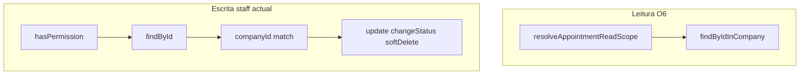

# O7 — Auditoria de segurança e escopo de escrita de agendamentos por perfil

**Data:** 10/11/2026  
**Tipo:** Somente leitura — nenhum ficheiro de implementação (`server/`, `client/`) alterado.  
**Branch analisada:** `develop` @ `970d85095feef762fbd70fe652ffc9a94c8e128a` (pós-O6, PR #135).  
**Contexto:** Validação da hipótese levantada em [`roadmap-audit-post-o6.md`](roadmap-audit-post-o6.md) e delimitação explícita de O6 (apenas **leitura**).

**Veredicto sumário:** A hipótese está **CONFIRMADA**. Um `EMPLOYEE` com `APPOINTMENT_UPDATE` pode modificar agendamentos atribuídos a outro funcionário da mesma empresa se conhecer o `_id`, porque as mutações staff usam `findById` + validação de `companyId`, sem equivalente ao escopo `employeeId` de O6.

---

## 1. Estado Git encontrado no início

| Item | Valor |
|------|--------|
| Branch | `develop` |
| HEAD | `970d85095feef762fbd70fe652ffc9a94c8e128a` |
| Tracking | `develop...origin/develop` |
| Staged / unstaged | Nenhum |
| Untracked | `docs/audits/roadmap-audit-post-o6.md` |
| Divergência vs remoto | Não determinada além do tracking (sem ahead/behind no `status -sb`) |

**Impacto na auditoria:** O código analisado corresponde a `develop` com O6 integrado. O ficheiro untracked do roadmap não afecta a análise de agendamentos.

**Operações Git de escrita:** não executadas.

**Testes automatizados:** não executados nesta entrega (análise estática; conforme enunciado, sem alterar dados nem repositório).

---

## 2. Resumo da arquitetura de autorização de agendamentos

### 2.1 Fluxo HTTP (rotas staff autenticadas)

Pedidos a `/api/appointments/*` (excepto rotas públicas em módulos separados) seguem, em ordem típica:

1. `AuthMiddleware.authenticate` — popula `req.user` (`userId`, `companyId`, `role`, `clientId?`).
2. `PasswordChangeMiddleware.requirePasswordChangeCompleted`
3. `RequireOperationalCompanyMiddleware.requireOperationalCompany` (mutações e listagem operacional)
4. `hasPermission(Permission.*)` ou `authorize(Role.*)` — falha → **403** `USER_NOT_PREVILEGES`
5. Validadores + `validateRequest` (onde aplicável)
6. `AppointmentController` — **sempre** passa `companyId` de `req.user!.companyId`
7. `AppointmentService` — regras de negócio

A autorização **por perfil** para *entrar* no endpoint é RBAC (permissão). A autorização **por objeto** (este agendamento pertence-me?) na **escrita** depende apenas de `findById` + `appointment.companyId === companyId`.

### 2.2 Leitura (O6) vs escrita (actual)

| Camada | Leitura O6 | Escrita staff |
|--------|------------|---------------|
| Escopo central | [`appointment-read-scope.ts`](../../server/src/modules/appointments/utils/appointment-read-scope.ts) | **Ausente** |
| Carga por ID | `findByIdInCompany` + filtros opcionais | `findById` |
| EMPLOYEE — colega | **404** | **Mutação possível** (se transição/business rules permitirem) |

### 2.3 Rotas fora deste relatório (referência)

- **Reservas públicas / token:** `PublicAppointmentRoutes`, `createPublic`, `updatePublicByToken`, `cancelPublicByToken` — credencial é o token, não `req.user` de staff.
- **Booking público:** fluxo GW / catálogo — criação sem sessão staff.

O7 centra-se em **escrita autenticada staff** via [`AppointmentRoutes.ts`](../../server/src/modules/appointments/routes/AppointmentRoutes.ts).

---

## 3. Lista dos endpoints de escrita analisados

Prefixo API: `/api/appointments` (montagem em `server/src/routes/index.ts`).

| # | Método | Rota | Permissão | Middlewares relevantes | Controller | Service |
|---|--------|------|-----------|----------------------|------------|---------|
| 1 | POST | `/` | `APPOINTMENT_CREATE` | auth, pwd, operational, hasPermission, validators | `create` | `create` |
| 2 | PATCH | `/:id` | `APPOINTMENT_UPDATE` | + `validateObjectId`, `updateAppointmentValidator` | `update` | `update` |
| 3 | PATCH | `/:id/confirm` | `APPOINTMENT_UPDATE` | + `validateObjectId` | `confirm` | `confirm` → `changeStatus` |
| 4 | PATCH | `/:id/complete` | `APPOINTMENT_UPDATE` | idem | `complete` | `complete` → `changeStatus` |
| 5 | PATCH | `/:id/cancel` | `APPOINTMENT_UPDATE` | idem | `cancel` | `cancel` → `changeStatus` |
| 6 | PATCH | `/:id/no-show` | `APPOINTMENT_UPDATE` | idem | `markAsNoShow` | `markAsNoShow` → `changeStatus` |
| 7 | DELETE | `/:id` | `APPOINTMENT_DELETE` | idem | `delete` | `delete` |

**Tenant:** Em todos os handlers de [`AppointmentController.ts`](../../server/src/modules/appointments/controllers/AppointmentController.ts), o `companyId` vem de `req.user!.companyId`. Não há leitura de `companyId` do body, query ou params para autorização.

**Persistência após validação:**

| Operação | Método repositório | Filtro na escrita Mongo |
|----------|-------------------|-------------------------|
| Atualização geral | `update(id, data)` | `{ _id: id, deletedAt: null }` |
| Transição de estado | `updateStatus(id, status)` | `{ _id: id, deletedAt: null }` |
| Soft delete | `softDelete(id)` | `{ _id: id, deletedAt: null }` |

A garantia de tenant na escrita assenta na pré-validação em service, não no filtro `companyId` do `updateMany`/`findOneAndUpdate`.

---

## 4. Matriz de permissões por perfil (RBAC)

Fonte: [`server/src/constants/rbac.ts`](../../server/src/constants/rbac.ts). Aplicação: [`hasPermission`](../../server/src/middlewares/permission.middleware.ts) — negação → **403**.

### 4.1 Permissões de agendamento

| Perfil | APPOINTMENT_READ | APPOINTMENT_CREATE | APPOINTMENT_UPDATE | APPOINTMENT_DELETE |
|--------|------------------|--------------------|--------------------|--------------------|
| OWNER | Sim | Sim | Sim | Sim |
| ADMIN | Sim | Sim | Sim | Não |
| MANAGER | Sim | Sim | Sim | Não |
| EMPLOYEE | Sim | **Não** | **Sim** | **Não** |
| CLIENT | Sim | Não | Não | Não |

### 4.2 Quais operações HTTP cada perfil pode **tentar**

| Operação HTTP | OWNER | ADMIN | MANAGER | EMPLOYEE | CLIENT |
|---------------|-------|-------|---------|----------|--------|
| POST `/` | 403→ok* | ok | ok | **403** | **403** |
| PATCH `/:id` (+ estados) | ok | ok | ok | **ok** | **403** |
| DELETE `/:id` | ok | **403** | **403** | **403** | **403** |

\*ok = passa RBAC; sucesso depende de validação de negócio.

**Nota:** `APPOINTMENT_READ` para CLIENT não abre escrita; rotas staff de mutação continuam bloqueadas por permissão (teste integração CLIENT POST/DELETE → 403 em [`availability-appointment.routes.test.ts`](../../server/tests/integration/availability-appointment.routes.test.ts)).

---

## 5. Resultado da análise do escopo por funcionário

### 5.1 Regra de leitura (O6) — referência

| Perfil | Escopo |
|--------|--------|
| OWNER, ADMIN, MANAGER | Empresa (`companyId`) |
| EMPLOYEE | `employeeId === req.user.userId` |
| CLIENT | `clientId` da sessão (rotas staff GET; portal `/mine`) |

Implementação: `resolveAppointmentReadScope` + `findByIdInCompany` / `findByCompanyId` com scope.

### 5.2 Escrita — código analisado

| Service method | Linhas (aprox.) | Carga do documento | Filtro `employeeId`? |
|----------------|-----------------|--------------------|-----------------------|
| `update` | [`AppointmentService.ts`](../../server/src/modules/appointments/services/AppointmentService.ts) ~824–834 | `findById(id)` | **Não** |
| `changeStatus` (confirm, complete, cancel, no-show) | ~1388–1402 | `findById(id)` | **Não** |
| `delete` | ~1509–1517 | `findById(id)` | **Não** |
| `create` | ~471–509 | N/A (novo doc) | Body pode indicar **qualquer** `employeeId` activo da empresa (só perfis com CREATE) |

**EMPLOYEE + PATCH em agendamento de colega:**

1. Passa `hasPermission(APPOINTMENT_UPDATE)`.
2. Service carrega agendamento por `_id` apenas.
3. Se `appointment.companyId === req.user.companyId` → prossegue.
4. **Não** compara `appointment.employeeId` com `req.user.userId`.

**Efeitos possíveis (facto de capacidade, não execução em produção nesta auditoria):**

- Alterar `notes`, `startAt`, `clientId`, `serviceId` via PATCH `/:id`.
- Reatribuir profissional: body `employeeId` aceite pelo validador (~L29–32 [`update-appointment.validator.ts`](../../server/src/modules/appointments/validators/update-appointment.validator.ts)); service chama `requireActiveEmployee` e persiste (~L901–905).
- Transições de estado (`confirm`, `cancel`, etc.) no agendamento do colega se o status actual permitir a transição.

**Conclusão:** O escopo de funcionário de O6 **não** se aplica à escrita. **CONFIRMADO** desalinhamento intencional de O6 (só leitura) + lacuna de segurança para EMPLOYEE.

---

## 6. Resultado da análise do isolamento multiempresa

| Verificação | Estado | Evidência |
|-------------|--------|-----------|
| `companyId` da sessão nos controllers | **CONCLUÍDO** | Todos os métodos de escrita usam `req.user!.companyId` |
| `companyId` forjado no cliente | **Não usado na autorização** | Sem leitura de tenant no body/query para escopo |
| Agendamento de outra empresa | **Bloqueado** | `appointment.companyId.toString() !== companyId` → **404** com mensagem de não encontrado (`update` ~832–834; `changeStatus` ~1397–1401) |
| Revelação cross-tenant | **Mitigado** | Mesma resposta 404 para inexistente e pertencente a outro tenant (na camada service) |
| Isolamento intra-empresa (EMPLOYEE) | **NÃO CONCLUÍDO** na escrita | Ver secção 5 |

**Hipótese não confirmada como vulnerabilidade:** escrita cross-company através de parâmetros HTTP com sessão válida de empresa A — o código analisado não permite escolher tenant externo.

---

## 7. Testes existentes e limitações

| Ficheiro | Tipo | O que comprova relativamente à escrita por EMPLOYEE |
|----------|------|-----------------------------------------------------|
| [`appointment-visibility.routes.test.ts`](../../server/tests/integration/routes/appointment-visibility.routes.test.ts) | Integração HTTP (mocks) | **Leitura** O6; EMPLOYEE GET colega → 404; **sem** PATCH/DELETE EMPLOYEE |
| [`availability-appointment.routes.test.ts`](../../server/tests/integration/availability-appointment.routes.test.ts) | Integração HTTP (mocks) | Mutações sob role **OWNER**; CLIENT → 403 em POST/DELETE; **sem** EMPLOYEE a alterar colega |
| [`AppointmentService.test.ts`](../../server/tests/unit/appointments/AppointmentService.test.ts) | Unitário (mocks) | `update`, `confirm` sem simular role/escopo; não prova isolamento por funcionário |
| [`appointment-read-scope.test.ts`](../../server/tests/unit/appointments/appointment-read-scope.test.ts) | Unitário | **Só** resolução de escopo de **leitura** |
| [`appointment-booking-concurrency.test.ts`](../../server/tests/integration/appointments/appointment-booking-concurrency.test.ts) | Integração + MongoMemoryReplSet | Concorrência de reserva; **não** RBAC EMPLOYEE write |
| Testes públicos (`AppointmentService.public*.test.ts`) | Unitário | Token público; não substitui escopo staff |

**Limitação explícita:** Nenhum teste existente **comprova** que a escrita nega mutação de agendamento de colega por EMPLOYEE. Testes O6 com mocks validam argumentos de **leitura**, não protecção de **escrita**.

**Afirmação inválida sem novo teste:** «EMPLOYEE não consegue alterar agendamento de colega» — o código indica o contrário; os testes não refutam.

---

## 8. Vulnerabilidades confirmadas

### V-O7-01 — IDOR / broken object-level authorization (EMPLOYEE → colega)

| Campo | Conteúdo |
|-------|----------|
| Severidade | **Alta** (integridade de dados operacionais) |
| Pré-requisitos | Sessão EMPLOYEE válida; conhecimento do `_id` (vazamento, partilha, log, etc.) |
| Impacto | Alteração de horário, cliente, serviço, notas, reassign `employeeId`; confirmar/cancelar/concluir/no-show agendamento alheio |
| Causa raiz | Escrita sem `employeeId` scope; RBAC concede `APPOINTMENT_UPDATE` sem distinção «próprio» vs «outro» |
| Relacionado | O6 leitura restringe descoberta via API, **não** mutação por ID |

**CONFIRMADO** por inspecção estática dos fluxos listados na secção 3.

### V-O7-02 — Assimetria defesa leitura vs escrita

| Campo | Conteúdo |
|-------|----------|
| Severidade | **Média** |
| Descrição | GET `/:id` devolve 404 para colega (O6); PATCH no mesmo ID pode ter sucesso |
| Risco | Política de segurança inconsistente; dificulta auditoria e expectativas de produto |

### Itens **não** classificados como vulnerabilidade nesta análise

- Cross-tenant write via `companyId` manipulado no cliente (**descartado** com o código actual).
- CLIENT a usar rotas staff de escrita (**bloqueado** por RBAC — 403).

---

## 9. Riscos e hipóteses que ainda precisam de validação

| ID | Hipótese | Por que validar | Como validar (futuro, sem esta tarefa) |
|----|----------|-----------------|--------------------------------------|
| H-01 | Exploração prática EMLOYEE→colega em runtime | Confirmar status codes e corpo em app real | Teste integração com mocks realistas ou Postman com dois users |
| H-02 | Frontend impede acções «invisíveis» | UI não substitui backend | Rever se EMPLOYEE pode invocar API sem UI (curl) — **assume-se que sim** |
| H-03 | Se EMPLOYEE ganhasse CREATE no futuro | `create` aceita `employeeId` arbitrário da empresa | Política de produto + testes antes de mudar RBAC |
| H-04 | Race entre read 404 e write concorrente | Baixa probabilidade | Fora de escopo |
| H-05 | `updateStatus` sem `companyId` no filtro Mongo | Defesa em profundidade | Revisão se pré-check for contornado |

Nenhum destes itens **invalida** V-O7-01; referem validação operacional ou endurecimento adicional.

---

## 10. Ficheiros e linhas relevantes

| Tema | Ficheiro | Referência |
|------|----------|------------|
| RBAC | [`server/src/constants/rbac.ts`](../../server/src/constants/rbac.ts) | L92–98 — EMPLOYEE: READ + UPDATE |
| Rotas escrita | [`server/src/modules/appointments/routes/AppointmentRoutes.ts`](../../server/src/modules/appointments/routes/AppointmentRoutes.ts) | L37–193 |
| Controller tenant | [`server/src/modules/appointments/controllers/AppointmentController.ts`](../../server/src/modules/appointments/controllers/AppointmentController.ts) | `companyId = req.user!.companyId` em create/update/confirm/…/delete |
| `update` | [`AppointmentService.ts`](../../server/src/modules/appointments/services/AppointmentService.ts) | ~824–834 `findById`; ~901–905 `dto.employeeId` |
| `changeStatus` | Idem | ~1388–1414 |
| `delete` | Idem | ~1509–1519 |
| Leitura O6 | [`appointment-read-scope.ts`](../../server/src/modules/appointments/utils/appointment-read-scope.ts) | `resolveAppointmentReadScope` |
| `findByIdInCompany` | [`AppointmentRepository.ts`](../../server/src/modules/appointments/repositories/AppointmentRepository.ts) | Usado em leitura, **não** em mutações staff |
| Validador PATCH | [`update-appointment.validator.ts`](../../server/src/modules/appointments/validators/update-appointment.validator.ts) | `employeeId` opcional no body |
| Permissão 403 | [`permission.middleware.ts`](../../server/src/middlewares/permission.middleware.ts) | L45–48 |

### Matriz de cenários — comportamento esperado vs encontrado

**Legenda:** *Esperado (produto alinhado a O6 na escrita)* = recomendação; *Encontrado* = código `develop` @ `970d850`.

#### Mutações com `APPOINTMENT_UPDATE` (PATCH `/:id`, `/confirm`, `/complete`, `/cancel`, `/no-show`)

| Perfil | Próprio agendamento | Agendamento de colega | Outra empresa |
|--------|---------------------|----------------------|---------------|
| OWNER | Esperado: permitir — **Encontrado: permitir** | Esperado: permitir — **Encontrado: permitir** | Esperado: 404 — **Encontrado: 404** |
| ADMIN | Permitir — **permitir** | Permitir — **permitir** | 404 — **404** |
| MANAGER | Permitir — **permitir** | Permitir — **permitir** | 404 — **404** |
| EMPLOYEE | Esperado: permitir (próprio) — **Encontrado: permitir** | Esperado: **404 ou 403** — **Encontrado: permitir** (IDOR) | 404 — **404** |
| CLIENT | 403 staff — **403** | 403 — **403** | 403 — **403** |

#### CREATE e DELETE

| Perfil | CREATE (POST `/`) | DELETE |
|--------|-------------------|--------|
| OWNER | Permitir — **permitir** | Permitir — **permitir** |
| ADMIN | Permitir — **permitir** | 403 — **403** |
| MANAGER | Permitir — **permitir** | 403 — **403** |
| EMPLOYEE | 403 — **403** | 403 — **403** |
| CLIENT | 403 — **403** | 403 — **403** |

---

## 11. Recomendações de correção (não implementadas)

Prioridade sugerida para a tarefa de implementação seguinte (O7-fix ou extensão O6):

1. **Escopo de escrita staff:** Introduzir `assertAppointmentWriteScope(appointment, req.user)` ou reutilizar `resolveAppointmentReadScope` + verificação: para `EMPLOYEE`, exigir `appointment.employeeId === userId`; resposta **404** (paridade com leitura) ou 403 se política preferir distinguir.
2. **Aplicar em todos os pontos de mutação staff:** `update`, `delete`, `changeStatus` (todas as transições), eventualmente `create` se política mudar.
3. **Campos no PATCH EMPLOYEE (produto):** Avaliar proibir `employeeId`, `clientId`, `serviceId` no body para EMPLOYEE; permitir apenas notas e transições de estado «operacionais» do próprio.
4. **Repositório:** Opcional `updateInCompany(id, companyId, scope?, data)` / `updateStatus` com filtro `{ _id, companyId, employeeId? }` para defesa em profundidade.
5. **RBAC:** Documentar se `APPOINTMENT_UPDATE` para EMPLOYEE deve significar «só próprios»; eventual permissão separada no futuro.
6. **Testes:** Novo ficheiro ou extensão de `appointment-visibility.routes.test.ts`: EMPLOYEE PATCH colega → 404; próprio → 200; OWNER regressão.

**Não executar** estas alterações até aprovação explícita após revisão deste relatório.

---

## Critérios de conclusão (enunciado O7)

| Critério | Cumprido |
|----------|----------|
| Todos os endpoints de escrita identificados e analisados | Sim (secção 3) |
| Permissões por perfil documentadas | Sim (secção 4) |
| Hipótese EMPLOYEE alterar colega confirmada ou descartada | **Confirmada** (secções 5, 8, 10) |
| Isolamento multiempresa analisado | Sim (secção 6) |
| Limitações dos testes explícitas | Sim (secção 7) |

---

## Referências cruzadas

- O6 implementação: [`docs/tasks/o6-appointment-visibility-by-role.md`](../tasks/o6-appointment-visibility-by-role.md)
- O6 auditoria prévia: [`appointment-visibility-by-role-audit.md`](appointment-visibility-by-role-audit.md)
- Roadmap pós-O6: [`roadmap-audit-post-o6.md`](roadmap-audit-post-o6.md)
