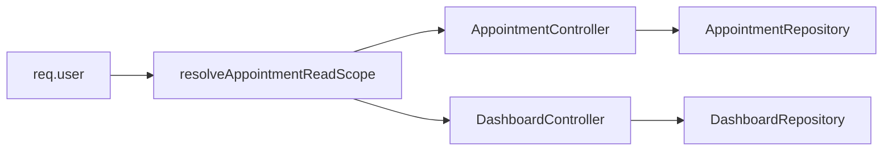

# SchedulerPro — Auditoria geral do roadmap (pós-O6)

**Data da auditoria:** 10/11/2026  
**Tipo:** Somente leitura — nenhum ficheiro de implementação (`server/`, `client/`) foi alterado nesta tarefa.  
**Objectivo:** Confirmar o estado real de `develop` após O6 e fundamentar o roadmap futuro com evidências no código e nos testes.

**Legenda de estados:**

| Estado | Significado |
|--------|-------------|
| **CONCLUÍDO** | Comportamento presente e coberto por evidência no código e/ou testes. |
| **PARCIALMENTE IMPLEMENTADO** | Parte do escopo existe; lacunas documentadas. |
| **NÃO IMPLEMENTADO** | Ausente ou stub vazio. |
| **NECESSITA VALIDAÇÃO** | Evidência indirecta ou requer execução manual/CI para confirmar. |
| **NÃO APLICÁVEL** | Fora do escopo actual do produto. |

Factos comprovados citam ficheiros no repositório. Secções marcadas como **Recomendação** ou **Hipótese** não são garantias de comportamento em produção.

---

## 1. Estado do Git no início da auditoria

| Item | Valor |
|------|--------|
| Branch | `develop` |
| HEAD | `970d85095feef762fbd70fe652ffc9a94c8e128a` |
| Mensagem HEAD | Merge pull request #135 — `feature/o6-appointment-visibility-by-role` |
| Tracking | `develop...origin/develop` |
| Staged / unstaged / untracked | **Nenhum** (`git status --porcelain` vazio) |
| Divergência vs `develop` | **Nenhuma** (auditoria já em `develop`) |

**Conclusão:** base representativa de `develop` pós-O6; ausência de alterações locais que distorçam a análise.

**Operações Git de escrita:** não executadas (commit, push, pull, merge, reset, checkout, etc.).

---

## 2. Resumo executivo

O SchedulerPro em `develop` @ `970d850` integra o dashboard operacional (O1, O2, O5) e a visibilidade de leitura de agendamentos por perfil (O6), mergeados via PR #135. A arquitetura mantém separação Controller → Service → Repository, multi-tenant por `req.user.companyId`, e autorização por permissões (`hasPermission`) e roles (`authorize`).

**Dashboard:** KPI de clientes ativos, distribuição por estado e refresh ao regressar à aba (45 s de throttle, proteção por geração de carga e aviso em falha) estão implementados no backend e no frontend com testes dedicados.

**O6:** Escopo de leitura centralizado em `resolveAppointmentReadScope`; EMPLOYEE vê apenas agendamentos com `employeeId === userId`; dashboard filtra agregações pelo mesmo critério; `activeClientsCount` omitido para EMPLOYEE na API e oculto na UI. A expiração automática de `scheduled` vencidos continua acoplada a listagens de empresa inteira e deixa de correr em listagens de EMPLOYEE e CLIENT.

**Lacunas prioritárias para o roadmap:**

1. **Escrita de agendamentos:** O6 não restringe mutações; EMPLOYEE com `APPOINTMENT_UPDATE` pode, em teoria, alterar agendamentos de colegas se souber o ID (leitura escopada, escrita não).
2. **Expiração:** `scheduled` vencidos atribuídos a EMPLOYEE podem persistir até uma acção com escopo de empresa ou um job futuro.
3. **Company Management:** backend maduro (incl. activate/deactivate, logo); UI sem soft-delete de empresa; `CompanyService.create()` vazio (registo só via auth).
4. **Testes:** integração HTTP dominada por mocks; Mongo em memória limitado a cenários de concorrência (GW); sem E2E browser.

A sequência de roadmap proposta pelo produto permanece válida, com **ajuste recomendado**: subir **expiração automática (job)** e **RBAC de escrita em appointments** para prioridade alta, antes de polish de timezone e E2E.

---

## 3. Estado confirmado: O1, O2, O5 e O6

### 3.1 O1 — KPI clientes ativos

| Aspecto | Estado | Evidência |
|---------|--------|-----------|
| Cálculo backend | **CONCLUÍDO** | `DashboardRepository.countActiveClients` — `Client.countDocuments` com `companyId`, `deletedAt: null`, `isActive: true` ([`server/src/modules/dashboard/repositories/DashboardRepository.ts`](../../server/src/modules/dashboard/repositories/DashboardRepository.ts)) |
| Contrato API | **CONCLUÍDO** | `DashboardSummary.activeClientsCount?: number` ([`server/src/modules/dashboard/index.ts`](../../server/src/modules/dashboard/index.ts)); preenchido em `DashboardService.getSummary` excepto escopo EMPLOYEE |
| UI | **CONCLUÍDO** | Card «Clientes ativos» em [`client/src/pages/dashboard/DashboardPage.tsx`](../../client/src/pages/dashboard/DashboardPage.tsx); `showActiveClientsKpi = role !== "EMPLOYEE"` (O6) |
| O6 EMPLOYEE | **CONCLUÍDO** | API omite campo; UI não renderiza card |
| Testes | **CONCLUÍDO** | `server/tests/unit/dashboard/DashboardService.test.ts`; `server/tests/integration/routes/dashboard.routes.test.ts`; bloco «active clients KPI» em `client/src/pages/dashboard/DashboardPage.test.tsx` |

### 3.2 O2 — Distribuição de agendamentos por estado

| Aspecto | Estado | Evidência |
|---------|--------|-----------|
| Agregação backend | **CONCLUÍDO** | `findStatusCounts` → `period.byStatus` + `period.total` ([`DashboardService.ts`](../../server/src/modules/dashboard/services/DashboardService.ts)) |
| UI | **CONCLUÍDO** | [`client/src/pages/dashboard/DashboardStatusDistribution.tsx`](../../client/src/pages/dashboard/DashboardStatusDistribution.tsx); ordem fixa dos 5 estados |
| Estados sem resultados | **CONCLUÍDO** | `buildByStatus` inicializa contadores a 0; `statusDistributionBarWidthPercent` devolve 0% se `total <= 0` |
| Testes | **CONCLUÍDO** | `DashboardPage.test.tsx` (bloco distribuição); `DashboardService.test.ts` |

### 3.3 O5 — Atualização automática do Dashboard

| Aspecto | Estado | Evidência |
|---------|--------|-----------|
| Evento visibility | **CONCLUÍDO** | [`client/src/hooks/useDashboardVisibilityRefresh.ts`](../../client/src/hooks/useDashboardVisibilityRefresh.ts) — listener `visibilitychange`, só se `visible` |
| Throttle 45 s | **CONCLUÍDO** | `DASHBOARD_AUTO_REFRESH_MIN_MS = 45_000` em [`client/src/config/dashboardRefresh.ts`](../../client/src/config/dashboardRefresh.ts); `shouldRunVisibilityRefresh` |
| Erros no refresh | **CONCLUÍDO** | `refreshDashboard` define `DASHBOARD_REFRESH_WARNING_MESSAGE` sem substituir summary em falha ([`DashboardPage.tsx`](../../client/src/pages/dashboard/DashboardPage.tsx) ~212–251) |
| Respostas desatualizadas | **CONCLUÍDO** | `loadGenerationRef` em `loadAll` e `refreshDashboard` |
| Testes | **CONCLUÍDO** | `client/src/hooks/useDashboardVisibilityRefresh.test.ts`; casos O5 em `DashboardPage.test.tsx` |
| Instabilidade | **NECESSITA VALIDAÇÃO** | [`docs/tasks/o6-appointment-visibility-by-role.md`](../tasks/o6-appointment-visibility-by-role.md) referencia falha intermitente do teste «waits for the full 45 second throttle» na suite completa; **não reexecutado** nesta auditoria |

### 3.4 O6 — Visibilidade de agendamentos por perfil

| Aspecto | Estado | Evidência |
|---------|--------|-----------|
| Escopo central | **CONCLUÍDO** | [`server/src/modules/appointments/utils/appointment-read-scope.ts`](../../server/src/modules/appointments/utils/appointment-read-scope.ts) — `resolveAppointmentReadScope`, `isCompanyWideAppointmentReadScope`, `toAppointmentListScope` |
| Isolamento `companyId` | **CONCLUÍDO** | Controllers usam `req.user.companyId`; testes ignoram `companyId` em query |
| EMPLOYEE / `employeeId` | **CONCLUÍDO** | `employeeId = userId`; `findByCompanyId` / `findByIdInCompany` aplicam filtro Mongo |
| CLIENT | **CONCLUÍDO** | `clientId` na sessão; `/appointments/mine` inalterado em intenção |
| KPI `activeClientsCount` EMPLOYEE | **CONCLUÍDO** | Ver O1 |
| Consulta por ID | **CONCLUÍDO** | Colega → 404 (`findByIdInCompany`) — [`appointment-visibility.routes.test.ts`](../../server/tests/integration/routes/appointment-visibility.routes.test.ts) |
| Expiração em listagem | **CONCLUÍDO** | `expireOverdueScheduled` só se `isCompanyWideAppointmentReadScope` ([`AppointmentService.findAll`](../../server/src/modules/appointments/services/AppointmentService.ts)) |
| Escrita (fora O6) | **PARCIAL** | Mutations não usam read scope — ver secção 6 |
| Testes / doc | **CONCLUÍDO** | 17 testes integração O6; `appointment-read-scope.test.ts`; [`docs/tasks/o6-appointment-visibility-by-role.md`](../tasks/o6-appointment-visibility-by-role.md) |

---

## 4. Análise detalhada: próximas funcionalidades

### 4.A Company Management

**Estado global:** **PARCIALMENTE IMPLEMENTADO** (backend maduro; produto/UI com lacunas).

| Área | Estado | Evidência / notas |
|------|--------|-------------------|
| Modelo `Company` | **CONCLUÍDO** | `name`, `timezone`, `isActive`, `logo`, `deletedAt` — [`Company.model.ts`](../../server/src/modules/companies/models/Company.model.ts) |
| Relação User | **CONCLUÍDO** | `User.companyId`; tenant na sessão |
| Criação empresa | **PARCIAL** | Via `POST /auth/register` (não `POST /companies`); [`CompanyService.create()`](../../server/src/modules/companies/services/CompanyService.ts) **vazio** (L79) |
| Atualização dados | **CONCLUÍDO** | `PATCH /companies/:id`; UI [`CompanyPage.tsx`](../../client/src/pages/company/CompanyPage.tsx) |
| Activate / deactivate | **CONCLUÍDO** | Rotas + modais na `CompanyPage`; `companyPermissions` (OWNER) |
| Soft-delete empresa | **PARCIAL** | `DELETE /companies/:id` no backend; **sem** `deleteCompany` no client (ausência de UI) |
| Logo | **CONCLUÍDO** | `POST/DELETE .../logo`; testes `company-logo.routes.test.ts` |
| Link booking público | **CONCLUÍDO** | Exposto na `CompanyPage` (auditorias anteriores; confirmado em testes `CompanyPage.test.tsx`) |
| Membros / multi-empresa | **NÃO APLICÁVEL** | Gestão de equipa via módulo Users; um tenant por sessão |
| Dados fiscais/comerciais | **NÃO IMPLEMENTADO** | Schema mínimo |
| Permissões | **CONCLUÍDO** | OWNER/ADMIN: read/update; lifecycle activate/deactivate: OWNER — [`companyPermissions.ts`](../../client/src/config/companyPermissions.ts) espelha [`rbac.ts`](../../server/src/constants/rbac.ts) |
| Testes | **PARCIAL** | Unit lifecycle/isolation; `CompanyPage.test.tsx`; pouca integração HTTP com Mongo real |

**Não confundir:** registo inicial (auth) ≠ painel de gestão completa; o segundo está **largamente** disponível para OWNER/ADMIN, excepto eliminação soft-delete na UI.

Documentação histórica: [`docs/reports/schedulerpro-companies-management-audit.md`](../reports/schedulerpro-companies-management-audit.md) (@ HEAD antigo) afirmava ausência de UI activate/deactivate — **desactualizado** face ao código actual.

### 4.B Fuso horário dinâmico

**Estado global:** **PARCIALMENTE IMPLEMENTADO** (IANA dinâmico por empresa; fallbacks fixos).

| Área | Estado | Evidência |
|------|--------|-----------|
| Campo `company.timezone` | **CONCLUÍDO** | Modelo + validação IANA |
| Backend | **CONCLUÍDO** | [`server/src/utils/timezone.ts`](../../server/src/utils/timezone.ts) — `DEFAULT_TIMEZONE = "Europe/Lisbon"`, `resolveCompanyTimezone` |
| Sessão / auth | **CONCLUÍDO** | `companyTimezone` no utilizador autenticado |
| Frontend agenda/dashboard/relatórios | **CONCLUÍDO** | `selectCompanyTimezone` (Redux `companySlice`) em páginas e calendários |
| Registo | **CONCLUÍDO** | `TimezonePicker` / `getDefaultTimezone()` em [`RegisterPage.tsx`](../../client/src/pages/RegisterPage.tsx) |
| `Europe/Lisbon` fixo | **PARCIAL** | Default legítimo; abundante em **testes** e fallbacks — não implica runtime fixo para tenants configurados |
| Armazenamento agendamentos | **CONCLUÍDO** | Instantes UTC; listagens com janela convertida no cliente |
| DST / mudança TZ com dados | **NECESSITA VALIDAÇÃO** | Sem bateria dedicada de regressão pós-`PATCH timezone` |
| Testes | **CONCLUÍDO** | `timezone.test.ts`, `AvailabilityService.timezone.test.ts`, `CompanyPage.test.tsx` |

**Recomendação:** inventário de fallbacks + testes de alteração de timezone após agendamentos existentes; não classificar o produto como «timezone fixo».

### 4.C RBAC

**Estado global:** **PARCIALMENTE IMPLEMENTADO** (matriz coerente; lacuna de escopo em escrita pós-O6).

| Área | Estado | Evidência |
|------|--------|-----------|
| Definições | **CONCLUÍDO** | [`server/src/constants/permissions.ts`](../../server/src/constants/permissions.ts), [`server/src/constants/rbac.ts`](../../server/src/constants/rbac.ts) |
| Middlewares | **CONCLUÍDO** | `hasPermission`, `authorize`, auth, operational company |
| Rotas protegidas | **CONCLUÍDO** | Padrão repetido em módulos (appointments, dashboard, reports, companies) |
| Frontend espelho | **CONCLUÍDO** | `client/src/config/*Permissions.ts` + testes por ficheiro |
| Relatórios | **CONCLUÍDO** | `authorize(OWNER, ADMIN, MANAGER)` — EMPLOYEE 403 ([`ReportRoutes.ts`](../../server/src/modules/reports/routes/ReportRoutes.ts), teste O6) |
| MANAGER vs EMPLOYEE | **CONCLUÍDO** | MANAGER: relatórios, mais permissões de cliente/serviço; EMPLOYEE: read-heavy, sem company, sem relatórios |
| Leitura appointments O6 | **CONCLUÍDO** | Escopo independente de RBAC de permissão (camada extra) |

**Facto crítico (pós-O6):**

| Item | Estado | Detalhe |
|------|--------|---------|
| `APPOINTMENT_UPDATE` para EMPLOYEE | **CONCLUÍDO** (RBAC) | [`rbac.ts`](../../server/src/constants/rbac.ts) L96 |
| Escopo em `AppointmentService.update` | **NÃO IMPLEMENTADO** | `findById` + `companyId` apenas (~L830) — sem `employeeId` |
| Risco | **Hipótese** | EMPLOYEE poderia PATCH agendamento de colega conhecendo UUID; leitura devolveria 404 |

**Recomendação:** alinhar mutações ao `AppointmentReadScope` ou restringir endpoints de estado a perfis com escopo empresa.

### 4.D Expiração automática de agendamentos

**Estado global:** **PARCIALMENTE IMPLEMENTADO** (lógica existe; acoplamento e gap EMPLOYEE).

| Aspecto | Estado | Evidência |
|---------|--------|-----------|
| Implementação | **CONCLUÍDO** | `AppointmentRepository.cancelOverdueScheduled` — `updateMany`, `scheduled`, `startAt < now` |
| Onde corre | **CONCLUÍDO** | `AppointmentService.findAll` se escopo empresa inteira |
| Onde não corre | **CONCLUÍDO** | CLIENT, EMPLOYEE list; dashboard (sem side-effects documentados) |
| Impacto O6 | **CONCLUÍDO** | EMPLOYEE não dispara expiração global |
| Gap dados | **CONCLUÍDO** | Próprios `scheduled` vencidos do EMPLOYEE podem permanecer |

**Alternativas (recomendação técnica):**

| Opção | Vantagens | Riscos |
|-------|-----------|--------|
| Job periódico (cron/worker) company-wide | Desacopla GET; cobre todos os perfis | Operação infra; notificações; idempotência |
| Expiração escopada em `findAll` EMPLOYEE | Mitigação rápida | Side-effect em read; duplica regra |
| Status quo | Sem custo imediato | Inconsistência operacional para EMPLOYEE |

**Recomendação:** job periódico como solução alvo; opcional mitigação escopada para EMPLOYEE até o job existir.

### 4.E Testes E2E com MongoDB real

**Estado global:** **PARCIALMENTE IMPLEMENTADO**.

| Aspecto | Estado | Evidência |
|---------|--------|-----------|
| Framework | **CONCLUÍDO** | Vitest (`server/vitest.config.ts`) |
| Integração HTTP | **CONCLUÍDO** | ~vários ficheiros em `server/tests/integration/` |
| Padrão mocks | **CONCLUÍDO** | `vi.mock` de repositórios + auth injectável (`dashboard.routes.test.ts`, `appointment-visibility.routes.test.ts`, etc.) |
| Mongo real / memória | **PARCIAL** | Dep. `mongodb-memory-server`; uso relevante em [`appointment-booking-concurrency.test.ts`](../../server/tests/integration/appointments/appointment-booking-concurrency.test.ts) (ReplSet + transacções) |
| Env teste | **CONCLUÍDO** | [`server/tests/setup.ts`](../../server/tests/setup.ts) — URI placeholder, secrets sintéticos |
| Multi-tenant E2E | **NÃO IMPLEMENTADO** | O6 valida **argumentos** de mock, não queries contra BD |
| Browser E2E | **NÃO IMPLEMENTADO** | Sem Playwright/Cypress no repo |
| Produção / Atlas | **NÃO APLICÁVEL** | Não utilizado nesta auditoria |

**Recomendação:** poucos testes de alto valor com MongoMemoryReplSet: isolamento `companyId` + filtro EMPLOYEE `employeeId`; evitar suite E2E browser até prioridade de produto.

---

## 5. Outras pendências identificadas

| Item | Categoria | Estado |
|------|-----------|--------|
| Escrita appointments EMPLOYEE sem escopo | Correção / segurança | **PARCIAL** |
| Expiração `scheduled` para EMPLOYEE | Melhoria técnica / produto | **PARCIAL** |
| UI soft-delete empresa | Funcionalidade produto | **NÃO IMPLEMENTADO** |
| `CompanyService.create` | Débito / desenho | **NÃO IMPLEMENTADO** (by design: auth) |
| GW-3 booking transaction retry | Infra reservas | **CONCLUÍDO** (docs `docs/tasks/gw3-*`; não re-auditado linha a linha) |
| O5 teste throttle flaky | Débito testes | **NECESSITA VALIDAÇÃO** |
| Stage 99 entrevista Mid-Level | Ideia / processo | **NECESSITA VALIDAÇÃO** (sem artefacto no repo) |
| Dupla query dashboard período (O3 histórico) | Débito performance | **NECESSITA VALIDAÇÃO** (mencionado em auditorias dashboard; não confirmado nesta passagem) |

---

## 6. Riscos técnicos e dependências

| Risco | Severidade | Dependência |
|-------|------------|-------------|
| IDOR escrita appointments (EMPLOYEE) | Alta | RBAC review + O6 follow-up |
| `scheduled` vencidos persistentes (EMPLOYEE) | Média | Job expiração ou escopo read |
| Testes integração não provam Mongo | Média | E2E Mongo |
| Mudança timezone com histórico | Baixa–média | Testes regressão TZ |
| Flaky O5 em CI | Baixa | Estabilizar fake timers / timeout |
| Documentação companies desactualizada | Baixa | Actualizar relatório antigo quando conveniente |

---

## 7. Roadmap atualizado e priorizado

### 7.1 Sequência proposta (utilizador)

1. Company Management  
2. Fuso horário dinâmico  
3. Revisão RBAC  
4. Expiração automática  
5. Testes E2E MongoDB  
6. Stage 99 — Preparação entrevista  

### 7.2 Sequência recomendada (pós-auditoria)

| Prio | Item | Justificação |
|------|------|----------------|
| **P1** | Company Management (fechar UI delete + doc) | Produto visível; API já existe |
| **P1–P2** | Expiração automática (job) | Gap pós-O6 + acoplamento a GET |
| **P2** | RBAC escrita appointments (alinhamento O6) | Fecha risco IDOR com permissão existente |
| **P2** | Fuso horário (hardening + testes mudança TZ) | Já dinâmico; reduz risco edge |
| **P3** | Testes E2E Mongo multi-tenant | Confiança isolamento; custo CI |
| **P4** | Stage 99 | Independente do código |

O1, O2, O5, O6: **manutenção apenas** — **CONCLUÍDOS** no âmbito actual.

### 7.3 Mapa resumido entregas dashboard/O6

| ID | Estado |
|----|--------|
| O1 | **CONCLUÍDO** |
| O2 | **CONCLUÍDO** |
| O5 | **CONCLUÍDO** (teste throttle: **NECESSITA VALIDAÇÃO**) |
| O6 | **CONCLUÍDO** |

---

## 8. Ficheiros e evidências (índice)

### Dashboard O1 / O2 / O5

- [`server/src/modules/dashboard/repositories/DashboardRepository.ts`](../../server/src/modules/dashboard/repositories/DashboardRepository.ts)
- [`server/src/modules/dashboard/services/DashboardService.ts`](../../server/src/modules/dashboard/services/DashboardService.ts)
- [`client/src/pages/dashboard/DashboardPage.tsx`](../../client/src/pages/dashboard/DashboardPage.tsx)
- [`client/src/pages/dashboard/DashboardStatusDistribution.tsx`](../../client/src/pages/dashboard/DashboardStatusDistribution.tsx)
- [`client/src/hooks/useDashboardVisibilityRefresh.ts`](../../client/src/hooks/useDashboardVisibilityRefresh.ts)
- [`client/src/config/dashboardRefresh.ts`](../../client/src/config/dashboardRefresh.ts)

### O6

- [`server/src/modules/appointments/utils/appointment-read-scope.ts`](../../server/src/modules/appointments/utils/appointment-read-scope.ts)
- [`server/src/modules/appointments/repositories/AppointmentRepository.ts`](../../server/src/modules/appointments/repositories/AppointmentRepository.ts) (`findByIdInCompany`)
- [`server/src/modules/appointments/services/AppointmentService.ts`](../../server/src/modules/appointments/services/AppointmentService.ts)
- [`server/tests/integration/routes/appointment-visibility.routes.test.ts`](../../server/tests/integration/routes/appointment-visibility.routes.test.ts)

### Company / RBAC / timezone

- [`server/src/modules/companies/routes/CompanyRoutes.ts`](../../server/src/modules/companies/routes/CompanyRoutes.ts)
- [`client/src/pages/company/CompanyPage.tsx`](../../client/src/pages/company/CompanyPage.tsx)
- [`server/src/constants/rbac.ts`](../../server/src/constants/rbac.ts)
- [`server/src/utils/timezone.ts`](../../server/src/utils/timezone.ts)

### Testes / infra

- [`server/vitest.config.ts`](../../server/vitest.config.ts)
- [`server/tests/setup.ts`](../../server/tests/setup.ts)
- [`server/tests/integration/appointments/appointment-booking-concurrency.test.ts`](../../server/tests/integration/appointments/appointment-booking-concurrency.test.ts)

### Documentação relacionada

- [`docs/tasks/o6-appointment-visibility-by-role.md`](../tasks/o6-appointment-visibility-by-role.md)
- [`docs/audits/appointment-visibility-by-role-audit.md`](appointment-visibility-by-role-audit.md)
- [`docs/reports/schedulerpro-companies-management-audit.md`](../reports/schedulerpro-companies-management-audit.md) (histórico; parcialmente desactualizado na UI lifecycle)

---

## 9. Limites desta auditoria

- Nenhum teste foi executado durante a redacção deste relatório (análise estática + Git read-only na data indicada).
- Não foi analisado ambiente de produção, Atlas, nem CI remota.
- Não foram implementadas correcções nem funcionalidades novas.

**Próximo passo sugerido (fora desta tarefa):** revisão conjunta deste documento e decisão de desenvolvimento conforme secção 7.2.
