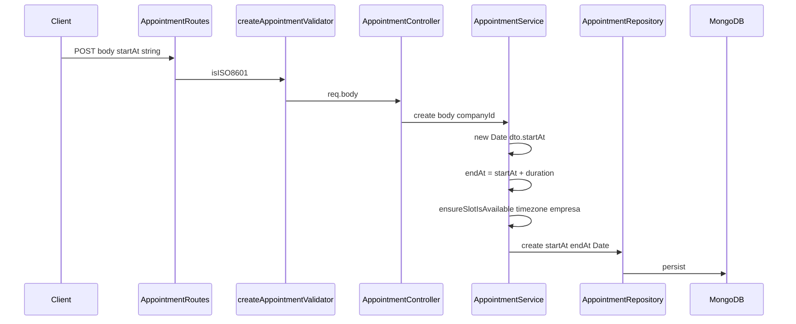

# Stage 36 — Parte 4: Auditoria do contrato de datas da API (autenticado)

Data da auditoria: 14/10/2026. Tipo: **somente leitura** — nenhum ficheiro de produção, testes ou `docs/api-contract.md` foi alterado.

## 1. Resumo executivo

- Nos endpoints **autenticados** de agendamento (`POST` / `PATCH /api/appointments`), `startAt` é validado apenas com `express-validator` **`isISO8601()`**, sem exigir `Z` nem offset explícito.
- Após a validação, o valor é convertido com **`new Date(string)`** (ECMAScript) em [`AppointmentService.ts`](../../server/src/modules/appointments/services/AppointmentService.ts) e em [`AppointmentController.ts`](../../server/src/modules/appointments/controllers/AppointmentController.ts) (filtros de listagem). **Não** há reinterpretação pelo `company.timezone` no body.
- Os fluxos **públicos** de criação/atualização de agendamento exigem offset explícito (`HAS_TIMEZONE_OFFSET`), alinhados com [`docs/api-contract.md`](../../docs/api-contract.md).
- O **frontend oficial** (Parte 3) envia `startAt` como instante UTC com sufixo `Z` via `toIsoUtc`.
- **Risco (R4, Stage 35):** clientes externos que enviem `2026-10-20T09:00:00` sem offset podem obter instantes diferentes conforme o `TZ` do processo Node.js, embora o validador aceite o valor.
- **Recomendação técnica (não implementada):** **Opção A** — alinhar o contrato autenticado ao público, exigindo instante explícito (`Z` ou `±HH:MM`), e manter **Opção C** para datas civis/`HH:mm` locais nos endpoints já separados (disponibilidade, exceções, slots).

## 2. Ficheiros inspecionados

| Área | Ficheiros |
|------|-----------|
| Validators autenticados | [`create-appointment.validator.ts`](../../server/src/modules/appointments/validators/create-appointment.validator.ts), [`update-appointment.validator.ts`](../../server/src/modules/appointments/validators/update-appointment.validator.ts), [`list-appointments.validator.ts`](../../server/src/modules/appointments/validators/list-appointments.validator.ts) |
| Validators públicos (comparação) | [`create-public-appointment.validator.ts`](../../server/src/modules/appointments/validators/create-public-appointment.validator.ts), [`update-public-appointment.validator.ts`](../../server/src/modules/appointments/validators/update-public-appointment.validator.ts) |
| Disponibilidade / booking | [`public-availability.validator.ts`](../../server/src/modules/public-booking/validators/public-availability.validator.ts), [`create-availability-exception.validator.ts`](../../server/src/modules/availability/validators/create-availability-exception.validator.ts) |
| Relatórios | [`list-reports.validator.ts`](../../server/src/modules/reports/validators/list-reports.validator.ts), [`ReportController.ts`](../../server/src/modules/reports/controllers/ReportController.ts) |
| Rotas | [`AppointmentRoutes.ts`](../../server/src/modules/appointments/routes/AppointmentRoutes.ts), [`PublicAppointmentRoutes.ts`](../../server/src/modules/appointments/routes/PublicAppointmentRoutes.ts) |
| Controller | [`AppointmentController.ts`](../../server/src/modules/appointments/controllers/AppointmentController.ts) |
| Service | [`AppointmentService.ts`](../../server/src/modules/appointments/services/AppointmentService.ts) |
| Persistência | [`AppointmentRepository.ts`](../../server/src/modules/appointments/repositories/AppointmentRepository.ts), [`Appointment.model.ts`](../../server/src/modules/appointments/models/Appointment.model.ts) |
| DTOs | [`CreateAppointment.dto.ts`](../../server/src/modules/appointments/dto/CreateAppointment.dto.ts), [`UpdateAppointment.dto.ts`](../../server/src/modules/appointments/dto/UpdateAppointment.dto.ts), DTOs públicos |
| Documentação | [`docs/api-contract.md`](../../docs/api-contract.md) |
| Frontend (consumidor) | [`client/src/config/appointmentTime.ts`](../../client/src/config/appointmentTime.ts), [`AppointmentForm.tsx`](../../client/src/components/appointments/AppointmentForm.tsx), [`appointments.api.ts`](../../client/src/api/endpoints/appointments.api.ts) |
| Testes | [`availability-appointment.routes.test.ts`](../../server/tests/integration/availability-appointment.routes.test.ts), [`public-appointment.routes.test.ts`](../../server/tests/integration/public-appointment.routes.test.ts), testes unitários de `AppointmentService` |

## 3. Percurso real de `startAt` e `endAt` (autenticado)

### 3.1 Criação (`POST /api/appointments`)

1. [`AppointmentRoutes.ts`](../../server/src/modules/appointments/routes/AppointmentRoutes.ts) L36-43: `createAppointmentValidator` → `validateRequest` → `AppointmentController.create`.
2. [`create-appointment.validator.ts`](../../server/src/modules/appointments/validators/create-appointment.validator.ts) L35-38: `startAt` obrigatório, `isISO8601()` apenas.
3. [`AppointmentController.create`](../../server/src/modules/appointments/controllers/AppointmentController.ts) L31-36: passa `req.body` ao service (tipagem em runtime é string ISO).
4. [`AppointmentService.create`](../../server/src/modules/appointments/services/AppointmentService.ts) L408-415: `startAt: new Date(dto.startAt)` dentro de `schedule()`.
5. `schedule()` L250-252: `endAt` calculado; **não** aceite do cliente. Comentário L67-68 confirma que `endAt` nunca entra no input de agendamento.
6. Disponibilidade/conflitos usam instantes `Date` já resolvidos + `company.timezone` apenas para regras locais (via `AvailabilityService`), não para re-parse do body.

### 3.2 Atualização (`PATCH /api/appointments/:id`)

- [`update-appointment.validator.ts`](../../server/src/modules/appointments/validators/update-appointment.validator.ts) L32-35: `startAt` opcional, `isISO8601()`.
- [`AppointmentService.update`](../../server/src/modules/appointments/services/AppointmentService.ts) ~L809-810: `startAt = new Date(dto.startAt)`; `endAt` recalculado (~L839).

### 3.3 Listagem (`GET /api/appointments`, portal `findMine`)

- Query `startAt` / `endAt`: [`list-appointments.validator.ts`](../../server/src/modules/appointments/validators/list-appointments.validator.ts) — `isISO8601` + ordem via `Date.parse`.
- Controller L57-65 / L101-109: `new Date(startAt)` / `new Date(endAt)`.
- Repository L109-114: filtro por sobreposição de intervalos em instantes MongoDB.

### 3.4 `endAt` no body autenticado

- Não consta nos validators de create/update autenticados; o modelo e o service tratam `endAt` como derivado da duração do serviço.

## 4. Comportamento por formato de entrada

Legenda: **Val** = `createAppointmentValidator` / `update` equivalente; **Parse** = `new Date(value)` no Node (auditoria empírica, 14/10/2026).

| # | Exemplo | Val autenticado (`isISO8601`) | Parse → UTC (evidência) | Depende de `TZ`? | Notas |
|---|---------|-------------------------------|-------------------------|------------------|-------|
| 1 | `2026-10-20T09:00:00Z` | Passa (script `express-validator`) | `2026-10-20T09:00:00.000Z` | Não | Contrato desejado; usado em integração autenticada |
| 2 | `2026-10-20T09:00:00+01:00` | Passa | `2026-10-20T08:00:00.000Z` | Não | Instante unívoco |
| 3 | `2026-10-20T09:00:00-03:00` | Passa | `2026-10-20T12:00:00.000Z` | Não | Instante unívoco |
| 4 | `2026-10-20T09:00:00` (sem offset) | **Passa** | Ver matriz TZ abaixo | **Sim** | Público: **rejeitado** (`HAS_TIMEZONE_OFFSET`) |
| 5 | `2026-10-20` (só data) | **Passa** | `2026-10-20T00:00:00.000Z` (meia-noite UTC) | Não para esta forma | Interpretado como UTC midnight em ECMAScript |
| 6 | `not-a-date` | Falha | `Invalid Date` | — | Integração autenticada: 400 com `not-a-date` ([`availability-appointment.routes.test.ts`](../../server/tests/integration/availability-appointment.routes.test.ts) L208) |
| 6b | `2026-02-30` | **Passa** `isISO8601` | `2026-03-02T09:00:00.000Z` com `Z` suffix test; data só `2026-02-30` passa validador | — | **Lacuna:** dia impossível aceite pelo validador; normalização ECMAScript |
| 7 | Meia-noite local / mudança de dia | Passa se ISO válido | Instante absoluto após parse | Só se sem offset | Regras de “mesmo dia” no service usam timezone **da empresa** **depois** do instante definido |
| 8 | DST (hora inexistente/ambígua) | Sem regra específica no validator autenticado | `new Date` / ECMAScript | Com offset explícito: instante definido; sem offset: ambíguo | Agendamento autenticado **não** replica validação Luxon do fluxo público |
| 9 | Mesmo payload, vários `TZ` | Igual | Só relevante para **sem offset** | **Sim** | Ver tabela seguinte |

### 4.1 Matriz `TZ` — cenário 4 (`2026-10-20T09:00:00` sem offset)

Execução read-only com `node -e` (não commitada), ambiente de auditoria Windows/Git Bash:

| `TZ` | `new Date('2026-10-20T09:00:00').toISOString()` observado |
|------|-----------------------------------------------------------|
| `UTC` | `2026-10-20T09:00:00.000Z` |
| `Europe/Lisbon` | `2026-10-20T08:00:00.000Z` |
| `Pacific/Auckland` | **Não aplicado** neste host (`Intl` continuou `Europe/Lisbon`); repetir em Linux/CI |

**Conclusão:** para strings **sem offset**, o instante persistido **pode** variar com o timezone do processo. Com `Z` ou offset numérico, o resultado foi estável nos testes executados.

### 4.2 Fluxo público (referência)

- [`create-public-appointment.validator.ts`](../../server/src/modules/appointments/validators/create-public-appointment.validator.ts) L15-16 documenta o motivo; L76-87 exige `HAS_TIMEZONE_OFFSET`.
- Teste de integração: `startAt sem fuso horário` → 400 ([`public-appointment.routes.test.ts`](../../server/tests/integration/public-appointment.routes.test.ts)).

### 4.3 Endpoints com contrato de **data civil** (Opção C parcial)

| Endpoint | Campo | Formato | Timezone empresa |
|----------|-------|---------|------------------|
| `GET .../availability?date=` | `date` | `AAAA-MM-DD` | Usado no service ao construir slots (Parte 2) |
| Exceções de disponibilidade | `date`, `startTime`/`endTime` | Data + `HH:mm` locais | Conversão local→UTC no service |
| Listagem agendamentos / relatórios | `startAt`/`endAt` query | ISO instante (validador fraco) | Não reinterpreta query como hora local da empresa |

## 5. Documentação vs implementação

| Tema | `docs/api-contract.md` | Implementação autenticada |
|------|------------------------|---------------------------|
| POST `/api/appointments` | L377: “startAt ISO 8601”; exemplo com `.000Z` (L390) | Validator: qualquer ISO8601; **não** exige `Z` |
| PATCH autenticado | L406-407: startAt opcional, ISO | Idem |
| POST público | L441-442: **explicit offset** | `HAS_TIMEZONE_OFFSET` + testes |
| GET listagens | Comentários em validators: “instantes UTC” | `isISO8601` sem exigir `Z` |
| Relatórios | Intervalo em instantes (via doc de módulo) | `new Date(query)` |

**Gap principal:** a documentação **sugere** UTC (`Z` nos exemplos) mas o validador autenticado **não** impõe offset, ao contrário do fluxo público documentado e implementado.

**Frontend:** [`appointmentTime.ts`](../../client/src/config/appointmentTime.ts) L16-18 declara payload em UTC; `toIsoUtc` produz string com `Z`. Comentário L10-14 sobre ausência de `companyTimezone` no Redux está **desatualizado** face à Parte 3 (`selectCompanyTimezone` + sessão) — irrelevante para o parse no backend, mas útil para quem lê só o client.

## 6. Testes existentes e lacunas

### 6.1 Cobertura existente

| Área | Evidência |
|------|-----------|
| POST autenticado com `Z` | [`availability-appointment.routes.test.ts`](../../server/tests/integration/availability-appointment.routes.test.ts) `validAppointment.startAt: "...Z"` |
| POST autenticado `not-a-date` | Mesmo ficheiro L208 → 400 |
| PATCH passado | `startAt` no passado → 400 (L287-294) |
| Query listagem | Filtros com `Z`; rejeita `not-a-date` e ordem invertida (L337-354) |
| Público sem offset | [`public-appointment.routes.test.ts`](../../server/tests/integration/public-appointment.routes.test.ts) |
| Service unitário | Payloads com ISO terminado em `Z` |

### 6.2 Lacunas

- **Nenhum** teste de integração autenticado com `startAt` **sem** offset nem matriz `TZ` no CI.
- **Nenhum** ficheiro unitário dedicado a `create-appointment.validator` / `update-appointment.validator`.
- **`isISO8601` aceita `2026-02-30`** (observado em script local) — sem teste que documente o comportamento indesejado.
- Independência de `TZ` do processo: Stage 35 referiu suite server com `TZ=Pacific/Auckland`; **não** há teste que fixe `TZ` e envie offsetless ao POST autenticado.
- DST no body de agendamento autenticado: sem casos dedicados.

### 6.3 Testes recomendados (futura implementação, não executados aqui)

1. Tabela parametrizada no validator autenticado: aceitar/rejeitar strings com e sem offset.
2. Integração `POST /api/appointments` com `TZ=UTC` vs `TZ=Europe/Lisbon` e payload `2026-10-20T09:00:00` — esperar **400** após Opção A, ou instantes distintos **antes** da mudança (regressão documentada).
3. Propriedade: mesmo instante com `Z` e com offset equivalente → mesmo documento MongoDB.
4. Datas futuras fixas (ex. `2027-08-29`) para evitar falhas por “passado” em testes de integração (lição da Parte 2 em public-booking).
5. Luxon/IANA apenas se Opção B for escolhida (horas locais ambíguas).

## 7. Opções A, B e C

### Opção A — Aceitar apenas instantes explícitos (recomendada)

| | |
|--|--|
| **Descrição** | Exigir `Z` ou offset (`±HH:MM`) em `startAt` (e query `startAt`/`endAt` se desejado) nos endpoints autenticados, reutilizando o padrão `HAS_TIMEZONE_OFFSET` do público. |
| **Vantagens** | Contrato unívoco; independente de `TZ` do Node; alinhado com exemplos em `api-contract.md` e com o frontend Parte 3; menor surpresa para integradores. |
| **Riscos** | Breaking change para clientes que enviam hora local sem offset (se existirem). |
| **Frontend** | Compatível (já envia `Z`). |
| **DST** | Offset explícito fixa o instante; sem ambiguidade no body. |

### Opção B — Aceitar hora local da empresa sem offset

| | |
|--|--|
| **Descrição** | Interpretar `2026-10-20T09:00:00` como 09:00 em `resolveCompanyTimezone(company)`. |
| **Vantagens** | Ergonómico para integradores que pensam em “hora da loja”. |
| **Riscos** | Contradiz o modelo atual (`new Date` = instante); exige política DST (hora inexistente/ambígua); mistura semânticas no mesmo campo; duplicidade com Opção C. |
| **Frontend** | Exigiria decidir se continua a enviar UTC ou hora local. |
| **DST** | Obrigatório documentar e testar (rejeitar vs deslocar vs escolher offset). |

### Opção C — Contratos separados (estado atual parcial)

| | |
|--|--|
| **Descrição** | Instantes explícitos para agendamentos; datas/`HH:mm` locais só em availability, exceções, slots públicos. |
| **Vantagens** | Já implementado para disponibilidade; clareza semântica. |
| **Riscos** | POST autenticado ainda admite instante **implícito** via offsetless ISO — buraco na Opção C. |
| **Frontend** | Alinhado se POST usar sempre UTC. |

**Recomendação:** adoptar **Opção A** nos endpoints autenticados de agendamento e **reforçar Opção C** na documentação (sem misturar hora local no campo `startAt` do appointment). **Opção B** só se produto exigir explicitamente hora local no body — não é o modelo atual do código.

## 8. Respostas às perguntas de conclusão

1. **A API aceita datas sem offset?**  
   **Sim**, nos endpoints autenticados de create/update/listagem de agendamentos, se `isISO8601()` passar. **Não** no create/update público de agendamento.

2. **Se aceitar, como são interpretadas?**  
   Via **`new Date(string)`** (ECMAScript). Strings sem offset são tratadas como **hora local do processo** (evidência TZ UTC vs Europe/Lisbon no cenário 4). Strings só-data tornam-se meia-noite **UTC**. Não há uso de `company.timezone` para parse do body.

3. **O resultado depende do timezone do Node.js?**  
   **Sim**, para entradas **sem offset** aceites pelo validador. **Não**, para `Z` ou offset explícito (nos testes executados).

4. **O frontend atual envia instantes explícitos nos fluxos autenticados?**  
   **Sim:** [`AppointmentForm.tsx`](../../client/src/components/appointments/AppointmentForm.tsx) `startAt: toIsoUtc(startAt, timezone)`; listagens usam `.toUTC().toISO()` em [`appointmentCalendar.ts`](../../client/src/config/appointmentCalendar.ts). Testes em [`AppointmentForm.test.tsx`](../../client/src/components/appointments/AppointmentForm.test.tsx) assertam sufixo `Z` em payloads.

5. **Qual o contrato mais seguro e compatível?**  
   **Opção A** + manter separação **Opção C** para datas civis. Compatível com o produto atual e com a Parte 3; endurece apenas o que hoje é ambíguo para terceiros.

6. **Que alterações e testes seriam necessários para implementar?**  
   Ver secção 9 e **CONTEXTO PARA A PRÓXIMA IA**.

## 9. Alterações sugeridas (futura etapa — não feitas nesta auditoria)

| Ficheiro | Alteração sugerida |
|----------|-------------------|
| `create-appointment.validator.ts`, `update-appointment.validator.ts` | Regra `HAS_TIMEZONE_OFFSET` (ou helper partilhado) + mensagem 400 clara |
| `list-appointments.validator.ts`, `list-reports.validator.ts` | Opcional: mesma regra em query params |
| `docs/api-contract.md` | Texto explícito “must include Z or offset” no autenticado; alinhar com público |
| Testes integração | Casos offsetless → 400; matriz `TZ` no CI |
| Testes unitários validators | Tabela de strings aceites/rejeitadas |

**Sem migração de dados:** instantes já guardados permanecem; só o **contrato de entrada** muda.

## 10. Impactos, riscos e limitações da auditoria

- **Compatibilidade:** integrações que enviem ISO local sem offset deixam de funcionar após Opção A (breaking change controlado).
- **R4 (Stage 35):** confirmado no código autenticado.
- **Limitações:** `Pacific/Auckland` não foi aplicado de forma fiável no host Windows da auditoria; cenários 7-8 para agendamento autenticado sem offset não foram exercidos em HTTP real com DST — inferidos de ECMAScript + arquitetura.
- **Não executado:** PATCH autenticado com cada formato da matriz via HTTP; apenas inspeção + script local + testes existentes citados.

## CONTEXTO PARA A PRÓXIMA IA

**Decisão recomendada:** implementar **Opção A** — exigir offset explícito ou `Z` em `startAt` (e considerar o mesmo para query `startAt`/`endAt` em listagens e relatórios) nos endpoints **autenticados**, reutilizando o regex `HAS_TIMEZONE_OFFSET` já usado em [`create-public-appointment.validator.ts`](../../server/src/modules/appointments/validators/create-public-appointment.validator.ts) (extrair para util partilhado, ex. `server/src/utils/iso-instant.ts`, para evitar divergência).

**Evidências-chave:** validators autenticados só com `isISO8601`; service usa `new Date(dto.startAt)`; público já exige offset; frontend Parte 3 envia `Z`; teste público rejeita sem fuso; integração autenticada só testa `Z`.

**Ficheiros a alterar na próxima etapa:**

1. [`server/src/modules/appointments/validators/create-appointment.validator.ts`](../../server/src/modules/appointments/validators/create-appointment.validator.ts)
2. [`server/src/modules/appointments/validators/update-appointment.validator.ts`](../../server/src/modules/appointments/validators/update-appointment.validator.ts)
3. (Opcional) [`list-appointments.validator.ts`](../../server/src/modules/appointments/validators/list-appointments.validator.ts), [`list-reports.validator.ts`](../../server/src/modules/reports/validators/list-reports.validator.ts)
4. [`docs/api-contract.md`](../../docs/api-contract.md) — secção Appointments autenticados
5. Novos/estendidos: `server/tests/integration/availability-appointment.routes.test.ts` ou ficheiro dedicado `appointment-date-contract.test.ts`
6. Atualizar comentário desatualizado em [`client/src/config/appointmentTime.ts`](../../client/src/config/appointmentTime.ts) (opcional, documentação client)

**Critérios de aceitação (implementação):**

- `POST`/`PATCH` autenticado: `2026-10-20T09:00:00` → **400** com mensagem explícita.
- `2026-10-20T09:00:00.000Z` e offsets equivalentes → **201/200** com mesmo instante em MongoDB.
- Teste CI com `TZ=UTC` e `TZ=Europe/Lisbon` provando que payload com `Z` produz o mesmo instante em ambos.
- Nenhuma alteração aos documentos de agendamento existentes na base de dados.
- Manter endpoints de disponibilidade/exceções com contrato **data civil** (Opção C) inalterado.

**Não fazer na mesma etapa:** reinterpretar body com `company.timezone` (Opção B), salvo decisão de produto explícita.
