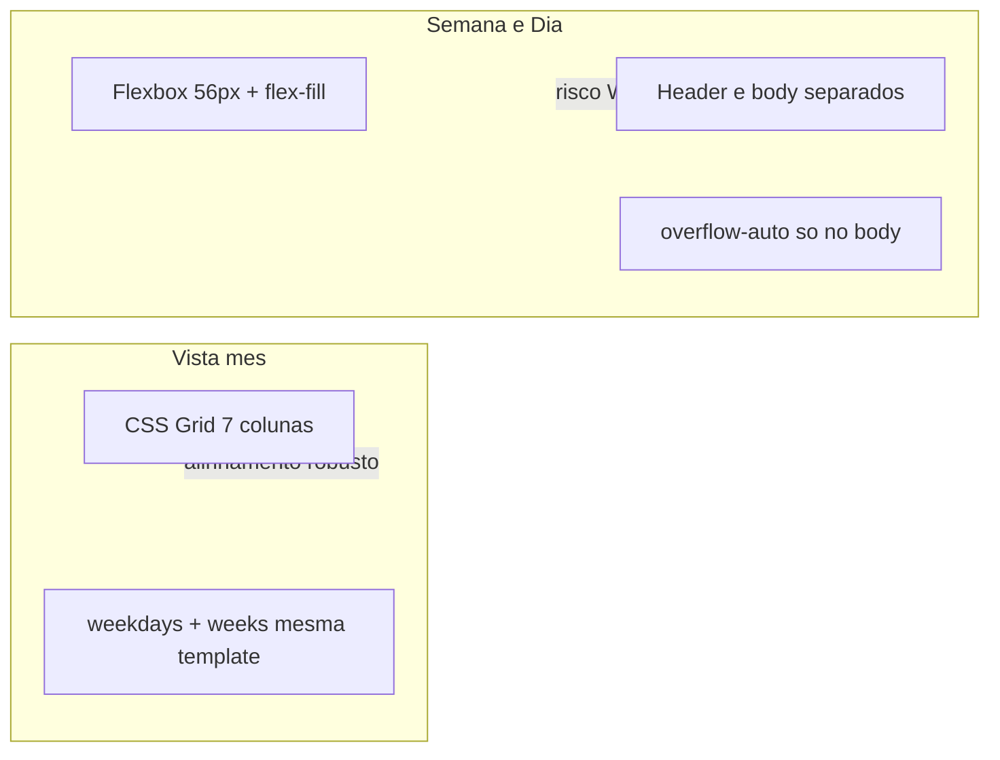

# SchedulerPro — Auditoria visual: alinhamento vistas Semanal e Diária

**Data:** 02/11/2026  
**Tipo:** Análise READ-ONLY (sem alterações de código)  
**Branch de referência:** `feature/ui-company-page-step-4` (ou `develop` — auditoria independente de Git)

**Contexto:** Capturas do utilizador na página Agendamentos — desalinhamento cabeçalho/colunas na **semana**; faixa azul do **dia** a invadir a coluna das horas e a grelha. A vista **mês** está correta e deve ser preservada.

Legenda: **Confirmado (código)** = dedutível do markup/CSS; **Hipótese** = requer confirmação visual/DevTools (scrollbar, zoom, SO).

---

## 1. Componentes envolvidos

| Vista | Componente principal | Composição |
|-------|----------------------|------------|
| **Semana** | [`WeekCalendar.tsx`](../../client/src/components/appointments/WeekCalendar.tsx) | Cabeçalho dos dias (L93–112) + corpo scrollável (L115–230): eixo 56px + 7 colunas `flex-fill`. |
| **Dia** | [`DayCalendar.tsx`](../../client/src/components/appointments/DayCalendar.tsx) | Cabeçalho da data (L97–101) + corpo (L103–201): eixo 56px + coluna `flex-grow-1`. |
| **Mês** | [`MonthView.tsx`](../../client/src/components/appointments/MonthView.tsx) → [`MonthCalendar.tsx`](../../client/src/components/appointments/MonthCalendar.tsx) | Grelha CSS `grid` 7 colunas; lista mobile opcional. |
| **Contentor** | [`CalendarView.tsx`](../../client/src/components/appointments/CalendarView.tsx) | `calendar-surface` / `calendar-surface--time-grid` para week/day. |
| **Layout hora** | [`calendarTimeGridLayout.ts`](../../client/src/config/calendarTimeGridLayout.ts) | Altura de linha 96px (&lt;992) / 120px (≥992) via `useTimeGridHourHeightPx`. |
| **Eventos** | [`CalendarTimeGridEvent.tsx`](../../client/src/components/appointments/CalendarTimeGridEvent.tsx) | Blocos na grelha (partilhado semana/dia). |

---

## 2. Ficheiros CSS envolvidos

| Ficheiro | Relação |
|----------|---------|
| [`client/src/styles/appointments-calendar.css`](../../client/src/styles/appointments-calendar.css) | Estilos principais: mês (`month-calendar__*`), semana/dia (`.week-calendar`, `.day-calendar`), media queries @992 / @991 / @767 / @575, zebra de linhas horárias. |
| [`client/src/main.tsx`](../../client/src/main.tsx) | Ordem: `bootstrap.min.css` → `index.css` → `appointments-calendar.css`. |
| Bootstrap 5 | `bg-primary-subtle`, `border-start`, `flex-fill`, utilities usadas no markup. |

**Nota:** Não existem regras dedicadas a `.calendar-week-day-header`, `.calendar-week-day-column`, `.calendar-day-header` ou `.calendar-day-column` em `appointments-calendar.css` — apenas classes hook + utilities Bootstrap.

---

## 3. Estrutura DOM relevante

### 3.1 Vista semanal (`WeekCalendar`)

```text
.week-calendar.d-flex.flex-column
├── .d-flex.border-bottom                    ← cabeçalho (NÃO scroll vertical)
│   ├── div[width:56, flexShrink:0]         ← gutter horas (vazio)
│   └── ×7 .flex-fill.calendar-week-day-header.border-start
└── .d-flex.flex-grow-1.overflow-auto        ← corpo (scroll vertical AQUI)
    ├── div[width:56]                         ← rótulos HH:00
    └── ×7 .flex-fill.calendar-week-day-column.border-start
        └── ×N .week-slot.border-bottom
```

Referências: [`WeekCalendar.tsx`](../../client/src/components/appointments/WeekCalendar.tsx) L91–112, L115–129.

### 3.2 Vista diária (`DayCalendar`)

```text
.day-calendar.d-flex.flex-column
├── .calendar-day-header.border-bottom       ← largura TOTAL (100%)
│   └── data formatada (text-center)
└── .d-flex.flex-grow-1.overflow-auto
    ├── div[width:56]                         ← rótulos horas (sem fundo «hoje»)
    └── .calendar-day-column.flex-grow-1      ← bg-primary-subtle se «hoje»
        └── ×N .day-slot.border-bottom
```

Referências: [`DayCalendar.tsx`](../../client/src/components/appointments/DayCalendar.tsx) L96–120.

### 3.3 Vista mensal (`MonthCalendar`) — referência correta

```text
.month-calendar
├── .month-calendar__weekdays                  ← display:grid; repeat(7, 1fr)
└── .month-calendar__weeks                     ← mesma grid-template-columns
    └── células .calendar-day-cell
```

Referências: [`MonthCalendar.tsx`](../../client/src/components/appointments/MonthCalendar.tsx) L96–104; CSS L304–307.

---

## 4. Causa técnica provável por problema

### 4.1 Semana — cabeçalho desalinhado das colunas

| ID | Causa | Evidência | Tipo |
|----|--------|-----------|------|
| **W1** | **Dois contentores flex independentes** (cabeçalho vs corpo) em vez de uma grelha/coluna única partilhada. | Dois filhos directos de `.week-calendar` com layouts paralelos (L93 vs L115). | **Confirmado** |
| **W2** | **Scrollbar vertical só no corpo** (`.overflow-auto` no 2.º filho). A faixa da scrollbar reduz a largura útil das 7 colunas no corpo; o cabeçalho não reserva o mesmo gutter. | Markup L115; padrão clássico de desalinhamento header/body em calendários. | **Confirmado (estrutural)** + **Hipótese** (magnitude visível depende do SO/navegador) |
| **W3** | **Gutter de horas por inline style `width: 56`** duplicado no cabeçalho e no corpo — alinhado em teoria, mas sensível a `box-sizing`, bordas `border-start` e diferença de largura efectiva por W2. | L94, L117. | **Confirmado** |
| **W4** | **Sem `grid-template-columns` partilhado** (contraste com mês). | Mês: L304–307; semana: só `flex-fill`. | **Confirmado** |
| **W5** | **Mobile/tablet @991:** `.week-calendar { overflow-x: auto }` e `.week-calendar > * { min-width: 620px }` (CSS L605–615) — cabeçalho e corpo scrollam horizontalmente em conjunto, mas **não** corrige W2 vertical. | [`appointments-calendar.css`](../../client/src/styles/appointments-calendar.css) L602–615. | **Confirmado** |

Não há `grid-column` / `grid-template-columns` na semana; gaps de grelha são `gap` do flex (0) + bordas Bootstrap.

### 4.2 Dia — faixa azul no cabeçalho e grelha

| ID | Causa | Evidência | Tipo |
|----|--------|-----------|------|
| **D1** | **Cabeçalho da data ocupa 100% da largura** do `.day-calendar`, incluindo a faixa visual acima da coluna das horas (56px). Não replica o split 56px + conteúdo da grelha. | `calendar-day-header` é irmão full-width acima do flex hora+coluna (L97–101 vs L103–105). | **Confirmado** |
| **D2** | **`bg-primary-subtle` no cabeçalho inteiro** quando `isToday` (`calendar-day-header-today`). | L98: classe Bootstrap no container full-width. | **Confirmado** |
| **D3** | **`bg-primary-subtle` na coluna inteira** `.calendar-day-column-today` — todas as linhas horárias herdam fundo azul claro na área de slots (não na coluna de rótulos 56px). | L119. | **Confirmado** |
| **D4** | **Sem propagação CSS descendente indevida** além das utilities Bootstrap — o eixo das horas **não** recebe `bg-primary-subtle` no TSX; se a captura mostra azul também nos rótulos, pode ser **continuidade visual** do cabeçalho full-width (D1) ou **Hipótese** de overlay/zoom. | Markup L105–115 sem `bg-*` no eixo. | **Confirmado** / **Hipótese** |
| **D5** | **Padrão «hoje» inconsistente com o mês:** no mês, «hoje» destaca sobretudo o **número** (`.calendar-day-cell.today .calendar-day-number` — círculo primary, CSS L351–355), não a célula inteira com `bg-primary-subtle`. | [`appointments-calendar.css`](../../client/src/styles/appointments-calendar.css) L351–355 vs week/day TSX. | **Confirmado** |

Não se identificou selector descendente tipo `.day-calendar.bg-primary-subtle *` — o problema é **colocação de classes no markup**, não vazamento de selector global custom.

---

## 5. Seletores e propriedades CSS responsáveis

### 5.1 Partilhado semana/dia

| Selector | Propriedades | Efeito |
|----------|--------------|--------|
| `.week-calendar`, `.day-calendar` | `min-height: 200px` | L431–434 |
| `.week-calendar .border-bottom:nth-child(even)`, `.day-calendar …` | `background-color: rgba(0,0,0,0.015)` | Zebra em filhos `.border-bottom` pares **dentro** de cada pai (slots horários); L687–689 |
| `@media (max-width: 991.98px)` `.week-calendar`, `.day-calendar` | `overflow-x: auto` | Scroll horizontal da superfície; L605–610 |
| `@media (max-width: 991.98px)` `.week-calendar > *`, `.day-calendar > *` | `min-width: 620px` | L612–615 |
| `@media (min-width: 992px)` `.calendar-surface--time-grid …` | flex column, min-heights | Grelha temporal preenche viewport; L538–559 |

### 5.2 Só semana/dia (eventos)

| Selector | Notas |
|----------|--------|
| `.week-calendar .calendar-time-grid-event-anchor`, `.day-calendar …` | padding/inset eventos; L436–487 |

### 5.3 Vista mês (preservar)

| Selector | Notas |
|----------|--------|
| `.month-calendar__weekdays`, `.month-calendar__weeks` | `grid-template-columns: repeat(7, minmax(0, 1fr))`; L304–307 |
| `.month-calendar .calendar-day-cell.today …` | Destaque «hoje» localizado no número; L351–355 |
| `.month-calendar .calendar-day-cell-selected` | Selecção mobile; L380–382 |

### 5.4 Bootstrap (markup week/day)

| Classe | Uso |
|--------|-----|
| `bg-primary-subtle` | Cabeçalho dia/semana «hoje» + coluna(s) «hoje» |
| `border-start` | Separadores entre colunas |
| `flex-fill` / `flex-grow-1` | Largura proporcional das colunas |

---

## 6. Relação entre estilos semanal, diário e mensal



| Aspeto | Mês | Semana / Dia |
|--------|-----|----------------|
| Colunas | `repeat(7, minmax(0,1fr))` explícito | `flex-fill` + gutter 56px inline |
| Cabeçalho vs corpo | Mesma grelha | Dois flex rows |
| Destaque «hoje» | Círculo no dia (CSS scoped) | `bg-primary-subtle` em célula/coluna inteira |
| Scroll | Superfície mês; overflow mês @991 | Vertical no corpo; horizontal @991 em `.week-calendar` |

**Classes partilhadas:** `.calendar-item`, `.calendar-week-event`, tokens `--calendar-event-*` — usados em mês **e** grelha horária; alterações a estes tokens afectam ambos (cuidado na implementação).

---

## 7. Proposta de correção mínima e localizada

### 7.1 Semana (prioridade alta)

1. **Unificar colunas** — Introduzir grelha ou variável `--calendar-time-gutter: 56px` num wrapper único, por exemplo:
   - `grid-template-columns: var(--calendar-time-gutter) repeat(7, minmax(0, 1fr))` para **uma** linha de cabeçalho sticky + área de scroll; **ou**
   - Manter dois rows mas envolver ambos num contentor com `scrollbar-gutter: stable` e **um único** `overflow-y: auto` (cabeçalho `position: sticky; top: 0`).
2. **Reservar gutter da scrollbar** — `scrollbar-gutter: stable` no contentor de scroll partilhado ou padding-inline-end equivalente no cabeçalho quando o corpo mostra scrollbar (alternativa mínima só CSS se a estrutura for mantida).
3. **Substituir inline `width: 56`** por classe `.calendar-time-gutter` (CSS) para alinhar com bordas e evitar drift.
4. **Evitar** alterar `.month-calendar__*` ou regras @767 da toolbar (Etapa 3).

Ficheiros prováveis: [`WeekCalendar.tsx`](../../client/src/components/appointments/WeekCalendar.tsx), [`appointments-calendar.css`](../../client/src/styles/appointments-calendar.css) (selectors `.week-calendar` apenas).

### 7.2 Dia (prioridade alta)

1. **Reestruturar cabeçalho** como na semana: `d-flex` com gutter 56px vazio + área `flex-grow-1` com texto da data e **`bg-primary-subtle` só na área da coluna de agendamentos**, não em full-width.
2. **Rever destaque «hoje» na grelha:** opções mínimas:
   - Manter `bg-primary-subtle` só no cabeçalho da data (zona conteúdo); remover ou suavizar na `.calendar-day-column` (ex.: borda esquerda primary, ou zebra normal + badge no header); **ou**
   - Alinhar ao mês: destaque primary no texto/data, fundo branco nos slots.
3. **CSS opcional** scoped: `.day-calendar .calendar-day-header` + `.calendar-time-gutter` sem afectar `.week-calendar` se markup divergir.

Ficheiros prováveis: [`DayCalendar.tsx`](../../client/src/components/appointments/DayCalendar.tsx), CSS scoped `.day-calendar`.

### 7.3 O que não fazer

- Não alterar [`MonthCalendar.tsx`](../../client/src/components/appointments/MonthCalendar.tsx) / grelha `month-calendar__*` salvo regressão acidental.
- Não reintroduzir CSS removido pelo utilizador na Etapa 3 (Agendamentos/Relatórios).
- Não mudar lógica de [`appointmentCalendar.ts`](../../client/src/config/appointmentCalendar.ts) (layout de eventos, horas).

---

## 8. Riscos de regressão

| Risco | Mitigação |
|-------|-----------|
| Sticky header semana quebra scroll mobile @991 | Testar 320px / 768px / 992px + scroll vertical longo |
| `min-width: 620px` desalinha após mudar estrutura | Validar scroll horizontal semana/dia |
| Remover `bg-primary-subtle` da coluna dia enfraquece «hoje» | Acordar critério visual com utilizador (badge vs fundo) |
| Zebra L687–689 afecta novos `.border-bottom` no header | Scope zebra a `.week-slot` / `.day-slot` se refactor criar ambiguidade |
| Eventos time-grid (padding anchor) | Smoke test clique/popover semana e dia |
| Mês mobile lista + grelha | `MonthView.test.tsx`, seleção de dia |

---

## 9. Testes existentes a executar após implementação

| Ficheiro | Cobertura |
|----------|-----------|
| [`CalendarView.test.tsx`](../../client/src/components/appointments/CalendarView.test.tsx) | `WeekCalendar`, `DayCalendar`, destaque «hoje» semana (L278–472+) |
| [`MonthCalendar.test.tsx`](../../client/src/components/appointments/MonthCalendar.test.tsx) | Regressão mês |
| [`MonthView.test.tsx`](../../client/src/components/appointments/MonthView.test.tsx) | Mês mobile + agenda |
| [`CalendarTimeGridEvent.test.tsx`](../../client/src/components/appointments/CalendarTimeGridEvent.test.tsx) | Render tiers eventos |
| [`calendarTimeGridLayout.test.ts`](../../client/src/config/calendarTimeGridLayout.test.ts) | Alturas 96/120px |
| [`AppointmentCalendar.test.tsx`](../../client/src/components/appointments/AppointmentCalendar.test.tsx) | Grelha formulário (classes `.calendar-grid` — não confundir com week/day) |

Suite completa `npm test -- --run` + `npm run build`.

**Gap:** não há testes de layout/CSS (alinhamento pixel, scrollbar). Validação manual obrigatória.

---

## 10. Critérios de aceitação — validação manual

### Semana

- [ ] Bordas verticais das colunas de dias alinhadas entre cabeçalho (nome/dia) e slots horários.
- [ ] Com scroll vertical no corpo, cabeçalho permanece alinhado (sem «escorregamento» ~15–17px típico de scrollbar).
- [ ] Gutter 56px alinhado entre rótulos `HH:00` e célula vazia do cabeçalho.
- [ ] Desktop (≥992), tablet (768–991 com scroll-x), mobile: sem regressão funcional (clique slot, evento, mudar dia no header).

### Dia

- [ ] Faixa do cabeçalho da data **não** pinta a zona das horas (56px) — ou fica neutra/branca como o eixo.
- [ ] Coluna de rótulos horários sem fundo azul de «hoje»; área de agendamentos com destaque «hoje» coerente (definido na implementação).
- [ ] Slots legíveis (zebra/contraste) e sem sensação de «grelha toda azul».
- [ ] Paridade visual aceitável com destaque «hoje» na semana (opcional product).

### Mês (regressão)

- [ ] Grelha 7×N intacta; «hoje» no círculo do número; selecção mobile; «+N mais».

---

## 11. Encerramento

Auditoria concluída **sem implementação**. Causas principais sustentadas pelo código:

1. **Semana:** arquitectura header/body separada + scroll vertical apenas no corpo (**W1, W2**).
2. **Dia:** cabeçalho full-width com `bg-primary-subtle` + coluna de slots inteira com o mesmo utility (**D1–D3**), diferente do padrão do mês.

Aguardar autorização explícita para implementação localizada (§7).
