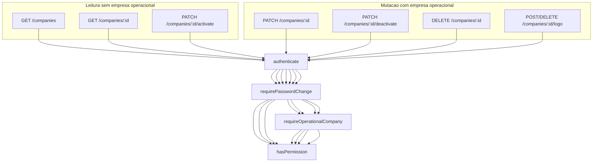

# SchedulerPro — Auditoria técnica: Gestão de Empresas

**Data:** 31/10/2026  
**Branch analisada:** `develop` @ `7b57b7448088d15702cc564bc154e158f0d713d1` (merge PR #116 — dashboard v1)  
**Tipo:** Análise **somente leitura** — sem alterações de código, configuração, base de dados ou operações Git destrutivas  
**Objetivo:** Estado actual do módulo Companies (backend + frontend), regras multi-tenant, lacunas, testes e plano de evolução para implementação futura.

**Relacionado (contexto histórico):**

- [schedulerpro-companies-module-technical-audit.md](./schedulerpro-companies-module-technical-audit.md) — levantamento @ `d074294` (pré-lifecycle completo; algumas conclusões de auth **obsoletas**)
- [schedulerpro-companies-lifecycle-auth.md](./schedulerpro-companies-lifecycle-auth.md) — implementação Etapa 1 lifecycle + auth (PR #115)
- [schedulerpro-companies-lifecycle-auth-final-review.md](./schedulerpro-companies-lifecycle-auth-final-review.md) — revisão final **APROVADO COM RESSALVAS**

---

## Verificação Git (início da auditoria)

| Item | Valor |
|------|--------|
| Branch actual | `develop` |
| Tracking | `develop...origin/develop` |
| HEAD | `7b57b74` — Merge pull request #116 (feature/dashboard-v1) |
| Working tree | Limpo |

Não foram executados commit, push, pull, merge, reset nem alterações a ficheiros de implementação (`server/`, `client/`).

---

## 1. Resumo executivo

O **backend** do módulo Gestão de Empresas está **maduro** para o scope actual: leitura e actualização de `name` e `timezone`, logo (Cloudinary), soft-delete, activate/deactivate com transacções MongoDB e sincronização de utilizadores (`companyDeactivationSuspended`), isolamento multi-tenant por `companyId`, RBAC granular e barreiras de empresa inactiva (auth + middleware operacional).

O **frontend** expõe **parcialmente** essas capacidades: página Empresa para OWNER/ADMIN com formulário, logo, link público de agendamento e badge de estado **somente leitura**. **Não existem** chamadas API nem UI para desactivar/reactivar ou eliminar (soft-delete) a empresa, apesar de o backend expor `PATCH .../activate`, `PATCH .../deactivate` e `DELETE /:id` (OWNER).

**Criação de empresa** continua exclusivamente via **`POST /auth/register`** (Company + utilizador OWNER), não via `POST /companies`. O método `CompanyService.create()` permanece **vazio**.

**Lacuna principal de produto:** o OWNER não consegue gerir o ciclo de vida da empresa na área autenticada sem ferramentas externas (API manual). **Lacuna de modelo:** não há contacto, morada ou dados comerciais/fiscais no schema.

---

## 2. Estrutura actual do módulo

### 2.1 Backend (`server/src/modules/companies/`)

| Camada | Ficheiro | Responsabilidade |
|--------|----------|------------------|
| Model | [`Company.model.ts`](../../server/src/modules/companies/models/Company.model.ts) | Persistência: `name`, `timezone`, `isActive`, `logo`, `deletedAt`, timestamps |
| Repository | [`CompanyRepository.ts`](../../server/src/modules/companies/repositories/CompanyRepository.ts) | CRUD persistência; filtros `deletedAt: null`; activate/deactivate com `session` |
| Service | [`CompanyService.ts`](../../server/src/modules/companies/services/CompanyService.ts) | Regras de negócio, tenant, lifecycle, logo |
| Controller | [`CompanyController.ts`](../../server/src/modules/companies/controllers/CompanyController.ts) | HTTP → service; usa `req.user!.companyId` |
| Routes | [`CompanyRoutes.ts`](../../server/src/modules/companies/routes/CompanyRoutes.ts) | Montagem de middlewares + permissões |
| DTO | [`UpdateCompany.dto.ts`](../../server/src/modules/companies/dto/UpdateCompany.dto.ts), [`CreateCompany.dto.ts`](../../server/src/modules/companies/dto/CreateCompany.dto.ts) | Contratos de entrada |
| Validators | [`update-company.validator.ts`](../../server/src/modules/companies/validators/update-company.validator.ts), [`create-company.validator.ts`](../../server/src/modules/companies/validators/create-company.validator.ts) | Validação HTTP (update; create no register) |
| Mapper | [`CompanyMapper.ts`](../../server/src/modules/companies/mappers/CompanyMapper.ts) | Resposta API (não expõe `deletedAt`) |
| Lifecycle TX | [`company-lifecycle-transaction.ts`](../../server/src/modules/companies/services/company-lifecycle-transaction.ts) | Transacções MongoDB para activate/deactivate |

Montagem API: prefixo `/api/companies` em [`server/src/routes/index.ts`](../../server/src/routes/index.ts).

### 2.2 Fluxo de pedidos (rotas Companies)

### 2.3 Frontend

| Área | Ficheiros |
|------|-----------|
| Página | [`CompanyPage.tsx`](../../client/src/pages/company/CompanyPage.tsx) |
| Formulário | [`CompanyForm.tsx`](../../client/src/components/company/CompanyForm.tsx) |
| API | [`company.api.ts`](../../client/src/api/endpoints/company.api.ts) |
| Permissões UX | [`companyPermissions.ts`](../../client/src/config/companyPermissions.ts) |
| Estado global | [`companySlice.ts`](../../client/src/store/slices/companySlice.ts) |
| Bootstrap | [`SessionBootstrap.tsx`](../../client/src/app/SessionBootstrap.tsx) — carrega empresa se role tem `COMPANY_READ` |
| Menu | [`menu.ts`](../../client/src/config/menu.ts) — item Empresa: OWNER, ADMIN |
| Link público | [`publicBookingUrl.ts`](../../client/src/config/publicBookingUrl.ts) + `env.appUrl` |

---

## 3. Backend — funcionalidades existentes

### 3.1 Modelo de dados (`Company`)

| Campo | Comportamento |
|-------|----------------|
| `name` | Obrigatório, trim, **lowercase**, **unique** global |
| `timezone` | IANA, default alinhado ao backend (`DEFAULT_TIMEZONE`) |
| `isActive` | Default `true`; lifecycle activate/deactivate |
| `logo` | Subdocumento `{ url, publicId }` ou null; só via endpoints de logo |
| `deletedAt` | Soft-delete; `null` = activo no repositório |

**Ausente no schema:** email, telefone, morada, NIF, website, moeda, locale, horários de funcionamento, metadata de integrações.

### 3.2 Endpoints autenticados

| Método | Rota | Permissão | Middleware operacional | Service |
|--------|------|-----------|------------------------|---------|
| GET | `/` | `COMPANY_READ` | Não | `findAll(companyId)` — lista 0..1 empresa |
| GET | `/:id` | `COMPANY_READ` | Não | `findById` + tenant |
| PATCH | `/:id` | `COMPANY_UPDATE` | **Sim** | `update` — só `name`, `timezone` |
| DELETE | `/:id` | `COMPANY_DELETE` | **Sim** | `softDelete` |
| PATCH | `/:id/activate` | `COMPANY_ACTIVATE` | **Não** | `activate` + restore users |
| PATCH | `/:id/deactivate` | `COMPANY_DEACTIVATE` | **Sim** | `deactivate` + suspend staff |
| POST | `/:id/logo` | `COMPANY_UPDATE` | **Sim** | `updateLogo` (multipart) |
| DELETE | `/:id/logo` | `COMPANY_UPDATE` | **Sim** | `removeLogo` (idempotente) |

Cadeia comum: `AuthMiddleware` → `requirePasswordChangeCompleted` → (`validateObjectId` onde aplicável) → (`requireOperationalCompany` onde aplicável) → `hasPermission` → validators → controller.

### 3.3 Isolamento multi-tenant

`CompanyService.ensureTenant(id, companyId)` exige `id === companyId`; caso contrário **404** (`COMPANY_NOT_FOUND`) — mesma semântica que “recurso inexistente”, sem revelar existência noutro tenant.

`findAll` filtra `{ _id: companyId, deletedAt: null }`. Não existe listagem cross-tenant para operadores da plataforma.

### 3.4 Ciclo de vida e utilizadores

**Desactivação** ([`CompanyService.deactivate`](../../server/src/modules/companies/services/CompanyService.ts)):

- Transacção: `CompanyRepository.deactivate` + `UserRepository.suspendActiveNonOwnerStaffForCompanyDeactivation`
- Staff activo não-OWNER fica com `isActive: false` e `companyDeactivationSuspended: true`
- OWNER não é suspendido pela desactivação da empresa

**Reactivação** (`activate`):

- Transacção: `CompanyRepository.activate` (idempotente se já activa) + `restoreUsersSuspendedByCompanyDeactivation`
- Restaura `isActive: true` apenas para quem tinha `companyDeactivationSuspended: true`

**Soft-delete:** define `deletedAt`; registos deixam de aparecer em `findById`/`findAll`. Sem cascade documentado para users, appointments ou outros domínios.

### 3.5 Logo

- Upload/substituição via `imageProvider.replace` (validação antes de apagar anterior)
- Remoção idempotente; storage + MongoDB
- `PATCH /companies/:id` **não** altera logo (testado em `CompanyService.logo.test.ts`)

### 3.6 Criação de empresa

- [`CompanyRepository.create`](../../server/src/modules/companies/repositories/CompanyRepository.ts) usado no **registo** ([`AuthService`](../../server/src/modules/auth/services/AuthService.ts))
- [`CompanyService.create()`](../../server/src/modules/companies/services/CompanyService.ts) — método **vazio** (stub)

### 3.7 RBAC (papéis vs permissões COMPANY)

| Role | COMPANY_READ | COMPANY_UPDATE | COMPANY_DELETE | COMPANY_ACTIVATE | COMPANY_DEACTIVATE |
|------|:---:|:---:|:---:|:---:|:---:|
| OWNER | Sim | Sim | Sim | Sim | Sim |
| ADMIN | Sim | Sim | Não | Não | Não |
| MANAGER | Não | Não | Não | Não | Não |
| EMPLOYEE | Não | Não | Não | Não | Não |
| CLIENT | Não | Não | Não | Não | Não |

Fonte: [`server/src/constants/rbac.ts`](../../server/src/constants/rbac.ts).

### 3.8 Empresa inactiva — auth e operações

**Login / refresh (não-OWNER):** [`assertUserMayAuthenticateAgainstCompany`](../../server/src/modules/auth/utils/assert-company-active-for-auth.ts) bloqueia com `COMPANY_INACTIVE_ACCESS` (403) se `!company.isActive`. **OWNER** mantém autenticação.

**Rotas operacionais:** [`RequireOperationalCompanyMiddleware`](../../server/src/middlewares/require-operational-company.middleware.ts) responde 403 `COMPANY_INACTIVE_OPERATION` quando a empresa está desactivada — **inclui OWNER** em rotas que montam este middleware (ex.: PATCH update, deactivate, logo).

**Excepções úteis para gestão:** GET companies, PATCH **activate** **não** montam middleware operacional — OWNER inactivo pode consultar e reactivar.

**Público:** [`PublicBookingEligibility`](../../server/src/modules/public-booking/services/PublicBookingEligibility.ts) (e fluxos públicos) respeitam `isActive` para agendamento.

---

## 4. Frontend — funcionalidades existentes

### 4.1 Navegação e acesso

- Rota `/company`; menu visível para **OWNER** e **ADMIN** apenas
- MANAGER/EMPLOYEE/CLIENT: mensagem “sem permissão”; **não** chama API ([`CompanyPage.test.tsx`](../../client/src/pages/company/CompanyPage.test.tsx))

### 4.2 Carregamento de dados

- `GET /companies` via [`companyApi.getCompany()`](../../client/src/api/endpoints/company.api.ts); usa `data[0]` como empresa da sessão
- Actualiza Redux `setCompany` após load e após save/logo
- `SessionBootstrap` pré-carrega empresa para roles com `COMPANY_READ`

### 4.3 Edição

- **OWNER e ADMIN** (`canUpdate`): [`CompanyForm`](../../client/src/components/company/CompanyForm.tsx)
  - Nome (3–120), timezone (lista IANA + valor legado)
  - Logo via `ImageUploader` → `uploadCompanyLogo` / `removeCompanyLogo`
  - Validação client-side alinhada ao validator server
- **ADMIN read-only path:** se `canView && !canUpdate` — não aplicável hoje (ADMIN tem update); bloco read-only existe para extensão futura

### 4.4 Estado operacional (`isActive`)

- Badge “Ativa” / “Inativa” em [`CompanyPage`](../../client/src/pages/company/CompanyPage.tsx)
- **Sem** botões ou fluxos de activate/deactivate
- **Sem** desactivar formulário quando empresa inactiva (OWNER pode ver form; PATCH update/logo falhará com 403 operacional)

### 4.5 Link público de agendamento

- URL derivada de `company.id` + `env.appUrl`
- Copiar / abrir em nova aba; testes de clipboard e produção URL

### 4.6 API client — cobertura vs backend

| Operação backend | Client |
|------------------|--------|
| GET `/companies` | `getCompany` |
| PATCH `/:id` | `updateCompany` |
| POST/DELETE `/:id/logo` | `uploadCompanyLogo`, `removeCompanyLogo` |
| PATCH `/:id/activate` | **Ausente** |
| PATCH `/:id/deactivate` | **Ausente** |
| DELETE `/:id` | **Ausente** |

### 4.7 Erros e UX

- `getApiError` / `getFriendlyErrorMessage` em load e save
- Loading, retry em falha de load, alertas de sucesso após save
- Responsividade: layout Bootstrap (`d-grid d-sm-block`, card); consistente com resto da app

---

## 5. Regras de negócio e multi-tenant (validação documental)

| Pergunta | Resposta com base no código |
|----------|----------------------------|
| Um utilizador pertence a uma única empresa? | **Sim.** `User.companyId` único; JWT expõe um tenant; sem selector multi-empresa. |
| OWNER gere apenas a própria empresa? | **Sim.** Todas as rotas Companies comparam `:id` com `req.user.companyId`. |
| Utilizador de outra empresa acede aos dados? | **Não** (404 em cross-tenant). Isolamento reforçado em testes [`CompanyService.isolation.test.ts`](../../server/tests/unit/companies/CompanyService.isolation.test.ts). |
| Permissões coerentes com papéis? | **Sim** no backend; frontend espelha READ/UPDATE para OWNER/ADMIN; **não** espelha ACTIVATE/DEACTIVATE/DELETE (OWNER-only no server). |
| Empresa desactivada respeita regras de acesso? | **Sim.** Staff não autentica; rotas operacionais 403; OWNER autentica e pode GET + activate; público bloqueado para booking. |
| Reactivação preserva estado anterior dos utilizadores? | **Parcialmente.** Restaura quem foi suspendido via `companyDeactivationSuspended`; não revoga sessões JWT existentes na desactivação (ver riscos). |
| Operações que contornam isolamento? | **Não identificadas** nas rotas Companies. Outros módulos dependem do mesmo `companyId` nos repositórios (fora do scope deste relatório). |

---

## 6. Classificação funcional

### 6.1 Implementado (completo no backend; frontend quando indicado)

- Identificação: nome, id, timestamps (API + página)
- Timezone IANA (model, validação, form, uso global via `companySlice` / sessão)
- Logo upload/remoção (backend + form)
- Leitura empresa autenticada (GET + Redux bootstrap)
- Link público de agendamento (UI)
- Soft-delete, activate, deactivate ( **backend only** )
- Multi-tenant e RBAC Companies
- Barreiras empresa inactiva (auth + middleware + público)

### 6.2 Parcialmente implementado

| Item | Detalhe |
|------|---------|
| Gestão operacional na UI | Badge `isActive` sem acções |
| `CompanyService.create()` | Stub; criação só no register |
| Settings empresariais | Só timezone + logo + nome |
| Desactivação “reconciliação H1” | Lógica no service para empresa já inactiva; **rota HTTP inacessível** (middleware operacional) |
| Soft-delete | API OWNER; sem UI; impacto em dados relacionados não documentado |

### 6.3 Inexistente (sem requisito implementado)

- Contactos, morada, dados fiscais/comerciais
- `POST /companies` fora do register
- Multi-empresa por utilizador / switch de tenant
- Backoffice plataforma (listar todas as empresas)
- Permissões COMPANY para MANAGER/EMPLOYEE (provavelmente intencional)
- Integrações (webhooks, API keys por empresa) no model Company

### 6.4 Melhorias técnicas (não bloqueantes)

- Revogação de sessões na desactivação da empresa
- Documentar ou implementar cascade policy em soft-delete
- Testes de integração HTTP dedicados a `/api/companies` (não existe ficheiro `companies.routes.test.ts` em integration)
- Mensagens frontend específicas para `COMPANY_INACTIVE_OPERATION` quando empresa inactiva
- Alinhar UX: desactivar edição/logo para todos quando `!isActive` (excepto fluxo activate)

### 6.5 Futuro (só com requisito de produto)

- Perfil empresarial alargado
- Política de retenção pós soft-delete
- Segunda via de criação de tenant (convites B2B, etc.)

---

## 7. Lacunas funcionais, riscos técnicos e segurança

### 7.1 Lacunas de produto (prioridade alta)

1. **OWNER não desactiva/reactiva pela UI** — funcionalidade backend crítica para offboarding temporário.
2. **ADMIN vê badge inactivo mas não tem acção** — correcto; falta orientação UX (banner + link para OWNER ou texto explicativo).
3. **Soft-delete sem UI** — risco de uso acidental só via API; impacto operacional opaco.

### 7.2 Inconsistências frontend/backend

- Formulário de edição visível para OWNER com empresa **inactiva** → PATCH/logo retornam 403; experiência confusa sem banner prévio.
- `companyPermissions` não expõe `canActivate` / `canDeactivate` / `canDelete`.

### 7.3 Riscos e limitações (backend)

| ID | Descrição | Severidade |
|----|-----------|------------|
| R1 | **H1 inalcançável via HTTP:** ramo `deactivate` idempotente quando já inactiva não corre via API porque a rota exige empresa operacional | Baixa (reconciliação manual só via DB/service tests) |
| R2 | **Sessões JWT não revogadas** na desactivação — utilizador com token válido até expirar (middleware operacional bloqueia na maioria dos pedidos) | Média |
| R3 | **`name` unique global lowercase** — colisão entre tenants no register; comportamento esperado SaaS single-DB mas limita nomes | Baixa |
| R4 | **Soft-delete sem cascade** — empresa “removida” pode deixar users/dados órfãos operacionais | Média (depende de política) |
| R5 | **`CompanyService.create()` vazio** — confusão para manutenção | Baixa |

### 7.4 Segurança

- Isolamento tenant e RBAC **adequados** para o modelo actual
- Logo: sem URLs arbitrárias; upload server-side
- Não expor `deletedAt` na API mapper — correcto
- Autorização real no server; frontend é UX only — **não confiar** no client para lifecycle

---

## 8. Testes — existentes e ausentes

### 8.1 Server — companies (`server/tests/unit/companies/`)

| Ficheiro | Cobertura principal |
|----------|---------------------|
| `CompanyRepository.test.ts` | Filtros soft-delete, updateLogo, softDelete |
| `CompanyService.behavior.test.ts` | Timezone inválido, tenant, update/activate/deactivate/delete |
| `CompanyService.isolation.test.ts` | Cross-tenant 404 em todas operações |
| `CompanyService.lifecycle.test.ts` | Transacções deactivate/activate + user suspend/restore |
| `CompanyService.logo.test.ts` | Upload, replace, remove, tenant, idempotência |
| `CompanyMapper.logo.test.ts` | Projeção logo na resposta |
| `company-logo.routes.test.ts` | Multipart, RBAC, tamanho, auth |
| `CompanyRoutes.lifecycle-rbac.test.ts` | OWNER activate/deactivate; ADMIN/MANAGER negados |

**Relacionados (auth/lifecycle):**

- [`assert-company-active-for-auth.test.ts`](../../server/tests/unit/auth/assert-company-active-for-auth.test.ts)
- [`require-operational-company.middleware.test.ts`](../../server/tests/unit/middlewares/require-operational-company.middleware.test.ts)
- [`UserRepository.company-lifecycle.test.ts`](../../server/tests/unit/users/UserRepository.company-lifecycle.test.ts)

### 8.2 Server — integração

**Não existe** suite de integração dedicada a CRUD/lifecycle `/api/companies`. Outros testes de integração referenciam `companyId` como fixture, mas não substituem cobertura E2E do módulo Companies.

### 8.3 Client

| Ficheiro | Cobertura |
|----------|-----------|
| `company.api.test.ts` | get, patch, logo post/delete, erros |
| `CompanyPage.test.tsx` | load, RBAC, link público, save, erros |
| `CompanyPage.logo.test.tsx` | fluxo logo na página |
| `CompanyForm.test.tsx` | validação e submit |
| `CompanyForm.logo.test.tsx` | upload/remove no form |
| `SessionBootstrap.test.tsx` | load company com COMPANY_READ |

**Ausente:** activate/deactivate/delete API e UI; empresa inactiva + tentativa de PATCH; badge + acções OWNER.

### 8.4 Cenários recomendados para testes futuros

1. OWNER desactiva via UI → badge inactivo; staff não opera (já backend)
2. OWNER reactiva → staff restaurado (integração ou E2E)
3. ADMIN não vê botões lifecycle
4. PATCH update com empresa inactiva → 403 amigável no client
5. Soft-delete OWNER — decisão de produto antes de automatizar

---

## 9. Recomendações priorizadas

| Prioridade | Recomendação | Justificação |
|:----------:|--------------|--------------|
| P0 | Expor lifecycle OWNER no frontend (API + UI + testes) | Maior lacuna vs backend já merged |
| P1 | UX empresa inactiva (banner, desactivar edição quando 403 inevitável) | Reduz confusão e chamadas falhadas |
| P2 | Mensagens `COMPANY_INACTIVE_OPERATION` / `COMPANY_INACTIVE_ACCESS` no client | Alinhamento com auth/lifecycle |
| P3 | Testes integração `/api/companies` lifecycle + operacional middleware | Confiança regressão |
| P4 | Decisão produto sobre soft-delete UI e cascade | R4 |
| P5 | Revogação sessões na desactivação | R2 — opcional, esforço maior |
| — | Campos contacto/morada | Só após requisito funcional |

---

## 10. Proposta de implementação em etapas

### Etapa A — Lifecycle no frontend (OWNER)

**Dependências:** Nenhuma backend; RBAC já definido.

**Alterações previstas:**

- [`client/src/api/endpoints/company.api.ts`](../../client/src/api/endpoints/company.api.ts) — `activateCompany(id)`, `deactivateCompany(id)`
- [`client/src/api/endpoints/company.api.test.ts`](../../client/src/api/endpoints/company.api.test.ts)
- [`client/src/config/companyPermissions.ts`](../../client/src/config/companyPermissions.ts) — `canDeactivate`, `canActivate` (OWNER only)
- [`client/src/pages/company/CompanyPage.tsx`](../../client/src/pages/company/CompanyPage.tsx) — secção perigo/gestão, confirmação modal, actualizar estado local + Redux
- Testes em `CompanyPage` (novo describe lifecycle)

**Critérios de aceitação:**

- OWNER desactiva e reactiva com feedback de sucesso/erro
- ADMIN vê estado mas **não** vê acções de lifecycle
- Após desactivação, resposta API reflecte `isActive: false` na página
- Não regressão em form/logo/link público (testes existentes verdes)

---

### Etapa B — UX empresa inactiva

**Dependências:** Etapa A (opcional mas recomendado).

**Alterações:** `CompanyPage`, possivelmente `CompanyForm` (prop `readOnly` quando `!company.isActive`), [`client/src/api/errors`](../../client/src/api/errors) se necessário.

**Critérios de aceitação:**

- Banner visível quando `!isActive` explicando impacto (staff, booking público)
- OWNER ainda acede a “Reactivar”; edição/logo desactivados ou com mensagem clara quando API retornaria 403
- ADMIN com empresa inactiva: vista read-only coerente

---

### Etapa C — Soft-delete (opcional)

**Dependências:** Decisão de produto + documentação de impacto.

**Alterações:** `deleteCompany` no client; fluxo OWNER com dupla confirmação; **não** implementar sem política de dados.

**Critérios de aceitação:**

- Alinhado com [`CompanyService.delete`](../../server/src/modules/companies/services/CompanyService.ts)
- OWNER only; 403 para outros roles
- Documentação utilizador sobre irreversibilidade operacional

---

### Etapa D — Backend hardening (opcional)

- Revogação de refresh tokens / sessões na desactivação
- Expor reconciliação H1 via rota admin interna **ou** remover ramo morto — decisão arquitectural
- Integração tests `server/tests/integration/routes/companies.routes.test.ts`

---

### Futuro — Perfil empresarial alargado

Requisitos funcionais → migration schema → DTOs/validators → form secções → público se aplicável.

---

## 11. Continuidade para outra IA

**Estado actual:** Backend Companies **completo** para scope v1 (nome, timezone, logo, lifecycle, tenant). Frontend **~70%** do exposto ao OWNER/ADMIN: falta lifecycle e polish inactivo.

**Próximo passo recomendado:** **Etapa A** (ficheiros client listados acima).

**Não repetir:** auditoria completa de auth/lifecycle — usar PR #115 e [schedulerpro-companies-lifecycle-auth-final-review.md](./schedulerpro-companies-lifecycle-auth-final-review.md).

**Commit base desta auditoria:** `7b57b7448088d15702cc564bc154e158f0d713d1` on `develop`.

---

## Apêndice — Mapa rápido de ficheiros para implementação futura

| Domínio | Ficheiros |
|---------|-----------|
| Client API | `client/src/api/endpoints/company.api.ts`, `company.api.test.ts` |
| Client UX | `client/src/pages/company/CompanyPage.tsx`, `CompanyForm.tsx`, testes associados |
| Client permissoes | `client/src/config/companyPermissions.ts` |
| Client tipos | `client/src/types/company.ts` (se novos campos) |
| Server (só se Etapa D) | auth/session, possivelmente `CompanyRoutes` / `CompanyService` |

*Nenhum ficheiro de implementação foi modificado durante a produção deste relatório.*
