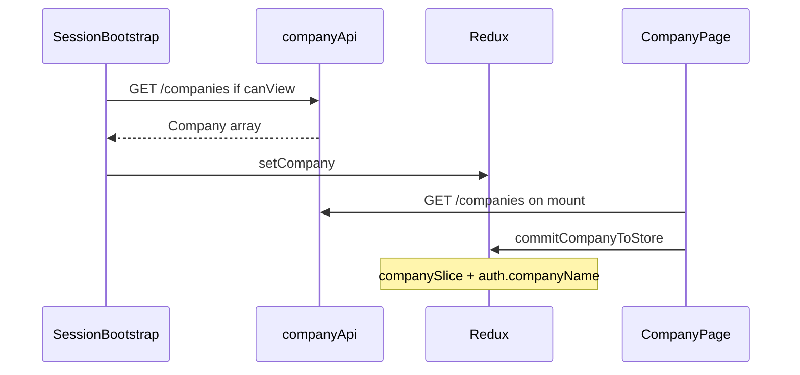

# SchedulerPro — Auditoria Company Management (read-only)

**Data da auditoria:** 2026-11-07  
**Âmbito:** branch `develop`, funcionalidade de gestão da empresa (backend + frontend + testes).  
**Tipo:** apenas leitura de código e Git; **nenhuma alteração** a código, testes ou configuração (exceto este relatório).

---

## 1. Estado inicial do Git

| Item | Valor |
| --- | --- |
| Branch | `develop` |
| `HEAD` (completo) | `2f7412570892ec1fa63a634c6b47bda60a08604e` |
| `HEAD` (curto) | `2f74125` |
| Commit atual | Merge pull request #130 (`feature/tablet-responsive-entity-cards`) |
| Tracking | `develop...origin/develop` |
| Working tree | **Limpo** (sem ficheiros modificados ou não rastreados no momento da auditoria) |

**Facto:** Não foram executadas operações Git de escrita (commit, push, stash, switch, etc.) como parte desta tarefa.

---

## 2. Resumo executivo

**Facto:** Na `develop`, Company Management está **largamente implementada** de ponta a ponta: API autenticada `/api/companies`, isolamento por `companyId` do token, RBAC OWNER/ADMIN, ciclo de vida ativar/desativar com transacções e suspensão/restauro de utilizadores, logo, validação IANA de timezone, página `CompanyPage` com formulário, link público, estado operacional, sincronização Redux parcial, avisos globais de empresa inactiva e ecrã de suspensão para MANAGER/EMPLOYEE.

**Facto:** A etapa visual `feature/ui-company-page-step-4` **está integrada** em `develop` (ancestral `d41529f`, merge PR #122): CSS do link público e centralização do uploader de logo em mobile.

**Lacuna documentada:** O checklist histórico menciona `data-testid="company-public-booking-link"`; no código actual só existe a classe `company-public-booking-link` — **sem** `data-testid` no markup.

**Parcial:** `DELETE /companies/:id` existe no backend (OWNER) mas **não** há UI nem cliente API no frontend. `CompanyService.create()` no módulo companies é um **stub vazio**; a criação real ocorre no **registo** (`AuthService`).

**Recomendação:** Tratar próximas implementações como refinamento (testes visuais, `data-testid`, soft-delete UI, sincronização `auth.user.companyTimezone` após PATCH) e não como greenfield.

---

## 3. Funcionalidades concluídas

### 3.1 Backend

| Área | Estado | Evidência |
| --- | --- | --- |
| Consulta lista / por id | Concluído | `GET /`, `GET /:id` → `CompanyService.findAll` / `findById` filtrados por `req.user.companyId` |
| Actualização nome + timezone | Concluído | `PATCH /:id` + `updateCompanyValidator`, validação IANA |
| Logo upload/remover | Concluído | `POST/DELETE /:id/logo`, Cloudinary via serviço |
| Activar empresa | Concluído | `PATCH /:id/activate` + `restoreUsersSuspendedByCompanyDeactivation` |
| Desactivar empresa | Concluído | `PATCH /:id/deactivate` + `suspendActiveNonOwnerStaffForCompanyDeactivation` |
| Soft delete empresa | Concluído (API) | `DELETE /:id` → `CompanyRepository.softDelete` |
| Isolamento multi-tenant | Concluído | `ensureTenant(id, companyId)` → 404 se `id !== companyId` |
| RBAC | Concluído | `hasPermission` por rota; `RolePermissions` em `rbac.ts` |
| Empresa inactiva — operações | Concluído | `RequireOperationalCompanyMiddleware` em PATCH, DELETE, deactivate, logo (não em activate) |
| Login com empresa inactiva | Concluído | `assertUserMayAuthenticateAgainstCompany` — só OWNER entra |
| Mensagens / erros | Concluído | `http-messages.ts` (`COMPANY_INACTIVE`, `COMPANY_INACTIVE_OPERATION`, etc.) |

**Facto — contrato de resposta** (`CompanyMapper.toResponse`): `id`, `name`, `timezone`, `isActive`, `logo` (`{ url, publicId } | null`), `createdAt`, `updatedAt`. Alinhado com [`client/src/types/company.ts`](../../client/src/types/company.ts).

**Facto — criação de empresa:** [`CompanyService.create()`](../../server/src/modules/companies/services/CompanyService.ts) está vazio; registo em [`AuthService`](../../server/src/modules/auth/services/AuthService.ts) (`createCompany`).

### 3.2 Frontend

| Área | Estado | Evidência |
| --- | --- | --- |
| Rota `/company` | Concluído | [`AppRoutes.tsx`](../../client/src/routes/AppRoutes.tsx) |
| Menu Empresa | Concluído | [`menu.ts`](../../client/src/config/menu.ts) — roles `OWNER`, `ADMIN` |
| CompanyPage — carga | Concluído | `companyApi.getCompany()` → primeiro item; `commitCompanyToStore` |
| Link público | Concluído | `getPublicBookingUrl` + `input-group company-public-booking-link` |
| Nome + timezone + logo | Concluído | `CompanyForm` + `TimezonePicker` + `ImageUploader` |
| Lifecycle UI | Concluído | Desactivar (modal) / Reativar; só `canActivate`/`canDeactivate` (OWNER) |
| Perfil read-only inactivo | Concluído | `canEditProfile = canUpdate && company.isActive`; `CompanyReadOnlyProfile` |
| RBAC UX | Concluído | [`companyPermissions.ts`](../../client/src/config/companyPermissions.ts) espelha backend |
| Aviso global inactivo | Concluído | `AppLayout` + `CompanyInactiveNotice` (OWNER/ADMIN) |
| Staff suspendido | Concluído | `StaffCompanySuspendedView` + `staffCompanyAccessSuspended` no `apiClient` |
| Sessão bootstrap | Concluído | `SessionBootstrap` → `loadSessionCompany` para quem tem `canView` |
| Redux empresa | Concluído | `companySlice`; `selectCompanyTimezone`; nome workspace |
| CSS responsivo step-4 | Concluído | [`index.css`](../../client/src/index.css) `.company-public-booking-link`, `.company-form-logo-uploader` @767.98px |

### 3.3 Integração `feature/ui-company-page-step-4`

| Critério histórico | Na `develop`? | Notas |
| --- | --- | --- |
| Link público responsivo | **Sim** | Classe `company-public-booking-link`; wrap mobile + border-radius custom |
| Border-radius mobile nos botões | **Sim** | Regras `@media (max-width: 767.98px)` em `index.css` |
| Logo centralizado ≤767px | **Sim** | `.company-form-logo-uploader` flex column + `justify-content: center` |
| Merge da branch | **Sim** | `git merge-base --is-ancestor d41529f HEAD` → yes |
| `data-testid="company-public-booking-link"` | **Não** | Só classe CSS; ver secção 5 |

---

## 4. Funcionalidades parcialmente concluídas

| Item | O que existe | O que falta |
| --- | --- | --- |
| Remoção de empresa | `DELETE /api/companies/:id` (OWNER, empresa operacional) | UI, `companyApi.delete`, fluxo de confirmação |
| `CompanyService.create` | Stub no módulo companies | Implementação formal ou remoção do método morto |
| Sincronização timezone na sessão JWT | `commitCompanyToStore` actualiza `companySlice` + `auth.user.companyName` | **Facto:** não há `setUserCompanyTimezone` no `authSlice`; roles sem `GET /companies` dependem de `user.companyTimezone` do login/refresh até nova sessão |
| Testes responsivos CompanyPage | Testes funcionais (RBAC, lifecycle, timezone) | **Facto:** nenhum teste referencia mobile/tablet/CSS do link ou logo |
| Validação visual 320px | Documentada como pendente no relatório step-4 | Sem evidência automatizada nesta auditoria |

---

## 5. Funcionalidades pendentes / gaps

**Facto (checklist externo):**

- `data-testid="company-public-booking-link"` ausente — dificulta testes E2E/selectores estáveis.

**Recomendação (baixa prioridade):**

- Testes de regressão visual ou asserts de classe nos testes de `CompanyPage` para o grupo do link público.
- Decidir se soft-delete de empresa deve expor-se na UI (produto/segurança).
- Após PATCH de timezone, avaliar se o refresh da sessão deve actualizar `auth.user.companyTimezone` para MANAGER/EMPLOYEE sem reload.

**Hipótese:** Falhas intermitentes em `CompanyForm.test.tsx` (`preserves a legacy backend timezone`) na suite completa do cliente podem ser timeouts de UI, não regressão de Company Management — **não reproduzido** nesta auditoria (sem execução de testes).

---

## 6. Regras de negócio encontradas

| Regra | Implementação |
| --- | --- |
| Um utilizador → uma empresa via `User.companyId` | Modelo users + token `companyId` |
| OWNER permissões completas sobre empresa | `COMPANY_*` incl. activate/deactivate/delete |
| ADMIN lê e actualiza; sem lifecycle | `rbac.ts` — sem `COMPANY_ACTIVATE`/`DEACTIVATE` |
| MANAGER/EMPLOYEE sem gestão empresa | Sem `COMPANY_READ`; item menu ausente |
| Só OWNER activa/desactiva | Rotas + `getCompanyAbilities` |
| Desactivação suspende staff activo ≠ OWNER | `companyDeactivationSuspended: true` |
| Reactivação restaura só suspensos por desactivação | Filtro `companyDeactivationSuspended` |
| OWNER permanece activo / pode autenticar com empresa inactiva | `assertUserMayAuthenticateAgainstCompany` |
| Timezone IANA obrigatório e validado | Schema Mongo, validator PATCH, frontend `isValidIanaTimezone` |
| Default timezone | **Facto:** `Europe/Lisbon` — backend `DEFAULT_TIMEZONE`, frontend `APPOINTMENT_TIMEZONE` |
| Tenant: `:id` deve igualar `companyId` do token | `ensureTenant` → 404 (não 403) |
| Operações mutáveis bloqueadas se empresa inactiva | Middleware operacional (excepto activate e leituras) |
| Agendamento público bloqueado se inactivo | Mensagens + copy na CompanyPage; validação no módulo público |

---

## 7. Endpoints e contratos

**Base:** montagem em [`server/src/routes/index.ts`](../../server/src/routes/index.ts) → `/api/companies` (prefixo API conforme app).

| Método | Rota | Permissão | Middleware operacional | Corpo / notas |
| --- | --- | --- | --- | --- |
| GET | `/companies` | `COMPANY_READ` | Não | Lista 0–1 empresa do tenant |
| GET | `/companies/:id` | `COMPANY_READ` | Não | Resposta `Company` |
| PATCH | `/companies/:id` | `COMPANY_UPDATE` | **Sim** | `{ name?, timezone? }` |
| DELETE | `/companies/:id` | `COMPANY_DELETE` | **Sim** | Soft delete |
| PATCH | `/companies/:id/activate` | `COMPANY_ACTIVATE` | Não | Sem body |
| PATCH | `/companies/:id/deactivate` | `COMPANY_DEACTIVATE` | **Sim** | Sem body |
| POST | `/companies/:id/logo` | `COMPANY_UPDATE` | **Sim** | multipart `logo` |
| DELETE | `/companies/:id/logo` | `COMPANY_UPDATE` | **Sim** | Idempotente |

**Frontend** [`company.api.ts`](../../client/src/api/endpoints/company.api.ts): `getCompany`, `updateCompany`, `uploadCompanyLogo`, `removeCompanyLogo`, `activateCompany`, `deactivateCompany` — **sem** `delete`.

**Público relacionado (não gestão):** `GET/POST /api/public/companies/:companyId/...` — tenant na URL; fora do escopo de CompanyPage mas usa `isActive` da empresa.

---

## 8. Ficheiros relevantes

### Backend

- Rotas: `server/src/modules/companies/routes/CompanyRoutes.ts`
- Controller: `.../controllers/CompanyController.ts`
- Serviço: `.../services/CompanyService.ts`, `.../services/company-lifecycle-transaction.ts`
- Repositório: `.../repositories/CompanyRepository.ts`
- Modelo: `.../models/Company.model.ts`
- DTO/validators: `.../dto/UpdateCompany.dto.ts`, `.../validators/update-company.validator.ts`
- Mapper: `.../mappers/CompanyMapper.ts`
- Auth criação: `server/src/modules/auth/services/AuthService.ts`
- Middleware: `server/src/middlewares/require-operational-company.middleware.ts`
- Auth empresa inactiva: `server/src/modules/auth/utils/assert-company-active-for-auth.ts`
- RBAC: `server/src/constants/rbac.ts`, `permissions.ts`, `roles.ts`
- Mensagens: `server/src/constants/http-messages.ts`, `error-codes.ts`
- Users lifecycle: `server/src/modules/users/repositories/UserRepository.ts`

### Frontend

- Página: `client/src/pages/company/CompanyPage.tsx`
- Form: `client/src/components/company/CompanyForm.tsx`
- Avisos: `CompanyInactiveNotice.tsx`, `StaffCompanySuspendedView.tsx`
- API: `client/src/api/endpoints/company.api.ts`
- Tipos: `client/src/types/company.ts`
- Permissões UX: `client/src/config/companyPermissions.ts`
- Redux: `client/src/store/slices/companySlice.ts`, `client/src/store/companySessionSync.ts`
- Sessão: `client/src/app/loadSessionCompany.ts`, `SessionBootstrap.tsx`
- Layout: `client/src/components/layout/AppLayout.tsx`
- Menu: `client/src/config/menu.ts`
- URL pública: `client/src/config/publicBookingUrl.ts`
- Timezone UI: `client/src/components/common/TimezonePicker.tsx`, `client/src/config/timezones.ts`
- CSS: `client/src/index.css` (secções `company-public-booking-link`, `company-form-logo-uploader`)
- Interceptor suspensão: `client/src/api/apiClient.ts`, `client/src/api/errors.ts`

### Documentação histórica (referência)

- `docs/reports/schedulerpro-company-page-step-4-implementation.md`
- `docs/reports/schedulerpro-company-page-duplicate-notice-fix.md`
- Vários relatórios timezone/nome Redux em `docs/reports/`

---

## 9. Estado dos testes

**Facto:** Testes **não foram executados** nesta auditoria (read-only). Inventário de ficheiros com foco company:

### Backend (`server/tests`)

| Ficheiro | Foco |
| --- | --- |
| `unit/companies/CompanyService.lifecycle.test.ts` | activate/deactivate + users |
| `unit/companies/CompanyRoutes.lifecycle-rbac.test.ts` | permissões nas rotas |
| `unit/companies/CompanyService.isolation.test.ts` | tenant |
| `unit/companies/CompanyService.behavior.test.ts` | update, regras gerais |
| `unit/companies/CompanyService.logo.test.ts` | logo |
| `unit/companies/company-logo.routes.test.ts` | rotas logo |
| `unit/companies/CompanyRepository.test.ts` | persistência |
| `unit/companies/CompanyMapper.logo.test.ts` | mapper |
| `unit/middlewares/require-operational-company.middleware.test.ts` | middleware |
| `unit/auth/assert-company-active-for-auth.test.ts` | login |
| `unit/users/UserRepository.company-lifecycle.test.ts` | flags suspensão |

### Frontend (`client/src`)

| Ficheiro | Foco |
| --- | --- |
| `pages/company/CompanyPage.test.tsx` | ~24 casos (RBAC, load, inactive, lifecycle, timezone) |
| `pages/company/CompanyPage.logo.test.tsx` | logo na página |
| `components/company/CompanyForm.test.tsx` | validação, timezone picker |
| `components/company/CompanyForm.logo.test.tsx` | upload logo |
| `components/company/CompanyInactiveNotice.test.tsx` | copy OWNER/ADMIN |
| `api/endpoints/company.api.test.ts` | contratos HTTP cliente |
| `config/companyPermissions.test.ts` | abilities |
| `store/slices/companySlice.test.ts` | timezone efectivo |
| `store/companySessionSync.test.ts` | commit store |
| `app/loadSessionCompany.test.ts` | bootstrap empresa |
| `components/layout/AppLayout.test.tsx` | avisos globais / staff view |
| `api/apiClient.test.ts` | código suspensão staff |

### Lacunas de cobertura (recomendação)

- Sem testes dedicados ao layout responsivo do link público / logo mobile.
- Sem teste de integração frontend para `DELETE` empresa (API inexistente no cliente).
- Rotas protegidas: `AppRoutes.test.tsx` mocka `company.api` mas cobertura E2E limitada.

---

## 10. Problemas e inconsistências

**Factos:**

1. **Nome vs testid:** documentação step-4 pode referir `data-testid` que nunca foi commitado ou foi omitido na integração — apenas classe CSS presente.
2. **`commitCompanyToStore`:** sincroniza nome para `authSlice`, não timezone — possível desvio temporal para roles que não recarregam empresa após OWNER muda timezone.
3. **`CompanyService.create` vazio** no módulo companies pode confundir leitores do código; criação real noutro módulo.
4. **`DELETE` empresa** sem superfície frontend — risco de API órfã se chamada manualmente.
5. **Duplicado de aviso inactivo na CompanyPage** foi removido (B.3) — **facto** alinhado com UX actual (só global no shell).

**Hipóteses (não confirmadas por execução):**

- Testes flaky na suite global (RegisterPage, CompanyForm legacy timezone) podem mascarar estado real de CI.

---

## 11. Riscos de regressão

| Risco | Mitigação existente |
| --- | --- |
| RBAC bypass no frontend | Backend `hasPermission` em todas as rotas |
| Cross-tenant update | `ensureTenant` |
| Staff activo com empresa inactiva | Middleware + suspensão em desactivação |
| Timezone inválido | Validação dupla FE/BE |
| Regressão CSS link/logo | Selectors escopados; **sem** testes automatizados dedicados |
| Redux empresa stale após troca de conta | `reconcileCompanySliceWithSession` |

---

## 12. Próximas etapas recomendadas (prioridade)

### P0 — Clarificação produto

- Confirmar se **soft-delete** de empresa deve permanecer só API ou ganhar UI.
- Confirmar se `data-testid` no link público é requisito de QA.

### P1 — Qualidade

- Adicionar `data-testid="company-public-booking-link"` no wrapper do link (se aprovado) + assert mínimo em `CompanyPage.test.tsx`.
- Teste (ou documentação de checklist manual) para viewport ≤767px — link + logo.
- Após PATCH timezone: avaliar refresh de sessão ou `setUserCompanyTimezone` para consistência em MANAGER/EMPLOYEE.

### P2 — Manutenção

- Remover ou implementar `CompanyService.create()` para clareza.
- Executar suites `server/tests/unit/companies/*` e `client` company-related na CI e registar baseline verde.
- Revisar relatórios antigos em `docs/reports/` e consolidar links neste documento como índice vivo.

---

## 13. Contexto técnico para continuidade (outra IA)

### Fluxo de dados (sessão + página)



### Matriz de superfície por role (empresa inactiva)

| Role | Menu Empresa | CompanyPage | Editar | Lifecycle | Aviso global | Conteúdo app |
| --- | --- | --- | --- | --- | --- | --- |
| OWNER | Sim | Sim | Não se inactiva | Sim | Sim | Sim (Outlet) |
| ADMIN | Sim | Sim | Não se inactiva | Não | Sim | Sim |
| MANAGER/EMPLOYEE | Não | N/A (sem rota útil) | — | — | Não | `StaffCompanySuspendedView` se flag API |

### Comandos úteis (próxima fase, não executados aqui)

```bash
cd server && npm test -- tests/unit/companies
cd client && npm run test -- src/pages/company src/components/company src/api/endpoints/company.api.test.ts
```

### Commit de referência histórico step-4

- Merge: `d41529f` — `Merge pull request #122 from WeidsonCordeiro/feature/ui-company-page-step-4`
- Implementação CSS associada: commit `523f315` (mensagem: link público, border-radius mobile, logo centralizado)

---

## 14. Legenda metodológica

- **Facto:** observado diretamente no código ou Git nesta branch.
- **Hipótese:** inferência não validada por testes ou runtime nesta tarefa.
- **Recomendação:** acção sugerida; requer aprovação do utilizador antes de implementação.

---

**Fim do relatório.** Aguardar aprovação antes de qualquer implementação.
