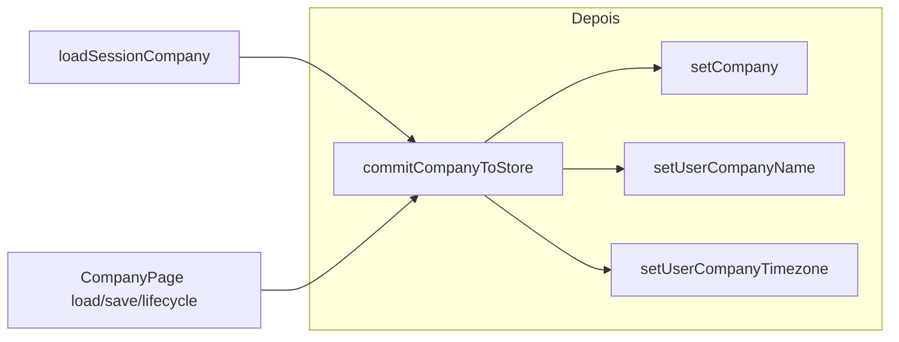

# SchedulerPro — Company Management: Quality & Session Consistency

**Data:** 2026-11-07  
**Referência:** [schedulerpro-company-management-audit.md](./schedulerpro-company-management-audit.md)  
**Branch:** `develop` @ `2f74125` (auditoria e início desta tarefa)  
**Sem operações Git de escrita.**

## Contexto

A auditoria identificou:

1. Ausência de `data-testid="company-public-booking-link"` no grupo do link público.
2. `commitCompanyToStore` actualizava `companySlice` e `auth.user.companyName`, mas **não** `auth.user.companyTimezone`, afectando `selectCompanyTimezone` quando o registo Redux da empresa não estava carregado após PATCH.
3. Cobertura de testes insuficiente para markup responsivo (link + logo).

Esta entrega corrige esses pontos sem alterar backend, RBAC, lifecycle ou CSS.

---

## Alterações realizadas

### A. Link público — `data-testid`

| Ficheiro | Alteração |
| --- | --- |
| [`client/src/pages/company/CompanyPage.tsx`](../../client/src/pages/company/CompanyPage.tsx) | `data-testid="company-public-booking-link"` no `div` existente (`input-group company-public-booking-link`). |

### B. Sincronização timezone na sessão

| Ficheiro | Alteração |
| --- | --- |
| [`client/src/store/slices/authSlice.ts`](../../client/src/store/slices/authSlice.ts) | Reducer `setUserCompanyTimezone` (espelha `setUserCompanyName`). |
| [`client/src/store/companySessionSync.ts`](../../client/src/store/companySessionSync.ts) | `commitCompanyToStore` despacha `setUserCompanyTimezone(company.timezone)`. |
| [`client/src/app/loadSessionCompany.ts`](../../client/src/app/loadSessionCompany.ts) | `GET /companies` bem-sucedido usa `commitCompanyToStore` em vez de só `setCompany`. |

**Decisão técnica:** Um único ponto de sincronização (`commitCompanyToStore`) para `companySlice`, `companyName` e `companyTimezone` na sessão Redux. **Não** altera JWT nem refresh de token; alinha o estado local com a resposta da API após load/PATCH/lifecycle na CompanyPage. No bootstrap, `SessionBootstrap` chama `setCredentials` antes de `loadSessionCompany`, por isso `auth.user` existe quando o commit corre.

### Fluxo antes → depois



### C. Testes

| Ficheiro | Novos / ajustados |
| --- | --- |
| `CompanyPage.test.tsx` | Asserts `auth.companyTimezone` + `selectCompanyTimezone` após load/PATCH; `describe("responsive markup")` (testid, classes, filhos do link; `.company-form-logo-uploader` + logo). |
| `companySessionSync.test.ts` | Timezone, rename preservando timezone. |
| `authSlice.test.ts` | `setUserCompanyTimezone` com user / sem user. |
| `loadSessionCompany.test.ts` | Sync nome + timezone no auth após load com credentials. |

**Nota:** Os testes de markup **não** substituem validação visual em browser (767px, tablet, desktop).

---

## Ficheiros modificados (código + testes)

- `client/src/pages/company/CompanyPage.tsx`
- `client/src/pages/company/CompanyPage.test.tsx`
- `client/src/store/slices/authSlice.ts`
- `client/src/store/slices/authSlice.test.ts`
- `client/src/store/companySessionSync.ts`
- `client/src/store/companySessionSync.test.ts`
- `client/src/app/loadSessionCompany.ts`
- `client/src/app/loadSessionCompany.test.ts`

---

## Validação

### Comando

```bash
cd client
npm run test -- src/pages/company src/components/company src/store/companySessionSync.test.ts src/store/slices/companySlice.test.ts src/store/slices/authSlice.test.ts src/app/loadSessionCompany.test.ts
npm run build
```

### Resultado (execução final)

| Verificação | Resultado |
| --- | --- |
| Testes scoped | **88 passed** (9 ficheiros) |
| `npm run build` | **Sucesso** (`tsc -b` + Vite) |
| Testes backend | **Não executados** (sem alterações server) |

**Observação:** Na primeira execução da suite scoped, 2 testes em `CompanyPage.test.tsx` falharam por condição de corrida/timeout em execução paralela pesada; nova execução **88/88 passou**. Não atribuído a regressão funcional desta entrega.

---

## Pendências (fora deste escopo)

- UI / cliente para `DELETE /companies/:id`.
- `CompanyService.create()` stub no backend (documentar; sem alteração aqui).
- Validação visual manual em ~320px do link público.
- MANAGER/EMPLOYEE continuam sem `GET /companies`; dependem de `auth.user.companyTimezone` do login até refresh de sessão — PATCH por OWNER actualiza só o Redux do utilizador que edita (comportamento esperado).

---

## Próximos passos sugeridos

1. **P1:** Checklist visual CompanyPage (link wrap, logo centrado ≤767px).
2. **P2:** Decisão produto sobre soft-delete na UI.
3. **P2:** Opcional — propagar timezone no refresh `/auth/me` se o backend passar a devolver `companyTimezone` actualizado no token/session.

---

**Fim.** Aguardar validação antes de merge/commit.
