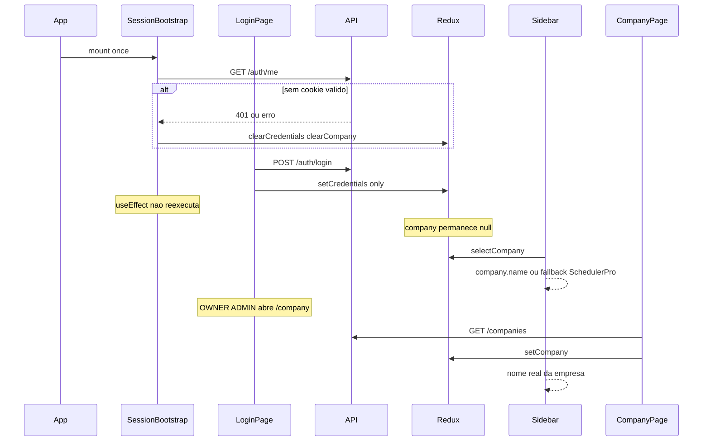
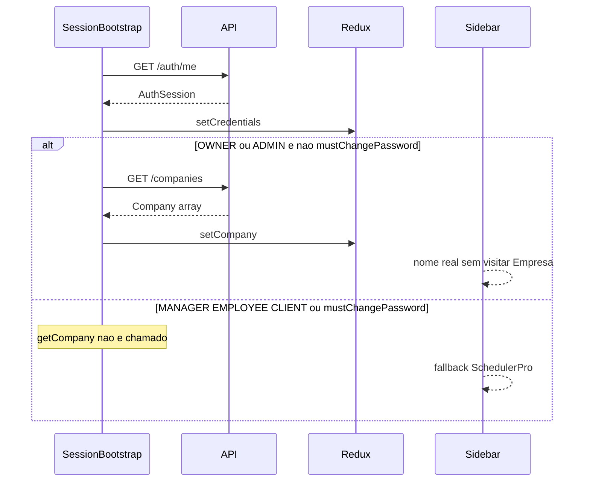

# SchedulerPro — Auditoria: nome da empresa após login

**Data:** 31/10/2026  
**Branch analisada:** `develop` @ `16b94ae` (`develop...origin/develop`)  
**Tipo:** Análise **somente leitura** — sem alterações de código, configuração ou operações Git destrutivas  
**Objetivo:** Explicar por que o nome da empresa permanece como **SchedulerPro** no shell autenticado até o utilizador aceder ao separador **Empresa**, mapeando autenticação, bootstrap, Redux e UI.

**Relacionado (contexto UX lifecycle):**

- [schedulerpro-companies-lifecycle-ux-implementation.md](./schedulerpro-companies-lifecycle-ux-implementation.md)
- [schedulerpro-suspended-users-ux-implementation.md](./schedulerpro-suspended-users-ux-implementation.md)
- [schedulerpro-company-inactive-duplicate-notices-fix.md](./schedulerpro-company-inactive-duplicate-notices-fix.md)

---

## 1. Contexto e objetivo

### Sintoma reportado

Após login, o nome exibido no canto superior da aplicação permanece **SchedulerPro** (valor por omissão). O nome correcto da empresa só aparece depois de abrir o separador **Empresa**.

### Hipótese inicial

Os dados da empresa não estariam a ser carregados ou sincronizados com o Redux durante a autenticação ou a inicialização da aplicação.

### Restrições desta auditoria

- Apenas leitura de código; nenhuma alteração a frontend, backend, Redux ou contratos API.
- Não propor solução baseada em nova consulta `GET /companies` em cada renderização do layout.
- Considerar OWNER, ADMIN, MANAGER, EMPLOYEE e CLIENT.
- Preservar comportamentos de empresa inactiva (OWNER/ADMIN) e staff suspenso (MANAGER/EMPLOYEE — Etapa B.1).

---

## 2. Fluxo actual (login → cabeçalho / sidebar)

### Arquitectura de arranque

[`App.tsx`](../../client/src/app/App.tsx) envolve as rotas com [`SessionBootstrap`](../../client/src/app/SessionBootstrap.tsx) dentro de `BrowserRouter`. O bootstrap corre **uma vez** no mount da aplicação (dependências do `useEffect`: apenas `[dispatch]`).

### Diagrama — caminho típico após login (sem refresh)

### Diagrama — refresh da página com sessão válida

### Passos narrativos

1. **Arranque em `/login` (ou qualquer rota):** `SessionBootstrap` chama `authApi.getMe()`. Sem cookie de sessão, o fluxo termina com `clearCredentials` / `clearCompany` e `isInitializing: false`.
2. **Login:** [`LoginPage`](../../client/src/pages/LoginPage.tsx) chama `authApi.login`, depois `dispatch(setCredentials(session))`. **Não** chama `companyApi.getCompany()` nem `setCompany`.
3. **Redirecionamento:** [`GuestRoute`](../../client/src/routes/GuestRoute.tsx) envia utilizador autenticado para `/` ou `/change-password` — sem reexecutar o bootstrap.
4. **Shell autenticado:** [`AppLayout`](../../client/src/components/layout/AppLayout.tsx) renderiza [`Navbar`](../../client/src/components/layout/Navbar.tsx) e [`Sidebar`](../../client/src/components/layout/Sidebar.tsx).
5. **Correcção observada:** [`CompanyPage`](../../client/src/pages/company/CompanyPage.tsx) executa `loadCompany()` → `GET /companies` → `dispatch(setCompany(loaded))`, actualizando o Redux que a sidebar consome.

Registo idêntico em [`RegisterPage`](../../client/src/pages/RegisterPage.tsx): só `setCredentials` após registo bem-sucedido.

---

## 3. Arquivos e funções envolvidos

| Área | Ficheiro | Função / responsabilidade |
|------|----------|---------------------------|
| Arranque | [`client/src/app/App.tsx`](../../client/src/app/App.tsx) | Monta `SessionBootstrap` + `AppRoutes` |
| Bootstrap | [`client/src/app/SessionBootstrap.tsx`](../../client/src/app/SessionBootstrap.tsx) | `getMe` → `setCredentials`; condicional `getCompany` → `setCompany` |
| Login / registo | [`client/src/pages/LoginPage.tsx`](../../client/src/pages/LoginPage.tsx), [`RegisterPage.tsx`](../../client/src/pages/RegisterPage.tsx) | `setCredentials` apenas |
| Auth Redux | [`client/src/store/slices/authSlice.ts`](../../client/src/store/slices/authSlice.ts) | `setCredentials`, `clearCredentials`, flags de sessão |
| Company Redux | [`client/src/store/slices/companySlice.ts`](../../client/src/store/slices/companySlice.ts) | `setCompany`, `clearCompany`, `selectCompany` |
| Permissões UX | [`client/src/config/companyPermissions.ts`](../../client/src/config/companyPermissions.ts) | `getCompanyAbilities` — `canView` = OWNER, ADMIN |
| API auth | [`client/src/api/endpoints/auth.api.ts`](../../client/src/api/endpoints/auth.api.ts) | `login`, `getMe`, `refresh` → `AuthSession` |
| API empresa | [`client/src/api/endpoints/company.api.ts`](../../client/src/api/endpoints/company.api.ts) | `getCompany` → `GET /companies` |
| Interceptor | [`client/src/api/apiClient.ts`](../../client/src/api/apiClient.ts) | Refresh: `setCredentials`; logout de sessão: `clearCompany` (não repõe empresa) |
| Layout | [`Navbar.tsx`](../../client/src/components/layout/Navbar.tsx), [`Sidebar.tsx`](../../client/src/components/layout/Sidebar.tsx) | Marca fixa vs nome a partir de Redux |
| Página Empresa | [`CompanyPage.tsx`](../../client/src/pages/company/CompanyPage.tsx) | `loadCompany`, updates, lifecycle → `setCompany` |
| Inactiva / suspenso | [`AppLayout.tsx`](../../client/src/components/layout/AppLayout.tsx), [`StaffCompanySuspendedView.tsx`](../../client/src/components/company/StaffCompanySuspendedView.tsx) | Avisos globais; logout staff limpa empresa |
| Backend auth | [`server/src/modules/auth/controllers/AuthController.ts`](../../server/src/modules/auth/controllers/AuthController.ts), [`AuthMapper.ts`](../../server/src/modules/auth/mapper/AuthMapper.ts) | Resposta login/me sem `companyName` |
| Testes bootstrap | [`client/src/app/SessionBootstrap.test.tsx`](../../client/src/app/SessionBootstrap.test.tsx) | Cobertura de `getCompany` condicional |

---

## 4. Momento em que o Redux recebe os dados da empresa

Estado inicial: `company.company === null` ([`companySlice`](../../client/src/store/slices/companySlice.ts)).

| Gatilho | Chama `GET /companies`? | `setCompany`? | Notas |
|---------|-------------------------|---------------|--------|
| `SessionBootstrap` após `getMe` OK | Sim, se `canView && !mustChangePassword` | Sim, se resposta OK | OWNER/ADMIN; uma vez por mount |
| `SessionBootstrap` — role sem `COMPANY_READ` | Não | Não | MANAGER, EMPLOYEE, CLIENT |
| `SessionBootstrap` — `mustChangePassword` | Não | Não | Teste explícito no ficheiro de testes |
| `SessionBootstrap` — falha `getCompany` | Sim (tentativa) | Não; `clearCompany` | Sessão auth mantida |
| `LoginPage` / `RegisterPage` | Não | Não | **Lacuna pós-login** |
| `apiClient` refresh bem-sucedido | Não | Não | Só `setCredentials` |
| `CompanyPage.loadCompany` | Sim | Sim | Explica sintoma «só após Empresa» |
| `CompanyPage` — PATCH/logo/lifecycle | Conforme acção | Sim | Mantém Redux alinhado |
| Logout / sessão inválida | Não | `clearCompany` | Navbar, apiClient, staff suspended |

### O que a API de autenticação devolve (facto)

Tipo [`AuthSession`](../../client/src/types/auth.ts) / [`AuthUser`](../../client/src/types/auth.ts): `companyId`, `companyTimezone` opcional, **sem nome nem logo da empresa**.

Backend [`AuthMapper.toAuthUser`](../../server/src/modules/auth/mapper/AuthMapper.ts): mapeia utilizador + `companyTimezone`; login em [`AuthService.authenticateWithSession`](../../server/src/modules/auth/services/AuthService.ts) resolve timezone via repositório, não expõe `name`.

---

## 5. Cabeçalho e layout — de onde vem «SchedulerPro»

| Componente | Localização UI | Fonte do texto | Fallback |
|------------|----------------|----------------|----------|
| **Navbar** | Barra superior escura | Literal `"SchedulerPro"` (linha 53 de [`Navbar.tsx`](../../client/src/components/layout/Navbar.tsx)) | Sempre SchedulerPro — **não depende de Redux** |
| **Sidebar** | Bloco «Espaço de trabalho» | `useAppSelector(selectCompany)` → `company?.name` | `"SchedulerPro"` se `company === null` ([`Sidebar.tsx`](../../client/src/components/layout/Sidebar.tsx) L31) |

**Interpretação do sintoma:** Se o utilizador refere o nome **por baixo de «Espaço de trabalho»** (sidebar), o comportamento encaixa no Redux vazio até `setCompany`. Se refere **apenas a marca na navbar**, parte do texto pode ser **design intencional** (marca do produto), não falha de bootstrap — mesmo com empresa carregada, a navbar continua a dizer SchedulerPro.

[`AppLayout`](../../client/src/components/layout/AppLayout.tsx) usa `selectCompany` para aviso global de empresa inactiva (`company && !company.isActive`), reforçando que o registo completo da empresa no Redux é relevante para OWNER/ADMIN além do nome na sidebar.

---

## 6. Página Empresa — o que corrige o nome

Para roles com `canView` (OWNER, ADMIN):

1. `useEffect` chama `loadCompany()` quando `canView` é true ([`CompanyPage.tsx`](../../client/src/pages/company/CompanyPage.tsx) L102–107).
2. `loadCompany` faz `companyApi.getCompany()`, guarda estado local e **`dispatch(setCompany(loaded))`** (L82–93).

MANAGER e EMPLOYEE **não** acedem à rota operacional de gestão: [`AppRoutes.test.tsx`](../../client/src/routes/AppRoutes.test.tsx) espera «Você não tem permissão…» em `/company`. Para estes perfis, visitar «Empresa» **não** é o caminho que corrige o nome — alinhado com ausência de `COMPANY_READ` no bootstrap.

---

## 7. Factos comprovados vs hipóteses

### Factos comprovados (código)

| # | Conclusão | Evidência |
|---|-----------|-----------|
| F1 | Após **login** ou **registo**, o Redux **não** recebe a empresa até outro gatilho | `LoginPage` / `RegisterPage`: só `setCredentials`; `SessionBootstrap` não reexecuta |
| F2 | **SessionBootstrap** é o único carregamento automático de empresa no arranque, condicionado a OWNER/ADMIN sem troca de senha pendente | [`SessionBootstrap.tsx`](../../client/src/app/SessionBootstrap.tsx) L26–41; testes em [`SessionBootstrap.test.tsx`](../../client/src/app/SessionBootstrap.test.tsx) |
| F3 | Abrir **Empresa** dispara `GET /companies` e **`setCompany`** para OWNER/ADMIN | [`CompanyPage.tsx`](../../client/src/pages/company/CompanyPage.tsx) `loadCompany` |
| F4 | Respostas **login/me/refresh** não incluem nome da empresa | [`AuthUser`](../../client/src/types/auth.ts), [`AuthMapper`](../../server/src/modules/auth/mapper/AuthMapper.ts) |
| F5 | **Navbar** mostra sempre **SchedulerPro**; sidebar usa Redux com fallback SchedulerPro | [`Navbar.tsx`](../../client/src/components/layout/Navbar.tsx), [`Sidebar.tsx`](../../client/src/components/layout/Sidebar.tsx) |
| F6 | MANAGER/EMPLOYEE/CLIENT: bootstrap **não** chama `getCompany` | [`companyPermissions.ts`](../../client/src/config/companyPermissions.ts); teste «role without COMPANY_READ» |
| F7 | Após **refresh** com cookie válido, OWNER/ADMIN **devem** obter empresa no bootstrap (sem visitar Empresa) | Mesmo fluxo bootstrap + teste «loads the authenticated company…» |

### Hipóteses (não confirmadas só pela leitura estática)

| # | Hipótese | Quando verificar |
|---|----------|------------------|
| H1 | Utilizador reporta problema **só na navbar** (marca fixa), não na sidebar | Confirmar qual bloco UI observam; se navbar, pode não ser regressão de bootstrap |
| H2 | Após **refresh**, sidebar ainda mostra SchedulerPro para OWNER/ADMIN | Verificar rede: `GET /companies` falha → bootstrap faz `clearCompany` silenciosamente (F6 inverso: sessão OK, empresa null) |
| H3 | Corrida: login antes de `getMe` inicial terminar | Caso limite; bootstrap e login partilham store mas efeitos independentes |

**Causa técnica principal (comprovada para o sintoma sidebar pós-login):** desacoplamento entre **estabelecer sessão** (`setCredentials`) e **hidratar empresa** (`setCompany`), porque a hidratação automática só ocorre no `useEffect` inicial do `SessionBootstrap`, que já correu em contexto anónimo antes do login.

---

## 8. Impacto por perfil de utilizador

| Perfil | `GET /companies` no bootstrap | Pode abrir `/company` | Nome na sidebar após login (sem refresh) | Nome após refresh (sessão OK) | Notas lifecycle UX |
|--------|------------------------------|-------------------------|------------------------------------------|-------------------------------|----------------------|
| **OWNER** | Sim* | Sim | Fallback **SchedulerPro** até Empresa ou refresh | Nome real se `getCompany` OK | Empresa inactiva: bootstrap ainda tenta carregar; aviso global no `AppLayout` |
| **ADMIN** | Sim* | Sim | Idem OWNER | Idem OWNER | Idem |
| **MANAGER** | Não | Bloqueado | **SchedulerPro** persistente | **SchedulerPro** persistente | B.1: `StaffCompanySuspendedView` se empresa desactivada; sem nome via API empresa |
| **EMPLOYEE** | Não | Bloqueado | Idem MANAGER | Idem MANAGER | Idem |
| **CLIENT** | Não | Redireccionado para portal | Shell staff não aplicável na mesma forma | — | Portal com rotas `/portal`; menu distinto |

\* Não se `mustChangePassword === true` (bootstrap omite `getCompany`).

**Timezone vs nome:** [`selectCompanyTimezone`](../../client/src/store/slices/companySlice.ts) pode usar `auth.user.companyTimezone` mesmo sem `company` no slice — agendamentos não dependem necessariamente do nome visível na sidebar.

---

## 9. Solução recomendada (não implementada nesta etapa)

Objectivo: hidratar `company` no Redux **no mesmo momento lógico** em que a sessão fica autenticada, **sem** consultar a API em cada render do layout.

### Opção A (recomendada — frontend, mínima)

1. Extrair lógica partilhada, por exemplo `loadSessionCompany(dispatch, session)`, espelhando condições actuais do bootstrap:
   - `getCompanyAbilities(role).canView && !mustChangePassword`
   - `companyApi.getCompany()` → `setCompany` ou `clearCompany` em falha
2. Invocar a partir de:
   - [`SessionBootstrap.tsx`](../../client/src/app/SessionBootstrap.tsx) (refactor do bloco existente)
   - [`LoginPage.tsx`](../../client/src/pages/LoginPage.tsx) e [`RegisterPage.tsx`](../../client/src/pages/RegisterPage.tsx) **após** `setCredentials` bem-sucedido
   - Opcional: [`apiClient.ts`](../../client/src/api/apiClient.ts) após refresh, se `canView` e `company` ainda `null` (evita regressão em sessões longas)
3. **Não** mover fetch para `AppLayout`, `Navbar` ou `Sidebar`.

Ficheiros candidatos: `SessionBootstrap.tsx`, `LoginPage.tsx`, `RegisterPage.tsx`, novo módulo utilitário em `client/src/app/` (ex. `loadSessionCompany.ts`).

### Opção B — contrato API

Incluir `companyName` (e opcionalmente logo mínima) em `AuthUser` no login/me/refresh ([`AuthMapper`](../../server/src/modules/auth/mapper/AuthMapper.ts), tipos client). Permite mostrar nome a **MANAGER/EMPLOYEE** sem `COMPANY_READ`, com impacto backend + frontend e decisão de produto (dados expostos vs RBAC).

### Opção C — Navbar

Decisão de produto: manter SchedulerPro como marca do produto **ou** substituir/complementar com `selectCompany?.name`. Independente da Opção A; não resolve sidebar sozinha.

### Preservar

- Aviso global empresa inactiva (depende de `company` no Redux para OWNER/ADMIN).
- Fluxo B.1 (`staffCompanyAccessSuspended`, `StaffCompanySuspendedView`, `clearCompany` no logout da vista).
- Bootstrap sem `getCompany` quando `mustChangePassword`.

---

## 10. Testes necessários para validar a solução

| Teste | Ficheiro / tipo | Assert principal |
|-------|-----------------|------------------|
| Login OWNER dispara `getCompany` e preenche Redux | Estender [`LoginPage.test.tsx`](../../client/src/pages/LoginPage.test.tsx) ou integração [`App.test.tsx`](../../client/src/app/App.test.tsx) | Após login mock, `store.getState().company.company?.name` definido **sem** navegar a `/company` |
| Registo OWNER idem | [`RegisterPage.test.tsx`](../../client/src/pages/RegisterPage.test.tsx) | Mesmo contrato |
| Bootstrap inalterado para CLIENT / MANAGER | [`SessionBootstrap.test.tsx`](../../client/src/app/SessionBootstrap.test.tsx) | `getCompany` not called |
| `mustChangePassword` não carrega empresa | SessionBootstrap + fluxo login com flag | `company` null |
| Sidebar mostra nome quando Redux preenchido | [`Sidebar.test.tsx`](../../client/src/components/layout/Sidebar.test.tsx) — incluir reducer `company` no store de teste | Texto do nome da empresa visível |
| Falha `getCompany` no login não derruba sessão | Novo caso espelhando bootstrap L34–39 | `isAuthenticated` true, `company` null |
| Regressão empresa inactiva | [`AppLayout.test.tsx`](../../client/src/components/layout/AppLayout.test.tsx) | Banner global com `setCompany` inactive |
| Regressão staff suspenso | Testes B.1 existentes + AppLayout | Suspended view intacta |
| Build / suite | `npm test -- --run` nos ficheiros acima; `npm run build` | Sem regressões |

Opcional E2E: login → dashboard → sidebar «Espaço de trabalho» com nome correcto sem visitar Empresa.

---

## 11. Verificação Git (início da redacção)

| Item | Valor |
|------|--------|
| Branch | `develop` |
| HEAD | `16b94ae` |
| Tracking | `develop...origin/develop` |

Não foram executados commit, push nem alterações a ficheiros de implementação como parte desta entrega — apenas criação deste relatório.

---

## 12. Resumo executivo

1. O **nome operacional da empresa** na sidebar vem de **`companySlice`**, preenchido por **`SessionBootstrap`** (só no mount, OWNER/ADMIN) ou **`CompanyPage`**.
2. **Login e registo** actualizam só **`authSlice`**; o bootstrap **não reexecuta**, logo **`company` fica null`** e a sidebar usa **`SchedulerPro`** como fallback — **causa comprovada** do sintoma pós-login.
3. Visitar **Empresa** chama **`setCompany`** — **causa comprovada** da «correcção» para OWNER/ADMIN.
4. A **navbar** usa **SchedulerPro fixo** — distinto do fallback da sidebar; pode explicar expectativa errada se o utilizador olhar só para a barra superior.
5. **MANAGER/EMPLOYEE** não têm **`COMPANY_READ`**; sem evolução de contrato ou Opção B, a sidebar pode **nunca** mostrar o nome real — comportamento actual, não só bug de timing.
6. Correcção recomendada: **helper partilhado de hidratação** invocado no login/registo (e bootstrap/refresh), **não** no layout.
