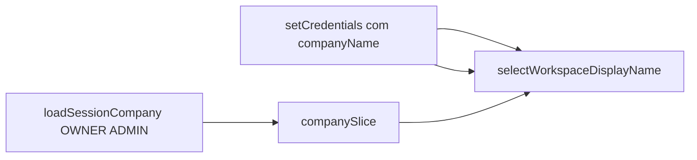

# SchedulerPro — Implementação: nome da empresa na Sidebar após login

**Data:** 31/10/2026  
**Base de referência:** auditoria em [schedulerpro-company-name-bootstrap-audit.md](./schedulerpro-company-name-bootstrap-audit.md) (`develop` @ `16b94ae`)  
**Tipo:** Implementação frontend + backend (contrato auth) + testes — **sem operações Git**

---

## 1. Problema identificado

Após login ou registo, a Sidebar («Espaço de trabalho») mostrava **SchedulerPro** até o utilizador abrir a página **Empresa**. Causa: `setCredentials` sem hidratação de `companySlice`; `SessionBootstrap` só corre no mount; MANAGER/EMPLOYEE não têm `GET /companies`.

---

## 2. Causa técnica

| Facto | Detalhe |
|-------|---------|
| Lacuna pós-login | [`LoginPage`](../../client/src/pages/LoginPage.tsx) / [`RegisterPage`](../../client/src/pages/RegisterPage.tsx) não chamavam `GET /companies` |
| Bootstrap único | [`SessionBootstrap`](../../client/src/app/SessionBootstrap.tsx) `useEffect(..., [dispatch])` |
| Staff sem COMPANY_READ | RBAC inalterado; nome não vinha na sessão |
| Sidebar | Só lia `company?.name` no Redux |

Navbar mantém **SchedulerPro** fixo (produto) — inalterado.

---

## 3. Arquitetura escolhida

**OWNER / ADMIN:** helper partilhado `loadSessionCompany` → `companyApi.getCompany()` → `setCompany`, após cada estabelecimento de sessão (bootstrap, login, registo, refresh se slice vazio).

**MANAGER / EMPLOYEE / CLIENT (staff):** campo **`companyName`** em `AuthUser` (login, me, refresh, registo), resolvido no backend apenas via `user.companyId` → `companyRepository.findById`.

**Sidebar:** selector `selectWorkspaceDisplayName` — prioridade `companySlice.name`, depois `auth.user.companyName`, depois fallback `SchedulerPro`. Sem chamadas API no layout.



---

## 4. Arquivos criados e alterados

### Criados

| Ficheiro |
|----------|
| [`client/src/app/loadSessionCompany.ts`](../../client/src/app/loadSessionCompany.ts) |
| [`client/src/app/loadSessionCompany.test.ts`](../../client/src/app/loadSessionCompany.test.ts) |

### Backend

| Ficheiro | Alteração |
|----------|-----------|
| [`server/src/modules/auth/types.ts`](../../server/src/modules/auth/types.ts) | `companyName: string` em `AuthUser` |
| [`server/src/modules/auth/mapper/AuthMapper.ts`](../../server/src/modules/auth/mapper/AuthMapper.ts) | `toAuthUser(..., companyName)` |
| [`server/src/modules/auth/services/AuthService.ts`](../../server/src/modules/auth/services/AuthService.ts) | `resolveCompanyAuthContext` (timezone + nome) |
| [`server/tests/unit/auth/AuthService.test.ts`](../../server/tests/unit/auth/AuthService.test.ts) | Asserts `companyName` login/me/refresh/MANAGER |

### Frontend (principais)

| Ficheiro | Alteração |
|----------|-----------|
| [`client/src/types/auth.ts`](../../client/src/types/auth.ts) | `companyName` |
| [`client/src/test/fixtures.ts`](../../client/src/test/fixtures.ts) | `companyName` nos fixtures |
| [`SessionBootstrap.tsx`](../../client/src/app/SessionBootstrap.tsx) | Usa `loadSessionCompany` |
| [`LoginPage.tsx`](../../client/src/pages/LoginPage.tsx) / [`RegisterPage.tsx`](../../client/src/pages/RegisterPage.tsx) | `await loadSessionCompany` após credenciais |
| [`client/src/api/apiClient.ts`](../../client/src/api/apiClient.ts) | Após refresh OK, hidrata empresa se slice vazio e `canView` |
| [`companySlice.ts`](../../client/src/store/slices/companySlice.ts) | `selectWorkspaceDisplayName` |
| [`Sidebar.tsx`](../../client/src/components/layout/Sidebar.tsx) | Selector + avatar com nome efectivo |
| Testes: `LoginPage`, `RegisterPage`, `Sidebar`, `apiClient`, `companySlice`, `authSlice`, `store/index`, `NotificationBell`, `useAppointmentsSchedule` (wrapper Redux) |

---

## 5. Alterações no contrato da API

Respostas de **login**, **register**, **`GET /auth/me`**, **`POST /auth/refresh`** incluem:

```json
"companyName": "<nome da empresa do tenant>"
```

- Resolvido no servidor a partir do `companyId` do utilizador autenticado.
- Sem parâmetros de cliente para escolher tenant.
- Não expõe logo, morada ou permissões extra.
- RBAC e `COMPANY_READ` **inalterados**.

---

## 6. Tratamento por perfil

| Perfil | Nome na Sidebar | Carregamento |
|--------|-----------------|--------------|
| **OWNER** | `company.name` (Redux) após `loadSessionCompany`; fallback `companyName` da sessão | Login, registo, bootstrap, refresh (se slice vazio) |
| **ADMIN** | Idem OWNER | Idem |
| **MANAGER** | `auth.user.companyName` | Só contrato auth — **sem** `getCompany` |
| **EMPLOYEE** | Idem MANAGER | Idem |
| **CLIENT** | Portal (sem mudança de shell operacional) | — |

---

## 7. Compatibilidade lifecycle

| Cenário | Comportamento |
|---------|----------------|
| **Empresa inactiva** | OWNER/ADMIN: `loadSessionCompany` continua a carregar registo → `AppLayout` + `CompanyInactiveNotice` |
| **`mustChangePassword`** | Helper **não** chama `GET /companies`; `companyName` na sessão pode alimentar Sidebar para staff |
| **Staff suspenso (B.1)** | Interceptor 403 + `StaffCompanySuspendedView` inalterados; `companyName` não contorna suspensão operacional |
| **Logout** | `clearCompany` + `clearCredentials` como antes |

---

## 8. Testes executados e resultados

### Backend

```bash
cd server && npm test -- --run tests/unit/auth/AuthService.test.ts
# 28 passed

cd server && npm test -- --run
# 91 files, 1287 passed

cd server && npm run build
# tsc OK
```

### Frontend (foco + regressão)

```bash
cd client && npm test -- --run loadSessionCompany.test SessionBootstrap.test LoginPage.test RegisterPage.test Sidebar.test companySlice.test authSlice.test apiClient.test AppLayout.test useAppointmentsSchedule.test
# OK

cd client && npm test -- --run
# 130 files, 1431 passed (após correção do wrapper Redux em useAppointmentsSchedule.test)

cd client && npm run build
# tsc + vite build OK
```

---

## 9. Comandos de build

| Comando | Resultado |
|---------|-----------|
| `cd server && npm run build` | OK |
| `cd server && npm test -- --run` | 1287 passed |
| `cd client && npm run build` | OK |
| `cd client && npm test -- --run` | 1431 passed |

---

## 10. Limitações e melhorias futuras

1. **Renomear empresa (PATCH):** `auth.user.companyName` pode ficar desactualizado para MANAGER/EMPLOYEE até novo login/me/refresh; Sidebar de OWNER/ADMIN usa `companySlice` após carga/edição na Empresa.
2. **Logo na Sidebar:** staff sem `companySlice` usa inicial do nome; logo só quando OWNER/ADMIN têm registo carregado.
3. **Navbar:** marca produto fixa; alterar só se produto quiser tenant no topo.
4. **`useAppointmentsSchedule.test`:** adicionado `Provider` Redux — o hook já usava `useAppSelector`; testes não estavam envolvidos (regressão exposta na suite completa).

---

## Resumo para outra IA

- **Problema:** desacoplamento login ↔ `companySlice`.
- **Fix OWNER/ADMIN:** [`loadSessionCompany`](../../client/src/app/loadSessionCompany.ts) nos mesmos pontos que a sessão fica válida.
- **Fix staff:** `companyName` no auth via [`resolveCompanyAuthContext`](../../server/src/modules/auth/services/AuthService.ts).
- **UI:** [`selectWorkspaceDisplayName`](../../client/src/store/slices/companySlice.ts) na Sidebar apenas.
- **Não feito:** mudanças RBAC, Navbar, Git, commits.
