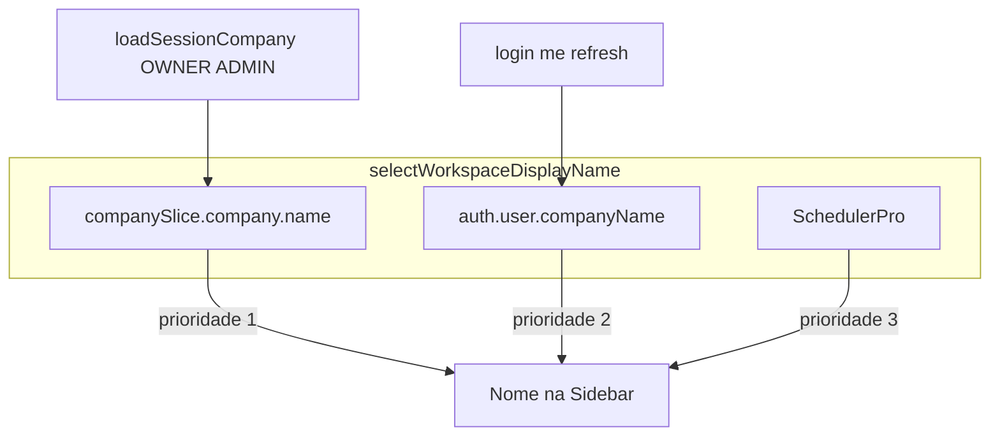

# SchedulerPro — Revisão técnica: nome da empresa na Sidebar

**Data:** 31/10/2026  
**Tipo:** Revisão **somente leitura** — sem alterações de código, configuração ou operações Git  
**Código analisado:** working tree local (referência histórica da auditoria: `develop` @ `16b94ae`)

**Documentos de referência:**

- [schedulerpro-company-name-bootstrap-audit.md](./schedulerpro-company-name-bootstrap-audit.md) — auditoria e causa raiz
- [schedulerpro-company-name-bootstrap-implementation.md](./schedulerpro-company-name-bootstrap-implementation.md) — implementação entregue

---

## Veredicto

## **APROVADO COM RESSALVAS**

A implementação corrige a lacuna funcional identificada na auditoria (login/registo sem hidratação de `companySlice`; staff sem `COMPANY_READ`), preserva RBAC e os fluxos de empresa inactiva / staff suspenso, e não introduz consultas API no layout. As ressalvas concentram-se em edge cases de consistência do Redux, sincronização do nome após PATCH para perfis staff, e cobertura de testes baseada em mocks (sem validação HTTP end-to-end do contrato `companyName`).

---

## Resumo executivo

- **Backend:** `companyName` integrado em `AuthUser` e propagado em login, registo, `/auth/me` e refresh via `resolveCompanyAuthContext(user.companyId)` — sem parâmetros de tenant do cliente.
- **Frontend OWNER/ADMIN:** helper [`loadSessionCompany`](../../client/src/app/loadSessionCompany.ts) reutilizado em bootstrap, login, registo e refresh (condicional); falha de `GET /companies` não invalida sessão.
- **Frontend MANAGER/EMPLOYEE:** nome via `auth.user.companyName` e [`selectWorkspaceDisplayName`](../../client/src/store/slices/companySlice.ts); `GET /companies` não é invocado para estes roles.
- **Lifecycle:** `mustChangePassword` omite carga administrativa; empresa inactiva e `USER_SUSPENDED_BY_COMPANY_DEACTIVATION` mantêm comportamento anterior (evidência em código + testes referenciados na implementação).
- **Ressalvas:** resposta vazia de `GET /companies` sem `clearCompany` (R-01); `companyName` em auth desactualizado para staff após PATCH (R-02); refresh não re-hidrata slice se já populado (R-03); testes sem integração HTTP do contrato (R-04).

---

## Matriz de verificação (10 itens obrigatórios)

| # | Requisito | Resultado | Evidência | Notas |
|---|-----------|-----------|-----------|-------|
| 1 | Contrato `companyName` em login, registo, `/auth/me`, refresh | **Conforme** | [`AuthController`](../../server/src/modules/auth/controllers/AuthController.ts): `register`, `login`, `refresh` devolvem `{ ...result.user, mustChangePassword }`; `me` devolve objecto de [`AuthService.me`](../../server/src/modules/auth/services/AuthService.ts). [`AuthUser.companyName`](../../server/src/modules/auth/types.ts). Frontend [`AuthSession`](../../client/src/types/auth.ts). | `AuthMapper.toAuthUser` inclui `companyName` em todos os fluxos que passam por `authenticateWithSession` ou `me`. |
| 2 | Nome resolvido só via `companyId` do utilizador autenticado | **Conforme** | [`AuthService.resolveCompanyAuthContext`](../../server/src/modules/auth/services/AuthService.ts) chama `companyRepository.findById(companyId)` com `user.companyId` de `UserDocument`. Sem leitura de body/query para tenant. | Teste unitário login MANAGER verifica `findById` com id do tenant ([`AuthService.test.ts`](../../server/tests/unit/auth/AuthService.test.ts)). |
| 3 | Utilizador / empresa inexistente ou removida | **Parcial** | `companyName: company?.name ?? ""` quando `findById` retorna null; timezone fallback via `resolveCompanyTimezone`. Sidebar: [`selectWorkspaceDisplayName`](../../client/src/store/slices/companySlice.ts) → `SchedulerPro` se slice e `companyName` vazios. | Comportamento previsível; string vazia no JSON (não omissão do campo). Utilizador órfão de empresa não modelado explicitamente além disso. |
| 4 | Prioridade e comportamento de `selectWorkspaceDisplayName` | **Conforme** | Ordem: `company.company.name` (trim) → `auth.user.companyName` (trim) → `"SchedulerPro"`. [`Sidebar.tsx`](../../client/src/components/layout/Sidebar.tsx) consome selector; sem API. | Testes em [`companySlice.test.ts`](../../client/src/store/slices/companySlice.test.ts) e [`Sidebar.test.tsx`](../../client/src/components/layout/Sidebar.test.tsx). |
| 5 | `loadSessionCompany` em login, registo, bootstrap, refresh | **Conforme** | [`SessionBootstrap.tsx`](../../client/src/app/SessionBootstrap.tsx) após `setCredentials`; [`LoginPage.tsx`](../../client/src/pages/LoginPage.tsx) / [`RegisterPage.tsx`](../../client/src/pages/RegisterPage.tsx) após login/registo; [`apiClient.ts`](../../client/src/api/apiClient.ts) `performSessionRefresh` se `!company && canView && !mustChangePassword`. | Condições espelham [`getCompanyAbilities`](../../client/src/config/companyPermissions.ts). |
| 6 | Falha em `GET /companies` não remove sessão válida | **Conforme** | [`loadSessionCompany`](../../client/src/app/loadSessionCompany.ts) `catch` → `clearCompany()` apenas; não chama `clearCredentials`. [`SessionBootstrap.test.tsx`](../../client/src/app/SessionBootstrap.test.tsx) «keeps the session when the company load fails»; [`loadSessionCompany.test.ts`](../../client/src/app/loadSessionCompany.test.ts) assert `isAuthenticated` após erro. | Alinhado com auditoria e implementação. |
| 7 | Nome após PATCH da empresa | **Parcial** | [`CompanyPage.tsx`](../../client/src/pages/company/CompanyPage.tsx): `dispatch(setCompany(updated))` em save/logo/lifecycle → Sidebar OWNER/ADMIN actualiza via slice. **`auth.user.companyName` não é actualizado** no PATCH. | MANAGER/EMPLOYEE continuam a ver nome antigo em auth até login/me/refresh — documentado na implementação §10. |
| 8 | MANAGER/EMPLOYEE sem `COMPANY_READ` / permissões extra | **Conforme** | [`server/src/constants/rbac.ts`](../../server/src/constants/rbac.ts): `COMPANY_READ` apenas OWNER/ADMIN. `loadSessionCompany` retorna cedo se `!canView`. Nenhuma alteração RBAC detectada. | Sidebar staff usa só `companyName` da sessão. |
| 9 | `mustChangePassword`, empresa inactiva, suspensão staff | **Conforme** | `loadSessionCompany`: `if (mustChangePassword) return`. Empresa inactiva: GET ainda permitido a OWNER/ADMIN (dados para `AppLayout`). [`apiClient.ts`](../../client/src/api/apiClient.ts): 403 + `isStaffCompanySuspensionCode` → `setStaffCompanyAccessSuspended` sem contornar RBAC. | Testes SessionBootstrap `mustChangePassword`; AppLayout/suspended mantidos na suite (ver implementação). |
| 10 | Testes cobrem perfis e contratos (além de mocks) | **Parcial** | Unitários: Login OWNER/ADMIN/MANAGER, Register, Sidebar roles, loadSessionCompany, SessionBootstrap, apiClient refresh, AuthService `companyName`. **Ausente:** teste HTTP real auth→JSON; `AuthMapper` real (mapper mockado em AuthService.test). | Mocks validam wiring Redux/UI; não substituem contrato integrado. |

---

## Fluxo Sidebar (pós-implementação)

---

## Achados detalhados

| ID | Severidade | Ficheiro | Função / contexto | Evidência | Correção recomendada |
|----|------------|----------|-------------------|-----------|----------------------|
| **R-01** | **Média** | [`client/src/app/loadSessionCompany.ts`](../../client/src/app/loadSessionCompany.ts) | `loadSessionCompany` | Em sucesso HTTP, se `data?.[0]` é undefined (array vazio), não executa `setCompany` **nem** `clearCompany`. `setCredentials` ([`authSlice`](../../client/src/store/slices/authSlice.ts)) não limpa `companySlice`. | Após GET bem-sucedido sem registo, `dispatch(clearCompany())`; ou `clearCompany` no início de login/registo antes de hidratar. |
| **R-02** | **Baixa** | [`client/src/pages/company/CompanyPage.tsx`](../../client/src/pages/company/CompanyPage.tsx), [`companySlice.ts`](../../client/src/store/slices/companySlice.ts) | PATCH nome empresa | `setCompany(updated)` actualiza slice; **`auth.user.companyName` inalterado**. Staff usa prioridade 2 só quando slice vazio. | Opcional: reducer/thunk que sincronize `companyName` no user ao `setCompany`, ou confiar em refresh periódico (documentar produto). |
| **R-03** | **Baixa** | [`client/src/api/apiClient.ts`](../../client/src/api/apiClient.ts) | `performSessionRefresh` | Se `store.getState().company.company` já existe, **não** chama `loadSessionCompany`, mas `setCredentials` actualiza `companyName` no auth. Selector prioriza nome do slice (pode ser mais antigo que auth após rename remoto). | Após refresh, actualizar `company.name` no slice a partir de `session.companyName` se slice existir, ou re-fetch condicional. |
| **R-04** | **Informativa** | [`server/tests/unit/auth/AuthService.test.ts`](../../server/tests/unit/auth/AuthService.test.ts) | Testes auth | `AuthMapper` mockado; controllers auth sem teste de serialização JSON com `companyName`. | Testes de integração ou contract test sobre rotas `/auth/login`, `/auth/me`, `/auth/refresh`. |

### Conformidades relevantes (sem achado)

- Recomendação **Opção A** da auditoria (helper partilhado, não fetch por render) — **implementada**.
- **Navbar** permanece `SchedulerPro` fixo — conforme requisito de produto.
- **Multi-tenant:** resolução backend amarrada ao `companyId` do user; `GET /companies` continua filtrado no backend pelo tenant da sessão (sem mudança revista neste diff).
- **Logout:** [`Navbar`](../../client/src/components/layout/Navbar.tsx) / [`apiClient`](../../client/src/api/apiClient.ts) `handleSessionExpired` mantêm `clearCompany` onde aplicável.

---

## Comparação: auditoria vs implementação

| Problema (auditoria) | Estado após implementação |
|----------------------|---------------------------|
| Login/registo só `setCredentials` | **Resolvido** — `await loadSessionCompany` após credenciais |
| Bootstrap uma vez no mount | **Mitigado** — login/registo cobrem o gap; bootstrap inalterado no mount |
| MANAGER/EMPLOYEE sem nome | **Resolvido** — `companyName` no auth + selector |
| Sidebar só `company?.name` | **Resolvido** — `selectWorkspaceDisplayName` |
| Navbar vs sidebar | **Inalterado** (navbar fixa; sidebar corrigida) |
| Risco fetch no layout | **Não introduzido** |

---

## Regressões e lifecycle (revisão estática)

| Área | Avaliação |
|------|-----------|
| Empresa inactiva (OWNER/ADMIN) | `loadSessionCompany` carrega registo completo → [`AppLayout`](../../client/src/components/layout/AppLayout.tsx) + aviso global dependem de `selectCompany` — fluxo coerente com implementação B. |
| Staff suspenso B.1 | Interceptor 403 e [`StaffCompanySuspendedView`](../../client/src/components/company/StaffCompanySuspendedView.tsx) não foram alterados para contornar suspensão; `companyName` é identificação, não permissão operacional. |
| `mustChangePassword` | Carga administrativa omitida; `companyName` ainda pode vir no payload auth — Sidebar pode mostrar nome sem expor gestão Empresa. |

Regressões automatizadas **não reexecutadas** nesta revisão; a implementação reporta suites [`AppLayout.test`](../../client/src/components/layout/AppLayout.test.tsx), SessionBootstrap e apiClient suspensão como verdes no ciclo de implementação.

---

## Testes e builds

### Execução nesta sessão de revisão

**Nesta sessão de revisão técnica não foram executados** `npm test`, `npm run build` **nem qualquer outro comando de validação automatizada.** A análise baseou-se na **leitura do código** e nos relatórios de auditoria e implementação.

### Resultados reportados na implementação (não revalidados aqui)

Reproduzido de [schedulerpro-company-name-bootstrap-implementation.md](./schedulerpro-company-name-bootstrap-implementation.md) §8–9 (31/10/2026):

| Comando (reportado) | Resultado (reportado) |
|---------------------|------------------------|
| `cd server && npm test -- --run` | 1287 testes passed |
| `cd server && npm run build` | OK (`tsc`) |
| `cd client && npm test -- --run` | 1431 testes passed |
| `cd client && npm run build` | OK (`tsc` + Vite) |

Qualquer decisão de merge ou deploy deve **reexecutar** estas suites localmente ou em CI.

---

## Conclusão

A implementação **cumpre o objectivo funcional** da auditoria para a Sidebar após login, respeita multi-tenant no backend para `companyName`, mantém RBAC e compatibilidade com lifecycle B/B.1, e trata falhas de `GET /companies` sem derrubar sessão.

**Classificação final: APROVADO COM RESSALVAS.**

**Condições sugeridas para APROVADO pleno (opcional):**

1. Endereçar **R-01** (lista vazia / slice stale) antes de cenários multi-utilizador no mesmo browser sem logout completo.
2. Aceitar ou corrigir **R-02/R-03** conforme expectativa de produto sobre rename e refresh.
3. Adicionar pelo menos um teste de contrato HTTP ou integração para `companyName` (**R-04**) se o contrato for crítico para clientes móveis ou terceiros.

---

## Git

Nenhuma operação Git foi realizada como parte desta revisão.
