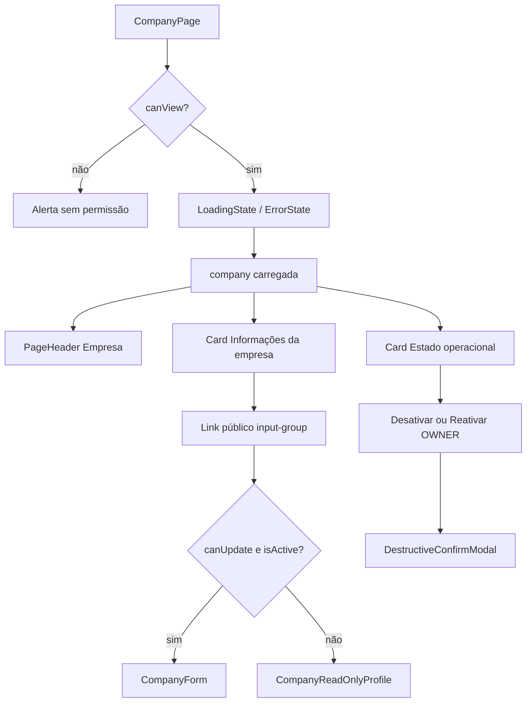

# SchedulerPro — Etapa 4.1 — Auditoria da CompanyPage

**Data:** 02/11/2026  
**Branch de trabalho:** `feature/ui-company-page-step-4` (criada na Etapa 4)  
**Tipo:** Análise estática (sem alterações de código, CSS, testes ou Git)

**Contexto:** Etapas 1–3 concluídas e validadas manualmente. Personalizações do utilizador na Etapa 3 (ex.: `borderRadius: "5px"` nos filtros Estado; remoção de blocos CSS do agente em Agendamentos) **não devem ser reintroduzidas** nem copiadas cegamente para CompanyPage.

---

## 1. Resumo da estrutura actual da CompanyPage

A rota `/company` renderiza [`CompanyPage.tsx`](../../client/src/pages/company/CompanyPage.tsx) dentro do shell autenticado (`AppLayout` → `Outlet`).

### 1.1 Fluxo de renderização

### 1.2 Secções visuais

| Secção | Conteúdo | Notas |
|--------|----------|--------|
| `PageHeader` | Título «Empresa», descrição | Sem `actions` no header (CTAs ficam nos cards). |
| Alertas | Sucesso, erro de lifecycle | Bootstrap `alert-*`. |
| Card «Informações da empresa» | Link público (sempre visível com `canView`) + formulário **ou** perfil só leitura | Link **acima** dos campos Nome/Timezone/logo. |
| Card «Estado operacional» | Badge Ativa/Inativa, copy, botões lifecycle | OWNER: desativar (activa) ou reativar (inactiva). ADMIN: só consulta. |
| Modal | Confirmação de desactivação | [`DestructiveConfirmModal`](../../client/src/components/common/DestructiveConfirmModal.tsx). |

### 1.3 Regra de edição (UX, não CSS)

`canEditProfile = canUpdate && company.isActive` ([`CompanyPage.tsx`](../../client/src/pages/company/CompanyPage.tsx) L71).  
OWNER e ADMIN editam perfil **apenas com empresa activa**; inactiva → `CompanyReadOnlyProfile` + aviso no link público (L263–267).

Aviso global «Empresa suspensa» vem de [`AppLayout`](../../client/src/components/layout/AppLayout.tsx) + [`CompanyInactiveNotice`](../../client/src/components/company/CompanyInactiveNotice.tsx) (`variant="global"`), **não** duplicado na página (coberto por testes).

---

## 2. Ficheiros e componentes analisados

### 2.1 Página e formulário

| Ficheiro | Papel |
|----------|--------|
| [`client/src/pages/company/CompanyPage.tsx`](../../client/src/pages/company/CompanyPage.tsx) | Layout, link público, permissões, lifecycle |
| [`client/src/components/company/CompanyForm.tsx`](../../client/src/components/company/CompanyForm.tsx) | Nome, timezone, logo, «Salvar alterações» |
| [`client/src/components/company/CompanyInactiveNotice.tsx`](../../client/src/components/company/CompanyInactiveNotice.tsx) | Alertas OWNER/ADMIN (uso principal: global no layout) |
| [`client/src/config/companyPermissions.ts`](../../client/src/config/companyPermissions.ts) | `getCompanyAbilities` (OWNER/ADMIN view+update; lifecycle só OWNER) |

### 2.2 Componentes partilhados (apresentação)

| Ficheiro | Uso na CompanyPage |
|----------|-------------------|
| [`PageHeader.tsx`](../../client/src/components/common/PageHeader.tsx) | Cabeçalho |
| [`ImageUploader.tsx`](../../client/src/components/common/ImageUploader.tsx) | Logo (`btn-sm` nas acções) |
| [`ImageAvatar.tsx`](../../client/src/components/common/ImageAvatar.tsx) | Pré-visualização logo / readonly |
| [`LoadingState`](../../client/src/components/common/LoadingState.tsx), [`ErrorState`](../../client/src/components/common/ErrorState.tsx) | Carregamento / retry |
| [`DestructiveConfirmModal.tsx`](../../client/src/components/common/DestructiveConfirmModal.tsx) | Desactivar empresa |

### 2.3 Estilos globais relevantes

| Ficheiro | Selectors / tokens |
|----------|-------------------|
| [`client/src/index.css`](../../client/src/index.css) | `:root` `--sp-btn-*`, `.btn` / `.btn-sm`, `.form-control` / `.form-select`, `.page-header`, `.page-actions`, `.section-actions`, `.image-uploader*`, media `@767` / `@575` |

**Observação:** Não existe ficheiro CSS dedicado à CompanyPage nem selectors `company-*` no repositório (grep em `*.css`).

### 2.4 Fora de scope directo (referência)

- [`AppLayout.tsx`](../../client/src/components/layout/AppLayout.tsx) — banner inactivo global.
- [`StaffCompanySuspendedView.tsx`](../../client/src/components/company/StaffCompanySuspendedView.tsx) — bloqueio MANAGER/EMPLOYEE (não é a CompanyPage).
- API / Redux — apenas mencionados onde afectam estados visíveis (readonly, spinners, disabled).

---

## 3. Problemas visuais e oportunidades (com referências)

Legenda: **Confirmado (código)** = deduzível do markup/CSS actual; **Hipótese** = requer validação no browser (viewport real).

### 3.1 Link público — `input-group`

| ID | Descrição | Classificação | Referência |
|----|-----------|---------------|------------|
| C1 | Único `input-group` da app; sem regras responsivas dedicadas | **Confirmado (código)** | [`CompanyPage.tsx`](../../client/src/pages/company/CompanyPage.tsx) L234–257; grep `input-group` só neste ficheiro |
| C2 | Botões «Copiar link» e «Abrir link» com larguras diferentes (copy ≠ open) | **Confirmado (código)** | L242–256; alinhado ao item **I13** da [auditoria global](./schedulerpro-global-button-ui-audit.md) |
| C3 | Acções do grupo **não** usam `--sp-btn-action-min-width` (ao contrário de `.table-actions .btn`) | **Confirmado (código)** | [`index.css`](../../client/src/index.css) L150–164 vs botões L242–256 sem classe wrapper |
| C4 | Input `form-control` com `min-height: 2.75rem`; `.btn` com `min-height: 2.5rem` | **Confirmado (código)** | [`index.css`](../../client/src/index.css) L57–60, L79–83 — discrepância global; no `input-group` o Bootstrap tende a esticar itens (**Hipótese:** alinhamento vertical aceitável; confirmar visualmente) |
| C5 | Em mobile estreito, grupo em fila única (`input-group` Bootstrap, `flex-wrap: nowrap` por omissão) | **Hipótese** | URL longa + dois botões podem comprimir o campo ou truncar labels; **validar** ~320–390px |
| C6 | «Abrir link» é `<a class="btn">` — herda mesmas regras que `<button>` | **Confirmado (código)** | L249–256; coerente com tokens globais de `.btn` |

### 3.2 Campos Nome e Timezone

| ID | Descrição | Classificação | Referência |
|----|-----------|---------------|------------|
| C7 | Padrão Bootstrap consistente: `form-label`, `form-control`, `form-select`, `form-text`, `is-invalid` | **Confirmado (código)** | [`CompanyForm.tsx`](../../client/src/components/company/CompanyForm.tsx) L137–176 |
| C8 | Altura dos campos (2.75rem) ≠ altura base dos botões primários do card lifecycle (2.5rem) | **Confirmado (código)** | Tokens globais; impacto visual baixo entre secções distintas (**Hipótese:** gap vertical parece correcto por `mb-3`) |

### 3.3 Botão «Salvar alterações»

| ID | Descrição | Classificação | Referência |
|----|-----------|---------------|------------|
| C9 | `btn btn-primary` sem `min-width: var(--sp-btn-save-min-width)` | **Confirmado (código)** | [`CompanyForm.tsx`](../../client/src/components/company/CompanyForm.tsx) L178–191; token `--sp-btn-save-min-width` só aplicado em `.availability-day-save .btn` ([`index.css`](../../client/src/index.css) L855–862) |
| C10 | Wrapper `d-grid d-sm-block` — largura total em `<576px`, inline a partir de `sm` | **Confirmado (código)** | L178 — **padrão positivo** alinhado à intenção mobile da Etapa 1 (CTA táctil), diferente de `.page-actions` mas equivalente em espírito |
| C11 | Label longo «Salvar alterações» vs «Salvar» noutros formulários | **Confirmado (código)** | L190; largura proporcional ao texto (sem token de save neste contexto) |

### 3.4 Logo — `ImageUploader`

| ID | Descrição | Classificação | Referência |
|----|-----------|---------------|------------|
| C12 | Acções «Adicionar/Substituir/Remover logo» já usam `btn btn-sm` | **Confirmado (código)** | [`ImageUploader.tsx`](../../client/src/components/common/ImageUploader.tsx) L143–172 — **alinhado à Etapa 1** (`--sp-btn-sm-*`) |
| C13 | Responsivo `@575`: acções a 100% largura, `flex: 1 1 auto` nos botões | **Confirmado (código)** | [`index.css`](../../client/src/index.css) L1428–1437 — beneficia CompanyForm sem CSS extra |
| C14 | `ImageUploader` com `margin-bottom: 1.25rem` vs campos com `mb-3` (1rem) | **Hipótese** | Espaçamento ligeiramente diferente entre bloco logo e campo Nome — validar ritmo vertical |

### 3.5 Perfil só leitura e estado inactivo

| ID | Descrição | Classificação | Referência |
|----|-----------|---------------|------------|
| C15 | `CompanyReadOnlyProfile`: avatar + `dl.row` (Nome, Timezone) | **Confirmado (código)** | [`CompanyPage.tsx`](../../client/src/pages/company/CompanyPage.tsx) L17–37 |
| C16 | Link público permanece editável visualmente (input readonly + botões activos) com empresa inactiva | **Confirmado (comportamento)** | L234–257; copy/abrir ainda disponíveis — correcto funcionalmente; **Hipótese:** reforço visual opcional (opacity) não existe |
| C17 | Card «Estado operacional» com `border border-primary` quando inactiva + OWNER pode reactivar | **Confirmado (código)** | L283–285 |

### 3.6 Botões lifecycle

| ID | Descrição | Classificação | Referência |
|----|-----------|---------------|------------|
| C18 | «Desativar empresa» — `btn btn-outline-danger`; «Reativar empresa» — `btn btn-primary` | **Confirmado (código)** | L307–338 |
| C19 | Sem `btn-sm`; altura `2.5rem` global | **Confirmado (código)** | Consistente com CTAs principais noutras páginas (pós-Etapa 1) |
| C20 | Não envolvidos em `.page-actions` / `.section-actions` | **Confirmado (código)** | Mobile: botões **não** forçados a 100% largura (regras `@767` só em `.page-actions` / `.section-actions`, [`index.css`](../../client/src/index.css) L1145–1174) — **Hipótese:** em telemóvel «Desativar»/«Reativar» ficam largura intrínseca; aceitável, validar tactil |

### 3.7 Duplicação / conflitos CSS

| ID | Descrição | Classificação | Referência |
|----|-----------|---------------|------------|
| C21 | Nenhuma regra CSS específica CompanyPage — zero duplicação local | **Confirmado (código)** | — |
| C22 | Possível conflito conceptual: `.btn { border-radius: 0.6rem }` global vs cantos segmentados do `input-group` Bootstrap | **Hipótese** | Validar se primeiro/último botão do grupo mantém aspecto «colado» ao input |

---

## 4. Comportamento por viewport (observado / inferido)

| Viewport | Comportamento inferido |
|----------|------------------------|
| **Desktop (≥992px)** | Dois cards empilhados; `input-group` horizontal; formulário em coluna única; `dl.row` readonly com rótulos `col-sm-3`. |
| **Tablet (768–991px)** | `PageHeader` mantém flex row (empilha só ≤767.98px). Link público ainda em fila única no grupo. Padding main `p-md-4`. |
| **Mobile (≤767.98px)** | Header empilha ([`index.css`](../../client/src/index.css) L1137–1140). «Salvar alterações» largura total (`d-grid`). Logo: acções com regras `@575` se aplicável. **Gap principal:** `input-group` sem stack/wrap dedicado (C5). |
| **Mobile estreito (≤575.98px)** | Logo uploader: botões expandem (C13). Navbar compacta (contexto shell, não CompanyPage). |

Nenhuma validação visual em browser foi executada nesta etapa; secções marcadas **Hipótese** dependem de teste manual.

---

## 5. Comparação com tokens e padrões das etapas anteriores

| Padrão (Etapa) | Estado na CompanyPage |
|----------------|------------------------|
| Tokens `--sp-btn-min-height`, padding, radius ([`index.css`](../../client/src/index.css) L41–68) | **Aplicados** a todos `.btn` / `.btn-sm` (link público, lifecycle, save, logo). |
| `.table-actions` + `--sp-btn-action-min-width` (Etapa 1) | **Não aplicado** ao par Copiar/Abrir (C2, C3). |
| `--sp-btn-save-min-width` (Etapa 1, Disponibilidade) | **Não aplicado** a «Salvar alterações» (C9). |
| `.page-actions` full-width @767 (Etapa 1) | CompanyPage **não usa** `PageHeader.actions`; save usa `d-grid` próprio (C10). |
| `.section-actions` @767 (Etapa 2) | **Não usado** na CompanyPage (lifecycle fora do padrão section-actions). |
| `.filter-bar` / toolbars `btn-sm` (Etapa 3) | **Não aplicável**; logo já em `btn-sm`. |
| Personalizações Etapa 3 (inline 5px Estado; remoção CSS vistas/status) | **Não copiar** para Company; se houver radius em grupos, preferir classe scoped nova (ex. `.company-public-link-actions`) em vez de reintroduzir blocos removidos em Agendamentos. |

---

## 6. Oportunidades por prioridade

| Prioridade | IDs | Resumo |
|------------|-----|--------|
| **Alta** | C5, C2, C3 | Responsividade e simetria do **link público** (único `input-group` da app). |
| **Média** | C4, C22, C9 | Harmonizar alturas input/botão no grupo; avaliar largura mínima do save ou manter `d-grid` mobile. |
| **Baixa** | C14, C20, C11 | Ritmo vertical logo/campos; largura lifecycle mobile; copy do botão save. |
| **Informativo** | C12, C13, C10 | Já alinhados à Etapa 1; manter em implementação. |

---

## 7. Proposta de implementação (tarefas pequenas)

1. **Classe de contexto no link público (markup mínimo)**  
   Envolver o `input-group` (ou adicionar className) p.ex. `company-public-booking-link` em [`CompanyPage.tsx`](../../client/src/pages/company/CompanyPage.tsx) L234 — só na implementação autorizada.

2. **CSS scoped em `index.css` (sem TSX além da class)**  
   - @767 (ou @575): `flex-wrap`, stack vertical ou quebra «input full width + row de acções» com `gap: var(--sp-btn-action-gap)`.  
   - Opcional: `.company-public-booking-link .btn { min-width: var(--sp-btn-action-min-width); }` para simetria Copiar/Abrir (C2, C3).  
   - Opcional: alinhar altura do controlo ao botão no grupo (`min-height` partilhado ou override local) — C4.

3. **Validar cantos do `input-group`** com `.btn { border-radius: 0.6rem }` (C22); ajustar só selectors dentro da classe de contexto se necessário.

4. **«Salvar alterações»**  
   Manter `d-grid d-sm-block`; decidir se aplica `--sp-btn-save-min-width` num wrapper `.company-form-save` (C9) ou deixa largura intrínseca em desktop.

5. **Lifecycle**  
   Opcional: envolver botões em `.section-actions` @767 para full-width — só se validação manual C20 pedir paridade com Nova exceção / CTAs de card.

6. **Regressão visual**  
   Matriz manual: OWNER/ADMIN × activa/inactiva × 320 / 768 / 992px; clipboard + link externo.

7. **Documentação**  
   Relatório Etapa 4.2 pós-implementação (seguir modelo das etapas 1–3).

**Fora de proposta:** alterar RBAC, textos de negócio, ordem funcional dos cards, reintroduzir CSS removido na Etapa 3 em Agendamentos.

---

## 8. Riscos de regressão e validação manual

| Risco | Mitigação |
|-------|-----------|
| Quebrar único `input-group` da app ao forçar wrap | Testar URLs longas (produção `env.appUrl`) em mobile |
| `min-width` em Copiar/Abrir aumentar overflow antes do breakpoint | Combinar com stack @767 |
| Full-width lifecycle via `.section-actions` alterar hierarquia visual do card | A/B manual OWNER desactivar |
| Logo uploader partilhado (Client/Employee forms) | Alterações só em `.company-*` ou validar que regras globais `.image-uploader` permanecem OK |
| Modal desactivar | Footer modal já padronizado globalmente — smoke test após CSS company |

**Validação manual obrigatória:** C4, C5, C14, C20, C22 (marcadas Hipótese).

---

## 9. Testes existentes reaproveitáveis

| Ficheiro | Cobertura útil para regressão pós-UI |
|----------|--------------------------------------|
| [`CompanyPage.test.tsx`](../../client/src/pages/company/CompanyPage.test.tsx) | Permissões, link público, copy, form vs readonly, lifecycle, inactive UX |
| [`CompanyPage.logo.test.tsx`](../../client/src/pages/company/CompanyPage.logo.test.tsx) | Logo na página |
| [`CompanyForm.test.tsx`](../../client/src/components/company/CompanyForm.test.tsx) | Campos, validação, submit |
| [`CompanyForm.logo.test.tsx`](../../client/src/components/company/CompanyForm.logo.test.tsx) | Upload/remover logo |
| [`CompanyInactiveNotice.test.tsx`](../../client/src/components/company/CompanyInactiveNotice.test.tsx) | Textos OWNER/ADMIN (layout global) |
| [`ImageUploader.test.tsx`](../../client/src/components/common/ImageUploader.test.tsx) | Acções sm (se existir no repo) |

Os testes actuais **não assertam** classes CSS, breakpoints ou dimensões — após implementação visual, correr suite completa (`vitest`) + checklist manual acima.

---

## 10. Confirmações desta etapa

- [x] Apenas análise estática; **nenhum** ficheiro TSX/CSS de produto alterado.
- [x] **Nenhuma** operação Git executada nesta etapa 4.1.
- [x] Personalizações Etapa 3 **não** propostas para reintrodução em Agendamentos.

---

## 11. Próximo passo

Aguardar **autorização explícita** para implementação (Etapa 4.2). Prioridade sugerida: tarefas 1–3 (link público responsivo + simetria de acções).
