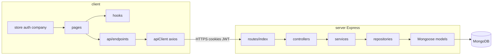

# SchedulerPro — Auditoria técnica completa

**Data da auditoria:** 01/11/2026  
**Modo:** READ-ONLY (sem alterações a código, config, dependências ou Git)  
**Entregável:** diagnóstico, evidências, plano de acção — **sem implementação de correções**

---

## 1. Estado e limitações do ambiente

| Item | Detalhe |
|------|---------|
| Working tree | Assumido **não limpo** (alterações locais de trabalhos recentes: Redux company name, build TS fix, etc.) — **não** inspeccionado via Git (proibido). |
| Base de dados | Testes server usam **MongoDB Memory Server** / mocks (Vitest); **não** foi ligado a MongoDB de produção. |
| Segredos | Variáveis `.env` **não** lidas nem reproduzidas neste documento. |
| npm audit | **Não executado** (não consta script dedicado; instalação de ferramentas extra proibida). |
| Cobertura linha-a-linha | Amostragem por domínio + grep + leitura de ficheiros âncora; **não** revisão exaustiva de ~800 ficheiros TS/TSX. |
| Documentação histórica | ~90 relatórios em `docs/reports/`; cruzados como pistas, revalidados no código quando possível. |

---

## 2. Resumo executivo

O SchedulerPro apresenta uma **arquitectura modular madura** (Express + camadas por domínio; React + Redux Toolkit + hooks + API client central), com **forte cobertura de testes** (1287+ testes server, 1439 client) e **padrões multi-tenant** aplicados sobretudo na **camada de serviço** (`companyId` da sessão, comparações após `findById`).

**Pontos fortes:** RBAC centralizado ([`server/src/constants/rbac.ts`](../../server/src/constants/rbac.ts)); transacções e reintentos para reserva ([`appointment-booking-transaction.ts`](../../server/src/modules/appointments/services/appointment-booking-transaction.ts)); testes de concorrência de booking; ciclo de vida de empresa e staff suspenso; sincronização recente do nome da empresa no Redux ([`loadSessionCompany`](../../client/src/app/loadSessionCompany.ts), [`companySessionSync`](../../client/src/store/companySessionSync.ts), refresh em [`apiClient`](../../client/src/api/apiClient.ts)).

**Riscos principais antes de produção:** middleware **`express-mongo-sanitize` desactivado** em [`app.ts`](../../server/src/app.ts); **CI GitHub só executa backend** ([`.github/workflows/ci.yml`](../../.github/workflows/ci.yml)); **bloqueio por tentativas de login** modelado mas **não ligado** ao fluxo de autenticação; dependências **Redis / Sentry / WhatsApp** parcialmente configuradas ou ausentes no runtime.

**Validação (01/11/2026):** builds server e client **OK**; suite client **1439/1439**; suite server **91/91** ficheiros na segunda corrida (primeira corrida reportou **1 ficheiro falhado** sem detalhe no log capturado — possível flakiness).

---

## 3. Arquitectura identificada

### 3.1 Visão geral



### 3.2 Backend (`server/src`)

| Camada | Responsabilidade | Observações |
|--------|------------------|-------------|
| `routes/index.ts` | Prefixo `/api`, registo de módulos | Rotas públicas em `/public` (booking, appointment token, client invite) |
| `middlewares/` | Auth, RBAC, password change, empresa operacional, rate limit, request ID, erros | [`require-operational-company.middleware.ts`](../../server/src/middlewares/require-operational-company.middleware.ts) |
| `modules/*` | Domínios de negócio | Padrão routes → controllers → services → repositories → models |
| `providers/` | DB, logger, mail (Resend), imagens (Cloudinary), tokens públicos | |
| `config/` | `env`, `validateEnv`, Morgan | Fail-fast em variáveis críticas |
| `constants/` | RBAC, roles, permissions, mensagens HTTP | |

**Módulos registados:** auth, users, companies, services, clients (`Clients/`), appointments (+ público), public-booking, availability, availability-exceptions, reports, dashboard, notifications, client-invites, reminders (scheduler no [`server.ts`](../../server/src/server.ts)).

**Anomalias estruturais:** pasta [`server/src/modules/Clients`](../../server/src/modules/Clients) com **C maiúsculo** (imports inconsistentes com convenção); comentário de `mongoSanitize` sem import activo.

### 3.3 Frontend (`client/src`)

| Área | Padrão |
|------|--------|
| `pages/` | Ecrãs por domínio + portal CLIENT + público |
| `components/` | UI Bootstrap, layout, domínios (appointments, company, …) |
| `hooks/` | `useAppointmentsSchedule`, `useAppointmentsNavigation`, `useMatchMedia` |
| `api/endpoints/` | Um módulo por recurso; [`apiClient.ts`](../../client/src/api/apiClient.ts) interceptors 401/403 |
| `store/` | **Dois slices:** `auth`, `company` |
| `config/*Permissions.ts` | Espelho **declarativo** do RBAC (backend autoridade final) |
| `routes/AppRoutes.tsx` | **Import estático** de todas as pages (sem `React.lazy`) |

### 3.4 Fluxo de sessão e tenant (staff)

1. Cookies HTTP → `AuthMiddleware` → `req.user` com `companyId`, `role`.
2. Serviços recebem `companyId` do contexto autenticado; muitos métodos comparam `entity.companyId` após `repository.findById(id)` (ex.: [`AppointmentService.findById`](../../server/src/modules/appointments/services/AppointmentService.ts) L754–758).
3. Frontend: `SessionBootstrap` + login/registo → `setCredentials` → `reconcileCompanySliceWithSession` → `loadSessionCompany` (OWNER/ADMIN); refresh patcha nome no slice se já carregado.

---

## 4. Estado funcional por módulo (checklist §2)

| Funcionalidade | Estado | Evidência resumida |
|----------------|--------|-------------------|
| Autenticação / JWT / refresh | **Confirmado** | Auth module, cookies, [`apiClient`](../../client/src/api/apiClient.ts) refresh partilhado, testes `SessionService`, `token-expiration` |
| Registo / login | **Confirmado** | AuthRoutes, AuthService, páginas Login/Register |
| Recuperação / reset senha | **Confirmado** | Forgot/Reset pages, AuthService (testes parciais unit) |
| Perfil / alteração senha | **Confirmado** | ChangePasswordRoute, middleware password change |
| Gestão empresas + lifecycle | **Confirmado** | CompanyService lifecycle, transacções, testes isolation/lifecycle |
| Suspensão staff / empresa inactiva | **Confirmado** | `assert-user-access-active`, AppLayout, interceptor 403 B.1 |
| RBAC 5 roles | **Confirmado** | `rbac.ts` + `authorize()` nas rotas; frontend `*Permissions` |
| Users / employees | **Confirmado** | UserService, EmployeesPage, hierarquia assign role |
| Clients + convites | **Confirmado** | ClientService, client-invites, Stage 32 docs |
| Services / availability | **Confirmado** | Módulos + testes timezone/exceptions |
| Appointments + público | **Confirmado** | AppointmentService, public routes, booking |
| Double-booking | **Parcial** | Transacções + índices + [`appointment-booking-concurrency.test.ts`](../../server/tests/integration/appointments/appointment-booking-concurrency.test.ts); não prova todos os cenários de corrida em produção |
| Dashboard v1 / reports | **Confirmado** | DashboardService/Repository, ReportRoutes (OWNER/ADMIN/MANAGER) |
| Upload logo | **Confirmado** | Cloudinary provider, CompanyPage tests |
| Nome empresa Sidebar | **Confirmado** | `selectWorkspaceDisplayName`, loadSessionCompany, R-01–R-03 |
| Brute-force login lock | **Parcial / gap** | Campos `failedLoginAttempts`/`lockUntil` no modelo; **sem** uso em AuthService além de reset (ver AUD-006) |
| Redis cache | **Não implementado** | `ioredis` no package.json, env `REDIS_*`, **zero** imports (ver AUD-004) |
| WhatsApp | **Não implementado** | Env + categoria log; sem provider de envio |
| Sentry | **Não inicializado** | Dependência `@sentry/node`, env; **sem** `Sentry.init` (ver AUD-005) |

---

## 5. Resultados — backend (Etapa 2)

### 5.1 Inicialização

- [`validateEnv.ts`](../../server/src/config/validateEnv.ts): `MONGO_URI`, JWT secrets, keyring tokens públicos — **fail fast**.
- [`server.ts`](../../server/src/server.ts): connect DB → `ReminderScheduler.start()` → listen; **SIGINT/SIGTERM** graceful (HTTP close, scheduler stop, disconnect).
- **Risco:** falha na init encerra com `process.exit(1)` — adequado.

### 5.2 Multi-tenancy

- **Confirmado (padrão dominante):** serviços validam `companyId` após leitura por `_id` (appointments, clients via `findByIdForCompany` em fluxos sensíveis).
- **Risco potencial (defesa em profundidade):** repositórios como [`AppointmentRepository.findById`](../../server/src/modules/appointments/repositories/AppointmentRepository.ts) (L53–59) e [`UserRepository.findById`](../../server/src/modules/users/repositories/UserRepository.ts) (L25–27) **não** filtram `companyId` — segurança depende de **todos** os call sites passarem pelo service (AUD-007).
- **Público:** tenant via URL `/public/companies/:companyId` documentado em [`routes/index.ts`](../../server/src/routes/index.ts); tokens de agendamento isolados por hash (AUD-008 positivo).

### 5.3 RBAC MANAGER vs EMPLOYEE

| Capacidade | MANAGER (`rbac.ts`) | EMPLOYEE |
|------------|---------------------|----------|
| USER_READ | Sim | Não |
| CLIENT_CREATE/UPDATE | Sim | Não (só READ) |
| APPOINTMENT_CREATE | Sim | Não (READ + UPDATE) |
| AVAILABILITY_UPDATE | Sim | READ only |
| Relatórios (rotas) | Sim (`ReportRoutes`) | Não |

Frontend [`menu.ts`](../../client/src/config/menu.ts) alinha visibilidade (ex.: relatórios só OWNER/ADMIN/MANAGER; empresa só OWNER/ADMIN). **Melhoria pendente histórica:** diferenciação MANAGER/EMPLOYEE já existe no backend; EMPLOYEE ainda vê entradas de menu para módulos read-only (comportamento aceitável se UI desactiva acções).

### 5.4 Agendamentos

- Índices compostos em [`Appointment.model.ts`](../../server/src/modules/appointments/models/Appointment.model.ts) para conflitos por funcionário.
- `withBookingTransaction` com até 4 tentativas e labels Mongo transitórios.

### 5.5 Segurança HTTP

- Helmet, CORS (default), compression, cookie parser, request ID, Morgan, Winston.
- **`express-mongo-sanitize` desactivado** (AUD-001).
- **xss-clean:** não presente em [`server/package.json`](../../server/package.json) (stack declarada no briefing do projecto **não** coincide com dependências actuais — INFORMATIVO).

---

## 6. Resultados — frontend (Etapa 3)

### 6.1 Rotas e permissões

- [`ProtectedRoute`](../../client/src/routes/ProtectedRoute.tsx): autenticação + `mustChangePassword`; **não** filtra por role (URLs directas possíveis; backend deve negar — **parcial**).
- [`AppLayout`](../../client/src/components/layout/AppLayout.tsx): separa portal CLIENT vs staff; aviso empresa inactiva (OWNER/ADMIN); vista suspensa MANAGER/EMPLOYEE.

### 6.2 Redux (recente — só documentado)

- `reconcileCompanySliceWithSession`, `loadSessionCompany`, `commitCompanyToStore`, `patchCompanyName` no refresh — coerente com relatórios R-01–R-03; testes dedicados existem.

### 6.3 UX / performance

- Navbar: marca **SchedulerPro** fixa; Sidebar: `selectWorkspaceDisplayName` (intencional).
- Bundle principal **~597 kB** minificado (aviso Rollup); **sem** code-splitting de rotas (AUD-010).

---

## 7. Auditoria de testes (Etapa 4)

| Métrica | Server | Client |
|---------|--------|--------|
| Ficheiros `*.test.ts` | **91** | **131** (glob `client/src`) |
| Execução 01/11/2026 | 1287 tests (7 skipped) 2ª corrida: **91 passed** | **1439 passed** |

**Lacunas confirmadas:**

- **Sem** testes de integração HTTP dedicados a `/auth/login`, `/auth/me`, `/auth/refresh` com assert de shape JSON (`companyName`, etc.) — unit `AuthService.test` mocka mapper (alinhado com achado R-04).
- Cobertura **boa** em appointments públicos, booking, concurrency, company lifecycle, dashboard/report routes.
- **Flakiness observada:** 1ª corrida server `Test Files 1 failed | 90 passed` com **exit code 0** (Vitest); 2ª corrida limpa — documentar instabilidade (AUD-009).

---

## 8. Dependências e CI (Etapas 5–6)

### 8.1 Dependências

- **Resend, Cloudinary, mongoose, express-rate-limit:** uso confirmado.
- **ioredis:** dependência declarada, **sem** import no `src` (AUD-004).
- **@sentry/node:** **sem** `Sentry.init` (AUD-005).
- **Client:** sem ESLint no `package.json`; scripts `typecheck`, `test`, `build`.

### 8.2 CI/CD

[`ci.yml`](../../.github/workflows/ci.yml): job único **Backend - Test and Build** (Node 22, `npm ci`, `npm test`, `npm run build`). **Frontend não corre no CI** (AUD-002).

### 8.3 Documentação

- **Sem README** na raiz do repositório (AUD-011).
- [`docs/api-contract.md`](../../docs/api-contract.md) e dezenas de relatórios stage — úteis mas **risco de drift** vs HEAD local.
- [`schedulerpro-global-technical-audit.md`](schedulerpro-global-technical-audit.md) indica fases D–H pendentes (Oct/2026) — **desactualizado** face ao estado actual (INFORMATIVO).

---

## 9. Resultados dos builds e testes (Etapa 7)

### Server

```text
npm test -- --run
  1ª corrida: Test Files 1 failed | 90 passed (91); Tests 1280 passed | 7 skipped; ~279.6s; exit 0
  2ª corrida: Test Files 91 passed (91); exit 0; ~136s

npm run build (tsc)
  exit 0
```

### Client

```text
npm test -- --run
  Test Files 131 passed (131)
  Tests 1439 passed (1439)
  Duration ~559s
  exit 0

npm run build (tsc -b && vite build)
  exit 0; chunk index ~597 kB; aviso Rollup >500 kB

npm run typecheck
  exit 0
```

**Lint:** não configurado no client; server sem script `lint` visível no `package.json`.

---

## 10. Achados classificados

Legenda: **C** = confirmado | **R** = risco potencial | **M** = melhoria

### CRÍTICO

#### AUD-001 (C) — Sanitização MongoDB desactivada

| Campo | Conteúdo |
|-------|----------|
| Área | Segurança / backend |
| Ficheiro | [`server/src/app.ts`](../../server/src/app.ts) L73 |
| Descrição | `//app.use(mongoSanitize());` — pacote `express-mongo-sanitize` instalado mas middleware **não** activo. |
| Evidência | Comentário no código; dependência em `server/package.json`. |
| Impacto | Entradas JSON com operadores `$` podem afectar queries Mongoose se algum filtro passar user input sem sanitizar. |
| Recomendação | Reactivar middleware ou sanitização equivalente em validators; teste de regressão. |
| Validação sugerida | Teste integração que envia `$gt` em campo filtrado; confirmar rejeição/neutralização. |

### ALTO

#### AUD-002 (C) — CI não valida frontend

| Campo | Conteúdo |
|-------|----------|
| Área | CI/CD |
| Ficheiro | [`.github/workflows/ci.yml`](../../.github/workflows/ci.yml) |
| Descrição | Apenas `server/` test + build; regressões TS/Vitest no client **não** bloqueiam merge. |
| Recomendação | Job paralelo `client`: `npm ci`, `npm test -- --run`, `npm run build`. |

#### AUD-003 (R) — Bloqueio por brute-force incompleto

| Campo | Conteúdo |
|-------|----------|
| Área | Auth |
| Evidência | `User.model` / `UserRepository.incrementFailedLogin`; [`AuthService`](../../server/src/modules/auth/services/AuthService.ts) só zera `failedLoginAttempts` — grep **sem** increment/lock no login |
| Referência histórica | [`schedulerpro-global-technical-audit-phase-c1.md`](schedulerpro-global-technical-audit-phase-c1.md) |
| Recomendação | Ligar tentativas falhadas ao login ou remover campos mortos; testes AuthService. |

### MÉDIO

#### AUD-004 (C) — Redis declarado, não usado

| Campo | Conteúdo |
|-------|----------|
| Área | Infra / deps |
| Evidência | `ioredis` em dependencies; `env.redis`; **zero** `import` de ioredis em `server/src` |
| Recomendação | Remover dependência **ou** implementar cache/session com necessidade documentada — **não** adoptar Redis só por stack. |

#### AUD-005 (C) — Sentry não inicializado

| Campo | Conteúdo |
|-------|----------|
| Área | Observabilidade |
| Evidência | `@sentry/node` + env; **sem** `Sentry.init` no código |
| Recomendação | Inicializar com DSN em prod **ou** remover pacote. |

#### AUD-006 (C) — WhatsApp só em config

| Campo | Conteúdo |
|-------|----------|
| Área | Integrações |
| Evidência | `env.whatsApp`, `Logger` category WHATSAPP; sem provider de envio |
| Recomendação | Roadmap explícito ou limpar env dead. |

#### AUD-007 (R) — Repositórios `findById` sem `companyId`

| Campo | Conteúdo |
|-------|----------|
| Área | Multi-tenancy |
| Ficheiros | Ex.: `AppointmentRepository`, `ClientRepository.findById`, `UserRepository.findById` |
| Descrição | Isolamento garantido na **service layer** hoje; novo call site directo ao repo seria perigoso. |
| Recomendação | APIs de repositório tenant-scoped (`findByIdForCompany`) ou auditoria estática de call sites. |

#### AUD-008 (M) — Contrato HTTP auth sem testes integração

| Campo | Conteúdo |
|-------|----------|
| Área | Testes / contrato |
| Evidência | Testes auth majoritariamente unitários; sem supertest login/me/refresh JSON |
| Recomendação | Contract tests mínimos para campos `companyName`, `companyTimezone`, cookies. |

#### AUD-009 (R) — Flakiness ocasional na suite server

| Campo | Conteúdo |
|-------|----------|
| Área | Testes |
| Evidência | 1ª corrida audit: 1 failed file, exit 0; 2ª corrida 91/91 |
| Recomendação | `--reporter=verbose` no CI; identificar ficheiro; aumentar timeout ou isolar Mongo memory server. |

### BAIXO

#### AUD-010 (M) — Bundle monolítico (~597 kB)

| Campo | Conteúdo |
|-------|----------|
| Área | Performance frontend |
| Evidência | `AppRoutes.tsx` imports estáticos; build Vite warning |
| Recomendação | `React.lazy` por rotas admin/portal/calendário. |

#### AUD-011 (M) — Ausência de README raiz

| Campo | Conteúdo |
|-------|----------|
| Área | Documentação |
| Recomendação | README com setup client/server, env, testes, CI. |

#### AUD-012 (M) — Nomenclatura `Clients/`

| Campo | Conteúdo |
|-------|----------|
| Área | Arquitectura |
| Evidência | Pasta capitalizada vs `companies`, `users` |
| Recomendação | Renomear em tarefa dedicada (imports, paths). |

### INFORMATIVO

#### AUD-013 — Documentação global audit incompleta

Relatório [`schedulerpro-global-technical-audit.md`](schedulerpro-global-technical-audit.md) (Oct/2026) não reflecte trabalhos Nov/2026 (company name, build fix).

#### AUD-014 — CORS default permissivo

[`app.ts`](../../server/src/app.ts) `cors()` sem origem restrita — acceptable em dev; **R** em produção multi-domínio.

#### AUD-015 — Stack briefing vs `package.json`

Briefing menciona xss-clean; **não** listado nas dependências server actuais.

---

## 11. Contagem por prioridade

| Prioridade | Quantidade |
|------------|------------|
| CRÍTICO | 1 |
| ALTO | 2 |
| MÉDIO | 6 |
| BAIXO | 3 |
| INFORMATIVO | 3 |

*(Total 15 achados numerados; alguns INFORMATIVO sem ID separado na tabela de acção.)*

---

## 12. Plano de acção recomendado

### 12.1 Correções obrigatórias antes de produção

1. **AUD-001** — Reactivar sanitização Mongo (ou equivalente) + teste.
2. **AUD-002** — CI frontend (test + build).
3. **AUD-003** — Política de brute-force explícita (implementar ou documentar ausência).

### 12.2 Correções funcionais prioritárias

4. **AUD-008** — Contract tests auth HTTP.
5. **AUD-009** — Estabilizar suite server (identificar teste flaky).

### 12.3 Melhorias de arquitectura

6. **AUD-007** — Endurecer repositórios multi-tenant.
7. **AUD-012** — Renomear módulo `Clients/` (tarefa isolada).

### 12.4 Performance

8. **AUD-010** — Code-splitting rotas client.

### 12.5 UX

9. Rotas role-aware opcionais (reduzir dependência de URL + 403) — melhoria **M**, não confirmada como bug.

### 12.6 Testes

10. Expandir integração multi-tenant por recurso (`:id` cross-company) amostral.

### 12.7 Futuro

11. **AUD-004–006** — Redis / Sentry / WhatsApp: implementar ou remover deps/env.

### Tabela de priorização

| ID | Prioridade | Área | Problema | Recomendação | Dependências |
|----|------------|------|----------|--------------|--------------|
| AUD-001 | CRÍTICO | Segurança | mongoSanitize off | Activar middleware | Testes integração |
| AUD-002 | ALTO | CI | Sem job client | Adicionar workflow | — |
| AUD-003 | ALTO | Auth | Lock login não usado | Wire AuthService ou remover campos | Testes auth |
| AUD-004 | MÉDIO | Deps | ioredis unused | Remove ou use | — |
| AUD-005 | MÉDIO | Ops | Sentry dead | Init ou remove | Env DSN |
| AUD-006 | MÉDIO | Integração | WhatsApp config only | Implement ou limpar | — |
| AUD-007 | MÉDIO | Tenant | Repo findById global | findByIdForCompany | Refactor call sites |
| AUD-008 | MÉDIO | Testes | Auth HTTP gap | supertest contract | — |
| AUD-009 | MÉDIO | Testes | Flaky server | Diagnose + fix timeout | CI logs |
| AUD-010 | BAIXO | Perf | Bundle 597kB | lazy routes | — |
| AUD-011 | BAIXO | Docs | No README | Add README | — |
| AUD-012 | BAIXO | Structure | Clients/ case | Rename folder | Imports |

### Sequência sugerida (etapas independentes)

| Etapa | Escopo | Critério de aceitação |
|-------|--------|------------------------|
| **S1** | AUD-001 + teste | Middleware activo; teste `$` operator |
| **S2** | AUD-002 | CI verde client+server em PR |
| **S3** | AUD-003 | Comportamento login documentado + testes |
| **S4** | AUD-008 | 4 rotas auth assert JSON |
| **S5** | AUD-009 | 3 corridas `npm test` server sem falhas |
| **S6** | AUD-010 | Bundle inicial < threshold acordado |
| **S7** | AUD-004–006 | Deps alinhadas à realidade |

---

## 13. Áreas não totalmente verificadas

- Revisão manual de **todas** as rotas Express para matriz RBAC completa.
- Pen-test / fuzzing; **npm audit** CVEs.
- WhatsApp, Redis, Sentry em runtime real.
- Comportamento com **MongoDB Atlas** produção (índices, transacções multi-doc).
- Testes E2E browser (Playwright/Cypress **ausentes**).
- Carga / stress beyond concurrency test de appointments.

---

## 14. Conclusão técnica

O SchedulerPro está **funcionalmente avançado** e **bem testado** para um SaaS multi-tenant, com boa separação de domínios e correcções recentes de consistência Redux/session. **Não** está isento de riscos de hardening: a sanitização Mongo desactivada e a falta de CI frontend são os bloqueios mais claros antes de produção. Multi-tenancy **depende** da disciplina da camada de serviços — reforço nos repositórios reduziria risco de regressão futura.

**Próxima etapa recomendada:** executar **S1 + S2** (sanitização + CI client) num ciclo curto, depois **S3/S4** (auth hardening + contract tests), sem misturar com refactors cosméticos (`Clients/` rename).

---

## Apêndice — Top 5 problemas

1. **AUD-001** — `mongoSanitize` comentado (`app.ts`).
2. **AUD-002** — CI só backend.
3. **AUD-003** — Brute-force modelado, não aplicado no login.
4. **AUD-007** — Repositórios `findById` sem tenant (mitigado em services).
5. **AUD-008** — Lacuna de contract tests HTTP auth.

---

## Apêndice — Contexto para outra IA

- Monorepo: `client/` (Vite React 19, Redux 2 slices), `server/` (Express 5, Mongoose 9, Vitest, memory mongo).
- Autorização: cookies + refresh; staff suspended via código 403 dedicado.
- Nome empresa: slice + auth + `loadSessionCompany` — ver `docs/reports/schedulerpro-company-name-*`.
- Double-booking: ver `docs/reports/schedulerpro-gw-3-double-booking.md` + test concurrency.
- **Não** propor Tailwind; Bootstrap é o UI kit.
