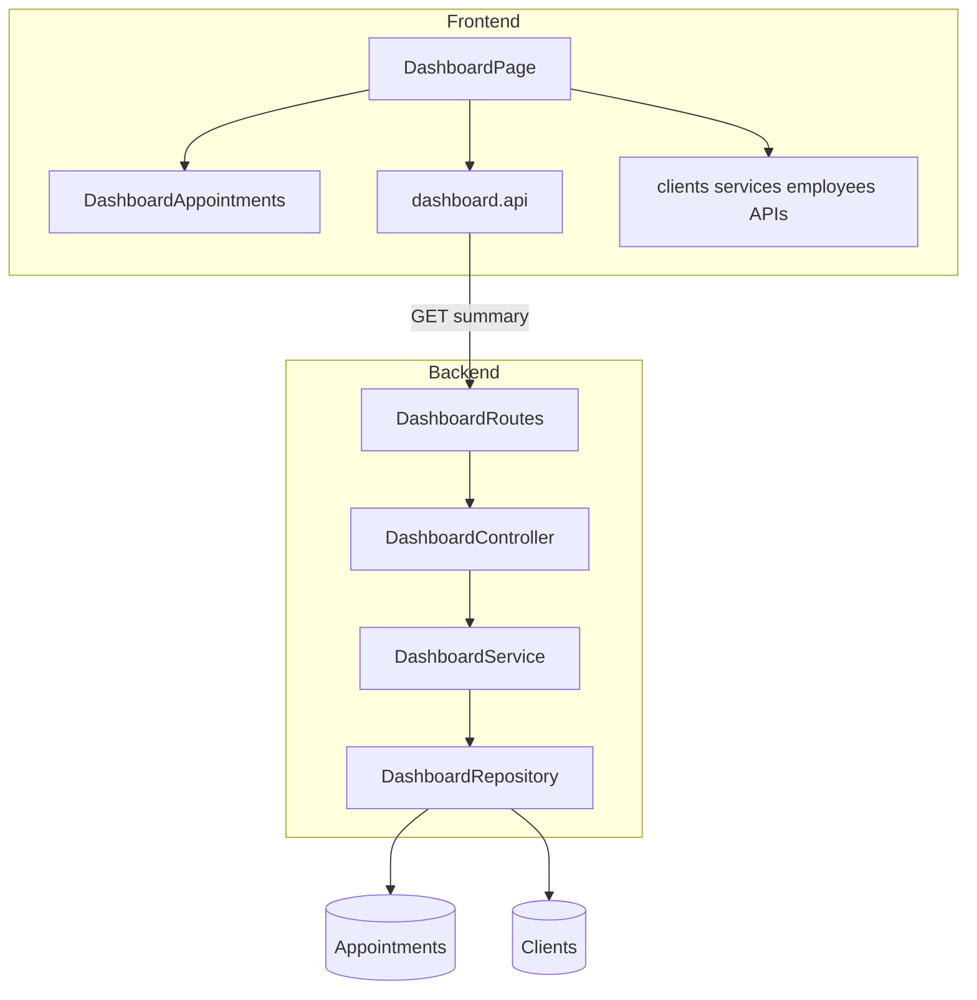

# SchedulerPro — Dashboard: Functional Evolution Audit

**Data da auditoria:** 2026-11-09  
**Tipo:** auditoria read-only (sem alterações a código, testes, CSS, contratos ou Git)  
**Referência UX técnica anterior:** [schedulerpro-dashboard-technical-audit.md](./schedulerpro-dashboard-technical-audit.md) (responsividade e shell — não repetida aqui).

---

## 1. Estado inicial do Git

| Item | Valor |
| --- | --- |
| Branch | `develop` |
| `HEAD` (completo) | `71c358f13c0bc70524af3869fe501f0a45cad47a` |
| `HEAD` (curto) | `71c358f` |
| Tracking | `develop...origin/develop` |
| Working tree | **Limpo** |

Não foram executadas operações Git de escrita (commit, push, stash, switch, etc.).

---

## 2. Resumo executivo

**Facto:** O Dashboard v1 está **implementado e operacional**: um único endpoint `GET /api/dashboard/summary` agrega indicadores no backend (status no período, lista do dia, próximos agendamentos, contagem de clientes activos), e o frontend [`DashboardPage`](../../client/src/pages/dashboard/DashboardPage.tsx) consome o resumo, enriquece com nomes via listagens auxiliares e apresenta KPIs + agendas do dia / próximos (desktop e mobile).

**Lacuna funcional principal (comprovada):** `activeClientsCount` **é calculado e devolvido pela API** mas **não é exibido** na UI.

**Oportunidades:** completar KPIs de distribuição por estado, optimizar consultas duplicadas no período, reduzir carga das listagens “related”, refresh após operações na agenda; decisão de produto sobre visibilidade global para EMPLOYEE.

**Primeira implementação recomendada:** card KPI “Clientes ativos” a partir de `activeClientsCount` (sem mudança de contrato).

---

## 3. Arquitectura actual do Dashboard



| Camada | Responsabilidade |
| --- | --- |
| **Routes** | Guards de auth, empresa operacional, roles staff, `APPOINTMENT_READ`, validação query |
| **Controller** | `companyId` do token; parse `startAt`, `endAt`, `upcomingLimit` |
| **Service** | Orquestra 4 leituras; normaliza `byStatus`; filtra cancelados na lista do dia |
| **Repository** | Agregação `$group` por status; `find` no intervalo; próximos futuros; `countDocuments` clientes |
| **DashboardPage** | Calcula “hoje” no timezone da empresa; exibe KPIs e listas; carrega entidades para mapas de nomes |

**Redux:** `selectCompanyTimezone`, `selectCompany`; **não** há slice dedicado ao dashboard — estado local `useState` para `summary` e listas related.

---

## 4. Endpoints e fluxo de dados

### 4.1 Endpoint

| Método | Path | Auth |
| --- | --- | --- |
| `GET` | `/api/dashboard/summary` | JWT + `RequireOperationalCompany` + `authorize(OWNER, ADMIN, MANAGER, EMPLOYEE)` + `Permission.APPOINTMENT_READ` |

**Query (obrigatório / opcional):**

| Parâmetro | Tipo | Regra |
| --- | --- | --- |
| `startAt` | ISO 8601 com offset | Início do intervalo |
| `endAt` | ISO 8601 com offset | Fim exclusivo `[startAt, endAt)` |
| `upcomingLimit` | int 1–20 | Opcional; default `5` no backend |

**Facto:** `companyId` **não** é aceite na query; tenant exclusivamente `req.user.companyId` (teste de integração confirma).

### 4.2 Resposta (`DashboardSummary`)

```typescript
// client/src/types/dashboard.ts + server/src/modules/dashboard/index.ts
{
  period: { startAt, endAt, total, byStatus: Record<AppointmentStatus, number> },
  todayAppointments: Appointment[],
  upcomingAppointments: Appointment[],
  activeClientsCount: number
}
```

### 4.3 Fluxo frontend

1. `buildReportRange("today", selectCompanyTimezone())` → `startAt` / `endAt` UTC.
2. `dashboardApi.getSummary({ startAt, endAt, upcomingLimit: 5 })`.
3. Em paralelo sequencial após sucesso: `getClients`, `getServices`, `getEmployees` (employees só OWNER/ADMIN — alinhado a `USER_READ`).
4. Maps `clientId` / `serviceId` / `employeeId` → nomes em [`DashboardAppointments`](../../client/src/pages/dashboard/DashboardAppointments.tsx).

**Facto:** Falha no summary **impede** related (não há chamadas a clientes/serviços). Falha parcial em related mostra `alert-warning` mas mantém o painel.

---

## 5. KPIs existentes e fontes

| Indicador (diretriz) | Backend | Exibido no UI | Notas |
| --- | --- | --- | --- |
| Agendamentos de hoje | `todayAppointments` (+ agregado `period.total` no intervalo) | Sim — card “Hoje” = `todayAppointments.length` | Lista exclui `CANCELLED` no service |
| Distribuição por estado | `period.byStatus` (agregação) | **Parcial** — só “Pendentes” (`scheduled`) e “Confirmados” (`confirmed`) | `completed`, `cancelled`, `no-show` não têm KPI |
| Próximos agendamentos | `findUpcoming` (`SCHEDULED` \| `CONFIRMED`, `startAt >= now`) | Sim — bloco “Próximos agendamentos” | `now` = relógio do **servidor** |
| Clientes activos | `countActiveClients` | **Não** | Campo presente na resposta e nos tipos |

**Facto:** Card “Hoje” usa **contagem da lista**; “Pendentes/Confirmados” usam **agregação do período** — coerente para o dia local se o intervalo for só “hoje”, mas semanticamente distintos se o período mudar no futuro.

**Separação Relatórios:** **Facto** — Dashboard não exibe receita, rankings nem métricas analíticas de [`ReportsPage`](../../client/src/pages/reports/ReportsPage.tsx); alinhado às diretrizes.

---

## 6. Timezone, RBAC e multi-tenant

### 6.1 Timezone

| Aspecto | Comportamento |
| --- | --- |
| Definição de “hoje” | Frontend: `buildReportRange("today", timezone)` com `selectCompanyTimezone()` |
| Armazenamento DB | `startAt`/`endAt` de agendamentos como instantes; filtro do dashboard em UTC |
| Exibição horários | `formatAppointmentTime/Date` com timezone nos componentes de agenda |
| Validação API | Instântes ISO com offset obrigatório (`dashboard-summary.validator`) |

**Risco (baixo):** desvio entre “agora” do servidor (próximos) e “hoje” calculado no cliente se clocks divergirem — hipótese, não reproduzida em testes.

### 6.2 RBAC

| Role | Acesso summary | Employees no related |
| --- | --- | --- |
| OWNER, ADMIN, MANAGER, EMPLOYEE | Sim (`APPOINTMENT_READ`) | OWNER/ADMIN: sim; MANAGER/EMPLOYEE: não |
| CLIENT | **403** | — |

**Facto:** Empresa **inactiva** → `403` via `RequireOperationalCompany` (integração coberta).

**Facto:** **EMPLOYEE** vê agendamentos de **toda a empresa** no summary — **sem** filtro `employeeId`. Alteração de escopo = **decisão de produto (P0)** antes de implementar.

### 6.3 Multi-tenant

- Todas as queries no repositório incluem `companyId` (+ `deletedAt: null` onde aplicável).
- Tentativa de passar `companyId` na query **não** altera o tenant usado.

---

## 7. Componentes frontend envolvidos

| Ficheiro | Função |
| --- | --- |
| [`DashboardPage.tsx`](../../client/src/pages/dashboard/DashboardPage.tsx) | Orquestração, KPIs, loading/erro, link agenda |
| [`DashboardAppointments.tsx`](../../client/src/pages/dashboard/DashboardAppointments.tsx) | Tabela desktop + cards mobile; status badges |
| [`DashboardCard.tsx`](../../client/src/components/common/DashboardCard.tsx) | KPI visual |
| [`dashboard.api.ts`](../../client/src/api/endpoints/dashboard.api.ts) | Cliente HTTP |
| [`types/dashboard.ts`](../../client/src/types/dashboard.ts) | Contrato TypeScript |
| [`config/reportPeriod.ts`](../../client/src/config/reportPeriod.ts) | Janela “today” |
| [`config/appointmentTime.ts`](../../client/src/config/appointmentTime.ts) | Formatação local |

**Estados UX:** loading (`A carregar o painel…`), erro com retry (quando aplicável), lista vazia por bloco, staff suspensa (`staffCompanyAccessSuspended` — não chama APIs).

**Atalho operacional:** `data-testid="dashboard-open-agenda"` → `/appointments`.

---

## 8. Testes existentes e lacunas

### 8.1 Inventário

| Ficheiro | Casos (aprox.) | Foco |
| --- | --- | --- |
| `DashboardService.test.ts` | 4 | Agregação, cancelados, `upcomingLimit` |
| `DashboardRepository.test.ts` | 4 | Tenant, intervalo, upcoming, clientes |
| `dashboard.routes.test.ts` | 10 | HTTP, RBAC, validação, empresa inactiva, estrutura |
| `DashboardPage.test.tsx` | 22 | KPIs, timezone em células, mobile/desktop testids, erros, retry, staff |

### 8.2 Execução nesta auditoria

| Comando | Resultado |
| --- | --- |
| `cd client && npm run test -- src/pages/dashboard/DashboardPage.test.tsx` | **22 passed** |
| `cd server && npm test -- tests/unit/dashboard tests/integration/routes/dashboard.routes.test.ts` | **18 passed** (3 ficheiros) |

### 8.3 Lacunas relevantes

| Área | Lacuna |
| --- | --- |
| KPI `activeClientsCount` | Sem assert UI |
| Distribuição completa `byStatus` | Sem cobertura de apresentação |
| EMPLOYEE escopo | Sem teste de filtro por funcionário (não existe filtro) |
| Refresh pós-agenda | Sem teste de revalidação |
| Timezone “hoje” vs servidor `now` | Sem teste de fronteira UTC |
| E2E browser | Fora do escopo actual |

---

## 9. Problemas identificados

### 9.1 Factos (comprovados no código)

1. **`activeClientsCount` órfão na UI** — API e tipos incluem o campo; `DashboardPage` não referencia.
2. **KPIs de estado incompletos** — só `scheduled` e `confirmed` visíveis; restantes só na payload.
3. **Dupla consulta no mesmo intervalo** — `findStatusCounts` + `findAppointmentsInPeriod` com o mesmo `$match`.
4. **Carga “related”** — três listagens completas (ou duas para MANAGER/EMPLOYEE) só para resolver nomes em poucos cartões.
5. **Sem refresh automático** — mount/`loadAll` único; regressão de consistência após editar na agenda até navegar/recarregar.
6. **Próximos usam `now` do servidor** — pode diferir ligeiramente do “hoje” do cliente em edge cases.

### 9.2 Hipóteses (não medidas em produção)

- Volume elevado de agendamentos no dia pode tornar `findAppointmentsInPeriod` mais pesado que agregação pura (sem profiling).
- Listagens related podem dominar tempo de TTI em tenants grandes.

### 9.3 Não são problemas (por desenho actual)

- Receita/rankings ausentes no Dashboard (pertencem a Relatórios).
- Redis não usado (directriz respeitada).

---

## 10. Oportunidades de evolução priorizadas

| ID | P | Problema | Benefício | Ficheiros / módulos | RBAC / tenant | Testes sugeridos |
| --- | --- | --- | --- | --- | --- | --- |
| **O1** | **P1** | Clientes activos invisíveis | KPI operacional das diretrizes | `DashboardPage.tsx`, `DashboardPage.test.tsx` | Nenhuma mudança | Assert card + valor do mock |
| **O2** | **P1** | Só 2 estados em KPI | Visão rápida da operação do dia (ex. concluídos / cancelados / no-show) | `DashboardPage.tsx`, possível subcomponente compacto | Igual | Snapshot de valores `byStatus` |
| **O3** | **P2** | Dupla query período | Menos I/O MongoDB | `DashboardRepository.ts`, `DashboardService.ts` | Igual | Unit: uma chamada ou pipeline partilhado |
| **O4** | **P2** | Related lists pesadas | Menos latência e payload | Mapper enrichment backend **ou** cache Redux existente **ou** endpoints pontuais | Manter tenant | Contract test se mapper mudar |
| **O5** | **P2** | Dados desactualizados após agenda | Coerência operacional | `DashboardPage` (`visibilitychange` / re-enter route) | Igual | Teste com remount ou hook mock |
| **O6** | **P0 produto** | EMPLOYEE vê toda a empresa | Privacidade / foco pessoal | `DashboardService` + regras appointments | **Mudaria** sem decisão explícita | RBAC + fixtures por role |

**Dependências:** O3–O4 tocam backend; O1–O2 só frontend; O6 requer alinhamento com listagem de agendamentos para EMPLOYEE.

---

## 11. Ficheiros prováveis na próxima implementação

**Entrega O1 (recomendada):**

- [`client/src/pages/dashboard/DashboardPage.tsx`](../../client/src/pages/dashboard/DashboardPage.tsx)
- [`client/src/pages/dashboard/DashboardPage.test.tsx`](../../client/src/pages/dashboard/DashboardPage.test.tsx)

**Entregas subsequentes:**

- Backend: [`DashboardRepository.ts`](../../server/src/modules/dashboard/repositories/DashboardRepository.ts), [`DashboardService.ts`](../../server/src/modules/dashboard/services/DashboardService.ts)
- Frontend: [`DashboardAppointments.tsx`](../../client/src/pages/dashboard/DashboardAppointments.tsx), [`dashboard.api.ts`](../../client/src/api/endpoints/dashboard.api.ts) (só se contrato mudar)
- Docs: actualizar implementação após merge (padrão `docs/reports/schedulerpro-dashboard-*.md`)

---

## 12. Riscos e dependências

| Risco | Mitigação actual / nota |
| --- | --- |
| Regressão KPIs | Testes existentes em `DashboardPage.test.tsx` (22) |
| Confundir Dashboard com Relatórios | Manter O1–O2 operacionais, sem revenue |
| Alterar escopo EMPLOYEE (O6) | Bloquear até decisão produto |
| O4 enrichment no backend | Coerência com `AppointmentMapper` e listagens existentes |
| Performance O3 | Validar com `DashboardRepository.test` + carga sintética (futuro) |

**Dependências externas:** timezone da empresa (`companySlice` / sessão); middleware empresa activa; RBAC `APPOINTMENT_READ`.

---

## 13. Recomendação — primeira entrega pequena

**Escopo:** **O1 — Card “Clientes ativos”**

- Valor: `summary.activeClientsCount`.
- Colocação: nova coluna na grelha `dashboard-kpis` (ex. `col-12 col-md-6 col-lg-3` ou segunda linha) com `DashboardCard` e ícone `bi-people`.
- **Sem** alterar `GET /dashboard/summary`.
- Teste: mock com `activeClientsCount: 12` → texto “12” visível.
- Esforço baixo, valor alinhado às diretrizes, sem duplicar Relatórios.

**Segunda onda sugerida:** O2 (distribuição compacta de estados) + O5 (refresh ao voltar à rota `/`).

---

## Contexto para continuidade (outra IA)

- Único endpoint de dashboard: **`/dashboard/summary`**; não procurar KPIs dispersos no frontend além de maps de nomes.
- **Não** re-auditar responsividade mobile — ver relatórios `schedulerpro-dashboard-mobile-*` e `schedulerpro-dashboard-final-ux-adjustments.md`.
- Contrato appointment: status enum partilhado com agenda (`appointment-status`).
- Menu: Dashboard em `/` para staff; cliente usa portal.
- Empresa inactiva: OWNER pode login mas rotas operacionais 403 — dashboard incluído.

---

**Legenda:** secções “Facto” baseiam-se em leitura de código e testes corridos nesta data; “Hipótese” / “Oportunidade” são recomendações — **não implementadas nesta auditoria**.

**Fim.** Aguardar aprovação antes de qualquer implementação.
