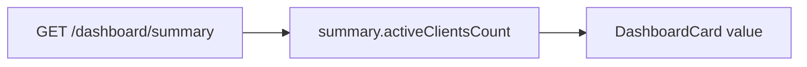

# SchedulerPro — Dashboard O1: KPI «Clientes ativos»

**Data:** 2026-11-09  
**Referência:** [schedulerpro-dashboard-functional-evolution-audit.md](./schedulerpro-dashboard-functional-evolution-audit.md) (oportunidade **O1**)  
**Sem operações Git de escrita.**

## Git (início da entrega)

| Campo | Valor |
| --- | --- |
| Branch | `develop` |
| HEAD (short) | `71c358f` |
| Status | `## develop...origin/develop` — untracked: relatório de auditoria do dashboard |

---

## Problema e solução

**Problema (auditoria §9.1.1):** `GET /api/dashboard/summary` e o tipo `DashboardSummary` já expõem `activeClientsCount`, mas a `DashboardPage` não mostrava o valor — KPI operacional em falta na grelha «Resumo do dia».

**Solução:** Quarto `DashboardCard` «Clientes ativos» (`bi-people`), valor `summary?.activeClientsCount ?? 0`, sem nova chamada API nem alteração de contrato. Grelha `dashboard-kpis` alinhada a quatro colunas `col-12 col-md-6 col-lg-3` (2×2 em `md`, 4 em `lg`).

---

## Ficheiros tocados

| Ficheiro | Alteração |
| --- | --- |
| [`client/src/pages/dashboard/DashboardPage.tsx`](../../client/src/pages/dashboard/DashboardPage.tsx) | `activeClientsCount`; quarto card; classes responsivas nos quatro wrappers |
| [`client/src/pages/dashboard/DashboardPage.test.tsx`](../../client/src/pages/dashboard/DashboardPage.test.tsx) | `cardValues()` com 4 entradas; `describe("active clients KPI")` (4 casos) |

**Fora de escopo (inalterado):** `dashboard.api.ts`, tipos, backend, RBAC, `index.css`, Redis.

---

## Fluxo do valor



Implementação no componente:

```ts
const activeClientsCount = summary?.activeClientsCount ?? 0;
```

---

## Testes e build

| Comando | Resultado |
| --- | --- |
| `npm run test -- src/pages/dashboard/DashboardPage.test.tsx` | **26** testes passaram, exit **0** (Vitest 4.1.11) |
| `npm run build` (`tsc -b && vite build`) | Sucesso, exit **0** |

Novos testes cobrem: valor `12`, valor `0` explícito, títulos dos KPIs existentes + quatro valores, classes do quarto wrapper na grelha.

**Backend:** não executado (sem alterações server).

---

## Pendência de produto (não implementada em O1)

| Role | Escopo desejado (futuro) |
| --- | --- |
| OWNER / ADMIN / MANAGER | Métricas e listagens ao nível da empresa (comportamento actual) |
| EMPLOYEE | Dashboard e APIs de leitura devem reflectir **apenas** agendamentos do próprio profissional (**O6** na auditoria) |

O1 apenas surface `activeClientsCount` tal como a API devolve hoje para todos os roles com acesso ao dashboard; **não** altera escopo EMPLOYEE.

---

## Pendências restantes da auditoria (O2–O5)

| ID | Resumo |
| --- | --- |
| **O2** | KPIs compactos para restantes estados (`completed`, `cancelled`, `no-show`, …) |
| **O3** | Unificar / optimizar dupla query de período no repositório |
| **O4** | Reduzir carga das listagens «related» para nomes nas tabelas |
| **O5** | Refresh ao voltar à rota ou `visibilitychange` após edições na agenda |

**O6** (RBAC EMPLOYEE) permanece bloqueado até decisão explícita de produto.

**Segunda onda sugerida na auditoria:** O2 + O5.
