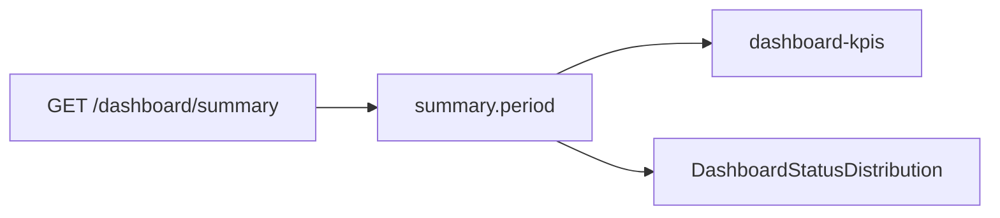

# SchedulerPro — Dashboard O2: Distribuição de Agendamentos por Estado

**Data:** 2026-11-10  
**Referência:** [dashboard-o2-status-distribution-audit.md](../audits/dashboard-o2-status-distribution-audit.md)  
**Branch base:** `develop` @ `bc7310a` (sem commit automatizado)

---

## 1. Objetivo

Exibir no Dashboard uma **distribuição compacta** dos cinco estados de agendamento do dia, usando apenas `summary.period.byStatus` e `summary.period.total` já devolvidos por `GET /api/dashboard/summary`, sem alterar backend nem contratos.

---

## 2. Ficheiros criados e modificados

| Ficheiro | Alteração |
| --- | --- |
| [`client/src/pages/dashboard/DashboardStatusDistribution.tsx`](../../client/src/pages/dashboard/DashboardStatusDistribution.tsx) | **Novo** — UI compacta, ordem fixa, barras e exports de teste |
| [`client/src/pages/dashboard/DashboardStatusDistribution.test.tsx`](../../client/src/pages/dashboard/DashboardStatusDistribution.test.tsx) | **Novo** — ordem e cálculo de proporções |
| [`client/src/pages/dashboard/DashboardPage.tsx`](../../client/src/pages/dashboard/DashboardPage.tsx) | Integração entre KPIs e agendas |
| [`client/src/pages/dashboard/DashboardPage.test.tsx`](../../client/src/pages/dashboard/DashboardPage.test.tsx) | Bloco O2 + `waitForDashboardLoaded` aguarda «Resumo do dia» |
| [`client/src/index.css`](../../client/src/index.css) | Classes `.dashboard-status-distribution*` |

**Inalterados:** API, tipos `DashboardSummary`, backend, quatro KPIs (incl. Clientes ativos O1), `loadSummary` / `loadRelated` / agendas.

---

## 3. Fluxo de dados

1. `DashboardPage` carrega o summary (já existente).
2. Após sucesso, renderiza `<DashboardStatusDistribution period={summary.period} />`.
3. O componente **não** chama API nem recalcula a partir de `todayAppointments`.

---

## 4. Estados apresentados

Ordem fixa (`DASHBOARD_STATUS_DISTRIBUTION_ORDER`):

1. `scheduled` — Agendado  
2. `confirmed` — Confirmado  
3. `completed` — Concluído  
4. `cancelled` — Cancelado  
5. `no-show` — Não compareceu  

Fonte: [`APPOINTMENT_STATUS_LABELS`](../../client/src/config/appointmentStatus.ts) e `APPOINTMENT_STATUS_BADGE_CLASS`.

**Nota de produto:** os KPIs «Pendentes» / «Confirmados» mantêm títulos operacionais; a distribuição usa os labels centralizados («Agendado», etc.).

---

## 5. Cálculo das proporções

Função exportada `statusDistributionBarWidthPercent(count, total)`:

- `total <= 0` ou `count <= 0` → largura **0%** (sem divisão por zero).
- Caso contrário: `(count / total) * 100`, limitado a `[0, 100]`.
- Contagens exibidas **sem** arredondamento (inteiro via `toLocaleString("pt-PT")`).

Barras: Bootstrap `progress` + `APPOINTMENT_STATUS_PROGRESS_BAR_CLASS` (`bg-primary`, `bg-info`, …) alinhado às cores dos badges.

---

## 6. Layout

- Um **card** full-width (`.dashboard-status-distribution`) entre `dashboard-kpis` e `dashboard-agenda-grid`.
- Cinco linhas: badge + contagem + barra fina (0,35rem).
- `total === 0`: mensagem «Sem agendamentos no período.» (`dashboard-status-distribution-empty`); todas as contagens `0` e barras a 0%.
- Sem segunda grelha de cinco `DashboardCard`.

---

## 7. Testes e build

| Comando | Resultado |
| --- | --- |
| `npm run test -- src/pages/dashboard/DashboardStatusDistribution.test.tsx src/pages/dashboard/DashboardPage.test.tsx` | **40/40** aprovados, exit **0** |
| `npm run build` | Sucesso (`tsc -b && vite build`), exit **0** |

**Warnings:** npm `devdir`; Vite chunk size > 500 kB (pré-existente).

Cobertura O2 (resumo):

- Cinco estados, labels PT, zeros visíveis, barras proporcionais, total zero, loading/erro sem bloco, agendas e KPIs/O1 em regressão.

---

## 8. Limitações e melhorias futuras

| Tema | Nota |
| --- | --- |
| KPI «Hoje» vs `period.total` | Lista do dia exclui cancelados no backend; total da distribuição inclui todos os estados no intervalo. |
| O5 refresh | Voltar à rota / `visibilitychange` ainda não implementado. |
| O3 backend | Dupla query período no repositório — optimização independente. |
| O6 EMPLOYEE | Escopo empresa inalterado. |
| Unificar ordem `STATUSES` | Reports duplica array; possível extrair para `appointmentStatus.ts` num refactor menor. |

---

## 9. Contexto para outra IA

- Dados: **apenas** `summary.period` após load bem-sucedido.
- Testids estáveis: `dashboard-status-distribution`, `dashboard-status-row-{status}`, `dashboard-status-bar-{status}`, `dashboard-status-count-{status}`.
- Helper de teste da página: `waitForDashboardLoaded()` espera o heading **«Resumo do dia»** (painel carregado).

**Fim.** Pronto para validação visual pelo utilizador; commit manual.
