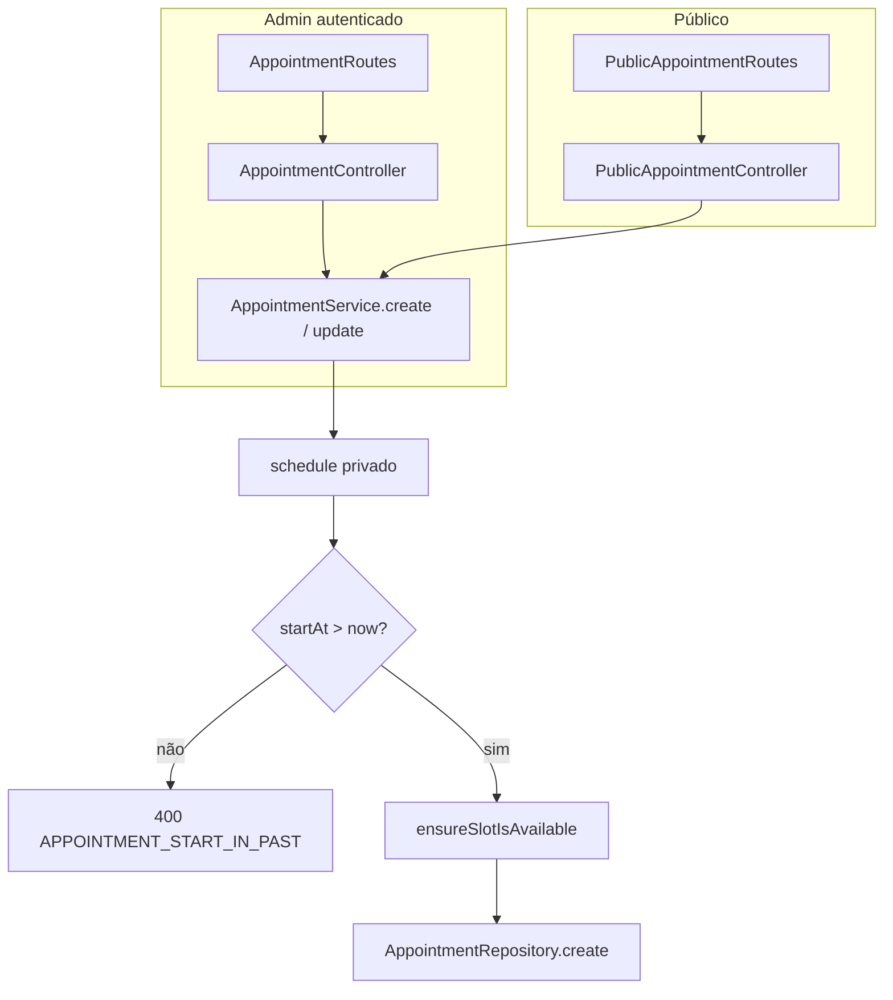

# SchedulerPro — Auditoria Técnica Global

**Data de início:** 24/10/2026  
**Modo:** Read-only (sem alterações ao código, configurações, dependências ou base de dados)  
**Estado:** **Fases A, B e C concluídas** — Fases D–H pendentes  
**Linha de base do repositório:** ver secção 2.

---

## 1. Objetivo e âmbito

Inventariar o estado verificável do SchedulerPro (SaaS multi-tenant de agendamento) antes de novas funcionalidades ou ondas de correção: código, contratos, testes, segurança, dados, infraestrutura e alinhamento com relatórios de etapas.

Este documento distingue **factos confirmados**, **hipóteses** e **itens não verificados**.

---

## 2. Fase A — Estado do repositório e documentação

### 2.1 Git (confirmado em 24/10/2026)

| Item | Evidência |
|------|-----------|
| Branch | `develop` |
| HEAD | `d9f2aeaabc05a34509f77499695dfcf935921b51` |
| Sincronização remota | `develop...origin/develop` — **sem commits à frente/atras** (`git status -sb`) |
| Working tree (Fase A) | Limpo na HEAD |
| Working tree (Fase B, 24/10/2026) | HEAD **inalterado** (`d9f2aea`); apenas `?? docs/reports/schedulerpro-global-technical-audit.md` (este relatório, untracked) |
| Último merge relevante (calendário) | PR **#109** — `Stage-51.8-Unificacao-visual-calendario` → commit `99a91b8` |

**Histórico recente (15 commits):** cadeia de merges Stage **51.1–51.8** (calendário, filtros, popover, cores por serviço, polimento visual, unificação Mês/Semana/Dia).

### 2.2 Estrutura do monorepo

| Pacote | Caminho | Scripts principais (`package.json`) |
|--------|---------|-------------------------------------|
| Frontend | `client/` | `dev`, `build`, `test` (vitest), `typecheck` |
| Backend | `server/` | `dev`, `build`, `test` (vitest), `start` — Node **≥22** |

**Contagem estática de ficheiros de teste (glob, não executado nesta fase):**

| Área | Ficheiros `*.test.ts(x)` |
|------|---------------------------|
| Client | **128** |
| Server | **81** |
| **Total** | **209** |

Comparação com relatórios históricos: Stage 37 documentava **108** ficheiros Vitest no client e **1.239** testes; o inventário atual de ficheiros (**128**) indica crescimento desde então — **contagem de testes na HEAD atual não foi reexecutada na Fase A** (reservado à Fase F).

### 2.3 Documentação em `docs/reports/`

**51 relatórios** listados sob `docs/reports/` (nomenclatura mista: `stage-NN-*`, `STAGE_NN_*`).

**Linha temporal recente (produto / agenda):** stages **49–51** (refactor agenda, CSS calendário, filtros, popover, cores, vista mês, polimento 51.6–51.8).

**Temas transversais documentados (amostra):**

| Tema | Relatórios de referência |
|------|---------------------------|
| Timezone / contrato de datas API | `STAGE_35`–`STAGE_36_*` (várias partes) |
| Preço histórico / status | `STAGE_33`, `STAGE_34` |
| Booking público / tokens | `STAGE_31_*` |
| Convites cliente | `STAGE_32_CLIENT_INVITE_REPORT.md`, `docs/stage-32.1-remover-dar-acesso.md` |
| Auditoria frontend Setmore | `stage-37-frontend-audit-setmore-comparison.md` |
| Calendário unificado | `stage-51-7`, `stage-51-8` (+ validações 51.x.1) |

**Mapeamento briefing → código (Fase B):**

| Referência do briefing | Evidência no código atual |
|------------------------|---------------------------|
| Stage 22 (gestão de empresa) | Módulo `companies` (`CompanyRoutes`, `CompanyService`, `update-company.validator` com IANA); registo em `AuthService` + `register.validator` (`company.timezone`); frontend `CompanyPage` / `companySlice` (Fase E) |
| Stage 24.1 (datas / conflitos) | `AppointmentService.schedule` rejeita passado (L259–263); `expireOverdueScheduled` em listagens admin (L625–626); `AvailabilityExceptionService.validateNoActiveAppointment` (L61–74) |

**Roadmap centralizado:** não existe ficheiro `*roadmap*` em `docs/` na pesquisa por glob. O roadmap implícito é a sequência de relatórios stage + histórico Git.

### 2.4 Stage 51.8 — integração com a linha de base (código vs relatório)

| Verificação | Resultado | Estado |
|-------------|-----------|--------|
| PR #109 mergeado em `develop` | Sim (`d9f2aea`) | Confirmado |
| `AppointmentCalendarEventBody.tsx` | Presente no commit `99a91b8` | Confirmado |
| Altura grelha Semana/Dia | `TIME_GRID_HOUR_HEIGHT_DESKTOP_PX = **120**`, `MOBILE_PX = **96**` em `client/src/config/calendarTimeGridLayout.ts` | Confirmado na HEAD |
| Relatório `stage-51-8-calendar-visual-unification.md` | Documenta follow-ups **51.8.1–51.8.4** (incl. 120/96 px e hover) | Alinhado com código na HEAD |
| Validação manual 51.8 | Utilizador declarou satisfatória (briefing auditoria) | **Aceite de produto** — não repetir sem motivo |
| Testes 51.8 no relatório | 128 ficheiros / 1376 testes (client), typecheck/build OK | **Não reexecutado** na Fase A |
| `computeDayLayout` / posicionamento temporal | Não auditado linha-a-linha nesta fase | Pendente Fase E (spot-check) |

**Nota:** A validação visual da Stage 51.8 **não** precisa ser repetida na auditoria global salvo regressão posterior; o foco é integração com o resto do sistema e suites automatizadas.

### 2.5 Stage 37 — reavaliação rápida de achados históricos (amostra, não exaustiva)

Achados catalogados **FE-001–FE-016** em `stage-37-frontend-audit-setmore-comparison.md`. Estado na HEAD `d9f2aea` (**amostra verificada por grep/leitura** — classificação completa na **Fase E**):

| ID | Título (resumo) | Estado preliminar | Evidência breve |
|----|-----------------|-------------------|-----------------|
| FE-001 | Loading/erro admin vs público | **Provável aberto / parcial** | `DashboardPage` usa `LoadingState`; padrão não uniforme em todo o admin (Stage 37) — requer inventário página a página |
| FE-002 | `ReportsPage` sem `PageHeader` em acesso negado | **Resolvido** | `ReportsPage.tsx` L256–266: `PageHeader` + `alert-warning` quando `!canView` |
| FE-003 | Catch-all `*` → `/` | **Resolvido** | `AppRoutes.tsx` L93: `path="*"` → `NotFoundPage` (Stage 43+) |
| FE-004 | Empty states dashboard/relatórios/disponibilidade | **Não confirmado** | Fase E |
| FE-005–FE-016 | Vários (modais, ranking, produto, testes calendário…) | **Não confirmado** | Fase E; FE-016 parcialmente mitigado por testes `CalendarView` / `CalendarTimeGridEvent` pós-51.x |

### 2.6 Riscos históricos (investigação, não confirmados como defeitos atuais)

| Sinal | Fonte histórica | Ação planeada |
|-------|-----------------|---------------|
| 6 falhas booking público (datas fixas) | Relatórios Stage 31.x | Fase F — reexecutar `PublicBookingPage.test.tsx` e integração |
| 4 falhas Dashboard/Reports | `STAGE_32_CLIENT_INVITE_REPORT.md` (preexistentes à Stage 32) | Fase F — `DashboardPage.test.tsx`, `ReportsPage.test.tsx` |
| Multi-tenancy global | Fora de âmbito em várias stages | Fase C — matriz `companyId` |
| Produção / deploy / monitorização | Sem relatório global | Fase G — limitações se sem acesso |

---

## 3. Inventário preliminar de superfície (para Fases B–E)

### 3.1 Frontend — rotas (`AppRoutes.tsx`)

Rotas públicas: booking (`/agendar`, `/agendar/:token`), convite cliente, fluxos auth (login, register, forgot/reset, verify-email), `NotFoundPage` em `*`.

Área autenticada (`ProtectedRoute` + `AppLayout`): dashboard, clients, services, employees, availability, appointments, reports, company, portal (`/portal/*`).

**Contagem exata de rotas e guards:** pendente Fase E (Stage 37 referia **20** rotas).

### 3.2 Backend — módulos (`server/src/modules/`)

Módulos identificados por estrutura de pastas (amostra): `appointments`, `availability`, `auth`, `Clients`, `client-invites`, `companies`, `notifications`, `public-booking`, `reminders`, `reports`, `services`, `users`, …

**Matriz de endpoints:** ver **§9 (Fase B)**.

### 3.3 Regras de negócio citadas no briefing (confirmadas na Fase B)

| Regra | Evidência | Estado |
|-------|-----------|--------|
| Rejeitar agendamento no passado (criação) | `AppointmentService.schedule` — `startAt.getTime() <= now` → `APPOINTMENT_START_IN_PAST` (L259–263) | **Confirmado** |
| Rejeitar mover para o passado (update) | `AppointmentService` — checks similares (p.ex. L814–817, L1155) | **Confirmado** (amostra) |
| Expirar `scheduled` com início passado | `findAll` chama `expireOverdueScheduled` se não há `clientScope` (L625–626); repositório `cancelOverdueScheduled` | **Confirmado** |
| Exceção vs agendamento ativo | `AvailabilityExceptionService.validateNoActiveAppointment` (L61–74) + timezone empresa | **Confirmado** |
| Instantes ISO com offset | `withIsoInstantRules` em `create-appointment.validator.ts`, `list-reports.validator.ts` | **Confirmado** |
| Timezone IANA na empresa | `update-company.validator.ts` L19–24; `register.validator` + `AuthService` | **Confirmado** |

---

## 4. Achados da auditoria (registo)

### 4.1 Investigação (Fase A)

| ID | Área | Título | Estado | Gravidade | Próxima fase |
|----|------|--------|--------|-----------|--------------|
| AUD-INV-002 | Testes | Contagens 1376 (client) e falhas históricas 4+6 | Não confirmado | Média | F |
| AUD-INV-003 | Frontend | FE-001 e restantes FE-* | Não confirmado | Média | E |
| AUD-INV-004 | Segurança | Isolamento multi-tenant global | **Não auditado** (por desenho) | Crítica se falhar | **C** |
| AUD-INV-005 | Infraestrutura | Deploy, backups, monitorização | Não verificado | Alta | G |

*AUD-INV-001 (Stage 22/24.1 por nome): **parcialmente resolvido** — ver §2.3 mapeamento.*

### 4.2 Achados backend / API (Fase B)

| ID | Área | Título | Estado | Gravidade | Evidência |
|----|------|--------|--------|-----------|-----------|
| AUD-001 | Segurança | `mongoSanitize` comentado no bootstrap Express | **Confirmado** | Média (P2) | `server/src/app.ts` L71–73 — **Fase C:** → AUD-SEC-005 |
| AUD-002 | Segurança | CORS com `cors()` sem origem restrita no código | **Confirmado** | Média (P2) | `server/src/app.ts` L42 — **Fase C:** → AUD-SEC-006 |
| AUD-003 | Backend | `CompanyService.create()` corpo vazio (stub) | **Confirmado** | Baixa (P3) | `CompanyService.ts` L77; sem `POST /companies` nas rotas |
| AUD-004 | API / consistência | Expiração de `scheduled` só em `findAll` admin, não em `findById` isolado | **Confirmado** (comportamento) | Baixa (P3) | `AppointmentService.findAll` L625–626 vs `findById` L661+ |
| AUD-005 | Segurança | Isolamento tenant em todos os módulos | **Parcialmente analisado** | — | Fase C: padrão service-layer + testes em vários módulos; **não** declarado seguro globalmente — ver [`schedulerpro-global-technical-audit-phase-c.md`](schedulerpro-global-technical-audit-phase-c.md) §6 |

**Recomendações (sem implementar):**

- **AUD-001:** Reavaliar ativação de sanitização MongoDB ou equivalente; teste de regressão em rotas com operadores `$`.
- **AUD-002:** Documentar/configurar origens permitidas por ambiente; validar cookies cross-site na Fase C.
- **AUD-003:** Remover stub morto ou implementar se produto exigir criação de empresa via API autenticada.
- **AUD-004:** Documentar para produto/QA ou alinhar expiração em mais pontos de leitura se inconsistência for indesejada.
- **AUD-005:** Matriz recurso-a-recurso + testes de acesso cruzado (existentes parcialmente em `report.routes.test.ts`, `public-booking.routes.test.ts`).

**Testes de aceitação (correção futura):** para AUD-001/AUD-002 — suite de integração + revisão de headers; para AUD-005 — casos automatizados empresa A vs B em cada módulo CRUD.

---

## 5. Plano das fases seguintes

| Fase | Objetivo | Estado |
|------|----------|--------|
| **A** | Repositório, docs, linha de base | **Concluída** (§2) |
| **B** | Backend, API, contratos | **Concluída** (§9) |
| **C** | Segurança e multi-tenancy | **Concluída** — [`schedulerpro-global-technical-audit-phase-c.md`](schedulerpro-global-technical-audit-phase-c.md) |
| **D** | MongoDB, índices, invariantes | Pendente |
| **E** | Frontend completo + FE-001–016 | Pendente |
| **F** | Testes, typecheck, build, regressões datas | Pendente |
| **G** | Infraestrutura e produção | Pendente |
| **H** | Roadmap, backlog priorizado, conclusão | Pendente |

### 5.1 Comandos previstos (Fase F — não executados na Fase A)

```bash
# Client (após confirmar ambiente local sem side-effects indesejados)
cd client && npm run typecheck && npm run test -- --run --pool=forks --maxWorkers=2

# Server (tipicamente MongoDB de teste / in-memory — validar config antes)
cd server && npm run typecheck && npm run test
```

---

## 6. Critérios de conclusão global

Conforme briefing do utilizador (secção 7 do plano): inventário, mapeamento de módulos/endpoints, reavaliação de achados históricos, evidências de segurança ou limitações explícitas, testes registados, backlog ordenado, distinção confirmado/inferido/não verificado.

**Progresso:** inventário repo/docs + mapeamento API backend (Fases A–B). Faltam segurança transversal, dados, frontend, testes executados, infra e backlog final (C–H).

---

## 7. Contexto para a próxima sessão

- Trabalhar sempre em modo **read-only** até nova instrução explícita.
- **Não** commit, merge, push, migrações ou seeds destrutivos.
- Stage **51.8** mergeada; utilizador validou manualmente; código na HEAD inclui **96/120 px/hora** e CSS de anchor/hover documentados em `stage-51-8`.
- Stage **37** permanece referência para FE-*; FE-002 e FE-003 aparentam resolvidos na HEAD.
- Stage **32** documenta **4 falhas preexistentes** em Dashboard/Reports — tratar como hipótese até Fase F.
- **Fase C concluída** — relatório dedicado [`schedulerpro-global-technical-audit-phase-c.md`](schedulerpro-global-technical-audit-phase-c.md). Achados `AUD-SEC-001`–`008`. **Próxima ação:** **Fase D** (MongoDB, índices, invariantes).
- Padrão tenant autenticado: `req.user.companyId` definido em `auth.middleware.ts` L104–110 a partir do utilizador na BD (não do body).
- Padrão tenant público: `:companyId` na URL + `validateObjectId`; rotas por token sem ObjectId no path (`PublicAppointmentRoutes.ts` L25–28).
- Testes de integração úteis para C: `server/tests/integration/public-booking.routes.test.ts`, `report.routes.test.ts`, `client-invite-*.routes.test.ts`, `availability-appointment.routes.test.ts`.

---

## 9. Fase B — Backend, API e contratos

**Data:** 24/10/2026  
**HEAD:** `d9f2aea` (inalterado)  
**Prefixo global:** `/api` (`app.ts` L83)

### 9.1 Stack HTTP e middleware global

| Ordem | Middleware | Ficheiro | Função |
|-------|------------|----------|--------|
| 1 | `helmet()` | `app.ts` L37 | Headers de segurança HTTP |
| 2 | `cors()` | `app.ts` L42 | CORS (sem restrição explícita no código — AUD-002) |
| 3 | `compression()` | L47 | Compressão de respostas |
| 4 | `express.json()` | L52 | Parse JSON |
| 5 | `cookieParser()` | L63 | Cookies (access/refresh token) |
| 6 | `requestIdMiddleware` | L68 | ID de pedido |
| 7 | `morganMiddleware` | L78 | Logs HTTP |
| — | `notFoundMiddleware` | L90 | 404 |
| — | `errorMiddleware` | L92 | `AppError` → JSON; JSON malformado → 400; resto → 500 (`error.middleware.ts` L65–93) |

**Envelope de resposta:** `ResponseHandler.success` / `error` — `{ success, message, data?, errors?, code? }` (`utils/response.ts` L22–55).

### 9.2 Middleware por pedido (padrões)

| Middleware | Uso típico |
|------------|------------|
| `AuthMiddleware.authenticate` | Cookie `accessToken`; valida JWT + sessão + utilizador ativo/verificado; `req.user` com `userId`, `companyId`, `role`, `sessionId`, opcional `clientId` |
| `PasswordChangeMiddleware.requirePasswordChangeCompleted` | Quase todas as rotas autenticadas exceto `PATCH /users/me/password` |
| `hasPermission(Permission.*)` | RBAC fino (CRUD por domínio) |
| `authorize(Role.*)` | Relatórios (OWNER/ADMIN/MANAGER), notificações (staff), portal (`CLIENT`), convites (`OWNER`/`ADMIN`) |
| `validateObjectId(param)` | IDs Mongo em path |
| `validateRequest` | Após `express-validator` |
| Rate limits | Rotas públicas: `public-booking-rate-limit`, `public-appointment-link-rate-limit`, `public-catalog-rate-limit`, `client-invite-rate-limit` |

### 9.3 Montagem de routers (`routes/index.ts`)

| Prefixo `/api` | Router | Autenticação |
|----------------|--------|----------------|
| `/auth` | `AuthRoutes` | Misto (público + `me`, `logout`) |
| `/users` | `UserRoutes` | Autenticado + permissões |
| `/companies` | `CompanyRoutes` | Autenticado + permissões |
| `/services` | `ServiceRoutes` | Autenticado |
| `/clients` | `ClientRoutes` | Autenticado + portal `CLIENT` em `/me` |
| `/appointments` | `AppointmentRoutes` | Autenticado + `/mine` para CLIENT |
| `/public` | `PublicAppointmentRoutes` + `PublicBookingRoutes` + `PublicClientInviteRoutes` | **Público** (rate limit + validação) |
| `/availability` | `AvailabilityRoutes` | Autenticado |
| `/availability-exceptions` | `AvailabilityExceptionRoutes` | Autenticado |
| `/reports` | `ReportRoutes` | Autenticado + roles staff (sem CLIENT/EMPLOYEE) |
| `/notifications` | `NotificationRoutes` | Autenticado + staff (sem CLIENT) |
| `/health` | inline | Público |

### 9.4 Inventário de endpoints (**86** rotas de aplicação + health)

Todas abaixo são relativas a `/api`.

#### Auth (`AuthRoutes.ts`)

| Método | Caminho | Auth | Validação / notas |
|--------|---------|------|-------------------|
| POST | `/auth/register` | — | `registerValidator` (incl. `company.timezone` IANA) |
| POST | `/auth/login` | — | `loginValidator` |
| POST | `/auth/refresh` | — | Sem validator no router |
| GET | `/auth/me` | JWT | — |
| GET | `/auth/verify-email` | — | `verifyEmailValidator` |
| POST | `/auth/logout` | JWT | — |
| POST | `/auth/forgot-password` | — | `forgotPasswordValidator` |
| POST | `/auth/reset-password` | — | `resetPasswordValidator` |

#### Users (`UserRoutes.ts`) — 10 rotas

GET/POST `/users`; GET/PUT/DELETE `/users/:id`; PATCH activate/deactivate; POST/DELETE `/users/:id/photo` (+ `uploadSingleImage` após auth); PATCH `/users/me/password` (sem `requirePasswordChangeCompleted`).

Permissões: `USER_*`; fotos exigem `USER_UPDATE`.

#### Companies (`CompanyRoutes.ts`) — 8 rotas

GET `/companies`, GET/PATCH/DELETE `/companies/:id`, PATCH activate/deactivate, POST/DELETE `/companies/:id/logo`.  
Serviço: `ensureTenant(id, companyId)` em operações por id (`CompanyService.ts` L39–43).  
Permissões: `COMPANY_*`; logo usa `COMPANY_UPDATE`.

#### Services (`ServiceRoutes.ts`) — 8 rotas

CRUD + activate/deactivate; permissões `SERVICE_*`.

#### Clients (`ClientRoutes.ts`) — 11 rotas

CRUD + activate/deactivate; GET `/clients/me` (`Role.CLIENT`); POST `/clients/:id/invite` (`OWNER`, `ADMIN`); fotos com `CLIENT_UPDATE`.

#### Appointments (`AppointmentRoutes.ts`) — 10 rotas

POST/GET `/appointments`; GET `/appointments/mine` (CLIENT); GET/PATCH/DELETE `/appointments/:id`; PATCH confirm, complete, cancel, no-show.  
Controller usa `req.user!.companyId` (ex.: `AppointmentController.ts` L32–36).  
Validadores: `create-appointment`, `update-appointment`, `list-appointments` (ISO instant).

#### Público — agendamentos (`PublicAppointmentRoutes.ts`) — 4 rotas

| Método | Caminho | Proteção |
|--------|---------|----------|
| POST | `/public/companies/:companyId/appointments` | rate limit + `createPublicAppointmentValidator` |
| GET | `/public/appointments/:token` | read rate limit |
| PATCH | `/public/appointments/:token` | write rate limit + validator |
| DELETE | `/public/appointments/:token` | cancel rate limit + `rejectCancelBodyValidator` |

#### Público — catálogo (`PublicBookingRoutes.ts`) — 3 rotas

GET `/public/companies/:companyId/services|employees|availability` — tenant só na URL; validator de disponibilidade rejeita `companyId` na query (comentário L19–23).

#### Público — convites (`PublicClientInviteRoutes.ts`) — 2 rotas

POST `/public/client-invites/inspect|accept` — token no **corpo** (evitar log em URL); rate limits dedicados.

#### Availability — 6 + Availability exceptions — 5 rotas

CRUD padrão; exceções com query opcional `employeeId` (MongoId).

#### Reports — 6 rotas

GET `/reports/overview`, `/revenue`, `/top-services`, `/employees`, `/clients`, `/cancellations` — guards: auth + password + `authorize(OWNER, ADMIN, MANAGER)` + `listReportsValidator` (período ISO, máx. 366 dias).

#### Notifications — 4 rotas

GET `/`, GET `/unread-count`, PATCH `/read-all`, PATCH `/:id/read` — staff apenas.

#### Health

GET `/health` — uptime + timestamp.

### 9.5 Fluxo de agendamentos (contrato e negócio)



- **Criação admin e pública** convergem em `AppointmentService.schedule` (comentário L223–227): passado, disponibilidade, exceções, conflitos, preço, notificações.
- **Listagem admin** pode cancelar `scheduled` atrasados antes da query (`expireOverdueScheduled`).
- **Portal** (`findMine` / `clientScope`): expiração **não** corre na listagem (L621–623).

### 9.6 Tratamento de erros e HTTP

- Erros de negócio: `AppError` com `statusCode`, opcional `errors[]` e `code` (`error.middleware.ts` L65–72).
- Validação: tipicamente 400 via `validateRequest` + `ResponseHandler.error`.
- 404 homogéneo em recursos cross-tenant (ex.: `AppointmentService.findById` L664–665 — mensagem genérica).

### 9.7 Limitações da Fase B

- **Nenhum teste** foi executado (reservado Fase F).
- **Isolamento multi-tenant não aprovado** — apenas padrões e amostras de código; Fase C obrigatória.
- Controllers/repositories de cada módulo não foram lidos linha a linha (amostra: appointments, companies, clients, availability exceptions).
- Reminders (`ReminderScheduler` em `server.ts`) e jobs não mapeados como HTTP.
- Contratos OpenAPI/Swagger: **não existem** no repositório (inferido por ausência de ficheiros).

### 9.8 Ficheiros e comandos consultados (Fase B)

**Comandos:** `git branch --show-current`, `git rev-parse HEAD`, `git status -sb` (read-only).

**Ficheiros principais:**

- `server/src/app.ts`, `server/src/routes/index.ts`
- `server/src/modules/**/routes/*Routes.ts` (13 routers)
- `server/src/middlewares/auth.middleware.ts`, `permission.middleware.ts`, `error.middleware.ts`
- `server/src/utils/response.ts`
- `server/src/modules/appointments/services/AppointmentService.ts` (amostras)
- `server/src/modules/appointments/controllers/AppointmentController.ts`
- `server/src/modules/appointments/validators/create-appointment.validator.ts`
- `server/src/modules/availability/services/AvailabilityExceptionService.ts` (amostra)
- `server/src/modules/companies/services/CompanyService.ts` (amostra)
- `server/tests/integration/routes/report.routes.test.ts`, `public-booking.routes.test.ts` (grep)

**Alterações ao código:** **nenhuma** (apenas este relatório markdown, untracked).

---

## 8. Histórico deste relatório

| Data | Alteração |
|------|-----------|
| 24/10/2026 | Criação do relatório; **Fase A** executada (git, docs, contagens, amostras 51.8 / 37 / 32) |
| 24/10/2026 | **Fase B** — inventário API, middleware, regras de agendamento/timezone, achados AUD-001–005 |
| 24/10/2026 | **Fase C** — segurança, RBAC, matriz multi-tenant, `AUD-SEC-*`; relatório em `schedulerpro-global-technical-audit-phase-c.md` |
