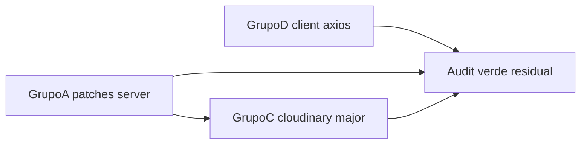

# SchedulerPro — GW-1: Triagem de vulnerabilidades das dependências

**Data da análise:** 24/10/2026  
**Modo:** Análise apenas — **nenhuma** dependência foi atualizada, **nenhum** lockfile foi modificado, **nenhuma** correção foi implementada.

**Referências:**

- [`schedulerpro-phase-g-infrastructure-audit.md`](schedulerpro-phase-g-infrastructure-audit.md) (AUD-INFRA-013, audit 24/10/2026)
- [`schedulerpro-phase-h-final-consolidation.md`](schedulerpro-phase-h-final-consolidation.md) (`CANON-001`, GW-1)
- [`schedulerpro-global-technical-audit.md`](schedulerpro-global-technical-audit.md) (não alterado)

**Nota de nomenclatura:** O relatório de consolidação é `schedulerpro-phase-h-final-consolidation.md` (não `schedulerpro-phase-h-final-audit.md`).

---

## 1. Objetivo e âmbito

Triagem técnica das vulnerabilidades reportadas pelo npm nas **dependências de produção** (`npm audit --omit=dev`) do backend ([`server/`](../../server/)) e frontend ([`client/`](../../client/)), com caminhos na árvore de dependências, exposição provável na aplicação SchedulerPro, riscos de atualização e plano de correção posterior.

**Fora do âmbito:** aplicar `npm audit fix`, `npm install`, alterar `package.json` / lockfiles, ou validar exploits em runtime.

---

## 2. Baseline Git observada

| Item | Valor |
|------|--------|
| Branch | `develop` |
| HEAD | `d9f2aeaabc05a34509f77499695dfcf935921b51` |
| Remote | `develop...origin/develop` |
| Código rastreado | Limpo |
| Relatórios `docs/reports/schedulerpro-*` | Não rastreados (preservados) |

**Ambiente de execução dos comandos npm:** Node **v24.19.0**, npm **11.17.0** (superior ao `engines.node >= 22` do server).

### 2.1 Estrutura vs Fase G

| Item | Fase G / HEAD `d9f2aea` | GW-1 (confirmado) |
|------|-------------------------|-------------------|
| `server/package.json` dependencies | 24 pacotes prod | Igual |
| `client/package.json` dependencies | 8 pacotes prod | Igual |
| Lockfiles presentes | `package-lock.json` em ambos | Igual |
| Scripts teste | `npm run test` (Vitest) em ambos | Igual |

**Observação estrutural:** `express` **não** está declarado em `server/package.json`; a árvore instalada mostra `express@5.2.1` apenas como dependência de `express-rate-limit@8.5.2`. A aplicação importa `express` diretamente em [`server/src/app.ts`](../../server/src/app.ts). Isto não foi alterado na GW-1; recomenda-se declarar `express` como dependência direta na fase de atualização.

---

## 3. Comandos executados e resultados

| # | Comando | Diretório | Data | Exit code | Alterou ficheiros? |
|---|---------|-----------|------|-----------|-------------------|
| 1 | `git branch`, `git rev-parse HEAD`, `git status -sb` | raiz | 24/10/2026 | 0 | Não |
| 2 | `npm audit --omit=dev` | `server/` | 24/10/2026 | **1** (vulns presentes) | Não |
| 3 | `npm audit --omit=dev --json` | `server/` | 24/10/2026 | 1 | Não |
| 4 | `npm ls <pkg> --omit=dev` | `server/` | 24/10/2026 | 0 | Não |
| 5 | `npm explain proxy-addr`, `npm explain body-parser` | `server/` | 24/10/2026 | 0 | Não |
| 6 | `npm audit --omit=dev` | `client/` | 24/10/2026 | **1** | Não |
| 7 | `npm audit --omit=dev --json`, `npm ls follow-redirects` | `client/` | 24/10/2026 | 1 | Não |

**Exit code 1** em `npm audit` indica vulnerabilidades encontradas, não falha de rede.

Aviso npm repetido: `Unknown env config "devdir"` — não afecta o relatório de audit.

**Verificação pós-audit:** `git status` sem alterações em `package-lock.json` (secção 12).

---

## 4. Comparação com resultados históricos (Fase G)

| Métrica | Fase G (reportado) | GW-1 (re-executado) | Delta |
|---------|-------------------|---------------------|-------|
| Server prod vulns | 11 (1 critical, 6 high, 4 moderate) | **11** (1 critical, 6 high, 4 moderate) | **Igual** |
| Client prod vulns | 1 high | **1** high | **Igual** |
| HEAD repositório | `d9f2aea` | `d9f2aea` | Igual |

Pacotes destacados na Fase G (`compression`, `body-parser`, `cloudinary`, `proxy-addr`, `qs`) permanecem na lista atual com as mesmas versões resolvidas no lockfile (ex.: `compression@1.8.1`, `body-parser@2.3.0`, `cloudinary@1.41.3`, `proxy-addr@2.0.7`).

---

## 5. Inventário das vulnerabilidades atuais

### 5.1 Backend (`server/`) — resumo por severidade npm

| Severidade | Quantidade | Pacotes (nome npm audit) |
|------------|------------|---------------------------|
| Critical | 1 | `proxy-addr` |
| High | 6 | `body-parser`, `cloudinary`, `compression`, `ip-address`, `multer`, `multer-storage-cloudinary` (efeito de `cloudinary`) |
| Moderate | 4 | `moment`, `mongoose`, `morgan`, `qs` |
| **Total** | **11** | |

### 5.2 Frontend (`client/`)

| Severidade | Quantidade | Pacote |
|------------|------------|--------|
| High | 1 | `follow-redirects` (via `axios`) |
| **Total** | **1** | |

---

## 6. Análise técnica por vulnerabilidade (backend)

Legenda **exposição app:** como o pacote entra no runtime SchedulerPro. **Confiança:** confirmada (lockfile + uso no código), provável, ou não verificável (exploit completo).

### 6.1 `proxy-addr@2.0.7` — CRITICAL

| Campo | Valor |
|-------|--------|
| GHSA | [GHSA-jqcg-44mw-7w3h](https://github.com/advisories/GHSA-jqcg-44mw-7w3h) |
| Range afectado | `>=1.1.0 <2.0.8` |
| Versão lockfile | **2.0.7** |
| Direct / transitiva | Transitiva |
| Cadeia | `express-rate-limit` → `express@5.2.1` → `proxy-addr` |
| Fix npm | `npm audit fix` (patch em `proxy-addr` / bump `express`) |
| Impacto advisory | IP spoofing via IPv4-mapped IPv6 em sub-redes de confiança |
| Exposição app | **Provável parcial** — Express usa `proxy-addr` para `req.ip` quando `trust proxy` está activo; comentários em rate-limit middlewares indicam **`trust proxy` não configurado** ([`public-booking-rate-limit.middleware.ts`](../../server/src/middlewares/public-booking-rate-limit.middleware.ts)). Risco sobe se produção activar `trust proxy` sem patch. Rate limits usam `req.ip` + `ipKeyGenerator`. |
| Mitigação existente | Sem `trust proxy`; IP de socket directo |
| Confiança | Vulnerabilidade no lockfile: **confirmada**; exploit em deploy actual: **provável baixo** sem trust proxy |

### 6.2 `body-parser@2.3.0` — HIGH

| Campo | Valor |
|-------|--------|
| GHSA | [GHSA-27r3-jxmh-p828](https://github.com/advisories/GHSA-27r3-jxmh-p828) |
| Range | `>=2.0.0 <2.4.0` |
| Versão lockfile | **2.3.0** |
| Cadeia | `express-rate-limit` → `express` → `body-parser` |
| Fix | **>=2.4.0** (audit fix) |
| Impacto | DoS via bytes trailing após corpo comprimido |
| Exposição app | **Confirmada** — `express.json()` em [`app.ts`](../../server/src/app.ts) usa stack Express/body-parser em **todos** os pedidos com corpo JSON |
| Confiança | Pacote vulnerável: confirmada; DoS prático: provável em API pública |

### 6.3 `compression@1.8.1` — HIGH (direct)

| Campo | Valor |
|-------|--------|
| GHSA | [GHSA-vc2v-76pw-4v95](https://github.com/advisories/GHSA-vc2v-76pw-4v95) |
| Range | `<1.8.2` |
| Versão lockfile | **1.8.1** (direct em `package.json`: `^1.8.1`) |
| Fix | **>=1.8.2** |
| Impacto | DoS / memory leak se resposta fechada prematuramente |
| Exposição app | **Confirmada** — `app.use(compression())` global em [`app.ts`](../../server/src/app.ts) |
| Confiança | Confirmada |

### 6.4 `multer@2.2.0` — HIGH (direct)

| Campo | Valor |
|-------|--------|
| GHSAs | Múltiplos (DoS field names, fd leak, fileFilter race, etc.) — ver audit; agregado `<=2.4.0`, fix **>=2.5.0** para GHSA-q7qp-rjg7-q26m |
| Versão lockfile | **2.2.0** |
| Fix npm | `npm audit fix` (minor/patch dentro de 2.x conforme lock) |
| Exposição app | **Confirmada** — uploads em [`imageUpload.middleware.ts`](../../server/src/providers/images/imageUpload.middleware.ts) (memória); rotas admin com imagens |
| Confiança | Confirmada para superfície multipart |

### 6.5 `cloudinary@1.41.3` — HIGH (direct)

| Campo | Valor |
|-------|--------|
| GHSA | [GHSA-g4mf-96x5-5m2c](https://github.com/advisories/GHSA-g4mf-96x5-5m2c) |
| Range | `<2.7.0` |
| Versão lockfile | **1.41.3** |
| Fix npm | **cloudinary@2.11.0** (`npm audit fix --force`, **semver major**) |
| Impacto | Injeção de argumentos via `&` em parâmetros |
| Exposição app | **Confirmada** quando uploads activos — [`CloudinaryImageProvider.ts`](../../server/src/providers/images/CloudinaryImageProvider.ts); validação de imagem antes do upload reduz superfície mas parâmetros Cloudinary ainda passam pelo SDK |
| Confiança | Vulnerabilidade: confirmada; exploit com dados controlados pelo atacante: **provável** em rotas de upload |

### 6.6 `multer-storage-cloudinary@4.0.0` — HIGH (direct, efeito cloudinary)

| Campo | Valor |
|-------|--------|
| Versão lockfile | **4.0.0** (declarado em `package.json`) |
| Uso no código | **Não utilizado** — comentários explícitos em `CloudinaryImageProvider.ts` e `imageUpload.middleware.ts` |
| Exposição app | **Baixa em runtime** (pacote morto), **alta em supply-chain** (mantém `cloudinary@1.x` na árvore) |
| Fix sugerido npm | Downgrade major para `2.2.1` ou **remover** dependência não usada + upgrade `cloudinary` |

### 6.7 `ip-address@10.2.0` — HIGH (transitiva)

| Campo | Valor |
|-------|--------|
| GHSAs | Vários SSRF / classificação (ver audit) — range audit `<=10.7.3` |
| Versão lockfile | **10.2.0** |
| Cadeia | `express-rate-limit` → `ip-address` (dependência directa do rate-limit) |
| Fix | `npm audit fix` (bump `express-rate-limit` ou `ip-address`) |
| Exposição app | **Provável** — validação IPv6 no rate limiter; impacto depende de como `express-rate-limit` usa a biblioteca |
| Confiança | Pacote vulnerável: confirmada; bypass SSRF na app: não verificável sem leitura do código do pacote |

### 6.8 `qs@6.15.2` — MODERATE (transitiva)

| Campo | Valor |
|-------|--------|
| GHSAs | [GHSA-x5fp-wj9c-mxmx](https://github.com/advisories/GHSA-x5fp-wj9c-mxmx), [GHSA-4mjr-xmp4-gh2g](https://github.com/advisories/GHSA-4mjr-xmp4-gh2g) |
| Range | `<=6.15.3` / `<6.16.0` |
| Versão lockfile | **6.15.2** |
| Cadeia | `express` → `qs`; também `body-parser` → `qs` |
| Fix | **>=6.16.0** |
| Exposição app | **Confirmada** — parsing query string e corpos urlencoded em pedidos HTTP |
| Confiança | Confirmada |

### 6.9 `mongoose@9.7.1` — MODERATE (direct)

| Campo | Valor |
|-------|--------|
| GHSA | [GHSA-664h-wqgq-64gw](https://github.com/advisories/GHSA-664h-wqgq-64gw) |
| Range | `>=9.0.0 <9.7.2` |
| Versão lockfile | **9.7.1** |
| Fix | **>=9.7.2** (patch) |
| Impacto | Prototype pollution em casting de updates com paths `__proto__` |
| Exposição app | **Provável** — depende de permitir operadores de update não sanitizados vindos do cliente; camada de serviço/validators pode mitigar |
| Confiança | Patch disponível: confirmada; exploit end-to-end: **não verificada** nesta fase |

### 6.10 `morgan@1.11.0` — MODERATE (direct)

| Campo | Valor |
|-------|--------|
| GHSAs | [GHSA-jxfw-x594-9x9m](https://github.com/advisories/GHSA-jxfw-x594-9x9m), [GHSA-9f6g-j8ch-79g4](https://github.com/advisories/GHSA-9f6g-j8ch-79g4) |
| Range | `<1.12.1` (agregado audit `<=1.12.0`) |
| Versão lockfile | **1.11.0** |
| Fix | **>=1.12.1** |
| Exposição app | **Confirmada** — logging HTTP em [`morgan.ts`](../../server/src/config/morgan.ts); redacção de tokens em URL mitiga parte do conteúdo malicioso |
| Impacto | Log forging / injection em ficheiros de log |
| Confiança | Confirmada para integridade de logs |

### 6.11 `moment@2.30.1` — MODERATE (transitiva)

| Campo | Valor |
|-------|--------|
| GHSA | [GHSA-4p3w-j4w9-5jqw](https://github.com/advisories/GHSA-4p3w-j4w9-5jqw) |
| Range | `>=2.29.2 <2.31.0` |
| Versão lockfile | **2.30.1** |
| Cadeia | `winston-daily-rotate-file` → `file-stream-rotator` → `moment` |
| Fix | **>=2.31.0** |
| Exposição app | **Baixa** — rotação de ficheiros de log em disco, não parsing HTTP de utilizadores |
| Confiança | Vulnerabilidade no lockfile: confirmada; impacto SchedulerPro: **provável baixo** |

---

## 7. Análise técnica (frontend)

### 7.1 `follow-redirects@1.16.0` — HIGH

| Campo | Valor |
|-------|--------|
| GHSAs | [GHSA-q3jh-wrc6-jgq8](https://github.com/advisories/GHSA-q3jh-wrc6-jgq8), [GHSA-8r9p-f939-6h3c](https://github.com/advisories/GHSA-8r9p-f939-6h3c) |
| Range | `>=1.16.0 <1.16.1` (instalado **1.16.0** exacto) |
| Cadeia | `axios@1.20.0` → `follow-redirects` |
| Fix | **1.16.1+** (via `npm audit fix` ou bump `axios` que puxe transitiva) |
| Exposição app | **Provável limitada** — cliente usa `axios` para API; em dev proxy same-origin; em prod `VITE_API_URL` pode ser absoluto. Redirects maliciosos + credenciais dependem de configuração axios (`withCredentials`) e URLs — cookies são `httpOnly` + `sameSite=strict` (Fase C). |
| Confiança | Pacote vulnerável: confirmada; roubo de credenciais em cenário real: **não verificada** |

---

## 8. Riscos de atualização e compatibilidade

| Pacote / grupo | Tipo fix | Risco breaking | Áreas SchedulerPro afectadas |
|----------------|----------|----------------|------------------------------|
| `compression`, `morgan`, `mongoose`, `qs`, `body-parser`, `proxy-addr`, `multer` (patch/minor) | Patch/minor via `npm audit fix` | **Baixo a médio** | HTTP stack, logs, BD, uploads |
| `ip-address` | Transitiva via `express-rate-limit` | Baixo | Rate limits públicos e auth (futuro) |
| `moment` | Transitiva via winston | Baixo | Rotação `logs/` |
| `cloudinary` 1.x → **2.11.0** | **Major** | **Alto** | API SDK v2, [`CloudinaryImageProvider`](../../server/src/providers/images/CloudinaryImageProvider.ts), testes de upload |
| `multer-storage-cloudinary` | Remover ou downgrade | Baixo se removido | Nenhum runtime hoje |
| `express` como direct dep | Declarar `express@^5.2.1` | Baixo | Clarifica árvore; facilita bumps de `body-parser`/`proxy-addr` |
| `axios` / `follow-redirects` (client) | Patch | Baixo | Chamadas API, testes Vitest |

**Coordenação:** Grupo “patch Express stack” deve ser testado com `npm run test` no server (1232 testes reportados Fase F) + testes de integração HTTP (supertest). Grupo Cloudinary exige testes manuais ou integração de upload + regressão imagens employee/client/company.

**Não executado:** `npm audit fix` dry-run formal; estimativas baseadas em saída audit e ranges GHSA.

---

## 9. Tabela de prioridades (triagem GW-1)

Ordem = prioridade de **correção recomendada**, não só severidade npm.

| Rank | ID triagem | Pacote | Sev. npm | Prioridade GW-1 | Motivo breve |
|------|------------|--------|----------|-----------------|--------------|
| 1 | GW1-01 | `compression` | High | **P0** | Middleware global; fix patch simples (1.8.2+) |
| 2 | GW1-02 | `body-parser` / `qs` | High/Mod | **P0** | Todos os corpos/query; fix via bump Express stack |
| 3 | GW1-03 | `multer` | High | **P0** | Uploads autenticados/públicos; múltiplos DoS |
| 4 | GW1-04 | `proxy-addr` | Critical | **P1** | Stack Express; crítico se `trust proxy` em prod |
| 5 | GW1-05 | `cloudinary` | High | **P1** | Direct + uploads; exige **major** planeado |
| 6 | GW1-06 | `ip-address` | High | **P2** | Rate limiting; subir com `express-rate-limit` |
| 7 | GW1-07 | `mongoose` | Moderate | **P2** | Patch 9.7.2; dados multi-tenant |
| 8 | GW1-08 | `follow-redirects` | High | **P2** | Client; patch mínimo 1.16.1 |
| 9 | GW1-09 | `morgan` | Moderate | **P3** | Log integrity |
| 10 | GW1-10 | `moment` | Moderate | **P3** | Transitiva logs; baixa exposição HTTP |
| 11 | GW1-11 | `multer-storage-cloudinary` | High (trans.) | **P3** | Remover dependência não usada (higiene) |

---

## 10. Plano recomendado de correção (execução futura — não aplicado)

### Grupo A — Patches de baixo risco (server)

- **Objetivo:** Eliminar vulns com `npm audit fix` **sem** `--force`.
- **Pacotes:** `compression@^1.8.2`, `multer@>=2.5.0`, `morgan@>=1.12.1`, `mongoose@>=9.7.2`, transitivas `body-parser`, `qs`, `proxy-addr`, `ip-address`, `moment`.
- **Passos sugeridos:** Backup lockfile → `cd server && npm audit fix` → rever `package-lock.json` → `npm run test` + `npm run build`.
- **Rollback:** `git checkout -- server/package-lock.json server/package.json` (após commit prévio).
- **Aceitação:** `npm audit --omit=dev` sem critical/high restantes **excepto** cloudinary se ainda 1.x.

### Grupo B — Higiene e Express

- **Objetivo:** Declarar `express@^5.2.1` como dependência directa; alinhar versão mínima com peer de `express-rate-limit`.
- **Risco:** Baixo; melhora reprodutibilidade.
- **Testes:** Smoke `supertest` existente.

### Grupo C — Cloudinary major

- **Objetivo:** `cloudinary@^2.11.0` (ou última 2.x >=2.7.0); **remover** `multer-storage-cloudinary` do `package.json` se continuar não usado.
- **Risco:** **Alto** — rever breaking changes SDK v2 (upload, destroy, config).
- **Testes:** Testes unitários provider se existirem; upload manual staging; regressão rotas com `imageUpload.middleware`.
- **Aceitação:** Audit sem GHSA-g4mf; uploads funcionais.

### Grupo D — Frontend axios chain

- **Objetivo:** `cd client && npm audit fix` ou bump `axios` para versão que resolva `follow-redirects@>=1.16.1`.
- **Testes:** `npm run test` (1376 testes reportados F); smoke login + chamada API.
- **Aceitação:** 0 high no client `--omit=dev`.

### Ordem segura recomendada

1. Grupo A (+ B opcional no mesmo PR).  
2. Grupo D (client independente).  
3. Grupo C (janela dedicada + QA uploads).  
4. Re-executar `npm audit --omit=dev` em ambos e documentar resíduos.



---

## 11. Testes e critérios de aceitação (pós-atualização)

| Gate | Comando / critério |
|------|-------------------|
| Server unit/integration | `cd server && npm run test` — 0 falhas (baseline Fase F: 1232) |
| Server build | `cd server && npm run build` |
| Client | `cd client && npm run test` — 0 falhas (baseline: 1376) |
| Client build | `cd client && npm run build` |
| Audit prod | `npm audit --omit=dev` em server e client — **0 critical**; highs documentados ou resolvidos |
| Smoke manual | Login, criar agendamento, upload imagem (se Cloudinary configurado), booking público rate-limited |
| Regressão CANON-001 | Entrada no relatório H satisfeita quando audit + testes verdes |

---

## 12. Limitações e pontos não verificáveis

- Não foi executado exploit PoC nem fuzzing HTTP.
- Exposição real de `proxy-addr` depende de `trust proxy` em produção (**não verificado**).
- Exposição `mongoose` pollution depende de inputs de update nas rotas (**não auditado endpoint-a-endpoint** nesta GW-1).
- `npm audit fix` não foi simulado; versões exactas pós-fix podem diferir ligeiramente das mínimas GHSA.
- Registry npm assumido disponível; sem análise de licenças ou SBOM completo.
- Relatório global não actualizado (por política das fases de auditoria).

---

## 13. Estado Git final e declaração de não-correção

**Estado após GW-1:**

```
## develop...origin/develop
?? docs/reports/schedulerpro-*.md (vários, incl. este ficheiro)
```

- **Nenhum** ficheiro rastreado modificado.
- **`server/package-lock.json` e `client/package-lock.json`:** sem alterações pela análise.
- **Nenhum** pacote instalado ou atualizado.
- **Nenhum** commit, branch ou push.

---

## 14. Contexto para a fase de atualização (próximo agente)

1. Ler este relatório e secção 10 (Grupos A–D).  
2. Criar branch de trabalho (fora do âmbito GW-1).  
3. Commit intermédio antes de `npm audit fix`.  
4. Após Grupo C, procurar referências SDK cloudinary v1 na documentação interna.  
5. Ligar conclusão a **CANON-001** / **AUD-INFRA-013** no backlog H.

**Declaração explícita:** Esta entrega GW-1 é **somente triagem e plano**. Nenhuma dependência foi atualizada e nenhuma correção foi implementada.
