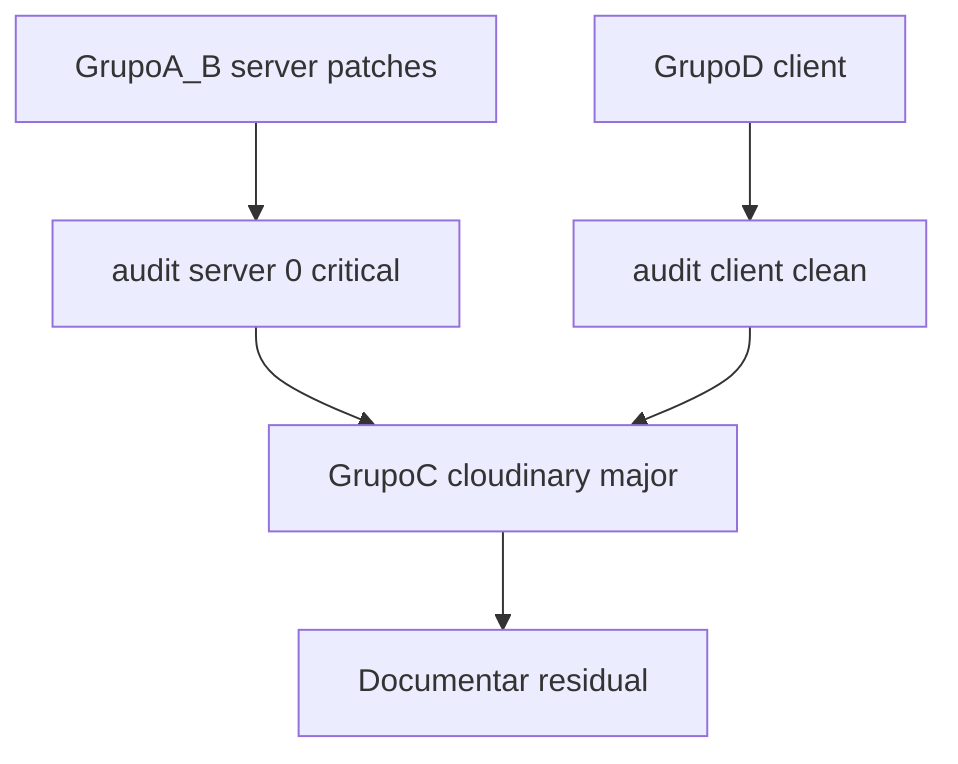

# SchedulerPro — GW-1.1: Validação final dos advisories

**Data:** 24/10/2026  
**Modo:** Análise apenas — **sem** `npm audit fix`, `npm install`, `npm update`; **sem** alteração de código, manifests ou lockfiles; **sem** commits.

**Documentos de entrada (não alterados):**

- [`schedulerpro-gw-1-dependency-triage.md`](schedulerpro-gw-1-dependency-triage.md) (GW-1)
- [`schedulerpro-phase-g-infrastructure-audit.md`](schedulerpro-phase-g-infrastructure-audit.md) (Fase G)
- [`schedulerpro-phase-h-final-consolidation.md`](schedulerpro-phase-h-final-consolidation.md) (`CANON-001`, GW-1)

**Objetivo GW-1.1:** Revalidar advisories e versões mínimas corrigidas; confirmar árvores no lockfile; refinar prioridades e critérios dos Grupos A–D do plano GW-1.

---

## 1. Baseline Git e lockfiles

| Item | Valor |
|------|--------|
| Branch | `develop` |
| HEAD | `d9f2aeaabc05a34509f77499695dfcf935921b51` |
| Código rastreado | Limpo |
| `server/package-lock.json` / `client/package-lock.json` | **Inalterados** nesta fase |

---

## 2. Comandos executados (GW-1.1)

| Comando | Resultado |
|---------|-----------|
| `git rev-parse HEAD`, `git status -sb` | HEAD `d9f2aea`; apenas relatórios `??` |
| `npm audit --omit=dev --json` (server) | 11 vulns (1 critical, 6 high, 4 moderate) — **igual GW-1** |
| `npm audit --omit=dev --json` (client) | 1 high (`follow-redirects`) — **igual GW-1** |
| `npm ls <pacotes> --omit=dev` | Árvores confirmadas (secção 4) |
| `npm view <pkg>@<versão-mínima> version` (registry, leitura) | Versões patch mínimas **existem** no npm (secção 3), exceto nota `ip-address` |

**Não executado:** `npm audit fix`, simulação de lockfile pós-fix, consulta sistemática à API GitHub Advisories para *published_at* de cada GHSA.

---

## 3. Advisories publicados ou atualizados após 24/10/2026

| Verificação | Resultado |
|-------------|-----------|
| Data da análise GW-1 / G | 24/10/2026 |
| Data GW-1.1 | **24/10/2026** (mesmo dia civil) |
| Diff de inventário npm audit vs GW-1 | **Nenhum** — mesmos pacotes, mesmas GHSAs, mesmas versões lockfile |
| GHSAs novos após 24/10/2026 | **Não identificados** com as ferramentas usadas |

**Limitação:** O npm audit não expõe, no JSON analisado, a data de publicação dos advisories. A tentativa de leitura web de [GHSA-27r3-jxmh-p828](https://github.com/advisories/GHSA-27r3-jxmh-p828) não devolveu metadados de data utilizáveis. **Conclusão:** não é possível afirmar que nenhum advisory foi publicado mais tarde no dia 24/10 ou em dias seguintes sem re-executar `npm audit` numa data posterior ou consultar o feed GitHub Advisory Database. Para a execução de correções, **repetir audit no dia do PR** é critério obrigatório (secção 8).

---

## 4. Árvore de dependências (lockfile actual)

### 4.1 Backend — versões resolvidas (`server/package-lock.json`)

| Pacote | Versão lockfile | Direct? | Caminho principal (`npm ls --omit=dev`) |
|--------|-----------------|---------|----------------------------------------|
| `body-parser` | 2.3.0 | Não | `express-rate-limit@8.5.2` → `express@5.2.1` → `body-parser` |
| `proxy-addr` | 2.0.7 | Não | `express-rate-limit` → `express` → `proxy-addr` |
| `qs` | 6.15.2 | Não | `express` → `qs`; `body-parser` → `qs` |
| `ip-address` | 10.2.0 | Não | `express-rate-limit@8.5.2` → `ip-address` |
| `compression` | 1.8.1 | **Sim** | `scheduler-api` → `compression` |
| `multer` | 2.2.0 | **Sim** | `scheduler-api` → `multer` |
| `cloudinary` | 1.41.3 | **Sim** | `scheduler-api` → `cloudinary`; também `multer-storage-cloudinary@4.0.0` → `cloudinary` |
| `mongoose` | 9.7.1 | **Sim** | `scheduler-api` → `mongoose` |
| `morgan` | 1.11.0 | **Sim** | `scheduler-api` → `morgan` |
| `moment` | 2.30.1 | Não | `winston-daily-rotate-file` → `file-stream-rotator` → `moment` |

**Nota:** `express@5.2.1` não está em `server/package.json`; entra apenas via `express-rate-limit`. O código importa `express` directamente — Grupo B do plano mantém-se válido.

### 4.2 Frontend (`client/package-lock.json`)

| Pacote | Versão | Caminho |
|--------|--------|---------|
| `follow-redirects` | 1.16.0 | `axios@1.20.0` → `follow-redirects` |

---

## 5. Tabela consolidada de advisories confirmados

Legenda **versão mínima corrigida:** inferida dos *ranges* reportados pelo `npm audit --omit=dev --json` em 24/10/2026 e confirmação de existência no registry (`npm view`, leitura). **Não** implica que `npm audit fix` resolverá exactamente essa versão sem inspecionar o lockfile gerado.

| Pacote | Instalada | Sev. npm | GHSA(s) (npm audit) | Range(s) afectado(s) | Versão mínima corrigida (confirmada) | Cobre todos os GHSAs listados? | Grupo plano |
|--------|-----------|----------|---------------------|----------------------|--------------------------------------|--------------------------------|-------------|
| `proxy-addr` | 2.0.7 | Critical | [GHSA-jqcg-44mw-7w3h](https://github.com/advisories/GHSA-jqcg-44mw-7w3h) | `>=1.1.0 <2.0.8` | **2.0.8** (existe no npm) | Sim, para este advisory | A |
| `body-parser` | 2.3.0 | High | [GHSA-27r3-jxmh-p828](https://github.com/advisories/GHSA-27r3-jxmh-p828) | `>=2.0.0 <2.4.0` | **2.4.0** | Sim | A |
| `compression` | 1.8.1 | High | [GHSA-vc2v-76pw-4v95](https://github.com/advisories/GHSA-vc2v-76pw-4v95) | `<1.8.2` | **1.8.2** | Sim | A |
| `multer` | 2.2.0 | High | [GHSA-wc9g-mqfw-jrwm](https://github.com/advisories/GHSA-wc9g-mqfw-jrwm), [GHSA-qfvm-cv95-jqjf](https://github.com/advisories/GHSA-qfvm-cv95-jqjf), [GHSA-qvfw-j98x-7q72](https://github.com/advisories/GHSA-qvfw-j98x-7q72), [GHSA-535w-7cp7-47q4](https://github.com/advisories/GHSA-535w-7cp7-47q4), [GHSA-3pph-fpjx-jg34](https://github.com/advisories/GHSA-3pph-fpjx-jg34), [GHSA-q7qp-rjg7-q26m](https://github.com/advisories/GHSA-q7qp-rjg7-q26m) | Vários (`<2.3.0`, `=2.2.0`, `<2.4.0`, `<2.5.0`, …) | **2.5.0** (limite superior do advisory mais restritivo `q7qp`: `<2.5.0`) | Sim, para os 6 GHSAs no audit | A |
| `cloudinary` | 1.41.3 | High | [GHSA-g4mf-96x5-5m2c](https://github.com/advisories/GHSA-g4mf-96x5-5m2c) | `<2.7.0` | **2.7.0** (major; npm sugere **2.11.0**) | Sim para este GHSA | **C** |
| `mongoose` | 9.7.1 | Moderate | [GHSA-664h-wqgq-64gw](https://github.com/advisories/GHSA-664h-wqgq-64gw) | `>=9.0.0 <9.7.2` | **9.7.2** | Sim | A |
| `morgan` | 1.11.0 | Moderate | [GHSA-jxfw-x594-9x9m](https://github.com/advisories/GHSA-jxfw-x594-9x9m), [GHSA-9f6g-j8ch-79g4](https://github.com/advisories/GHSA-9f6g-j8ch-79g4) | `<1.12.0`, `<1.12.1` | **1.12.1** | Sim (ambos) | A |
| `moment` | 2.30.1 | Moderate | [GHSA-4p3w-j4w9-5jqw](https://github.com/advisories/GHSA-4p3w-j4w9-5jqw) | `>=2.29.2 <2.31.0` | **2.31.0** | Sim | A |
| `qs` | 6.15.2 | Moderate | [GHSA-x5fp-wj9c-mxmx](https://github.com/advisories/GHSA-x5fp-wj9c-mxmx), [GHSA-4mjr-xmp4-gh2g](https://github.com/advisories/GHSA-4mjr-xmp4-gh2g) | `<=6.15.3`, `<6.16.0` | **6.16.0** | Sim | A |
| `ip-address` | 10.2.0 | High | 8 GHSAs (ver audit: mwp4, 4xrf, 22jq, rpw4, 2vr4, j6r3, h3mg, rxp7) | Agregado audit `<=10.7.3` | **>10.7.3** — última patch line **10.7.4** no registry (`npm view ip-address version`) | **Provável** para o conjunto reportado pelo npm; **não** re-auditado após bump sem executar fix | A |
| `follow-redirects` | 1.16.0 | High | [GHSA-q3jh-wrc6-jgq8](https://github.com/advisories/GHSA-q3jh-wrc6-jgq8), [GHSA-8r9p-f939-6h3c](https://github.com/advisories/GHSA-8r9p-f939-6h3c) | `>=1.16.0 <1.16.1` | **1.16.1** | Sim | D |

**Pacote extra no audit (GW-1):** `multer-storage-cloudinary@4.0.0` — vulnerável por dependência de `cloudinary@1.x`; **não** listado na tarefa GW-1.1 mas permanece no audit até remover a dependência ou Grupo C.

---

## 6. Riscos de exposição (resumo, inalterado em essência vs GW-1)

| Pacote | Risco operacional SchedulerPro | Confiança |
|--------|--------------------------------|-----------|
| `compression`, `body-parser`, `qs`, `multer` | Superfície HTTP / uploads — **alta** relevância | Confirmada no código |
| `proxy-addr` | **Crítico** se `trust proxy` activo; código documenta ausência de `trust proxy` | Parcial |
| `cloudinary` | Uploads quando credenciais configuradas | Confirmada |
| `ip-address` | Validação IP em `express-rate-limit` | Provável |
| `mongoose` | Updates Mongo — depende de input não sanitizado | Não verificada E2E |
| `morgan`, `moment` | Logs / rotação ficheiros | Baixa–média |
| `follow-redirects` | Redirects `axios` — cenário credenciais limitado por cookies | Provável limitada |

---

## 7. Revisão dos Grupos A–D (plano refinado)

### Grupo A — Patches server (sem `--force`)

| Aspecto | GW-1 | GW-1.1 (ajuste) |
|---------|------|-----------------|
| Objetivo | `npm audit fix` | Igual |
| Versões-alvo explícitas | Lista parcial | **Tabela secção 5** — mínimos: `compression@1.8.2`, `multer@2.5.0`, `morgan@1.12.1`, `mongoose@9.7.2`, `moment@2.31.0`, `qs@6.16.0`, `body-parser@2.4.0`, `proxy-addr@2.0.8`, `ip-address@>=10.7.4` |
| Prioridade | P0/P1 misto | **Manter:** `compression`, `body-parser`/`qs`, `multer` antes de `proxy-addr`; `ip-address` com `express-rate-limit` |
| Aceitação | Sem critical/high exceto cloudinary | **Reforçado:** (1) `npm audit --omit=dev` **0 critical**; (2) **0 high** excepto `cloudinary` / `multer-storage-cloudinary`; (3) lockfile mostra versões **≥** mínimos da secção 5; (4) `npm run test` + `npm run build` server |
| Risco regressão | Baixo–médio | **Nota:** bump `multer` 2.2→2.5+ merece testes de upload explícitos |

### Grupo B — Express direct dependency

| Aspecto | Conteúdo |
|---------|----------|
| Objetivo | Adicionar `express@^5.2.1` a `dependencies` |
| Aceitação | `npm ls express` mostra dependência directa; facilita upgrades de `body-parser` / `proxy-addr` |
| Ordem | Mesmo PR que Grupo A **recomendado** |

### Grupo C — Cloudinary major

| Aspecto | Conteúdo |
|---------|----------|
| Versão mínima | **≥2.7.0** (GHSA); alvo prático **2.11.0** (sugestão npm) |
| Aceitação | Sem GHSA-g4mf; `CloudinaryImageProvider` + uploads OK; remover `multer-storage-cloudinary` se continuar morto |
| **Não** coberto por Grupo A | Confirmado — `audit fix` sem `--force` **não** resolve `cloudinary@1.41.3` |

### Grupo D — Client

| Aspecto | Conteúdo |
|---------|----------|
| Versão mínima | `follow-redirects@1.16.1` |
| Aceitação | `npm audit --omit=dev` **0 vulnerabilities** no client; `npm run test` + `npm run build` |
| Ordem | Paralelo a A após ou antes; independente de C |

### Sequência recomendada (inalterada, com gates)

1. **Grupo A + B** → validar audit + testes server.  
2. **Grupo D** → validar client.  
3. **Grupo C** → janela separada + QA imagens.  
4. **Audit final** nos dois pacotes + registo em PR (`CANON-001`).

---

## 8. Critérios de aceitação globais (pós-implementação futura)

| ID | Critério | Verificação |
|----|----------|-------------|
| ACC-01 | Nenhuma vulnerabilidade **critical** em `--omit=dev` (server) | `npm audit --omit=dev` |
| ACC-02 | High server apenas aceitável se documentado e com data de remediação (cloudinary pré-C) | Relatório PR |
| ACC-03 | Versões lockfile ≥ mínimos secção 5 | `grep` / `npm ls` |
| ACC-04 | Testes Fase F reexecutados | server 1232 + client 1376, 0 falhas |
| ACC-05 | Audit reexecutado no **dia do merge** | Capturar advisories posteriores a 24/10/2026 |

---

## 9. Limitações GW-1.1

- Versões exactas após `npm audit fix` **não** simuladas.
- Datas de publicação GHSA **não** confirmadas fonte a fonte.
- `ip-address@10.8.0` **não** existe no npm; usar linha **10.7.4+** conforme registry.
- Advisories npm com `source` numérico (ex. 1243074) podem ser mais recentes que advisories antigos sem diff detectável no mesmo dia.
- Nenhuma alteração em [`schedulerpro-gw-1-dependency-triage.md`](schedulerpro-gw-1-dependency-triage.md) — este ficheiro **complementa** GW-1.

---

## 10. Declaração final

- **Nenhuma** dependência foi atualizada.  
- **Nenhum** lockfile ou manifest foi modificado.  
- **Nenhum** commit.

**Estado Git:** `develop` @ `d9f2aea`; relatórios `docs/reports/schedulerpro-*` untracked, incluindo este ficheiro.

---

## Anexo — Resumo executivo (tabela pedida)

| # | Pacote | Instalada | Sev. | Versão corrigida mín. | Risco app | Prioridade execução |
|---|--------|-----------|------|------------------------|-----------|---------------------|
| 1 | `compression` | 1.8.1 | High | 1.8.2 | Alto | 1 — Grupo A |
| 2 | `body-parser` | 2.3.0 | High | 2.4.0 | Alto | 1 — Grupo A |
| 3 | `qs` | 6.15.2 | Moderate | 6.16.0 | Alto | 1 — Grupo A |
| 4 | `multer` | 2.2.0 | High | 2.5.0 | Alto | 1 — Grupo A |
| 5 | `proxy-addr` | 2.0.7 | Critical | 2.0.8 | Médio–alto* | 2 — Grupo A |
| 6 | `ip-address` | 10.2.0 | High | 10.7.4 | Médio | 2 — Grupo A |
| 7 | `cloudinary` | 1.41.3 | High | 2.7.0+ | Alto | 3 — Grupo C |
| 8 | `mongoose` | 9.7.1 | Moderate | 9.7.2 | Médio | 2 — Grupo A |
| 9 | `morgan` | 1.11.0 | Moderate | 1.12.1 | Baixo | 3 — Grupo A |
| 10 | `moment` | 2.30.1 | Moderate | 2.31.0 | Baixo | 3 — Grupo A |
| 11 | `follow-redirects` | 1.16.0 | High | 1.16.1 | Médio | 2 — Grupo D |

\* `proxy-addr`: severidade npm máxima; exposição efectiva menor sem `trust proxy`.

**Diferença face à Fase G / GW-1:** inventário e contagens **idênticos**; GW-1.1 acrescenta versões mínimas validadas no registry e critérios de aceitação mais estritos para Grupo A (`multer@2.5.0`, `ip-address@10.7.4`).

**Localização:** [`docs/reports/schedulerpro-gw-1.1-advisory-validation.md`](schedulerpro-gw-1.1-advisory-validation.md)
