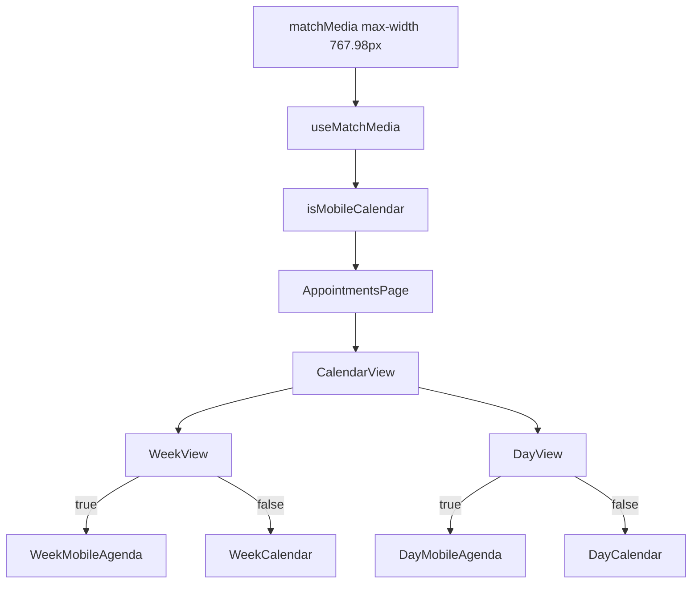

# SchedulerPro — Etapa 6.3: Diagnóstico visual calendário mobile (Semana e Dia)

**Data:** 03/11/2026  
**Tipo:** Diagnóstico READ-ONLY (sem alterações de código, testes, dependências ou Git)  
**Branch:** `feature/appointments-mobile-calendar-step-6`  
**Implementação de referência:** [`schedulerpro-mobile-calendar-step-6-implementation.md`](./schedulerpro-mobile-calendar-step-6-implementation.md)  
**Auditoria de referência:** [`schedulerpro-mobile-calendar-step-6-audit.md`](./schedulerpro-mobile-calendar-step-6-audit.md)

Legenda:

- **Confirmado (código)** — dedutível do repositório analisado.
- **Confirmado (utilizador)** — feedback explícito nesta etapa.
- **Hipótese** — plausível, requer confirmação no browser (DevTools).
- **Descartado (código/lógica)** — inconsistente com o fluxo ou com dados do utilizador.

---

## 1. Contexto do problema

A Etapa 6.2 introduziu `WeekView`, `DayView`, `WeekMobileAgenda` e `DayMobileAgenda`, com `timeGrid.isMobileViewport` ligado a `isMobileCalendar`. Testes automatizados e build reportaram sucesso.

**Confirmado (utilizador):** em modo mobile, as vistas **Semana** e **Dia** continuam com aparência de **grelha time-grid** (comportamento anterior).

**Confirmado (utilizador):** no **mesmo** viewport/dispositivo, a vista **Mês** mobile funciona (grelha compacta + lista de agendamentos do dia abaixo).

Este relatório explica o fluxo de renderização, o que deveria aparecer em cada largura, por que os testes podem passar sem garantir o runtime, e a causa raiz mais provável **sem** alterar código.

---

## 2. Fluxo de renderização (Confirmado — código)

### 2.1 Cadeia de props

```text
useMatchMedia(MOBILE_CALENDAR_MEDIA_QUERY)
  → useAppointmentsNavigation.isMobileCalendar
  → AppointmentsPage
       month.isMobileViewport = isMobileCalendar
       timeGrid.isMobileViewport = isMobileCalendar
  → CalendarView
       timeGridMobile = timeGrid?.isMobileViewport ?? false
       WeekView / DayView isMobileViewport={timeGridMobile}
  → WeekView: isMobileViewport ? WeekMobileAgenda : WeekCalendar
  → DayView:  isMobileViewport ? DayMobileAgenda  : DayCalendar
```

| Ficheiro | Linhas / símbolo | Papel |
|----------|------------------|--------|
| [`client/src/hooks/useMatchMedia.ts`](../../client/src/hooks/useMatchMedia.ts) | `MOBILE_CALENDAR_MEDIA_QUERY` | `(max-width: 767.98px)`; estado inicial + `addEventListener("change")` |
| [`client/src/hooks/useAppointmentsNavigation.ts`](../../client/src/hooks/useAppointmentsNavigation.ts) | ~L128 | `const isMobileCalendar = useMatchMedia(...)` |
| [`client/src/pages/appointments/AppointmentsPage.tsx`](../../client/src/pages/appointments/AppointmentsPage.tsx) | ~L312–324 | `month` + `timeGrid` ambos com `isMobileViewport: isMobileCalendar` |
| [`client/src/components/appointments/CalendarView.tsx`](../../client/src/components/appointments/CalendarView.tsx) | L77, L79–80, L116–145 | `timeGridMobile`; sem `calendar-surface--time-grid` em mobile |
| [`client/src/components/appointments/WeekView.tsx`](../../client/src/components/appointments/WeekView.tsx) | L37–52 | Ramificação mobile/desktop |
| [`client/src/components/appointments/DayView.tsx`](../../client/src/components/appointments/DayView.tsx) | L33–44 | Idem |

**Confirmado (código):** Semana e Dia **não** usam um breakpoint diferente do Mês. Uma única flag `isMobileCalendar` alimenta mês e time-grid.

### 2.2 Diagrama



### 2.3 Marcadores DOM (Confirmado — código)

| Modo | Semana — deve existir | Semana — não deve existir |
|------|------------------------|---------------------------|
| Mobile (6.2 activo) | `[data-testid="week-mobile-agenda"]`, `.week-mobile-agenda-day` (×7) | `.week-calendar`, `.week-calendar-time-grid` |
| Desktop/tablet | `.week-calendar`, `.week-calendar-time-grid` | `[data-testid="week-mobile-agenda"]` |

| Modo | Dia — deve existir | Dia — não deve existir |
|------|-------------------|-------------------------|
| Mobile | `[data-testid="day-mobile-agenda"]` | `.day-calendar-time-body` |
| Desktop | `.day-calendar`, `.day-calendar-time-body` | `[data-testid="day-mobile-agenda"]` |

---

## 3. Breakpoints e valores efectivos

| Largura viewport (CSS px) | `window.matchMedia("(max-width: 767.98px)").matches` | `isMobileCalendar` | Semana (código 6.2) | Dia (código 6.2) |
|---------------------------|------------------------------------------------------|--------------------|---------------------|------------------|
| 390 | `true` | `true` | `WeekMobileAgenda` | `DayMobileAgenda` |
| 767 | `true` | `true` | idem | idem |
| 768 | `false` | `false` | `WeekCalendar` (grelha, min-width 620px @≤991 CSS) | `DayCalendar` |
| 1024 | `false` | `false` | idem | idem |

**Confirmado (código):** @768px a grelha é **intencional** (Etapa 6.2 — tablet preserva time-grid).

**Confirmado (código):** [`client/index.html`](../../client/index.html) usa `viewport` width=device-width — o breakpoint segue a largura do layout viewport, não o “modo mobile” nominal do DevTools sem largura &lt;768.

**Hipótese:** DevTools com dispositivo seleccionado mas painel &gt;767px efectivos, ou zoom, faz `matches === false` **só** se a largura real ≥768; porém o utilizador reportou **mês mobile OK** no mesmo contexto, o que implica `matches === true` nesse teste.

---

## 4. Componente efectivamente renderizado vs esperado

### 4.1 Se `isMobileCalendar === true` (consistente com mês mobile OK)

| Vista | Esperado (6.2) | Observado (utilizador) | Consistência |
|-------|----------------|------------------------|--------------|
| Mês | Grelha compacta + `MonthDayAgendaList` | OK | Alinhado |
| Semana | Agenda vertical 7 dias | Grelha antiga | **Contradição lógica** com ramificação `WeekView` no código 6.2 |
| Dia | Agenda + horários | Grelha antiga | **Contradição lógica** idem |

**Dedução (não confirmada no DOM do utilizador):** se o JavaScript em execução for **exactamente** o da Etapa 6.2 e `isMobileCalendar === true`, `WeekCalendar` **não** é montado por `WeekView`. Ver secção 5.

### 4.2 Se `isMobileCalendar === false` (largura ≥768)

| Vista | Esperado | Observado |
|-------|----------|-----------|
| Semana / Dia | Grelha | Grelha — **comportamento correcto por especificação** |

**Descartado como “bug 6.2”** se a largura efectiva for ≥768px.

---

## 5. Causa raiz

### 5.1 Confirmado (código)

1. O wiring `isMobileCalendar` → `timeGrid` → `WeekView`/`DayView` está **correcto** no repositório actual.
2. `timeGrid?.isMobileViewport ?? false` faz fallback para **grelha** se `timeGrid` omitido — mas [`AppointmentsPage`](../../client/src/pages/appointments/AppointmentsPage.tsx) **passa** `timeGrid`.
3. Não existe CSS que substitua grelha por agenda; a selecção é **render condicional React**.
4. Testes 6.2 validam mobile injectando `timeGrid.isMobileViewport: true` ou testando `WeekMobileAgenda`/`WeekView` directamente — **não** provam integração com `useMatchMedia` na página completa.

### 5.2 Confirmado (utilizador)

- Mês mobile funciona no mesmo ambiente → **`isMobileCalendar` é `true` no runtime desse teste** (mesmo hook que `timeGrid`).

### 5.3 Causa raiz mais provável — **Hipótese forte (pendente 1 verificação DOM)**

**O bundle JavaScript servido ao browser para Semana/Dia não inclui o ramo Etapa 6.2** (`WeekView` ainda delegando implicitamente a grelha antiga), **embora** o código-fonte local e o mês mobile (funcionalidade **anterior** a 6.2) pareçam correctos.

Cenários operacionais típicos:

| Cenário | Descrição |
|---------|-----------|
| Cache / deploy | `client/dist` antigo, preview de build pré-6.2, ou servidor remoto sem merge 6.2 |
| Dev server | Vite sem reinício após adicionar `WeekView`; HMR parcial **Hipótese** |
| Branch / ambiente | Teste noutro clone ou URL que não aponta para `feature/appointments-mobile-calendar-step-6` |
| Service worker | **Hipótese** — projecto não evidenciou SW no grep; confirmar Application → Service Workers |

**Verificação decisiva (utilizador / DevTools):** na vista Semana com largura &lt;768:

```javascript
window.matchMedia("(max-width: 767.98px)").matches
document.querySelector('[data-testid="week-mobile-agenda"]')
document.querySelector(".week-calendar-time-grid")
```

- Se `matches === true` e existe `.week-calendar-time-grid` **e não** existe `week-mobile-agenda` → **confirma** bundle pré-6.2 ou `CalendarView` antigo em runtime (não o código actual do repo).
- Se `matches === true` e existe `week-mobile-agenda` → utilizador pode estar a descrever UX diferente da expectativa (**Hipótese**); não é grelha DOM.

### 5.4 Descartado (dado mês OK + código actual)

| Hipótese | Motivo |
|----------|--------|
| `timeGrid` não passado em `AppointmentsPage` | Código L320–324 passa-o |
| Breakpoint diferente entre mês e semana | Mesmo `isMobileCalendar` |
| `WeekView` ignora prop | Código L37 ramifica correctamente |
| CSS esconde agenda e mostra grelha | Grelha não é montada em mobile no 6.2 |
| `matchMedia` nunca actualiza | Mês mobile funcionaria mal; utilizador diz mês OK |

### 5.5 Descartado ou “comportamento esperado”

| Hipótese | Motivo |
|----------|--------|
| Largura 768–1024px | Grelha **por desenho**; informar utilizador se for o caso |
| Falha de testes = falha de produto | Testes não ligam hook à página; podem passar com código correcto no repo mas runtime desactualizado |

---

## 6. Lacunas de testes (Confirmado — código)

| Lacuna | Evidência | Risco |
|--------|-----------|--------|
| `CalendarView` semana **sem** `timeGrid` | [`CalendarView.test.tsx`](../../client/src/components/appointments/CalendarView.test.tsx) — testes legacy `viewType="week"` omit `timeGrid` → default grelha | Regressão silenciosa se `AppointmentsPage` deixar de passar `timeGrid` |
| `WeekCalendar` / `DayCalendar` testados isolados | Describes directos, não via `WeekView` | Não valida switch |
| `useAppointmentsNavigation.test.ts` | `useMatchMedia` mock **sempre `false`** (L12–16) | Nunca simula mobile real na navegação |
| Sem `AppointmentsPage.test` mobile semana | Grep sem `timeGrid` / `WeekMobile` | Integração não coberta |
| Testes mobile injectam prop | `timeGrid: { isMobileViewport: true }` | Passam sem `matchMedia` |

**Recomendação para etapa futura (não implementada aqui):**

1. Teste `AppointmentsPage` ou `CalendarView` com `matchMedia` mock `true` @390px, vista semana → `week-mobile-agenda` presente.
2. Teste `useAppointmentsNavigation` com `useMatchMediaMock` retornando `true` e assert indirecto via componente filho (ou export de teste).
3. Manter asserts **DOM** (não `scrollWidth` jsdom).

---

## 7. Correção recomendada (Etapa 6.4 — aguardar autorização)

**Não alterar código nesta Etapa 6.3.** Ordem sugerida:

### Passo A — Validação operacional (obrigatório)

1. Confirmar branch e ficheiros: existem [`WeekView.tsx`](../../client/src/components/appointments/WeekView.tsx) e import em [`CalendarView.tsx`](../../client/src/components/appointments/CalendarView.tsx).
2. Reiniciar `npm run dev`; hard refresh (Ctrl+Shift+R); evitar `dist` antigo se se testa build estático.
3. DevTools → largura 390px → vista Semana → executar queries da secção 5.3.
4. DevTools → Sources → procurar `WeekMobileAgenda` no bundle servido.

### Passo B — Consoante resultado DOM

| Resultado | Acção recomendada |
|-----------|-------------------|
| `week-mobile-agenda` presente | Clarificar expectativa UX com utilizador; possível ajuste visual/copy, não switch |
| `week-calendar-time-grid` com `matches === true` | Corrigir **deploy/cache/build**; depois teste integração `AppointmentsPage` |
| `matches === false` com largura aparente “mobile” | Medir largura real; se ≥768, documentar comportamento tablet |
| Mês deixa de funcionar mobile após refresh | Investigar hook/`matchMedia` separadamente (**improvável** dado estado actual) |

### Passo C — Melhoria preventiva (código, só após autorização)

- Teste integração descrito em §6.
- Opcional: assert em dev-only ou teste E2E Playwright @390px (fora do âmbito actual).

**Não recomendado** sem evidência: alterar breakpoint, duplicar `useMatchMedia` dentro de `WeekView`, ou refactor de negócio.

---

## 8. Checklist DevTools (utilizador)

Na página **Agendamentos**, vista **Semana**, viewport **390px**:

1. Consola: `window.matchMedia("(max-width: 767.98px)").matches` → esperado `true` se mês mobile OK.
2. Consola: `!!document.querySelector('[data-testid="week-mobile-agenda"]')` → esperado `true` com 6.2 activo.
3. Consola: `!!document.querySelector(".week-calendar-time-grid")` → esperado `false` com 6.2 activo e passo 1 `true`.

Repetir na vista **Dia** com `[data-testid="day-mobile-agenda"]` e `.day-calendar-time-body`.

---

## 9. Ficheiros analisados (READ-ONLY)

- [`useMatchMedia.ts`](../../client/src/hooks/useMatchMedia.ts)
- [`useAppointmentsNavigation.ts`](../../client/src/hooks/useAppointmentsNavigation.ts)
- [`AppointmentsPage.tsx`](../../client/src/pages/appointments/AppointmentsPage.tsx)
- [`CalendarView.tsx`](../../client/src/components/appointments/CalendarView.tsx)
- [`WeekView.tsx`](../../client/src/components/appointments/WeekView.tsx)
- [`DayView.tsx`](../../client/src/components/appointments/DayView.tsx)
- [`WeekMobileAgenda.tsx`](../../client/src/components/appointments/WeekMobileAgenda.tsx)
- [`DayMobileAgenda.tsx`](../../client/src/components/appointments/DayMobileAgenda.tsx)
- [`appointments-calendar.css`](../../client/src/styles/appointments-calendar.css) (sem regra que inverta mobile/desktop)
- [`CalendarView.test.tsx`](../../client/src/components/appointments/CalendarView.test.tsx)
- [`useAppointmentsNavigation.test.ts`](../../client/src/hooks/useAppointmentsNavigation.test.ts)
- [`index.html`](../../client/index.html)

---

## 10. Contexto para outra IA (correcção futura)

1. **Sintoma:** mês mobile OK + semana grelha ⇒ `isMobileCalendar === true` mas runtime sem `WeekView` branch **ou** utilizador em largura ≥768 / bundle velho.
2. **Código repo 6.2:** lógica coerente; bug **não** encontrado na condição `isMobileViewport` dado `timeGrid` passado.
3. **Próximo passo:** DOM checklist §8; se grelha com `matches true`, foco em **artefacto servido**, não em `appointmentCalendar.ts`.
4. **Testes:** adicionar integração `AppointmentsPage` + `matchMedia true` antes de mudanças funcionais.

---

**Fim do diagnóstico Etapa 6.3.** Aguardar autorização antes de qualquer implementação (Etapa 6.4).
