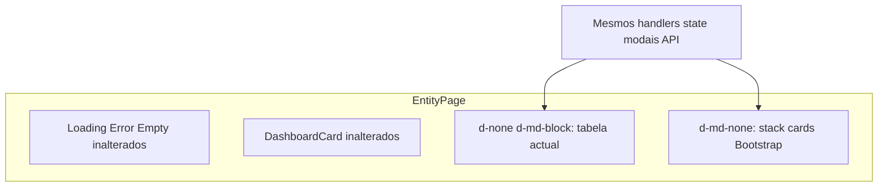

# SchedulerPro — Etapa 6.4d.1 — Auditoria das listagens de funcionários, clientes e serviços no mobile

**Data:** 2026-11-04  
**Tipo:** auditoria read-only (sem alterações de código, CSS ou testes)

**Relacionado:** [`schedulerpro-mobile-ux-step-6-4-audit.md`](./schedulerpro-mobile-ux-step-6-4-audit.md) (§1.5–1.7, §6.5–6.7, P4), [`schedulerpro-sidebar-mobile-step-6-4c-3-implementation.md`](./schedulerpro-sidebar-mobile-step-6-4c-3-implementation.md) (sidebar mobile — preservar)

**Nota de nomenclatura:** No roadmap da auditoria mobile global (6.4), cards para Clientes/Serviços/Funcionários apareciam como sub-etapa **6.4e**. O prompt da presente etapa **6.4d.1** redefine **Stage 6.4d** para estas três listagens. Este relatório segue o escopo do prompt 6.4d.1; a implementação futura deve alinhar-se com a numeração acordada pelo equipa após revisão.

---

## 1. Objetivo da auditoria

Identificar como o frontend apresenta hoje as listagens de **funcionários**, **clientes** e **serviços**, com foco no comportamento em viewports pequenas (rolagem horizontal indesejada) e preparar uma proposta técnica para exibir cada registo em **cards verticais no mobile**, mantendo tabelas e comportamento actuais no desktop.

Esta etapa **não inclui implementação** — apenas análise do código existente e recomendações documentadas.

---

## 2. Branch, HEAD e estado do Working Tree

Inspeção read-only no momento da auditoria (sem commit, push, switch ou outras operações destrutivas):

| Verificação | Resultado |
|-------------|-----------|
| Branch actual | `develop` (tracking `origin/develop`) |
| HEAD | `e32241a3666722730ff7ee7d9ccf6e7f6e361d0b` |
| Working tree | **Limpo** — sem ficheiros modified/staged/untracked antes da criação deste relatório |

Após a auditoria, o working tree deve conter **apenas** este ficheiro `.md` como alteração local (untracked ou staged conforme gestão manual do utilizador).

---

## 3. Arquivos e componentes analisados

### 3.1 Páginas (listagem principal)

| Entidade | Rota | Página |
|----------|------|--------|
| Funcionários | `/employees` | [`client/src/pages/employees/EmployeesPage.tsx`](../../client/src/pages/employees/EmployeesPage.tsx) |
| Clientes | `/clients` | [`client/src/pages/clients/ClientsPage.tsx`](../../client/src/pages/clients/ClientsPage.tsx) |
| Serviços | `/services` | [`client/src/pages/services/ServicesPage.tsx`](../../client/src/pages/services/ServicesPage.tsx) |

Registo de rotas: [`client/src/routes/AppRoutes.tsx`](../../client/src/routes/AppRoutes.tsx).

**Facto:** Não existem componentes dedicados do tipo `EmployeesListView` / `ClientsListView` — a tabela e a lógica de linha estão **inline** em cada página.

### 3.2 Formulários, modais e APIs

| Área | Componentes | API |
|------|-------------|-----|
| Funcionários | [`EmployeeForm`](../../client/src/components/employees/EmployeeForm.tsx), [`DeleteEmployeeModal`](../../client/src/components/employees/DeleteEmployeeModal.tsx) | [`employees.api.ts`](../../client/src/api/endpoints/employees.api.ts) |
| Clientes | [`ClientForm`](../../client/src/components/clients/ClientForm.tsx), [`DeleteClientModal`](../../client/src/components/clients/DeleteClientModal.tsx), [`SendClientInviteModal`](../../client/src/components/clients/SendClientInviteModal.tsx) | [`clients.api.ts`](../../client/src/api/endpoints/clients.api.ts) |
| Serviços | [`ServiceForm`](../../client/src/components/services/ServiceForm.tsx), [`DeleteServiceModal`](../../client/src/components/services/DeleteServiceModal.tsx) | [`services.api.ts`](../../client/src/api/endpoints/services.api.ts) |

### 3.3 Permissões e menu

| Ficheiro | Papel |
|----------|--------|
| [`employeePermissions.ts`](../../client/src/config/employeePermissions.ts) | `getEmployeeAbilities` |
| [`clientPermissions.ts`](../../client/src/config/clientPermissions.ts) | `getClientAbilities` |
| [`servicePermissions.ts`](../../client/src/config/servicePermissions.ts) | `getServiceAbilities` |
| [`menu.ts`](../../client/src/config/menu.ts) | Visibilidade de rotas por role |

### 3.4 UI partilhada e estilos

| Recurso | Papel nas listagens |
|---------|---------------------|
| [`PageHeader`](../../client/src/components/common/PageHeader.tsx) | Título, descrição, botão «Novo …» |
| [`DashboardCard`](../../client/src/components/common/DashboardCard.tsx) | KPIs acima da tabela (responsivo) |
| [`LoadingState`](../../client/src/components/common/LoadingState.tsx), [`ErrorState`](../../client/src/components/common/ErrorState.tsx), [`EmptyState`](../../client/src/components/common/EmptyState.tsx) | Estados de lista |
| [`ImageAvatar`](../../client/src/components/common/ImageAvatar.tsx) | Avatar em clientes e funcionários |
| [`index.css`](../../client/src/index.css) | `.table-card`, `.table-responsive`, `.table-actions`, `.person-cell`, media query `767.98px`, `min-width: 680px` |

### 3.5 Tipos de dados

| Tipo | Ficheiro |
|------|----------|
| `Employee` | [`client/src/types/employee.ts`](../../client/src/types/employee.ts) |
| `Client` | [`client/src/types/client.ts`](../../client/src/types/client.ts) |
| `Service` | [`client/src/types/service.ts`](../../client/src/types/service.ts) |

### 3.6 Testes

| Ficheiro |
|----------|
| [`EmployeesPage.test.tsx`](../../client/src/pages/employees/EmployeesPage.test.tsx), [`EmployeesPage.photo.test.tsx`](../../client/src/pages/employees/EmployeesPage.photo.test.tsx) |
| [`ClientsPage.test.tsx`](../../client/src/pages/clients/ClientsPage.test.tsx), [`ClientsPage.photo.test.tsx`](../../client/src/pages/clients/ClientsPage.photo.test.tsx) |
| [`ServicesPage.test.tsx`](../../client/src/pages/services/ServicesPage.test.tsx) |

---

## 4. Diagnóstico individual (funcionários, clientes, serviços)

### 4.1 Funcionários

**Factos:**

- Listagem: `card table-card` → `table-responsive` → tabela 6 colunas de dados + coluna **Ações** condicional.
- Colunas: Funcionário (`person-cell` + avatar + nome + sublinha «Você» se `employee.id === currentUser.id`), E-mail, Perfil (badge com `employee.role`), Status (Ativo/Inativo), Adicionado em (`formatDate` com `toLocaleDateString("pt-PT")`).
- Filtro defensivo pós-API: exclui `role === "CLIENT"` da lista (alinhado ao backend).
- KPIs quando há dados: Total da equipa, Ativos, Managers (`DashboardCard` em `row` responsivo).
- Mobile: sujeito a `min-width: 680px` na tabela → **scroll horizontal**; coluna de acções com até 4 botões (Editar, Desativar/Ativar, Excluir) agrupados em `.table-actions`.

### 4.2 Clientes

**Factos:**

- Tabela 4 colunas + **Ações**: Cliente (avatar + nome), Email (`className="text-nowrap"`), Telefone, Status.
- KPI: um `DashboardCard` «Clientes na sua base».
- Acção **Convidar** condicional: `canInvite && client.email && !client.portalAccess.exists`.
- Campos `notes`, `createdAt`, etc. existem no tipo `Client` mas **não** aparecem na listagem.
- Mobile: email `text-nowrap` + tabela 680px mín. → scroll horizontal e risco de email truncado visualmente fora do card.

### 4.3 Serviços

**Factos:**

- Tabela: Serviço (nome + `table-subline` com `description` se existir), Duração (`{duration} min`), Preço (`formatPrice` pt-PT), Status, Ações.
- KPIs: Serviços ativos + No catálogo.
- Toggle activo/inactivo inline na listagem (`handleToggleActive` + `togglingId`).
- Mobile: descrições longas aumentam altura de linha; scroll horizontal mantém-se pela regra global da tabela.

---

## 5. Funcionamento actual no desktop e no mobile

### 5.1 Desktop (≥768px — Bootstrap `md`)

| Aspecto | Comportamento |
|---------|----------------|
| Layout listagem | Tabela Bootstrap `table-hover` dentro de `table-card` |
| KPIs | Grelha `col-md-4` / `col-md-6` conforme página |
| Page header | [`PageHeader`](../../client/src/components/common/PageHeader.tsx) horizontal |
| Acções por linha | `.table-actions` com `flex-wrap` e `min-width` nos botões |

### 5.2 Mobile (≤767.98px)

| Aspecto | Comportamento |
|---------|----------------|
| Page header | CSS empilha título e acções (`flex-direction: column`; botões largura total) — [`index.css`](../../client/src/index.css) L1199–1214 |
| Tabela | **Mesma markup** que desktop; regra global: |

```css
@media (max-width: 767.98px) {
  .table-responsive .table {
    min-width: 680px;
  }
}
```

| Efeito UX | Utilizador deve fazer **pan horizontal** para ver email, acções, etc. |
| KPIs | Já empilham (`col-12`) — **sem** problema de scroll |
| Sidebar 6.4c | Drawer mobile independente destas páginas — **não alterar** nesta etapa |

**Facto:** Breakpoint `767.98px` coincide com `MOBILE_CALENDAR_MEDIA_QUERY` em [`useMatchMedia.ts`](../../client/src/hooks/useMatchMedia.ts) — recomendável reutilizar o mesmo limiar para cards de entidades (consistência).

**Facto:** Relatórios usam `.table-responsive.table-compact` com `min-width: 0` — as três páginas de entidades **não** usam `table-compact`.

---

## 6. Campos e acções disponíveis em cada registo

### 6.1 Funcionários

| Campo na UI | Origem |
|-------------|--------|
| Nome, avatar | `employee.name`, `employee.avatar` |
| «Você» | comparação com `currentUser.id` |
| E-mail | `employee.email` |
| Perfil | `employee.role` + `ROLE_BADGE_CLASS` |
| Status | `employee.isActive !== false` |
| Adicionado em | `employee.createdAt` |

| Acção | Condição |
|-------|----------|
| Editar | `canEdit` |
| Desativar | `canDeactivate`, não self, activo |
| Ativar | `canActivate`, não self, inactivo |
| Excluir | `canDelete`, não self |

Sem acção «visualizar» dedicada — edição via modal `EmployeeForm`.

### 6.2 Clientes

| Campo na UI | Origem |
|-------------|--------|
| Nome, avatar | `client.name`, `client.avatar` |
| Email | `client.email ?? "—"` |
| Telefone | `client.phone` |
| Status | `client.isActive` |

| Acção | Condição |
|-------|----------|
| Editar | `canUpdate` |
| Convidar | `canInvite && client.email && !client.portalAccess.exists` |
| Excluir | `canDelete` |

### 6.3 Serviços

| Campo na UI | Origem |
|-------------|--------|
| Nome | `service.name` |
| Descrição (subline) | `service.description` |
| Duração | `service.duration` |
| Preço | `service.price` |
| Status | `service.isActive` |

| Acção | Condição |
|-------|----------|
| Editar | `canUpdate` |
| Desactivar / Activar | `canUpdate` (mesmo botão alternado) |
| Excluir | `canDelete` |

---

## 7. Filtros, pesquisa e paginação

**Factos (código actual):**

| Funcionalidade | Funcionários | Clientes | Serviços |
|----------------|--------------|----------|----------|
| Filtros UI | Não | Não | Não |
| Pesquisa / search | Não | Não | Não |
| Paginação | Não | Não | Não |
| Ordenação client-side | Ordem devolvida pela API | Idem | Idem |

Carga: um único `getEmployees()` / `getClients()` / `getServices()` no `useEffect` ao montar (funcionários só se `canList`).

**Recomendação (6.4d):** Cards mobile devem listar o **mesmo array** `employees` / `clients` / `services` — sem novos filtros. Toolbar de filtros **não aplicável** hoje.

---

## 8. Regras de acesso e permissões

### 8.1 Menu ([`menu.ts`](../../client/src/config/menu.ts))

| Rota | Roles com item de menu |
|------|------------------------|
| `/clients` | OWNER, ADMIN, MANAGER, EMPLOYEE |
| `/services` | OWNER, ADMIN, MANAGER, EMPLOYEE |
| `/employees` | OWNER, ADMIN |

### 8.2 Abilities por página

**Funcionários** — [`getEmployeeAbilities`](../../client/src/config/employeePermissions.ts):

| Role | Listar | Criar/Editar/Act./Desact. | Excluir |
|------|--------|---------------------------|---------|
| OWNER | Sim | Sim | Sim |
| ADMIN | Sim | Sim | Não |
| MANAGER, EMPLOYEE, outros | Não (`canList` false) | — | — |

Página: se `!canList`, renderiza alerta de permissão e **não** chama API.

**Clientes** — [`getClientAbilities`](../../client/src/config/clientPermissions.ts):

| Role | Listar* | Criar/Editar | Excluir | Convidar |
|------|---------|--------------|---------|----------|
| OWNER | Sim | Sim | Sim | Sim |
| ADMIN | Sim | Sim | Não | Sim |
| MANAGER | Sim | Sim | Não | Não |
| EMPLOYEE | Sim | Não | Não | Não |

\* `canList` existe na config; a página **não** bloqueia acesso por `canList` — EMPLOYEE vê lista read-only (sem coluna acções). Backend permanece autoridade final.

**Serviços** — [`getServiceAbilities`](../../client/src/config/servicePermissions.ts):

| Role | Listar* | Criar/Editar/Toggle | Excluir |
|------|---------|---------------------|---------|
| OWNER | Sim | Sim | Sim |
| ADMIN | Sim | Sim | Não |
| MANAGER, EMPLOYEE | Sim | Não | Não |

\* Idem: página não verifica `canList` explicitamente; testes cobrem EMPLOYEE read-only.

**Recomendação (6.4d):** Replicar exactamente as mesmas condicionais nos cards mobile (coluna acções oculta = rodapé de card omitido ou só leitura).

---

## 9. Estados de carregamento, erro e lista vazia

| Estado | Padrão nas três páginas |
|--------|-------------------------|
| Carregamento | `<LoadingState label="A carregar …" />` — substitui listagem |
| Erro | `<ErrorState message={loadError} onRetry={…} />` — `loadErrorRetryable` controla botão retry |
| Vazio | `<EmptyState>` com CTA «Cadastrar primeiro …» se `canCreate` (ou equivalente) |
| Sucesso acção | `alert alert-success` no topo |
| Erro acção (func./serv.) | `alert alert-danger` (`actionError`) em toggle falhado |

**Facto:** KPIs e tabela só renderizam quando `!isLoading && !loadError && length > 0`.

**Recomendação (6.4d):** Cards mobile entram no mesmo ramo condicional que a tabela (após loading/error/empty) — **não** duplicar lógica de estados.

---

## 10. Testes existentes e lacunas

### 10.1 Funcionários — [`EmployeesPage.test.tsx`](../../client/src/pages/employees/EmployeesPage.test.tsx)

**Coberto:** loading; erro + retry; empty + botão criar; render colunas; superfície `.table-responsive`; exclusão CLIENT; CRUD modais; activate/deactivate; erro toggle; permissão MANAGER/EMPLOYEE; RBAC ADMIN vs OWNER; linha «Você» sem acções destrutivas; tokens não persistidos.

**Lacunas:** viewport mobile; presença de cards; ausência de scroll obrigatório; regressão desktop explícita por breakpoint.

### 10.2 Clientes — [`ClientsPage.test.tsx`](../../client/src/pages/clients/ClientsPage.test.tsx)

**Coberto:** loading; erro; empty por role; lista com email/telefone/status; tabela partilhada; CRUD; RBAC acções; fluxo Convidar (OWNER/ADMIN/MANAGER/EMPLOYEE); conflito convite; cliente com portal / sem email.

**Lacunas:** idem mobile/cards.

### 10.3 Serviços — [`ServicesPage.test.tsx`](../../client/src/pages/services/ServicesPage.test.tsx)

**Coberto:** loading; erro; empty; colunas incl. subline descrição; toggle activo/inactivo; RBAC; delete OWNER only.

**Lacunas:** idem mobile/cards.

### 10.4 Testes photo

[`*.photo.test.tsx`](../../client/src/pages/clients/ClientsPage.photo.test.tsx) — upload avatar; **independente** da forma da listagem.

**Recomendação (implementação):** Seguir padrão [`AppointmentsPage.test.tsx`](../../client/src/pages/appointments/AppointmentsPage.test.tsx) (`mockMobileCalendarViewport` com query `767.98`); assert região mobile (`data-testid` ou query por card); manter teste existente de `getByRole('table')` em viewport desktop (default jsdom).

---

## 11. Proposta técnica para os cards mobile

> **Secção de recomendações** — não reflecte comportamento actual.

### 11.1 Abordagem geral



1. **Dual surface por página** em [`EmployeesPage`](../../client/src/pages/employees/EmployeesPage.tsx), [`ClientsPage`](../../client/src/pages/clients/ClientsPage.tsx), [`ServicesPage`](../../client/src/pages/services/ServicesPage.tsx):
   - **≥768px:** manter markup de tabela byte-a-byte equivalente (classes `d-none d-md-block` no wrapper).
   - **<768px:** `d-md-none` com lista vertical de `div.card` (ou `list-group-item`) por registo.

2. **Conteúdo do card** — espelhar colunas existentes (secção 6), prioridade visual:
   - **Funcionários:** cabeçalho `person-cell`; email; badges perfil + status; data «Adicionado em» em texto secundário; rodapé acções.
   - **Clientes:** `person-cell`; email com quebra permitida (`overflow-wrap` / sem `text-nowrap` só no card); telefone; badge status; acções.
   - **Serviços:** título nome; descrição truncada ou 2 linhas; meta duração + preço; badge status; acções.

3. **Acções:** extrair bloco JSX de botões partilhado entre `<td>` e card footer **ou** duplicar com comentário `// keep in sync` — preferível pequena função render local `renderEmployeeActions(employee)` para evitar drift.

4. **Sobrecarga de botões (funcionários OWNER):** dropdown Bootstrap «Ações» no mobile se >3 botões visíveis (alinhado a [`schedulerpro-mobile-ux-step-6-4-audit.md`](./schedulerpro-mobile-ux-step-6-4-audit.md) §6.7).

5. **CSS:** classe wrapper `.entity-list-mobile` para espaçamento (`gap`, `margin-top`); **não** remover regra global `680px` — ocultar tabela no mobile via `d-none d-md-block`.

6. **Arquitectura mínima:** evitar framework genérico de «entity CRUD»; opcional [`EntityMobileCardShell`](../../client/src/components/common/) (título + body + footer slot) **só** se três páginas partilharem estrutura idêntica.

7. **Detecção viewport:** preferir utilitários Bootstrap `d-none d-md-block` / `d-md-none` (sem `useMatchMedia` extra) unless testes exigirem hook.

### 11.2 Informações essenciais vs secundárias (mobile)

| Entidade | Essencial no card | Secundário |
|----------|-------------------|------------|
| Funcionários | Nome, avatar, status, perfil | Email, data criação |
| Clientes | Nome, avatar, status | Email, telefone |
| Serviços | Nome, preço, duração, status | Descrição longa |

Todos os campos da tabela actual devem permanecer **acessíveis** no card (secundário ≠ omitido), salvo truncamento visual de descrição com tooltip/`title` existente.

---

## 12. Arquivos que provavelmente precisarão ser alterados (implementação)

| Prioridade | Ficheiro |
|------------|----------|
| Alta | [`EmployeesPage.tsx`](../../client/src/pages/employees/EmployeesPage.tsx) |
| Alta | [`ClientsPage.tsx`](../../client/src/pages/clients/ClientsPage.tsx) |
| Alta | [`ServicesPage.tsx`](../../client/src/pages/services/ServicesPage.tsx) |
| Média | [`index.css`](../../client/src/index.css) — estilos `.entity-list-mobile` |
| Média | [`EmployeesPage.test.tsx`](../../client/src/pages/employees/EmployeesPage.test.tsx), [`ClientsPage.test.tsx`](../../client/src/pages/clients/ClientsPage.test.tsx), [`ServicesPage.test.tsx`](../../client/src/pages/services/ServicesPage.test.tsx) |
| Baixa (opcional) | Novo componente shell em `components/common/` |

**Não alterar nesta implementação:** permissões, APIs, Redux, [`AppLayout`](../../client/src/components/layout/AppLayout.tsx), calendário, `AppointmentForm`.

---

## 13. Riscos e pontos de atenção

| Risco | Mitigação sugerida |
|-------|-------------------|
| Duplicação tabela + cards diverge (Convidar, self-row, toggling) | Função render partilhada por entidade para acções |
| Funcionários: 4 botões em 360px | Dropdown ou `flex-wrap` full-width no footer |
| Email cliente longo | Quebra só no card mobile |
| Descrição serviço longa | `text-truncate` + `title` com texto completo |
| Alterar `min-width: 680px` globalmente | **Não** — afecta agendamentos lista e outras tabelas |
| EMPLOYEE read-only | Card sem footer acções — testes RBAC |
| Regressão desktop | Testes com viewport default + classe `d-md-block` visível |

---

## 14. Plano de testes da implementação

1. **Mobile (mock `matchMedia` 767.98px):**
   - Funcionários: card mostra nome; OWNER vê Editar; self sem Desactivar/Excluir.
   - Clientes: OWNER vê Convidar quando `portalAccess.exists === false`; EMPLOYEE sem botões acção.
   - Serviços: toggle Desactivar chama API mock; estado «Aguarde...» desabilita botões.

2. **Desktop:**
   - Tabela presente (`role="table"`); wrapper mobile `d-md-none` não afecta queries existentes (elementos podem existir no DOM ocultos — preferir `matchMedia` mock `matches: false` para desktop).

3. **Regressão:**
   - Executar suites completas das três páginas + smoke `AppRoutes.test.tsx` rotas `/clients`, `/services`, `/employees`.

4. **Manual QA (checklist):**
   - 360px e 768px: sem scroll horizontal na área de listagem.
   - Sidebar 6.4c: abrir menu, navegar para Clientes — drawer fecha (comportamento existente).
   - Modais Editar/Excluir/Convidar abrem a partir de acções no card.

---

## 15. Funcionalidades fora do escopo

- Vista **Lista de agendamentos** (`AppointmentsListView`) — etapa distinta no roadmap 6.4 original.
- Portal cliente (`PortalAppointmentsPage`) e dashboard (`DashboardAppointments`).
- Novos filtros, pesquisa, paginação ou ordenação UI.
- Alteração de RBAC, contratos API, Redux, hooks de fetch.
- Sidebar mobile (6.4c), calendário, `AppointmentForm`, TimezonePicker (6.4b).
- Stage **6.4e** do documento antigo (se ainda reservada para outras listagens ou regressão global 6.4f).
- Tradução ou alteração de copy/labels fora do necessário para layout card.

---

## 16. Contexto para continuidade (outra IA / implementação 6.4d)

**Problema:** Três páginas CRUD usam o padrão global `table-card` + `table-responsive` + `min-width: 680px` em mobile → scroll horizontal.

**Solução direction:** Segundo surface mobile em cada página (`d-md-none`), cards Bootstrap verticais, mesmos arrays e handlers; desktop intacto com `d-none d-md-block`.

**Ficheiros núcleo:** `EmployeesPage.tsx`, `ClientsPage.tsx`, `ServicesPage.tsx`, opcional `index.css`.

**Permissões:** Copiar condicionais exactas de `get*Abilities` já usadas nas colunas `<td>` de acções.

**Testes:** Adicionar casos mobile às três `*Page.test.tsx`; referência `mockMobileCalendarViewport` em `AppointmentsPage.test.tsx`.

**Git no início da implementação:** Confirmar branch/HEAD limpos; não assumir estado de conversas anteriores.

**Preservar:** Melhorias 6.4c sidebar (`AppLayout`, focus trap, `inert`) — zero alterações nestas áreas.

---

## Confirmação da etapa 6.4d.1

| Item | Estado |
|------|--------|
| Alterações em componentes/CSS/testes | **Nenhuma** |
| Único artefacto produzido | Este relatório |
| Implementação cards mobile | **Não iniciada** — aguardar revisão e autorização do utilizador |
