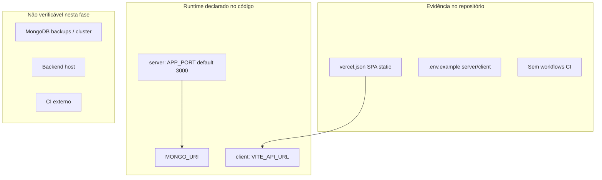

# SchedulerPro — Auditoria Técnica Global | Fase G — Infraestrutura, CI/CD, deploy, monitorização e backups

**Data:** 24/10/2026  
**Modo:** Read-only (sem alterações a código, configuração versionada, dependências, deploy ou histórico Git)

**Relatórios de referência (preservados, não alterados):**

- [`schedulerpro-global-technical-audit.md`](schedulerpro-global-technical-audit.md)
- [`schedulerpro-global-technical-audit-phase-c.md`](schedulerpro-global-technical-audit-phase-c.md)
- [`schedulerpro-global-technical-audit-phase-c1.md`](schedulerpro-global-technical-audit-phase-c1.md)
- [`schedulerpro-global-technical-audit-phase-d.md`](schedulerpro-global-technical-audit-phase-d.md)
- [`schedulerpro-phase-f-test-reliability-audit.md`](schedulerpro-phase-f-test-reliability-audit.md)

---

## 1. Objetivo e âmbito

Auditar evidências **no repositório** sobre ambientes e configuração, build/execução, CI/CD, deploy/hosting, health checks, logging e observabilidade, MongoDB e DR/backups, integrações externas e segurança operacional (cruzamento com Fases C/C.1 e D).

**Não** foram aplicadas correções, criados pipelines, Docker, runbooks operacionais nem alterados relatórios de fases anteriores.

**Revalidações solicitadas:** `GET /api/health` vs MongoDB (**AUD-DATA-005** / **AUD-INFRA-002**); backups/DR (**AUD-DATA-006** / **AUD-INFRA-003**); ausência de CI (**AUD-TEST-005** / **AUD-INFRA-001**).

---

## 2. Baseline Git observado

| Item | Valor |
|------|--------|
| Branch | `develop` |
| HEAD | `d9f2aeaabc05a34509f77499695dfcf935921b51` |
| Remote | `develop...origin/develop` (sem ahead/behind reportado) |
| vs Fases D / F | **Igual** |

---

## 3. Estado do working tree

### 3.1 Inicial (início da Fase G)

- Código rastreado: **limpo** (sem modificações em ficheiros versionados).
- Não rastreados: relatórios em `docs/reports/` (global, C, C.1, D, F).

### 3.2 Final (após relatório)

- Esperado: adição de **este** ficheiro como `?? docs/reports/schedulerpro-phase-g-infrastructure-audit.md`.
- Código, CI, Docker e `.env`: **sem alterações** (secção 14).

**Nota:** Ficheiros locais como `server/.env` ou `.vercel/` podem existir na máquina do auditor; **não** foram lidos valores de segredos. [`server/.gitignore`](../../server/.gitignore) ignora `.env`.

---

## 4. Ambientes e configuração (5.1)

### 4.1 Fail-fast no arranque

[`server/src/config/validateEnv.ts`](../../server/src/config/validateEnv.ts) exige presença (trim) de:

- `MONGO_URI`, `JWT_SECRET`, `REFRESH_SECRET`
- `PUBLIC_APPOINTMENT_TOKEN_ENCRYPTION_KEYS`, `PUBLIC_APPOINTMENT_TOKEN_ENCRYPTION_ACTIVE_VERSION` (com validação de formato do keyring)

[`server/src/config/env.ts`](../../server/src/config/env.ts) chama `validateEnv()` antes de exportar `env`.

### 4.2 Lacunas de validação vs uso real

| Variável usada em `env.jwt` | Em `REQUIRED_ENV_VARIABLES` | Risco |
|-----------------------------|-----------------------------|--------|
| `RESET_PASSWORD_SECRET` | **Não** | Arranque possível com `undefined`; falha tardia em fluxos de reset |
| `EMAIL_VERIFICATION_SECRET` | **Não** | Idem para verificação de e-mail |

Também **ausentes** em [`server/.env.example`](../../server/.env.example): não há entradas para reset/verification secrets → onboarding só pelo exemplo pode omitir variáveis críticas.

### 4.3 Divergência de nomes `.env.example` vs `env.ts`

| Conceito | `.env.example` | `env.ts` |
|----------|----------------|----------|
| Ambiente | `NODE_ENV` | `APP_NODE_ENV` (default `development`) |
| Porta | `PORT` | `APP_PORT` (default `3000`) |

Se o operador configurar apenas `PORT`/`NODE_ENV` como no exemplo, a API pode correr na porta default **3000** e com `NODE_ENV` efectivo **development** (nível de log `debug` no Winston), independentemente da intenção de produção.

### 4.4 Frontend

[`client/.env.example`](../../client/.env.example): `VITE_API_URL` (dev: `/api` + proxy Vite); notas sobre cookies `sameSite=strict` e CORS com credentials em produção cross-origin.

[`client/.gitignore`](../../client/.gitignore): `.env` e `.env.*` ignorados (com exceção `!.env.example`) — **confirmado**.

### 4.5 Segredos versionados

- `.env` ignorado no server; **não** foi inspecionado conteúdo local.
- Nenhuma evidência de secrets commitados nesta fase (apenas leitura de exemplos e código).

---

## 5. Build e execução (5.2)

### 5.1 API (server)

| Script | Comando | Notas |
|--------|---------|--------|
| `dev` | `tsx --watch src/server.ts` | Hot reload |
| `build` | `tsc` | Output `dist/` |
| `start` | `node dist/server.js` | Produção |
| `test` | `vitest run` | Fase F: 1232 testes, 0 falhas neste HEAD |
| `engines` | `node >= 22` | [`server/package.json`](../../server/package.json) |

Ordem de arranque em [`server/src/server.ts`](../../server/src/server.ts): `Database.connect()` → `ReminderScheduler.start()` → `app.listen(PORT)`.

### 5.2 Client

| Script | Comando |
|--------|---------|
| `build` | `tsc -b && vite build` → `client/dist` |
| `dev` / `preview` | Vite; proxy `/api` → `http://localhost:3000` ([`client/vite.config.ts`](../../client/vite.config.ts)) |

### 5.3 MongoDB

[`MongoDatabase.ts`](../../server/src/providers/database/MongoDatabase.ts): `mongoose.connect` com `serverSelectionTimeoutMS: 5000`; falha → log + `process.exit(1)`. Métodos `isConnected()` / `getStatus()` existem mas **não** são usados no health HTTP.

### 5.4 Graceful shutdown

SIGINT/SIGTERM em `server.ts`: `server.close`, `ReminderScheduler.stop`, `Database.disconnect`, `process.exit(0)` (erros → exit 1).

### 5.5 Containerização

- **Nenhum** `Dockerfile` ou `docker-compose` no repositório (pesquisa por glob).
- Único manifesto de hosting encontrado na raiz: [`vercel.json`](../../vercel.json) (SPA estática).

### 5.6 Rate limiting

Middlewares públicos (`express-rate-limit`) documentam **store em memória**; reinício zera contadores; múltiplas réplicas não partilham estado (ex.: [`public-appointment-link-rate-limit.middleware.ts`](../../server/src/middlewares/public-appointment-link-rate-limit.middleware.ts)).

---

## 6. CI/CD (5.3)

| Evidência | Resultado |
|-----------|-----------|
| `.github/workflows/*` | **Ausente** (0 ficheiros) |
| GitLab CI, CircleCI, etc. | **Não encontrado** no repo |

**Classificação:** ausência de pipeline versionado — **confirmada** (reforça **AUD-TEST-005** da Fase F).

CI/CD externo (Vercel/GitHub Actions fora do clone, Render, etc.): **não verificável** apenas com o repositório.

---

## 7. Deploy, hosting e matriz de ambientes (5.4)

### 7.1 `vercel.json`

- Build estático: `client/dist/**/*` com `@vercel/static`.
- Rotas: assets + fallback `index.html` (SPA).
- **Não** define build da API Node nem serverless functions para o backend.

### 7.2 Backend em produção

Nenhuma referência no repo a Render, Railway, Fly.io, Heroku (grep em docs/código). Hosting da API: **não documentado** — **não verificável**.

### 7.3 Diagrama de evidência

### 7.4 Matriz de ambientes

| Ambiente | Backend | Frontend | Evidência |
|----------|---------|----------|-----------|
| Dev local | `npm run dev` (tsx) + `.env` | Vite + proxy `/api` | `package.json`, `vite.config.ts` |
| Prod (inferido) | Não definido no repo | Deploy Vercel estático **possível** | `vercel.json` |
| Testes | Vitest, Mongo mockado / ausente | Vitest jsdom | Fase F |

### 7.5 `.vercel/`

Pasta de link local Vercel pode existir; **não** há `.gitignore` na raiz do monorepo neste HEAD — risco de commit acidental se não ignorado globalmente. **Não** verificado conteúdo.

---

## 8. Health e disponibilidade (5.5)

**Revalidação (código):** [`server/src/routes/index.ts`](../../server/src/routes/index.ts) — `GET /api/health` devolve `uptime` e `timestamp` via `ResponseHandler.success`. **Sem** chamada a `Database.isConnected()` ou ping Mongo.

| Endpoint | Liveness | Readiness (DB) |
|----------|----------|----------------|
| `/api/health` | Sim (processo HTTP) | **Não** |
| `/api/health/ready` ou similar | — | **Ausente** |

**Estado:** alinhado com **AUD-DATA-005** (Fase D) → **AUD-INFRA-002** confirmado.

Implicação: orquestradores/load balancers podem manter instâncias “saudáveis” com Mongo indisponível após arranque (cenário raro pós-`connect`, mas desconexão posterior não reflectida).

---

## 9. Logging, request-id e monitorização (5.6)

### 9.1 HTTP access logs

[`morgan.ts`](../../server/src/config/morgan.ts): Morgan → Winston; token `safe-url` com [`redact-public-appointment-token`](../../server/src/utils/redact-public-appointment-token.ts).

### 9.2 Winston

[`logger.ts`](../../server/src/config/logger.ts):

- Console (formato colorido) + ficheiros rotativos `logs/%DATE%-app.log` (30d) e `logs/%DATE%-error.log` (60d, nível error).
- Nível: `debug` se `env.app.NODE_ENV === "development"`, senão `http`.
- Stacks em ficheiro via `format.errors({ stack: true })`.

### 9.3 Request ID

[`request-id.middleware.ts`](../../server/src/middlewares/request-id.middleware.ts): atribui `req.requestId = randomUUID()`; **não** define header de resposta (ex. `X-Request-Id`).

Grep em `server/src`: `requestId` aparece apenas em middleware, tipos Express e `providers/logger/types.ts` — **não** propagado a logs Morgan nem ao `error.middleware` (que regista `method`, `url`, `ip`, `stack` sem `requestId`).

### 9.4 Erros HTTP

[`error.middleware.ts`](../../server/src/middlewares/error.middleware.ts): log completo no servidor; cliente recebe mensagem genérica em 500; `AppError` com mensagem controlada.

### 9.5 Sentry

- `SENTRY_DSN` em `env` e `.env.example`.
- Dependência `@sentry/node` em [`server/package.json`](../../server/package.json).
- **Nenhum** `import` / inicialização Sentry em `server/src/` (grep).

### 9.6 Alertas e dashboards

Não definidos no repositório — **não verificável** (Datadog, Atlas alerts, etc.).

### 9.7 Processo Node

Grep por `unhandledRejection` / `uncaughtException` em `server/`: **nenhum** handler global — **AUD-INFRA-010** (confirmado por ausência no código).

---

## 10. MongoDB, backups e DR (5.7)

| Tópico | Evidência no repo |
|--------|-------------------|
| Conexão | `MONGO_URI` (Atlas ou self-hosted) — tipo de cluster **não verificável** |
| Pool / timeouts | Apenas `serverSelectionTimeoutMS: 5000` explícito |
| Backups / PITR | **Sem** runbook, scripts ou documentação |
| Restore testado | **Não verificável** |

**Cruzamento Fase D:** **AUD-DATA-006** (estratégia backup/restore não documentada) permanece **não verificável em operações**; no repo = **ausência documental** → **AUD-INFRA-003**.

---

## 11. Dependências externas (5.8)

| Serviço | Uso no código | Config / falha |
|---------|---------------|----------------|
| **Resend** | [`ResendProvider.ts`](../../server/src/providers/mail/ResendProvider.ts) — verifica `result.error` do SDK | `RESEND_API_KEY` default `""`; `MAIL_FROM` default `onboarding@resend.dev` (sandbox Resend) |
| **Cloudinary** | [`CloudinaryImageProvider.ts`](../../server/src/providers/images/CloudinaryImageProvider.ts) — validação por operação (`assertConfigured`) | Credenciais opcionais `""` → 500 `IMAGE_NOT_CONFIGURED`; erros SDK → `AppError`; **sem** retry explícito |
| **Redis** | Apenas `env.redis` | **Sem** cliente Redis em `src/` |
| **WhatsApp** | Apenas `env.whatsApp` | **Sem** integração funcional em `src/` |
| **Sentry** | Env + pacote npm | **Sem** integração em `src/` |

Auth, notificações e convites dependem de e-mail via provider Resend; uploads de imagem dependem de Cloudinary quando a feature é usada.

---

## 12. Segurança operacional e dependências npm (5.9)

### 12.1 Cruzamento Fases C / C.1

- **CORS:** `app.use(cors())` sem restrição de origem em [`app.ts`](../../server/src/app.ts) — ver **AUD-SEC-004** (produção cross-origin + cookies: **não verificável** nesta fase sem URL real).
- **Helmet:** activo.
- **Cookies:** `CookieProvider` / `sameSite=strict` — ver **AUD-SEC-006**; implicação com `VITE_API_URL` absoluto em prod documentada no client `.env.example`.
- **mongoSanitize:** comentado em `app.ts` — **AUD-SEC-005**.

### 12.2 `npm audit --omit=dev` (somente leitura, sem fix)

Executado em 24/10/2026:

| Pacote | Produção (`--omit=dev`) | Resumo |
|--------|-------------------------|--------|
| **server** | Sim | **11** vulnerabilidades: 1 critical, 6 high, 4 moderate (incl. transitivas: `proxy-addr`, `qs`, `body-parser`, `compression`, `cloudinary` direct, `ip-address`, etc.) |
| **client** | Sim | **1** high (`follow-redirects`, dependência de `axios`) |

Saída sugere `npm audit fix` / upgrades semver — **não executado** (fora do âmbito read-only de correção).

**Nota operacional:** vulnerabilidades em `compression`, `body-parser`, `cloudinary` afectam superfície HTTP da API; planear upgrades em janela de manutenção com testes (Fase F: suíte verde neste HEAD).

---

## 13. Achados classificados (AUD-INFRA)

| ID | Título | Estado | Impacto | Prob. | Relação | Prioridade sugerida |
|----|--------|--------|---------|-------|---------|---------------------|
| AUD-INFRA-001 | Ausência de pipeline CI versionado | Confirmado (repo) | Regressões sem gate automático | Alta | AUD-TEST-005 | **P1** |
| AUD-INFRA-002 | Health não verifica MongoDB | Confirmado | LB/orchestrator não detecta DB down | Média | AUD-DATA-005 | **P2** |
| AUD-INFRA-003 | Backups/DR não documentados no repo | Não verificável (ops) / ausência doc | Perda de dados se Atlas sem PITR | Alta se sem backup | AUD-DATA-006, AUD-INV-005 | **P2** |
| AUD-INFRA-004 | Deploy backend não descrito; só Vercel SPA | Confirmado (repo) | Risco de config ad-hoc em prod | Média | — | **P2** |
| AUD-INFRA-005 | Divergência `.env.example` (`PORT`/`NODE_ENV`) vs `APP_*` | Confirmado | Porta/ambiente errados em deploy | Média | — | **P2** |
| AUD-INFRA-006 | Secrets reset/email não em `validateEnv` nem no example | Confirmado | Falhas silenciosas ou runtime errors | Média | — | **P2** |
| AUD-INFRA-007 | Sentry/Redis/WhatsApp em env sem uso | Confirmado | Confusão operacional / deps mortas | Baixa | — | **P3** |
| AUD-INFRA-008 | Rate limit em memória | Confirmado | Abuso distribuído em multi-réplica | Média | Segurança ops | **P2** |
| AUD-INFRA-009 | Logs locais rotativos; IP/stack em erros | Parcial | PII/retention em disco do host | Média | — | **P3** |
| AUD-INFRA-010 | Sem handlers `unhandledRejection` / `uncaughtException` | Confirmado | Crash sem log estruturado | Média | — | **P3** |
| AUD-INFRA-011 | Sem Docker/runbook deploy/rollback | Confirmado (repo) | Onboarding ops lento | Média | — | **P3** |
| AUD-INFRA-012 | `MAIL_FROM` default Resend sandbox | Parcial | E-mails não entregues em prod | Alta se não sobrescrito | — | **P2** |
| AUD-INFRA-013 | Vulnerabilidades npm (audit) em deps de produção | Confirmado (scan) | DoS / injeção conforme advisory | Variável | — | **P2** (triagem) |

### Critérios de aceitação (resumo)

- **001:** Workflow no repo executando `npm run test` em `server/` e `client/` em PR para `develop`/`main`.
- **002:** `GET /api/health/ready` (ou extensão do health) retorna 503 se `!Database.isConnected()`.
- **003:** Runbook com RPO/RTO, responsável, e evidência de restore testado (wiki ou `docs/ops/`).
- **004–005–006:** Documentação de deploy alinhada com `env.ts`; `validateEnv` inclui todos os secrets JWT usados; `.env.example` sincronizado.
- **008:** Store Redis (ou equivalente) para rate limits em produção multi-instância.
- **012:** `MAIL_FROM` obrigatório em produção com domínio verificado Resend.

---

## 14. Metodologia, limitações e conclusão

### 14.1 Comandos e acções executadas

| Acção | Executado |
|-------|-----------|
| `git branch`, `git rev-parse HEAD`, `git status` | Sim |
| Leitura de código/config (env, server, vercel, providers, middlewares) | Sim |
| `npm audit --omit=dev` em `server/` e `client/` | Sim (sem `audit fix`) |
| Deploy, `docker build`, curl a prod, Atlas backup UI | **Não** |
| Leitura de `server/.env` ou secrets | **Não** |
| Alteração de relatórios anteriores ou código | **Não** |

### 14.2 Limitações

- Produção real (URLs, CORS efectivo, cookies cross-site, réplicas, backups Atlas): **fora do alcance** sem acesso operacional.
- CI hospedado fora do Git: **não verificável**.
- Fase F reportou **2608** testes verdes neste HEAD; esta fase **não** re-executou a suíte completa (foco infra).

### 14.3 Conclusão

O monorepo está **operacionalmente documentado de forma parcial**: scripts de build/dev claros, shutdown graceful e logging estruturado com redacção de tokens públicos em URLs, mas **sem** CI versionado, **sem** readiness de Mongo no health, **sem** runbook de DR/backups, **sem** definição de hosting da API, e com **inconsistências de configuração** entre `.env.example` e `env.ts`. Integrações Resend/Cloudinary são reais; Sentry/Redis/WhatsApp aparecem apenas como configuração preparatória.

**Próximos passos sugeridos (após aprovação):** endereçar **AUD-INFRA-001** + **002** em conjunto com backlog **AUD-TEST-005** / **AUD-DATA-005**; alinhar env examples e `validateEnv`; documentar deploy full-stack; validar backups com o fornecedor MongoDB; triagem de **AUD-INFRA-013**.

### 14.4 Contexto para continuidade

| Campo | Valor |
|-------|--------|
| Branch / HEAD | `develop` @ `d9f2aeaabc05a34509f77499695dfcf935921b51` |
| Entregável G | Este ficheiro |
| Global audit | Não atualizado (por especificação) |
| Fase seguinte típica | Implementação corretiva ou auditoria de prod com acesso ops |

---

## Verificação read-only (checklist)

- [x] Nenhum ficheiro de aplicação ou teste modificado
- [x] Nenhum workflow, Dockerfile ou `.env` alterado
- [x] Nenhum `npm audit fix` / upgrade de dependências
- [x] Nenhum commit ou push
- [x] Valores de secrets não reproduzidos no relatório
