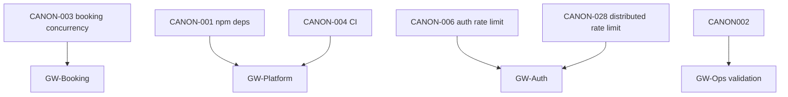

# SchedulerPro — Fase H — Consolidação final da auditoria técnica e backlog de correções

**Data:** 24/10/2026  
**Modo:** Read-only (sem alterações a código, testes, dependências, configuração versionada, relatórios anteriores ou Git)

**Relatórios de referência (consultados, não alterados):**

- [`schedulerpro-global-technical-audit.md`](schedulerpro-global-technical-audit.md) (Fases A/B + achados iniciais)
- [`schedulerpro-global-technical-audit-phase-c.md`](schedulerpro-global-technical-audit-phase-c.md)
- [`schedulerpro-global-technical-audit-phase-c1.md`](schedulerpro-global-technical-audit-phase-c1.md)
- [`schedulerpro-global-technical-audit-phase-d.md`](schedulerpro-global-technical-audit-phase-d.md)
- [`schedulerpro-phase-f-test-reliability-audit.md`](schedulerpro-phase-f-test-reliability-audit.md)
- [`schedulerpro-phase-g-infrastructure-audit.md`](schedulerpro-phase-g-infrastructure-audit.md)
- [`stage-37-frontend-audit-setmore-comparison.md`](stage-37-frontend-audit-setmore-comparison.md) (definições FE-*)

---

## 1. Resumo executivo

A consolidação cobre **52 IDs originais** (`AUD-001`–`005`, `AUD-INV-001`–`005`, `AUD-SEC-001`–`008`, `AUD-DATA-001`–`010`, `AUD-TEST-001`–`010`, `AUD-INFRA-001`–`013`) e **16 itens FE-001–FE-016** re-verificados no código na Fase H.

| Métrica | Valor |
|---------|--------|
| **Problemas canónicos (backlog acionável)** | **42** (`CANON-001`–`042`) |
| Prioridade recomendada **P1** | 4 |
| Prioridade recomendada **P2** | 24 |
| Prioridade recomendada **P3** | 11 |
| **Informativo / produto / fechado com evidência** | 3 canónicos + 5 FE resolvidos |
| Execução de testes (Fase F, **reportada**) | 2608 testes, 0 falhas no HEAD `d9f2aea` — **não** prova ausência de bugs |

**Principais riscos (por impacto negócio + evidência no repo):**

1. **Concorrência em agendamentos** (`CANON-003`) — double-booking plausível; parcialmente confirmado no código (Fase D); sem teste de concorrência.
2. **Ausência de CI versionado** (`CANON-004`) — regressões podem entrar sem gate automático.
3. **Backups/DR** (`CANON-002`) — não documentados no repo; estado em produção **não verificável** aqui.
4. **Autenticação** (`CANON-006`–`008`) — sem rate limit em auth, refresh sem rotação, password sem revogar sessões; confirmados no código (Fases C/C.1).
5. **Dependências npm produção** (`CANON-001`) — 11 vulns server + 1 client (Fase G); requer triagem e upgrade planeado.
6. **Configuração de deploy** (`CANON-025`–`027`, `CANON-029`) — env example desalinhado, backend hosting não descrito, `MAIL_FROM` sandbox por defeito.

**Limitação global:** produção (CORS efectivo, cookies cross-origin, Atlas PITR, CI externo, réplicas) **não** foi observada nesta fase; conclusões sobre produção permanecem condicionais.

---

## 2. Objetivo e limites

**Objetivo:** Responder, com rastreabilidade, quais riscos existem, como estão confirmados, como se deduplicam, em que ordem corrigir, que testes validam cada correção e o que exige acesso operacional.

**Limites:**

- Não re-executar a suíte completa de 2608 testes (usar resultados da Fase F como **resultado reportado**).
- Não afirmar vulnerabilidades **exploráveis** sem evidência das Fases C/C.1.
- Não declarar correções implementadas (nenhuma foi aplicada na Fase H).
- Não modificar [`schedulerpro-global-technical-audit.md`](schedulerpro-global-technical-audit.md) nem relatórios de fases C–G.

---

## 3. Baseline Git observada

### 3.1 Início e fim da Fase H

| Momento | Branch | HEAD | Working tree (rastreado) |
|---------|--------|------|---------------------------|
| Início | `develop` | `d9f2aeaabc05a34509f77499695dfcf935921b51` | Limpo |
| Fim | `develop` | `d9f2aeaabc05a34509f77499695dfcf935921b51` | Limpo |

**Não rastreados (preservados):** relatórios `schedulerpro-*` em `docs/reports/` + **este** ficheiro.

### 3.2 Alinhamento com fases anteriores

Todos os relatórios `schedulerpro-*` auditados referem o mesmo HEAD `d9f2aea`, exceto onde o relatório global ainda declara internamente “Fases D–H pendentes” (ver secção 13).

---

## 4. Inventário dos relatórios consultados

| Ficheiro | Fase | HEAD referido | Achados principais |
|----------|------|---------------|-------------------|
| `schedulerpro-global-technical-audit.md` | A, B | `d9f2aea` | Inventário, `AUD-001`–`005`, `AUD-INV-*`, amostra FE |
| `schedulerpro-global-technical-audit-phase-c.md` | C | `d9f2aea` | `AUD-SEC-001`–`008` |
| `schedulerpro-global-technical-audit-phase-c1.md` | C.1 | `d9f2aea` | Validação SEC + critérios aceitação |
| `schedulerpro-global-technical-audit-phase-d.md` | D | `d9f2aea` | `AUD-DATA-001`–`010` |
| `schedulerpro-phase-f-test-reliability-audit.md` | F | `d9f2aea` | `AUD-TEST-001`–`010`, execução testes |
| `schedulerpro-phase-g-infrastructure-audit.md` | G | `d9f2aea` | `AUD-INFRA-001`–`013` |
| `stage-37-frontend-audit-setmore-comparison.md` | Stage 37 | histórico | `FE-001`–`FE-016` |

**Ausente:** relatório dedicado **Fase E** (`schedulerpro-phase-e-*`); FE fechado por re-verificação H (secção 6.2).

**Não consultados exaustivamente:** 51 relatórios `stage-*` / `STAGE_*` (citados só quando cruzam achados globais).

---

## 5. Metodologia

1. Extração tabular de achados por relatório (IDs originais preservados).
2. **Deduplicação** quando a mesma causa técnica e critérios de aceitação coincidem; IDs relacionados mantidos na coluna “IDs originais”.
3. **Estados de confirmação** (secção 5.2 do brief): aplicados por canónico.
4. **FE-001–016:** critérios Stage 37 + grep/leitura em `client/src` na Fase H.
5. **Priorização recomendada:** exposição, multi-tenant, perda de dados, deteção — não só prioridade original da fase.
6. **Sequência GW-1…:** grupos de implementação futura (não executados).

### 5.1 Estados de confirmação (legenda)

| Estado | Uso na consolidação |
|--------|---------------------|
| Confirmado no código | Evidência direta em `server/` ou `client/` |
| Confirmado por teste | Teste existente com alcance explícito |
| Parcialmente confirmado | Código ou teste cobre parte do risco |
| Hipótese | Plausível, não demonstrado |
| Não verificável no repositório | Depende de ops/prod |
| Não reproduzido | Investigado; não ocorreu nas condições do teste (**≠ resolvido**) |

---

## 6. Catálogo consolidado de achados

### 6.1 Backend, dados, segurança, testes, infra (por ID original)

Resumo por ID — detalhe completo nos relatórios de origem.

| ID original | Fase | Resumo | Estado H | Prioridade origem |
|-------------|------|--------|----------|-------------------|
| AUD-001 | B | `mongoSanitize` comentado | Confirmado código → `CANON-010` | P2 |
| AUD-002 | B | CORS aberto | Confirmado código → `CANON-009` | P2 |
| AUD-003 | B | `CompanyService.create` stub | Confirmado → `CANON-034` | P3 |
| AUD-004 | B | Expiração `scheduled` só em `findAll` | Confirmado → `CANON-035` | P3 |
| AUD-005 | B | Isolamento tenant global | Parcial → `CANON-012` | — |
| AUD-INV-002 | Global | Falhas testes client | Não reproduzido F → `CANON-024` | Informativa |
| AUD-INV-003 | Global | FE-* completos | Parcial H → FE canónicos | Média |
| AUD-INV-004 | Global | Segurança multi-tenant global | Endereçado em C (não reabrir como gap único) | — |
| AUD-INV-005 | Global | Infra não verificada | Parcial G → `CANON-002` | Alta |
| AUD-SEC-001 | C | Refresh sem rotação | Confirmado → `CANON-007` | P2 |
| AUD-SEC-002 | C | Password sem revoke sessões | Confirmado → `CANON-008` | P2 |
| AUD-SEC-003 | C | Auth sem rate limit | Confirmado → `CANON-006` | P2 |
| AUD-SEC-004 | C | CSRF / cookies | Parcial → `CANON-011` | P2–P3 |
| AUD-SEC-005 | C | Sanitize off | = AUD-001 → `CANON-010` | P2 |
| AUD-SEC-006 | C | CORS | = AUD-002 → `CANON-009` | P2 |
| AUD-SEC-007 | C | 403 vs 404 cross-tenant | Confirmado → `CANON-013` | P3 |
| AUD-SEC-008 | C | Lacuna testes HTTP users/services | Confirmado → `CANON-012` | P3 |
| AUD-DATA-001 | D | Concorrência booking | Parcial → `CANON-003` | P2 |
| AUD-DATA-002 | D | Índice conflito | Hipótese estática → `CANON-016` | P2 |
| AUD-DATA-003 | D | Sem paginação listagens | Confirmado → `CANON-014` | P2 |
| AUD-DATA-004 | D | N+1 `findMine` | Confirmado → `CANON-015` | P2 |
| AUD-DATA-005 | D | Health sem Mongo | Confirmado → `CANON-005` | P2 |
| AUD-DATA-006 | D | Backups não no repo | Não verificável → `CANON-002` | P2 |
| AUD-DATA-007 | D | Sessões sem TTL | Confirmado → `CANON-017` | P3 |
| AUD-DATA-008 | D | Email/company globais | Desenho → `CANON-019` | Info |
| AUD-DATA-009 | D | Soft-delete em histórico | Comportamento → `CANON-018` | P3 |
| AUD-DATA-010 | D | Lacuna testes concorrência | Confirmado → `CANON-003` | P3 |
| AUD-TEST-001 | F | Sem teste concorrência | Lacuna → `CANON-003` | P2 |
| AUD-TEST-002 | F | Sem HTTP `/api/auth/*` | Lacuna → `CANON-021` | P2 |
| AUD-TEST-003 | F | HTTP cross-tenant users/services | Lacuna → `CANON-012` | P2 |
| AUD-TEST-004 | F | Integration com repos mock | Confirmado → `CANON-020` | P2 |
| AUD-TEST-005 | F | Sem CI no repo | Confirmado → `CANON-004` | P2 |
| AUD-TEST-006 | F | Falhas históricas | Não reproduzido → `CANON-024` | Info |
| AUD-TEST-007 | F | Sem E2E browser | Confirmado → `CANON-022` | P3 |
| AUD-TEST-008 | F | Sem teste changePassword/sessões | Lacuna → `CANON-008` | P2 |
| AUD-TEST-009 | F | Rate limit auth não testado | Lacuna → `CANON-006` | P2 |
| AUD-TEST-010 | F | Sem testes `ServiceService` | Lacuna → `CANON-023` | P3 |
| AUD-INFRA-001 | G | CI ausente | Confirmado → `CANON-004` | **P1** |
| AUD-INFRA-002 | G | Health sem Mongo | Confirmado → `CANON-005` | P2 |
| AUD-INFRA-003 | G | DR não documentado | Não verificável → `CANON-002` | P2 |
| AUD-INFRA-004 | G | Deploy backend | Confirmado → `CANON-027` | P2 |
| AUD-INFRA-005 | G | `PORT`/`NODE_ENV` vs `APP_*` | Confirmado → `CANON-025` | P2 |
| AUD-INFRA-006 | G | Secrets reset/email | Confirmado → `CANON-026` | P2 |
| AUD-INFRA-007 | G | Sentry/Redis/WhatsApp mortos | Confirmado → `CANON-030` | P3 |
| AUD-INFRA-008 | G | Rate limit memória | Confirmado → `CANON-028` | P2 |
| AUD-INFRA-009 | G | Logs PII / sem requestId | Parcial → `CANON-031` | P3 |
| AUD-INFRA-010 | G | Sem unhandledRejection | Confirmado → `CANON-032` | P3 |
| AUD-INFRA-011 | G | Sem Docker/runbook | Confirmado → `CANON-033` | P3 |
| AUD-INFRA-012 | G | MAIL_FROM sandbox | Parcial → `CANON-029` | P2 |
| AUD-INFRA-013 | G | npm audit prod | Confirmado scan → `CANON-001` | P2 triagem |

### 6.2 Frontend FE-001–FE-016 (re-verificação Fase H)

| FE | Título (resumo) | Estado H | Canónico | Evidência H (código) |
|----|-----------------|----------|----------|----------------------|
| FE-001 | Loading/erro admin vs público | Parcialmente confirmado | `CANON-036` | Maioria das páginas admin usa `LoadingState`/`ErrorState`; `AppointmentsPage` usa loading via `CalendarView`/`isLoading` sem `LoadingState` |
| FE-002 | Reports acesso negado sem header | **Fechado** | — | `ReportsPage.tsx` L256–266: `PageHeader` + alert |
| FE-003 | Catch-all → `/` | **Fechado** | — | `AppRoutes.tsx` L93: `NotFoundPage` |
| FE-004 | Empty states dashboard/reports/disponibilidade | Parcialmente confirmado | `CANON-037` | `DashboardPage` `emptyMessage`; `ReportsPage` `EmptyState` + rankings; `AvailabilityPage` grelha sem `EmptyState` dedicado |
| FE-005 | Modais delete duplicados | Confirmado (dívida UX) | `CANON-038` | Vários `Delete*Modal`; sem `ConfirmDialog` genérico |
| FE-006 | `RankingTable` não extraído | Confirmado (dívida) | `CANON-039` | Função local em `ReportsPage.tsx` L551+ |
| FE-007 | `/reports` sem guard | **Fechado** (com nuance) | — | `AppLayout.tsx` L30–31: CLIENT redirecionado para `/portal`; EMPLOYEE vê mensagem em `ReportsPage`; testes `AppRoutes.test.tsx` L415–437 |
| FE-008 | Notificações sem preferências UI | Informativo produto | `CANON-040` | `NotificationBell.tsx` staff-only; sem settings |
| FE-009 | Multi-empresa / troca tenant | Informativo MVP | `CANON-041` | Fora escopo documentado Stage 37 |
| FE-010 | Pagamentos | Informativo produto | — | Feature futura |
| FE-011 | Sync calendário externo | Informativo produto | — | Feature futura |
| FE-012 | Validação visual/responsiva | Não verificável repo | `CANON-042` | Gap processo QA; não afirmar regressão |
| FE-013 | `ErrorState` sem retry admin | **Largamente fechado** | — | `onRetry` em dashboard, CRUD, reports, availability, appointments, público (grep `onRetry` em pages) |
| FE-014 | Auth sem `PageHeader` | Confirmado aceitável | — | `LoginPage.tsx` layout auth específico (documentado Stage 37) |
| FE-015 | Sem `any` em src | Confirmado | — | Grep `: any` / `as any` em `client/src`: **0** matches |
| FE-016 | Subcalendários sem teste | **Fechado** | — | `CalendarView.test.tsx` cobre `MonthCalendar` e `WeekCalendar` |

---

## 7. Mapa de deduplicação e referências cruzadas

| ID canónico | IDs originais | Relação |
|-------------|---------------|---------|
| CANON-001 | AUD-INFRA-013 | Único |
| CANON-002 | AUD-DATA-006, AUD-INFRA-003, AUD-INV-005 (parcial) | Mesmo tema DR/backups; ops distinto de código |
| CANON-003 | AUD-DATA-001, AUD-DATA-010, AUD-TEST-001 | Risco + lacuna teste; **não** fundir mitigação com DATA-002 |
| CANON-004 | AUD-TEST-005, AUD-INFRA-001 | Mesmo gap CI |
| CANON-005 | AUD-DATA-005, AUD-INFRA-002 | Mesmo gap health/readiness |
| CANON-006 | AUD-SEC-003, AUD-TEST-009 | Auth rate limit + teste |
| CANON-007 | AUD-SEC-001 | Único |
| CANON-008 | AUD-SEC-002, AUD-TEST-008 | Password + sessões + teste |
| CANON-009 | AUD-002, AUD-SEC-006 | CORS |
| CANON-010 | AUD-001, AUD-SEC-005 | mongoSanitize |
| CANON-011 | AUD-SEC-004 | CSRF (distinto de CANON-009) |
| CANON-012 | AUD-005 (parcial), AUD-SEC-008, AUD-TEST-003 | Isolamento + cobertura teste |
| CANON-013 | AUD-SEC-007 | Único |
| CANON-014 | AUD-DATA-003 | Único |
| CANON-015 | AUD-DATA-004 | Único |
| CANON-016 | AUD-DATA-002 | Índice — hipótese; aceitação distinta de CANON-003 |
| CANON-017 | AUD-DATA-007 | Único |
| CANON-018 | AUD-DATA-009 | Único |
| CANON-019 | AUD-DATA-008 | Informativo |
| CANON-020 | AUD-TEST-004 | Único |
| CANON-021 | AUD-TEST-002 | Único |
| CANON-022 | AUD-TEST-007 | Único |
| CANON-023 | AUD-TEST-010 | Único |
| CANON-024 | AUD-INV-002, AUD-TEST-006 | Histórico testes client |
| CANON-025 | AUD-INFRA-005 | Único |
| CANON-026 | AUD-INFRA-006 | Único |
| CANON-027 | AUD-INFRA-004 | Único |
| CANON-028 | AUD-INFRA-008 | **Distinto** de CANON-006 (distribuído vs auth) |
| CANON-029 | AUD-INFRA-012 | Único |
| CANON-030 | AUD-INFRA-007 | Único |
| CANON-031 | AUD-INFRA-009 | Único |
| CANON-032 | AUD-INFRA-010 | Único |
| CANON-033 | AUD-INFRA-011 | Único |
| CANON-034 | AUD-003 | Único |
| CANON-035 | AUD-004 | Único |
| CANON-036 | FE-001 | UX loading |
| CANON-037 | FE-004 | Empty states |
| CANON-038 | FE-005 | Modais |
| CANON-039 | FE-006 | RankingTable |
| CANON-040 | FE-008 | Notificações |
| CANON-041 | FE-009 | Multi-tenant UI |
| CANON-042 | FE-012 | QA visual |



---

## 8. Backlog priorizado

Colunas: ID canónico | IDs originais | Categoria | Problema | Evidência | Estado | Impacto | Prob. | Prioridade rec. | Dependências | Testes aceitação | Validação ops |

| ID | IDs originais | Cat. | Problema | Evidência | Estado | Impacto | Prob. | P rec. | Dependências | Testes aceitação | Ops |
|----|---------------|------|----------|-----------|--------|---------|-------|--------|--------------|------------------|-----|
| CANON-001 | AUD-INFRA-013 | Segurança/deps | Vulns npm produção (11 server, 1 client) | Fase G `npm audit --omit=dev` | Confirmado scan | Alto | Média | **P1** | — | Upgrades + `npm test` server/client verde; notas advisories | Staging smoke |
| CANON-002 | AUD-DATA-006, INFRA-003, INV-005 | DR | Backups/restore não documentados | Fases D, G | Não verificável repo | Crítico se ausente | — | **P1** | — | Runbook RPO/RTO + evidência restore testado | **Atlas/PITR obrigatório** |
| CANON-003 | AUD-DATA-001,010; TEST-001 | Dados | Double-booking por concorrência | `AppointmentService.schedule` Fase D | Parcial código | Alto | Média | **P1** | — | Teste paralelo create; zero overlaps; opcional transação/unique | Carga staging |
| CANON-004 | AUD-TEST-005; INFRA-001 | Infra | Sem CI versionado | Zero `.github/workflows` | Confirmado repo | Alto | Alta | **P1** | — | Workflow PR: test+typecheck ambos pacotes | CI host |
| CANON-005 | AUD-DATA-005; INFRA-002 | Infra | Health sem readiness Mongo | `routes/index.ts` health | Confirmado código | Médio | Média | P2 | CANON-004 útil | `/ready` 503 se DB down | LB/k8s |
| CANON-006 | AUD-SEC-003; TEST-009 | Segurança | Auth sem rate limit | C/C.1 Auth routes | Confirmado código | Médio | Alta | P2 | — | Integration: 429 após N tentativas login | — |
| CANON-007 | AUD-SEC-001 | Segurança | Refresh sem rotação | C.1 AuthService | Confirmado código | Médio | Média | P2 | — | Refresh invalida token anterior | — |
| CANON-008 | AUD-SEC-002; TEST-008 | Segurança | Password não revoga sessões | C.1 UserService | Confirmado código | Médio | Média | P2 | — | Teste: após changePassword refresh antigo falha | — |
| CANON-009 | AUD-002; SEC-006 | Segurança | CORS permissivo no código | `app.ts` L42 | Confirmado repo | Médio | Depende deploy | P2 | CANON-027 | `origin` whitelist por env; teste preflight | **Prod CORS** |
| CANON-010 | AUD-001; SEC-005 | Segurança | mongoSanitize off | `app.ts` L73 comentado | Confirmado | Baixo-médio | Baixa | P2 | — | Ativar ou alternativa; teste `$` operator | — |
| CANON-011 | AUD-SEC-004 | Segurança | Superfície CSRF cookies | C.1 SameSite strict | Parcial | Médio | Baixa-média | P2 | CANON-009 se cross-origin | Documentar threat model; double-submit ou same-site only | Prod cookies |
| CANON-012 | AUD-005; SEC-008; TEST-003 | Segurança/testes | Lacuna HTTP cross-tenant users/services | Fase F grep | Confirmado lacuna | Médio | Média | P2 | — | supertest 404/403 empresa B | — |
| CANON-014 | AUD-DATA-003 | Dados/perf | Listagens sem paginação | Fase D repositories | Confirmado | Médio | Média | P2 | — | API limit/offset; testes | — |
| CANON-015 | AUD-DATA-004 | Dados/perf | N+1 `findMine` | Fase D | Confirmado | Médio | Alta volume | P2 | — | ≤N+2 queries; teste mock contagem | — |
| CANON-016 | AUD-DATA-002 | Dados/perf | Índice conflito subótimo | Fase D análise estática | Hipótese | Médio | Média escala | P2 | CANON-003 opcional | explain() melhorado; benchmark | — |
| CANON-020 | AUD-TEST-004 | Testes | HTTP integration mock repos | Fase F | Confirmado | Médio | Média | P2 | CANON-004 | Pelo menos 1 fluxo com BD test container ou contract | — |
| CANON-021 | AUD-TEST-002 | Testes | Sem testes HTTP auth | Fase F | Confirmado lacuna | Médio | Média | P2 | CANON-006–008 | supertest login/refresh/cookies | — |
| CANON-025 | AUD-INFRA-005 | Config | `.env.example` vs `APP_PORT`/`APP_NODE_ENV` | G env.ts | Confirmado | Médio | Média | P2 | — | Example alinhado; doc deploy | — |
| CANON-026 | AUD-INFRA-006 | Config | Reset/email secrets fora validateEnv | G | Confirmado | Médio | Média | P2 | CANON-025 | Fail-fast se ausentes | — |
| CANON-027 | AUD-INFRA-004 | Infra | Backend hosting não documentado | vercel.json SPA only | Confirmado | Médio | Média | P2 | — | `docs/ops/deploy.md` com API+FE | Ops |
| CANON-028 | AUD-INFRA-008 | Infra/seg | Rate limit só memória | Middlewares públicos G | Confirmado | Médio | Média multi-réplica | P2 | Redis se multi-instância | Store partilhado; teste 2 instâncias | **Nº réplicas** |
| CANON-029 | AUD-INFRA-012 | Infra | MAIL_FROM default sandbox | env.ts G | Parcial | Alto prod | Alta se default | P2 | CANON-027 | MAIL_FROM obrigatório prod | Resend painel |
| CANON-013 | AUD-SEC-007 | Segurança | 403 vs 404 leak | ServiceService C | Confirmado | Baixo | Média | P3 | — | Política uniforme 404 | — |
| CANON-017 | AUD-DATA-007 | Dados | Sessões sem TTL | Fase D modelo | Confirmado | Baixo-médio | Média | P3 | — | TTL index Mongo | — |
| CANON-018 | AUD-DATA-009 | Dados | Refs soft-deleted histórico | Fase D | Comportamento | Baixo | Alta | P3 | — | Documentar ou populate filter | — |
| CANON-022 | AUD-TEST-007 | Testes | Sem E2E browser | Fase F | Confirmado | Baixo | Média | P3 | CANON-004 | Playwright smoke crítico | — |
| CANON-023 | AUD-TEST-010 | Testes | Sem testes ServiceService | Fase F | Confirmado | Baixo | Baixa | P3 | — | Unit behavior tenant | — |
| CANON-030 | AUD-INFRA-007 | Infra | Env Sentry/Redis/WhatsApp sem uso | G grep | Confirmado | Baixo | Alta confusão | P3 | — | Integrar ou remover env | — |
| CANON-031 | AUD-INFRA-009 | Observabilidade | requestId não nos logs HTTP/erro | G morgan/error | Parcial | Médio | Alta debug | P3 | — | Logs com requestId; header opcional | — |
| CANON-032 | AUD-INFRA-010 | Observabilidade | Sem unhandledRejection | G grep | Confirmado | Médio | Média | P3 | — | Handlers log + exit policy | — |
| CANON-033 | AUD-INFRA-011 | Infra | Sem Docker/runbook | G | Confirmado | Baixo-médio | Média | P3 | CANON-027 | Dockerfile ou doc PaaS | — |
| CANON-034 | AUD-003 | Backend | Company create stub | Global B | Confirmado | Baixo | Baixa | P3 | — | Remover ou implementar | — |
| CANON-035 | AUD-004 | API | Expiração scheduled inconsistente | Global B | Comportamento | Baixo | Média | P3 | — | Alinhar findById ou doc | — |
| CANON-024 | AUD-INV-002; TEST-006 | Testes | Falhas históricas client | Fase F execução | Não reproduzido | — | — | Monitorar | — | CI verde; reabrir se falhar | — |
| CANON-019 | AUD-DATA-008 | Produto | Unicidade global email/nome empresa | Fase D | Desenho | Produto | — | Info | — | Decisão produto documentada | — |
| CANON-036 | FE-001 | Frontend | Padrão loading inconsistente | H: AppointmentsPage | Parcial | Baixo | Média | P3 | — | Appointments usa LoadingState ou doc | — |
| CANON-037 | FE-004 | Frontend | Empty state availability | H AvailabilityPage | Parcial | Baixo | Baixa | P3 | — | EmptyState se sem períodos | — |
| CANON-038 | FE-005 | Frontend | Modais delete duplicados | H Delete*Modal | Dívida UX | Baixo | — | P3 | — | ConfirmDialog partilhado | — |
| CANON-039 | FE-006 | Frontend | RankingTable inline | ReportsPage | Dívida | Baixo | — | P3 | — | Extrair se 2º uso | — |
| CANON-040 | FE-008 | Frontend | Sem prefs notificações | NotificationBell | Produto | Baixo | — | P3 | — | Doc limitação | — |
| CANON-041 | FE-009 | Frontend | Sem multi-empresa UI | Stage 37 | Produto | — | — | Info | — | Roadmap | — |
| CANON-042 | FE-012 | Frontend | Gap validação visual | Processo | Não verificável | Médio UX | — | P3 | — | Checklist manual ou Percy | Staging visual |

---

## 9. Justificação das prioridades

| Alteração vs fase origem | Motivo |
|--------------------------|--------|
| **CANON-004 P1** (F tinha P2, G P1) | Sem CI, todas as outras correções dependem de deteção humana; alinhado com risco de regressão em 2608 testes não automatizados em PR. |
| **CANON-001 P1** | 1 critical + várias high na cadeia HTTP (`compression`, `body-parser`, `cloudinary` direct) — triagem antes de exposição pública intensa. |
| **CANON-002 P1** | Perda de dados não mitigável por código no repo; bloqueia confiança operacional mesmo com app correto. |
| **CANON-003 P1** | Impacto direto no core do produto (agenda); evidência TOCTOU em D; probabilidade sobe com tráfego. |
| **CANON-006–008 permanecem P2** | Confirmados e importantes, mas mitigáveis após integridade de booking e gate CI; ordem C.1 mantida: rate limit → refresh → password. |
| **CANON-028 P2 mas ops-dependent** | Só crítico com **múltiplas réplicas** — prioridade sobe após confirmar contagem de instâncias. |
| **CANON-024 não priorizado** | Não reproduzido ≠ corrigido; manter monitorização via CANON-004. |
| **FE fechados (002,003,007,013,015,016)** | Removidos do backlog acionável; permanecem no catálogo 6.2. |

---

## 10. Sequência proposta de implementação

### GW-1 — Triagem dependências (CANON-001)

- **Objetivo:** Reduzir superfície conhecida de advisories em deps de produção.
- **Módulos:** `server/package.json`, `client/package.json`, lockfiles.
- **Testes:** `npm run test` em ambos; smoke manual auth + booking se upgrades major.
- **Aceitação:** `npm audit --omit=dev` sem critical; highs documentados ou resolvidos.
- **Riscos:** Breaking changes Cloudinary major (G nota semver).
- **Ops:** Deploy staging após merge.

### GW-2 — Validação operacional (CANON-002, CANON-029, partes CANON-009/011)

- **Objetivo:** Confirmar backups, email e config real sem alterar código.
- **Pré-requisitos:** Acesso Atlas, Resend, hosting.
- **Aceitação:** Runbook escrito; MAIL_FROM verificado; CORS/cookies documentados para URLs reais.
- **Ops:** **Obrigatório** — não substituível por código só.

### GW-3 — Integridade de agendamentos (CANON-003, CANON-016)

- **Objetivo:** Eliminar ou reduzir double-booking; otimizar índice se métricas justificarem.
- **Módulos:** `AppointmentService.schedule`, repositório appointments, índices Mongoose.
- **Testes:** Novo teste concorrência (Vitest + Mongo memory ou integration); regressão booking público.
- **Aceitação:** Critérios AUD-DATA-001 Fase D.
- **Dependências:** GW-1 recomendado; GW-4 paralelizável.

### GW-4 — Autenticação e abuso (CANON-006, CANON-007, CANON-008, CANON-028 se multi-réplica)

- **Objetivo:** Rate limit auth, rotação refresh, revoke sessões; store distribuído se aplicável.
- **Módulos:** `AuthService`, `UserService`, middlewares rate limit, rotas auth.
- **Testes:** AUD-TEST-008, 009; opcional CANON-021.
- **Aceitação:** C.1 critérios por SEC ID.
- **Riscos:** Lockout legítimo se rate limit agressivo.

### GW-5 — Plataforma e config (CANON-004, CANON-005, CANON-025, CANON-026, CANON-027, CANON-033)

- **Objetivo:** CI, health/ready, env alinhado, documentação deploy.
- **Módulos:** `.github/workflows`, `routes/index.ts`, `validateEnv.ts`, `server/.env.example`, `docs/ops/`.
- **Testes:** Pipeline verde; teste health ready com Mongo mock down.
- **Dependências:** Facilita todos os GW seguintes.

### GW-6 — Dados e desempenho (CANON-014, CANON-015, CANON-017)

- **Objetivo:** Paginação, reduzir N+1, TTL sessões.
- **Testes:** Unit + integration listagens; migration TTL index em staging.

### GW-7 — Segurança HTTP e higiene (CANON-009, CANON-010, CANON-011, CANON-013)

- **Objetivo:** CORS, sanitize, CSRF policy, 404 consistente.
- **Validação:** Staging com origem real do frontend.

### GW-8 — Observabilidade (CANON-031, CANON-032, CANON-030)

- **Objetivo:** requestId, handlers globais, Sentry ou limpeza env.

### GW-9 — Testes e qualidade (CANON-012, CANON-020, CANON-021, CANON-022, CANON-023)

- **Objetivo:** Fechar lacunas HTTP auth, cross-tenant, E2E mínimo.
- **Dependências:** GW-4 e GW-5.

### GW-10 — Frontend dívida (CANON-036–039, CANON-042)

- **Objetivo:** UX consistency pós-correções backend.
- **Prioridade:** Após P1/P2 backend.

**Ordem sugerida:** GW-1 → GW-2 (paralelo) → GW-5 (CI cedo) → GW-3 → GW-4 → GW-6 → GW-7 → GW-8 → GW-9 → GW-10.

---

## 11. Critérios de aceitação por grupo de trabalho

| Grupo | Critérios observáveis |
|-------|------------------------|
| GW-1 | Audit sem critical prod; testes verdes; changelog deps |
| GW-2 | Runbook backup com RPO/RTO; restore testado; MAIL_FROM domínio verificado |
| GW-3 | Teste paralelo sem double-book; opcional 409 em conflito |
| GW-4 | 429 auth; refresh one-time; sessões antigas inválidas após password |
| GW-5 | Workflow CI em PR; `/api/health/ready` 503 sem Mongo; `.env.example` completo |
| GW-6 | Paginação documentada; queries `findMine` acotadas |
| GW-7 | CORS por env; sanitize ativo ou justificado; política 404 documentada |
| GW-8 | Logs com requestId; Sentry init ou env removido |
| GW-9 | Novos ficheiros `integration/auth*.test.ts`; cross-tenant users/services |
| GW-10 | FE-001/004 melhorados ou aceites documentados |

---

## 12. Questões que exigem acesso operacional

| Item | Evidência necessária | Como obter (sem secrets no relatório) |
|------|----------------------|----------------------------------------|
| CI externo | Logs pipeline, badge | GitHub/Vercel/Render UI; exportar config se existir |
| URLs produção FE/API | Origens reais | Painel hosting; variáveis `VITE_API_URL`, `FRONTEND_URL` |
| CORS e cookies efectivos | Headers resposta | `curl -I` contra API prod com `Origin`; DevTools Network |
| Segredos prod | Presença, não valores | Checklist env vars vs `validateEnv` |
| MongoDB cluster | Tier, PITR, região | Atlas cluster settings |
| Backups / restore | Último restore testado | Atlas backup tab + ticket de drill |
| Réplicas API | Contagem instâncias | PaaS dashboard |
| Rate limit efetivo | Comportamento sob carga | Teste staging multi-IP; confirmar 1 vs N instâncias |
| Resend entrega | Taxa bounce, domínio | Resend dashboard |
| Alertas | Canais ativos | Sentry/Atlas alerts se configurados |

---

## 13. Inconsistências e limitações documentais

| Inconsistência | Nota |
|----------------|------|
| Relatório global §estado “D–H pendentes” | Desatualizado face a D, F, G, H entregues como ficheiros separados; **não corrigido** por regra da Fase H. |
| AUD-INV-002 vs AUD-TEST-006 | Global citava falhas; Fase F **não reproduziu** — tratar como monitorização, não como bug aberto. |
| Prioridade CI | Fase F P2 vs Fase G P1 → H adopta **P1** (secção 9). |
| AUD-INV-004 “não auditado” | Fase C auditou módulos; não equivale a certificação formal de todos os endpoints — `CANON-012` cobre lacunas residuais. |
| Fase E ausente | FE-001–016 dependiam de E; H re-verificou no código com limitações (sem inventário página-a-página exaustivo para FE-001). |
| npm audit | Snapshot Fase G; versões lockfile podem envelhecer sem re-scan na H. |

**Limitações:** Nenhuma afirmação sobre exploração ativa em produção; números de teste são **reportados** na data da Fase F.

---

## 14. Comandos e verificações realizados

| Acção | Executado na Fase H |
|-------|---------------------|
| `git branch`, `git rev-parse HEAD`, `git status -sb` | Sim (início e fim) |
| Leitura relatórios schedulerpro-* e stage-37 | Sim |
| Grep/leitura FE: `AppRoutes`, `ReportsPage`, `AppLayout`, `ErrorState`/`onRetry`, `Delete*Modal`, `CalendarView.test.tsx`, `client/src` `: any` | Sim |
| `npm test` / `npm audit` | **Não** (usar dados F/G) |
| Alteração código, configs, relatórios anteriores | **Não** |
| `git add` / commit / push | **Não** |

---

## 15. Estado Git final

```
## develop...origin/develop
?? docs/reports/schedulerpro-global-technical-audit-phase-c.md
?? docs/reports/schedulerpro-global-technical-audit-phase-c1.md
?? docs/reports/schedulerpro-global-technical-audit-phase-d.md
?? docs/reports/schedulerpro-global-technical-audit.md
?? docs/reports/schedulerpro-phase-f-test-reliability-audit.md
?? docs/reports/schedulerpro-phase-g-infrastructure-audit.md
?? docs/reports/schedulerpro-phase-h-final-consolidation.md
```

Código rastreado: **sem modificações**. Apenas novo relatório H adicionado ao conjunto untracked.

---

## 16. Contexto para outra IA / fase corretiva

| Campo | Valor |
|-------|--------|
| HEAD | `d9f2aeaabc05a34509f77499695dfcf935921b51` |
| Backlog | Secção 8 (`CANON-001`–`042`) |
| Ordem implementação | Secção 10 (GW-1…10) |
| Ficheiros críticos | [`server/src/modules/appointments/services/AppointmentService.ts`](../../server/src/modules/appointments/services/AppointmentService.ts) (`schedule`), [`server/src/modules/auth/`](../../server/src/modules/auth/) (auth/sessões), [`server/src/config/validateEnv.ts`](../../server/src/config/validateEnv.ts), [`server/src/routes/index.ts`](../../server/src/routes/index.ts) (health), [`server/src/app.ts`](../../server/src/app.ts) (CORS/sanitize), [`client/src/routes/AppLayout.tsx`](../../client/src/routes/AppLayout.tsx) |
| Testes a criar primeiro | Concorrência booking; auth HTTP; rate limit auth; health ready |
| Regra | Aprovação explícita do utilizador antes de GW; após cada GW, `npm test` server+client |
| Relatório global | Atualizar só quando o utilizador autorizar |

---

## Verificação read-only (checklist Fase H)

- [x] Novo ficheiro apenas em `docs/reports/schedulerpro-phase-h-final-consolidation.md`
- [x] Relatórios anteriores e código não modificados
- [x] IDs originais rastreáveis (secções 6–7)
- [x] Deduplicação justificada; problemas distintos não fundidos (ex. CANON-006 vs CANON-028)
- [x] Lacunas ops explícitas (secção 12)
- [x] Sem commits
