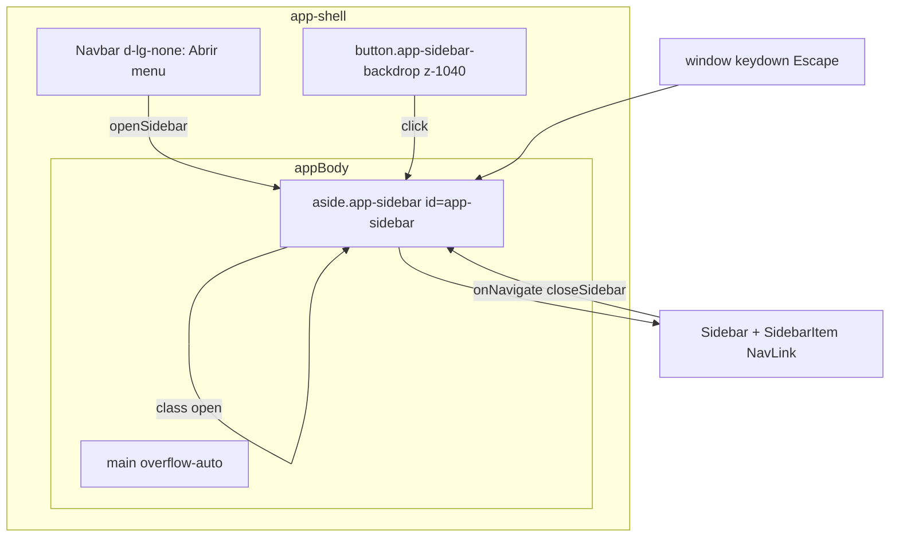

# SchedulerPro — Etapa 6.4c.1 — Auditoria da Sidebar Mobile

**Data:** 2026-11-04  
**Branch:** `develop`  
**HEAD:** `df3d168ceafc63cf30dbc92bb283b2544f3f2f53` — *Merge pull request #126* (Etapa 6.4b TimezonePicker)  
**Tipo:** auditoria read-only (sem alterações de código)

**Relacionado:** [`schedulerpro-mobile-ux-step-6-4-audit.md`](./schedulerpro-mobile-ux-step-6-4-audit.md) (§3.3 sidebar), [`stage-38-layout-global-overflow.md`](./stage-38-layout-global-overflow.md)

---

## 1. Inspeção Git

| Verificação | Resultado |
|-------------|-----------|
| Branch actual | `develop` (sincronizada com `origin/develop`) |
| Working tree | **Limpo** — sem modified/staged/untracked |
| Merge 6.4b em `develop` | **Sim** — `df3d168` inclui PR #126; `ffc27cf` (base 6.4a) é ancestral de HEAD |
| Mudança de branch | Não (conforme instruções) |

Estado **diferente** do último relatório 6.4b (que reflectia branch de feature com ficheiros por commitar). A auditoria 6.4c.1 reflecte **`develop` pós-merge**.

---

## 2. Componentes e ficheiros analisados

| Papel | Ficheiro |
|-------|----------|
| Shell + estado drawer | [`client/src/components/layout/AppLayout.tsx`](../../client/src/components/layout/AppLayout.tsx) |
| Navbar + toggle mobile | [`client/src/components/layout/Navbar.tsx`](../../client/src/components/layout/Navbar.tsx) |
| Conteúdo do menu (RBAC) | [`client/src/components/layout/Sidebar.tsx`](../../client/src/components/layout/Sidebar.tsx) |
| Item de rota | [`client/src/components/layout/SidebarItem.tsx`](../../client/src/components/layout/SidebarItem.tsx) |
| Definição de rotas permitidas | [`client/src/config/menu.ts`](../../client/src/config/menu.ts) |
| Estilos shell / drawer | [`client/src/index.css`](../../client/src/index.css) (`.app-shell`, `.app-sidebar*`, `.app-navbar`, MQ `991.98px`, `575.98px`) |
| Integração rotas | [`client/src/routes/AppRoutes.tsx`](../../client/src/routes/AppRoutes.tsx) — `AppLayout` em rotas autenticadas |
| Redux (contexto workspace) | [`client/src/store/slices/companySlice.ts`](../../client/src/store/slices/companySlice.ts) — `selectWorkspaceDisplayName` (via Sidebar) |
| Testes | [`AppLayout.test.tsx`](../../client/src/components/layout/AppLayout.test.tsx), [`Sidebar.test.tsx`](../../client/src/components/layout/Sidebar.test.tsx), [`Navbar.test.tsx`](../../client/src/components/layout/Navbar.test.tsx) |

**Não há** Context API dedicado à sidebar — estado local `useState(sidebarOpen)` em `AppLayout`.

**Hooks externos:** nenhum `useMatchMedia` no layout; breakpoint mobile do drawer é **só CSS** (`max-width: 991.98px` vs Bootstrap `lg` 992px).

---

## 3. Arquitetura actual

| Camada | Comportamento |
|--------|----------------|
| Estado | `sidebarOpen: boolean` — abrir via navbar; fechar via backdrop, Escape, `btn-close` no drawer, `onNavigate` nos links |
| Desktop (`≥992px`) | Sidebar **inline** no flex (`width: 280px`); hamburger oculto (`d-lg-none`); classe `open` irrelevante (sem `transform`) |
| Mobile/tablet (`≤991.98px`) | Sidebar **fixed drawer** sob navbar (`top: var(--sp-navbar-height)`); `translateX(-100%)` → `.open` traz para `0` |
| Scroll | Documento: `body:has(.app-shell) { overflow: hidden }`; conteúdo: `main overflow-auto`; menu: `.app-sidebar-scroll { overflow-y: auto }` |
| RBAC menu | `getMenuItemsForRole(role)`; grupos fixos (Visão geral / Operação / Gestão); redirect CLIENT ↔ `/portal` em `AppLayout` |

---

## 4. Comportamento desktop (`≥992px`, incl. 1024px e 1440px)

| Aspecto | Observação (código + testes) |
|---------|------------------------------|
| Dimensões | Largura fixa **280px**; fundo branco; `border-end` |
| Expandido/recolhido | **Não existe** modo colapsado — sidebar sempre visível |
| Rota activa | `NavLink` + classe `active` (cor primária, fundo `#edf2ff`) |
| Ícones | **Apenas texto** nos itens |
| Espaçamento links | `min-height: 2.7rem`, padding generoso; **`margin-left: 2rem`** em todos os breakpoints |
| Conteúdo principal | `flex-grow-1`, padding `p-3 p-md-4`, scroll vertical independente |
| Navbar | Marca «SchedulerPro»; cluster utilizador + notificações + logout |

**Conclusão desktop:** comportamento estável e alinhado ao layout actual. **Não recomendar** redesign desktop na 6.4c salvo correcções mobile que exijam tokens partilhados (ex.: indentação).

---

## 5. Comportamento mobile (análise por código; viewports inferidos)

**Limitação:** não foi feita inspecção visual real nesta sessão (browser/DevTools). Métricas de largura derivam de CSS; conforto táctil/contraste assinalados como hipótese onde aplicável.

### 5.1 Mecanismo

| Viewport | Comportamento esperado |
|----------|------------------------|
| 360–430px | Drawer `width: min(260px, 82vw)` → **260px** em 360–430; ~**72%** da largura em 360px |
| 768px | Mesmo drawer (ainda `<992px`); conteúdo útil ~507px com drawer aberto + backdrop |
| 991px | Limite superior do drawer; a partir de 992px layout desktop |

Drawer **não** cobre a navbar (`top: navbar-height`) — correcção documentada na Stage 38.

### 5.2 Abrir / fechar

| Acção | Implementado? | Evidência |
|-------|---------------|-----------|
| Abrir (☰) | Sim | `Navbar` → `onToggleSidebar` → `setSidebarOpen(true)` |
| Fechar backdrop | Sim | `AppLayout` + teste |
| Fechar Escape | Sim | `useEffect` + teste |
| Fechar botão «Menu» / `btn-close` | Sim | `d-lg-none` header no drawer |
| Fechar ao escolher item | Sim | `Sidebar onNavigate={closeSidebar}` em `SidebarItem` |
| Fechar ao clicar ☰ com drawer aberto | **Não** | Toggle só chama `openSidebar`; `aria-expanded` true mas segundo clique não fecha |
| Fechar ao mudar rota sem clique (ex. history) | **Não** | Sem `useEffect` em `location` |
| Bloqueio scroll `body` extra com drawer | Redundante | `body` já `overflow: hidden` com `.app-shell` |

### 5.3 Sobreposição e stacking

| Elemento | z-index / notas |
|----------|-----------------|
| Backdrop | `1040`, `inset: 0` — cobre **toda** a viewport incluindo navbar |
| Drawer | `1050` — acima do backdrop |
| Navbar | Sem z-index explícito — fica **por baixo** do backdrop quando menu aberto (toggle não acessível até fechar) |
| Modais Bootstrap | Tipicamente `1055+` — drawer `1050` pode ficar **abaixo** de modais abertos (esperado) |
| `NotificationBell` | Dropdown; com drawer fechado funciona; com backdrop activo, painel fica coberto |

### 5.4 Conteúdo do menu

- **Workspace:** avatar + «Espaço de trabalho» + nome (`text-truncate`) — nomes longos truncados com reticências.
- **Grupos:** labels uppercase (`letter-spacing: 0.1em`, `font-weight: 800`) — legíveis mas densos em ecrãs pequenos.
- **Itens:** sem ícones; área mínima ~2.7rem altura — **boa** para toque (~43px).
- **Indentação `margin-left: 2rem`:** reduz largura útil do texto dentro de drawer estreito (**confirmado** — oportunidade de melhoria mobile).

### 5.5 Navbar mobile

| Breakpoint | Efeito |
|------------|--------|
| `≤575.98px` | Navbar mais baixa (`3.75rem`); oculta `user-summary` (nome/role) — só avatar + logout + sino |
| `768–991.98px` | Oculta `user-role`; trunca `user-name` `max-width: 9rem` |

Scroll horizontal: `min-w-0` em `container-fluid` e `main` — **intencional** anti-overflow global.

---

## 6. Acessibilidade (revisão estática)

| Critério | Estado | Detalhe |
|----------|--------|---------|
| `aria-label` abrir/fechar | Parcial | «Abrir menu», «Fechar menu» presentes |
| `aria-expanded` | Sim | No botão ☰, sincronizado com estado (teste) |
| `aria-controls` | **Ausente** | Não liga toggle a `#app-sidebar` |
| `role` / semântica | Misto | Drawer é `<aside>`; menu interior `<nav>`; backdrop é `<button>` (bom) |
| Foco ao abrir | **Ausente** | Sem `focus()` no painel ou primeiro link |
| Foco ao fechar | **Ausente** | Sem devolver foco ao ☰ |
| Focus trap | **Ausente** | Tab pode ir para conteúdo atrás do backdrop (main ainda no DOM) |
| Escape | Sim | Fecha drawer (não `preventDefault` global — aceitável) |
| Contraste links | Provável OK | Texto `#667085` / active `#3157d5` sobre branco — **não medido** com ferramenta |
| Teclado no drawer | Parcial | Links focusáveis; sem roving tabindex |

---

## 7. Cobertura de testes actual

| Comportamento | Testado? |
|---------------|----------|
| Abrir drawer + backdrop | Sim (`AppLayout.test.tsx`) |
| Fechar backdrop | Sim |
| Fechar Escape | Sim |
| `aria-expanded` false/true | Sim |
| Região `.app-sidebar-scroll` | Sim |
| Fechar ao clicar item de menu | **Não** |
| Toggle ☰ fecha quando aberto | **Não** |
| Viewport / CSS drawer width | **Não** (só unitários sem `matchMedia` layout) |

---

## 8. Problemas e oportunidades

### 8.1 Confirmados (código)

| ID | Severidade | Problema | Impacto |
|----|------------|----------|---------|
| C1 | **Média** | Drawer **260px + ~72%** em 360px | Pouco conteúdo principal visível; sensação de menu «grande» (métrica já na auditoria 6.4) |
| C2 | **Média** | **`margin-left: 2rem`** nos links em mobile | Texto dos itens mais estreito; desalinhado com drawer estreito |
| C3 | **Média** | Botão ☰ **só abre**; não alterna fecho | Com drawer aberto, utilizador depende de backdrop/X/Escape; ☰ inacessível sob backdrop |
| C4 | **Média** | **Sem focus trap** / gestão de foco | Utilizadores teclado/leitor de ecrã podem tabular para `main` com menu aberto |
| C5 | **Baixa** | Falta **`aria-controls="app-sidebar"`** no toggle | WCAG combobox/dialog pattern incompleto |
| C6 | **Baixa** | Drawer **não fecha** em mudança de `location` sem `onNavigate` | Casos raros (navegação programática) |
| C7 | **Baixa** | **z-index 1050** do drawer vs modais/notificações | Possível sobreposição incorrecta se menu aberto + modal (edge case) |
| C8 | **Info** | Breakpoint drawer **991.98px** vs calendário mobile **767.98px** | Tablet 768–991: drawer + UX calendário «desktop» — já documentado em 6.4 |

### 8.2 Oportunidades (melhoria, não bug)

| ID | Descrição |
|----|-----------|
| O1 | Reduzir indentação ou padding lateral **só** em `@media (max-width: 991.98px)` |
| O2 | Largura drawer `min(280px, 88vw)` ou ~**85%** max — equilibrar com C1 |
| O3 | Ícones por item (fora de escopo mínimo; alinhar com referências Setmore na stage-50) |
| O4 | Fechar drawer em `useEffect(() => setSidebarOpen(false), [location.pathname])` |
| O5 | Teste RTL: clicar «Clientes» → drawer fecha |

### 8.3 Preservar (regressão)

- Sidebar **inline 280px** em desktop.
- Drawer **abaixo** da navbar (`top: var(--sp-navbar-height)`).
- Backdrop + Escape + fecho em navegação por link.
- Scroll independente em `.app-sidebar-scroll` com cabeçalho «Menu» fixo.
- RBAC via `menu.ts` e redirects CLIENT/portal.
- `body`/shell overflow strategy (Stage 38).
- Testes existentes de abrir/fechar/backdrop/Escape.

---

## 9. Plano de implementação proposto (Etapa 6.4c — subetapas)

| Subetapa | Objectivo | Ficheiros prováveis | Risco |
|----------|-----------|---------------------|-------|
| **6.4c.2** | Ajustes CSS mobile drawer (largura, indentação links, opcional padding grupos) | `index.css` | Baixo — validar 360/768/992 |
| **6.4c.3** | Comportamento toggle ☰ (open/close) + `aria-controls` | `AppLayout.tsx`, `Navbar.tsx` | Baixo |
| **6.4c.4** | Acessibilidade: foco inicial, devolver foco ao fechar, focus trap opcional (ou `inert` no `main`) | `AppLayout.tsx` | Médio — testar teclado |
| **6.4c.5** | Fecho em mudança de rota + testes `AppLayout` (nav link, toggle) | `AppLayout.tsx`, `AppLayout.test.tsx` | Baixo |
| **6.4c.6** | Validação manual viewports + actualização relatório | docs | — |

**Não incluir** nesta sequência: listagens em cards (6.4d/e), calendário, timezone, redesign desktop.

---

## 10. Estratégia de testes (por subetapa)

| Subetapa | Testes automatizados | Manual |
|----------|----------------------|--------|
| 6.4c.2 | Opcional snapshot CSS (frágil); preferir testes de presença de classes | 360, 390, 430: drawer aberto — largura útil, sem scroll horizontal |
| 6.4c.3 | `AppLayout`: segundo clique ☰ fecha; `aria-controls` | 768: toggle repetido |
| 6.4c.4 | Simular Tab / focus (RTL `userEvent.tab`) se trap implementado | Leitor de ecrau: ordem de foco |
| 6.4c.5 | Clicar link menu → `not.toHaveClass('open')` | Navegação entre 2 rotas |
| 6.4c.6 | `npm test` layout + regressão suite | Escape, backdrop, nomes longos workspace |

---

## 11. Limitações da auditoria

1. **Sem validação visual real** em 360–1440px — comportamento inferido de CSS e testes unitários.
2. **Sem medição** de contraste (WCAG) ou performance de animação `transform 0.2s`.
3. **Sem teste** em iOS Safari / Android Chrome reais (safe-area, overscroll).
4. Auditoria **não** alterou código, conforme pedido.
5. Base **`develop` limpa** — não reflecte work-in-progress local de branches anteriores.

---

## 12. Conclusão e próximo passo (6.4c.2)

A sidebar mobile está **funcionalmente completa** (drawer, backdrop, Escape, fecho ao navegar, scroll interno, testes básicos). Os principais gaps para uma UX mobile «polida» são **métricas do drawer** (largura + indentação), **toggle que só abre**, **acessibilidade de foco/trap**, e **cobertura de testes** do fecho por link.

**Recomendação para 6.4c.2:** iniciar por **ajustes CSS mobile** (C1, C2, O1) — menor risco, alto impacto visual, sem mudar RBAC nem rotas — seguidos de validação manual nos viewports da tabela §5.

Implementação **não autorizada** até revisão deste relatório pelo utilizador.
