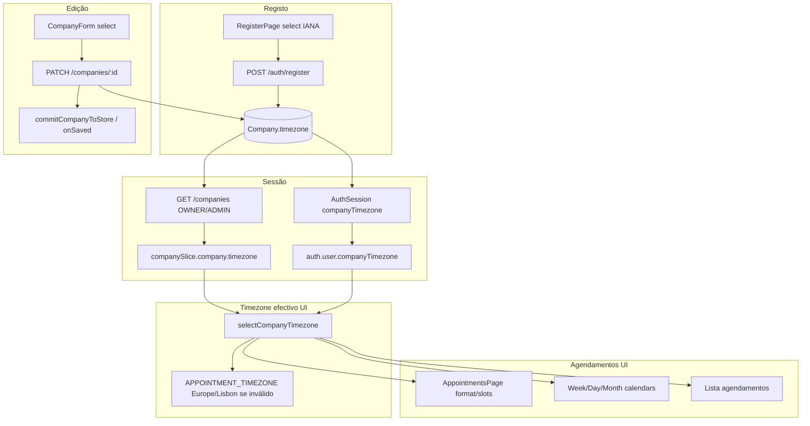

# SchedulerPro — Etapa 6.4b: Auditoria do seletor de fuso horário (READ-ONLY)

**Data da auditoria:** 2026-11-04  
**Tipo:** Análise READ-ONLY (sem alterações de código de produto, testes, estilos ou dependências)  
**Branch observada no momento da inspeção:** `develop`  
**Contexto:** Etapa 6.4a integrada; próximo passo UX mobile = seletor IANA pesquisável (auditoria 6.4 §6.4b).

Legenda: **Confirmado (código)** | **Hipótese** (validação visual / browser)

**Implementação 6.4b:** **Não autorizada** nesta etapa.

Relacionado: [`schedulerpro-mobile-ux-step-6-4-audit.md`](./schedulerpro-mobile-ux-step-6-4-audit.md) (§2.2, §6.4b), [`schedulerpro-company-page-step-4-audit.md`](./schedulerpro-company-page-step-4-audit.md).

---

## 1. Estado Git observado

| Item | Valor |
|------|--------|
| Branch activa | `develop` |
| `HEAD` (completo) | `ffc27cfcd133e231ec5cabbc6b98956154a2c886` |
| `HEAD` (short) | `ffc27cf` |
| Mensagem | `Merge pull request #125 from WeidsonCordeiro/feature/appointments-unified-modal-step-6-4a` |
| Tracking | `develop...origin/develop` (sem divergência reportada no status local) |
| Working Tree | **Limpo** — sem ficheiros modificados ou untracked no `git status` da inspeção |

### Confirmação Etapa 6.4a em `develop`

**Confirmado** no histórico local (`git log`):

1. `ffc27cf` — merge PR **#125** `feature/appointments-unified-modal-step-6-4a`
2. `059c9cc` — commit «unificar o modal de agendamento…»
3. `a15ece6` — merge PR #124 (Etapa 6.2 calendário mobile)

Nenhuma operação Git destrutiva ou de escrita foi executada durante esta auditoria.

---

## 2. Diagnóstico do seletor actual

### 2.1 Onde aparece

| Contexto | Ficheiro | UI |
|----------|----------|-----|
| Edição empresa (OWNER/ADMIN, empresa activa) | [`CompanyForm.tsx`](../../client/src/components/company/CompanyForm.tsx) | `<select class="form-select" id="company-timezone">` |
| Registo (nova empresa + utilizador) | [`RegisterPage.tsx`](../../client/src/pages/RegisterPage.tsx) | `<select class="form-select" id="register-company-timezone">` |
| Só leitura perfil empresa | [`CompanyPage.tsx`](../../client/src/pages/company/CompanyPage.tsx) | `<dd>{company.timezone}</dd>` (texto plano) |

**Confirmado:** não existe componente partilhado; os dois formulários duplicam o padrão `<select>` + lista completa.

### 2.2 Lista de fusos e apresentação

| Aspecto | Implementação |
|---------|----------------|
| Fonte da lista | [`getIanaTimezones()`](../../client/src/config/timezones.ts) — `Intl.supportedValuesOf("timeZone")` quando disponível (~**418** zonas em runtimes modernos); fallback `FALLBACK_TIMEZONES` (~70 entradas) |
| Ordenação | `localeCompare` (`en`) |
| Label na UI | **Apenas** o identificador IANA (`Europe/Lisbon`) — **sem** offset UTC, **sem** agrupamento por região |
| Offset / cidade | **Não calculados** no seletor (Luxon já está no projecto para outros módulos) |

### 2.3 Valor seleccionado e persistência no form

**CompanyForm**

- Estado local: `useState(company.timezone)`.
- Opções: `timezoneOptions` = lista IANA; se `company.timezone` **não** estiver na lista, prepend `[company.timezone, ...zones]` (legado backend).
- Submit: `UpdateCompanyPayload { name, timezone: timezone.trim() }` → `companyApi.updateCompany`.
- Validação cliente: obrigatório + `isValidIanaTimezone` (Luxon `IANAZone.isValidZone`, alinhado ao backend).

**RegisterPage**

- Estado: `useState(getDefaultTimezone())` — tenta `Settings.defaultZone.name` (Luxon); senão **`Europe/Lisbon`**.
- Lista: constante module-level `TIMEZONES = getIanaTimezones()` (todas as opções no mount).
- Submit: `authApi.register({ … company: { name, timezone: companyTimezone } })`.
- Validação: `isValidIanaTimezone(companyTimezone)`.

### 2.4 CSS e mobile

**Confirmado:** [`index.css`](../../client/src/index.css) aplica `.form-select { min-height: 2.75rem }` globalmente; **não** há regras específicas para o dropdown de timezone.

**Hipótese (forte):** em mobile, o browser abre picker nativo com centenas de `<option>` — sensação de lista «desproporcional» (auditoria 6.4 e captura do utilizador). Não é um `<select size="n">` custom no DOM.

### 2.5 Problemas identificados

| ID | Problema | Tipo |
|----|----------|------|
| P1 | ~418 opções num `<select>` nativo — UX mobile fraca | **Confirmado** (lista + padrão HTML) |
| P2 | Labels só IANA — difícil escolher zona sem pesquisa | **Confirmado** |
| P3 | Duplicação Register + CompanyForm | **Confirmado** |
| P4 | Sem componente reutilizável / a11y combobox | **Confirmado** (grep: zero `combobox`/`datalist` no client) |
| P5 | Legado: valor fora da lista runtime deve continuar seleccionável | **Confirmado** (só CompanyForm hoje; Register não injecta legado) |

---

## 3. Ficheiros e componentes envolvidos

### 3.1 Frontend — configuração e forms

| Ficheiro | Papel |
|----------|--------|
| [`client/src/config/timezones.ts`](../../client/src/config/timezones.ts) | `getIanaTimezones`, `isValidIanaTimezone` |
| [`client/src/config/timezones.test.ts`](../../client/src/config/timezones.test.ts) | Lista completa, ordenação, validação |
| [`client/src/components/company/CompanyForm.tsx`](../../client/src/components/company/CompanyForm.tsx) | Select empresa |
| [`client/src/components/company/CompanyForm.test.tsx`](../../client/src/components/company/CompanyForm.test.tsx) | Select, legado, submit timezone |
| [`client/src/pages/RegisterPage.tsx`](../../client/src/pages/RegisterPage.tsx) | Select registo + default timezone |
| [`client/src/pages/RegisterPage.test.tsx`](../../client/src/pages/RegisterPage.test.tsx) | Label «Fuso horário», payload register |
| [`client/src/pages/company/CompanyPage.tsx`](../../client/src/pages/company/CompanyPage.tsx) | Exibição read-only |
| [`client/src/types/company.ts`](../../client/src/types/company.ts) | `Company.timezone`, `UpdateCompanyPayload` |
| [`client/src/api/endpoints/company.api.ts`](../../client/src/api/endpoints/company.api.ts) | PATCH empresa |
| [`client/src/api/endpoints/auth.api.ts`](../../client/src/api/endpoints/auth.api.ts) | POST register |

### 3.2 Frontend — sessão e consumo do timezone

| Ficheiro | Papel |
|----------|--------|
| [`client/src/store/slices/companySlice.ts`](../../client/src/store/slices/companySlice.ts) | `selectCompanyTimezone`, `resolveEffectiveCompanyTimezone` |
| [`client/src/store/companySessionSync.ts`](../../client/src/store/companySessionSync.ts) | Commit empresa após save |
| [`client/src/app/loadSessionCompany.ts`](../../client/src/app/loadSessionCompany.ts) | GET `/companies` → `setCompany` |
| [`client/src/config/appointmentTime.ts`](../../client/src/config/appointmentTime.ts) | Formatação datas/horas com timezone IANA passado como argumento |
| [`client/src/config/appointmentCalendar.ts`](../../client/src/config/appointmentCalendar.ts) | Slots, dias, `isInstantInPast` (Luxon) |
| Calendário / listagens / portal | `useAppSelector(selectCompanyTimezone)` ou prop `timezone` da página |

### 3.3 Backend (referência — contrato a preservar)

| Ficheiro | Papel |
|----------|--------|
| [`server/src/modules/companies/models/Company.model.ts`](../../server/src/modules/companies/models/Company.model.ts) | `timezone: String`, default `DEFAULT_TIMEZONE`, validator IANA |
| [`server/src/utils/timezone.ts`](../../server/src/utils/timezone.ts) | `DEFAULT_TIMEZONE = "Europe/Lisbon"`, `isValidIanaTimezone`, `resolveCompanyTimezone` |
| [`server/src/modules/auth/services/AuthService.ts`](../../server/src/modules/auth/services/AuthService.ts) | Registo: `timezone: dto.company.timezone ?? DEFAULT_TIMEZONE` |
| Validators register / create / update company | `body("timezone")` + `isValidIanaTimezone` |

---

## 4. Fluxo de `company.timezone` (end-to-end)



### 4.1 Passos detalhados

1. **Registo:** string IANA no body → `AuthService.register` valida e persiste → sessão inclui `companyTimezone` resolvido.
2. **Persistência:** MongoDB `Company.timezone` (string IANA, required, validated).
3. **Carregamento:** `loadSessionCompany` (OWNER/ADMIN) ou dados da sessão; `selectCompanyTimezone` prefere `company.timezone` válido, depois `user.companyTimezone`, depois fallback.
4. **Edição:** `CompanyForm` → `updateCompany` → `onSaved` / sync Redux (padrão existente em [`CompanyPage.tsx`](../../client/src/pages/company/CompanyPage.tsx)).
5. **Agendamentos:** instants UTC na API; **interpretação e formatação** no frontend com timezone da empresa (`formatAppointmentTime`, `getTodayDateKey`, calendário, slots). **Não alterar** nesta etapa.
6. **Apresentação:** labels de data/hora usam Luxon `setZone(timezone)` — independentes do control de seleção.

### 4.2 Constantes `Europe/Lisbon` no frontend (inventário — não substituir na 6.4b)

| Local | Uso |
|-------|-----|
| [`appointmentTime.ts`](../../client/src/config/appointmentTime.ts) `APPOINTMENT_TIMEZONE` | Fallback quando Redux/sessão não têm IANA válido |
| [`companySlice.ts`](../../client/src/store/slices/companySlice.ts) | Mesmo fallback via `resolveEffectiveCompanyTimezone` |
| [`RegisterPage.tsx`](../../client/src/pages/RegisterPage.tsx) `getDefaultTimezone()` | Default inicial do select no registo |
| Testes / fixtures | Valor habitual de mock — não afecta produção |

**Confirmado:** o valor **persistido** continua a ser IANA escolhido pelo utilizador; `Europe/Lisbon` é apenas default/fallback alinhado ao backend [`DEFAULT_TIMEZONE`](../../server/src/utils/timezone.ts).

---

## 5. Proposta técnica — componente `TimezonePicker`

### 5.1 Objectivos

- Substituir `<select>` de 418 itens por UI **pesquisável**, **compacta** fechada, lista scrollável aberta.
- Manter **valor = string IANA** (mesmo contrato forms/API).
- Reutilizar em **CompanyForm** e **RegisterPage**.
- **Zero dependências** novas (Bootstrap 5 + React 19 + Luxon já presentes).

### 5.2 API sugerida do componente

Ficheiro proposto: [`client/src/components/common/TimezonePicker.tsx`](../../client/src/components/common/TimezonePicker.tsx) (ou `client/src/components/company/` se preferir âmbito empresa — `common` favorece registo + empresa).

```typescript
interface TimezonePickerProps {
  id: string;
  label: string;
  value: string;                    // IANA
  onChange: (iana: string) => void;
  invalid?: boolean;
  errorMessage?: string;
  helperText?: string;
  disabled?: boolean;
  /** Garante valor legado visível mesmo fora de getIanaTimezones() */
  ensureOption?: string;
}
```

Comportamento:

| Requisito | Abordagem |
|-----------|-----------|
| Pesquisa | `<input type="search">` filtra por substring em IANA + label amigável |
| Offset UTC | Helper em `timezones.ts`: ex. `formatTimezoneOptionLabel(iana)` usando `DateTime.now().setZone(iana).toFormat("ZZ")` + IANA |
| Valor actual | Botão/campo fechado mostra label do `value`; lista highlight |
| Desktop | Dropdown ancorado (`position: absolute`), `max-height` ~40vh, scroll interno |
| Mobile (≤767.98px) | **Modal Bootstrap fullscreen ou dialog scrollable** para escolha (evita picker nativo gigante) — breakpoint alinhado a `767.98px` do projecto |
| Teclado | Lista com `role="listbox"`, opções `role="option"`, Escape fecha, Enter selecciona; focus trap no modal mobile |
| Vazio | «Nenhum fuso encontrado» quando filtro não match |
| Erro | Props `invalid` + `errorMessage` (Bootstrap `is-invalid`) |
| Carregamento | Lista síncrona em `useMemo` — sem spinner obrigatório; opcional defer mount da lista longa |

### 5.3 Helpers em `timezones.ts` (extensão mínima)

- `formatTimezoneOptionLabel(zone: string): string` — ex. `(UTC+01:00) Europe/Lisbon` (offset **informativo**, valor enviado continua IANA).
- `filterIanaTimezones(zones: string[], query: string): string[]` — normalizar acentos opcional; case-insensitive.
- Manter `getIanaTimezones` e `isValidIanaTimezone` **inalterados** na semântica.

### 5.4 Integração nos formulários

**CompanyForm:** substituir bloco `<select>` (L155–178) por `<TimezonePicker ensureOption={company.timezone} … />`; manter `validate()` e payload PATCH iguais.

**RegisterPage:** substituir `<select>` (L252–265); manter `getDefaultTimezone()` como `value` inicial; validação inalterada.

**CompanyPage read-only:** sem alteração.

### 5.5 O que não fazer (regras de preservação)

- Não alterar DTOs, rotas, schema Mongo, validators server.
- Não persistir offset fixo (`+01:00`) em vez de IANA.
- Não mudar `selectCompanyTimezone` / lógica de agendamentos.
- Não adicionar biblioteca headless/combobox externa sem necessidade demonstrada.

---

## 6. Ficheiros provavelmente alterados na implementação

| Acção | Ficheiro |
|-------|----------|
| **Novo** | `client/src/components/common/TimezonePicker.tsx` |
| **Novo** | `client/src/components/common/TimezonePicker.test.tsx` |
| **Estender** | `client/src/config/timezones.ts` (+ labels/filtro) |
| **Estender** | `client/src/config/timezones.test.ts` |
| **Modificar** | `client/src/components/company/CompanyForm.tsx` |
| **Modificar** | `client/src/pages/RegisterPage.tsx` |
| **Modificar** | `CompanyForm.test.tsx`, `RegisterPage.test.tsx` |
| **Opcional CSS** | `client/src/index.css` ou ficheiro scoped `.timezone-picker*` (mobile modal, lista) |

**Fora de âmbito 6.4b:** `appointmentTime.ts`, Redux slices, API client signatures, backend.

---

## 7. Testes recomendados

### 7.1 Existentes a adaptar

| Ficheiro | Notas |
|----------|--------|
| [`CompanyForm.test.tsx`](../../client/src/components/company/CompanyForm.test.tsx) | Hoje usa `HTMLSelectElement` e `fireEvent.change` — migrar para interacções do picker (abrir, pesquisar, clicar opção) |
| [`RegisterPage.test.tsx`](../../client/src/pages/RegisterPage.test.tsx) | Assert payload `timezone`; adicionar seleção explícita se default não for determinístico em CI |
| [`timezones.test.ts`](../../client/src/config/timezones.test.ts) | Cobrir novos helpers de label/filtro |

### 7.2 Novos (TimezonePicker)

1. Renderiza valor inicial (incl. `ensureOption` legado).
2. Filtra lista ao digitar («Lisbon» → contém `Europe/Lisbon`).
3. Seleccionar opção chama `onChange` com IANA exacto.
4. Estado inválido / mensagem de erro.
5. Teclado: Escape fecha painel; Enter selecciona (smoke).
6. Mobile viewport mock (`matchMedia` 767.98px): abre modal, selecciona, fecha.

### 7.3 Regressão manual (checklist)

- Registo com timezone não-Lisbon → login → calendário reflecte fuso.
- Editar empresa → PATCH → Redux/session actualizados.
- Empresa com timezone legado ainda visível e gravável se IANA válido.
- iOS Safari + Android Chrome: modal/lista sem overflow da página.

---

## 8. Riscos e cuidados

| Risco | Mitigação |
|-------|-----------|
| Regressão validação IANA | Manter `isValidIanaTimezone` no submit; não confiar só no filtro UI |
| Performance render 418 linhas | Virtualização **não** necessária se lista filtrada + scroll; considerar render lazy só ao abrir |
| Duplicar offset DST | Label com `DateTime.now()` — offset **varia** com DST; documentar que é indicativo |
| A11y combobox complexa | Seguir padrão listbox + modal mobile; testes RTL + teclado |
| CI timezone default Register | Testes fixam timezone escolhido ou mock `getDefaultTimezone` |
| Tradução UI | Manter PT nos strings do picker (alinhado app) |

---

## 9. Plano de implementação sugerido (sub-etapas)

1. **6.4b.1** — Helpers `formatTimezoneOptionLabel` + `filterIanaTimezones` + testes unitários.
2. **6.4b.2** — `TimezonePicker` desktop (dropdown) + testes componente.
3. **6.4b.3** — Ramo mobile modal + CSS responsivo.
4. **6.4b.4** — Integrar `CompanyForm` + actualizar testes.
5. **6.4b.5** — Integrar `RegisterPage` + actualizar testes.
6. **6.4b.6** — Relatório implementação + validação manual viewports 360–767–1024.

---

## 10. Contexto para IA / developer (continuidade)

- O projecto **já** centraliza lista e validação IANA em [`timezones.ts`](../../client/src/config/timezones.ts); o picker é **só UX**.
- Backend e Redux **esperam string IANA** — o picker é controlado como o `<select>` actual (`value` / `onChange`).
- Padrão visual: Bootstrap (`form-label`, `form-control`, `modal`, `list-group`, `invalid-feedback`).
- Não existe precedente combobox no repo — este componente define o padrão.
- Etapa 6.4a (modal calendário) **já está em `develop`**; 6.4b é independente.

---

## 11. Conclusão da auditoria

A substituição do `<select>` nativo por um **`TimezonePicker` pesquisável reutilizável** é tecnicamente directa, de **baixo risco** para API/modelo, e ataca a causa confirmada da UX mobile (lista IANA enorme no picker nativo). A implementação deve limitar-se ao client (componente + 2 forms + testes + CSS opcional).

**Aguardar autorização explícita do utilizador antes de implementar a Etapa 6.4b.**

---

*Fim do relatório — Etapa 6.4b auditoria READ-ONLY.*
