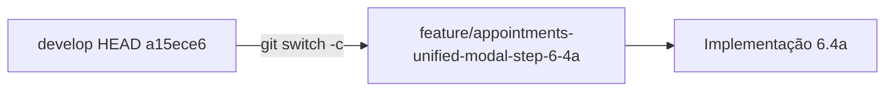

# SchedulerPro — Etapa 6.4a — Branch unificação modal de agendamento

**Data:** 2026-11-04  
**Objetivo:** Criar branch Git exclusiva para implementar a **unificação do modal/fluxo de detalhe de agendamento** nas vistas Mês, Semana e Dia, com base no `HEAD` actual de `develop`, **sem** alterar código de produto, testes, commit ou push nesta etapa.

**Auditoria de referência:** [`schedulerpro-mobile-ux-step-6-4-audit.md`](./schedulerpro-mobile-ux-step-6-4-audit.md)

---

## 1. Objetivo da branch

A Etapa 6.4 (READ-ONLY) documentou que:

| Vista | Viewport | UI actual |
|-------|----------|-----------|
| Mês | todas | [`AppointmentForm`](../../client/src/components/appointments/AppointmentForm.tsx) via `handleCalendarAppointmentClick` |
| Semana / Dia | ≤767.98px (agenda mobile) | **AppointmentForm** (já alinhado) |
| Semana / Dia | ≥768px (grelha) | [`AppointmentQuickDetails`](../../client/src/components/appointments/AppointmentQuickDetails.tsx) via `openQuickDetails` — só leitura |

A branch `feature/appointments-unified-modal-step-6-4a` destina-se à implementação futura que fará **todas** as vistas usar o **mesmo fluxo que o mês** (`AppointmentForm`, regras `isInstantInPast` / permissões inalteradas).

---

## 2. Branch de origem

| Campo | Valor |
|--------|--------|
| Branch | `develop` |
| Sincronização com remoto | `develop` e `origin/develop` no mesmo commit (refs locais; **sem** `pull` nesta etapa) |
| `HEAD` (completo) | `a15ece68ee5c9e1da58b2a78ebdf9cfc953ea40d` |
| `HEAD` (short) | `a15ece6` |
| Mensagem | `Merge pull request #124 from WeidsonCordeiro/feature/appointments-mobile-calendar-step-6` |

A nova branch foi criada **a partir do `HEAD` actual** de `develop`, com `git switch -c`, sem `merge`, `rebase`, `pull`, `stash`, `reset` ou `clean`.

---

## 3. Confirmação — Etapa 6.2 na base

| Evidência | Detalhe |
|-----------|---------|
| Merge PR #124 | Calendário mobile Semana/Dia (Etapa 6.2) integrado em `develop` |
| Componentes | [`WeekView.tsx`](../../client/src/components/appointments/WeekView.tsx), [`DayView.tsx`](../../client/src/components/appointments/DayView.tsx) presentes no working tree |
| Relatórios relacionados | [`schedulerpro-mobile-calendar-step-6-implementation.md`](./schedulerpro-mobile-calendar-step-6-implementation.md), [`schedulerpro-mobile-calendar-step-6-diagnostic.md`](./schedulerpro-mobile-calendar-step-6-diagnostic.md) |

---

## 4. Working Tree — antes da operação

```
On branch develop
?? docs/reports/schedulerpro-mobile-ux-step-6-4-audit.md
```

| Item | Estado |
|------|--------|
| Ficheiros **modificados** (rastreados) | Nenhum |
| Ficheiros **não rastreados** | `docs/reports/schedulerpro-mobile-ux-step-6-4-audit.md` (Etapa 6.4 — auditoria READ-ONLY) |
| Operações destrutivas | Nenhuma |

---

## 5. Operação executada

```bash
git switch -c feature/appointments-unified-modal-step-6-4a
```

**Nome da branch criada:** `feature/appointments-unified-modal-step-6-4a`

---

## 6. Estado após a criação da branch

| Campo | Valor |
|--------|--------|
| Branch actual | `feature/appointments-unified-modal-step-6-4a` |
| `HEAD` (completo) | `a15ece68ee5c9e1da58b2a78ebdf9cfc953ea40d` (igual à origem) |
| `HEAD` (short) | `a15ece6` |
| Código em `client/` | **Inalterado** (nenhum diff rastreado) |
| Testes | **Inalterados** |
| Commit / push | **Não executados** |

```
?? docs/reports/schedulerpro-mobile-ux-step-6-4-audit.md
?? docs/reports/schedulerpro-unified-appointment-modal-branch.md
```

(após criação deste ficheiro)

---

## 7. Confirmação — nenhum código alterado nesta tarefa

| Área | Alteração nesta etapa |
|------|------------------------|
| `client/src/**` | Nenhuma |
| Testes | Nenhuma |
| Dependências | Nenhuma |
| Git (além de `switch -c`) | Nenhuma |

Apenas foi criada a branch local e este relatório (ficheiro novo, não commitado).

---

## 8. Contexto funcional — implementação futura (Etapa 6.4a)

**Escopo previsto** (após autorização do utilizador; ver auditoria §6.4a e §8):

1. Encaminhar cliques em eventos da grelha Semana/Dia (≥768px) para `handleCalendarAppointmentClick` → `AppointmentForm`, em paridade com a vista Mês.
2. Deixar de usar `onTimeGridAppointmentClick` → `openQuickDetails` / `AppointmentQuickDetails` para o fluxo principal (ou remover estado morto associado).
3. Ficheiros prováveis: [`AppointmentsPage.tsx`](../../client/src/pages/appointments/AppointmentsPage.tsx), [`WeekView.tsx`](../../client/src/components/appointments/WeekView.tsx), [`DayView.tsx`](../../client/src/components/appointments/DayView.tsx), [`CalendarView.tsx`](../../client/src/components/appointments/CalendarView.tsx), testes em `CalendarView.test.tsx` / `WeekView` / `DayView`.
4. **Preservar:** regras `isInstantInPast`, permissões Redux/API, comportamento mobile já correcto.



**Implementação:** aguarda autorização explícita do utilizador.

---

*Fim do relatório — criação de branch Etapa 6.4a.*
