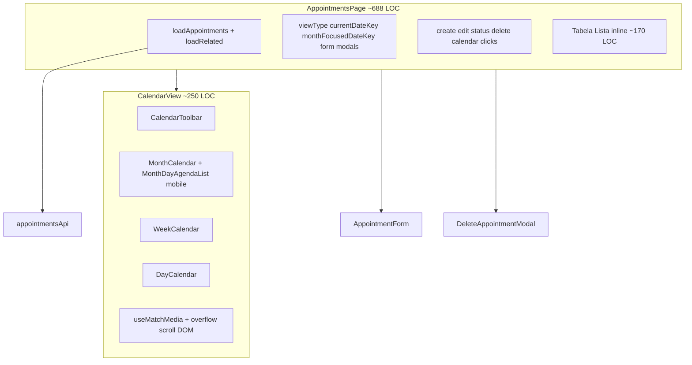
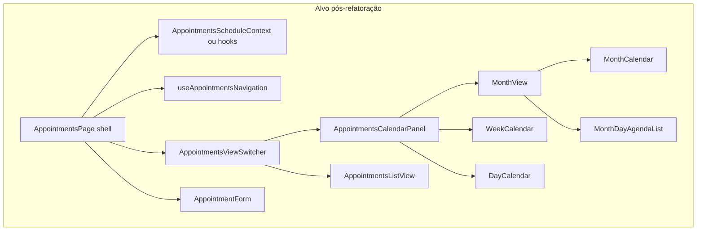

# Stage 49 — Auditoria e planeamento da refatoração da página de agendamentos

Data: 21/10/2026  
Âmbito: **auditoria e planeamento apenas** — sem alterações ao código de produção nem operações Git nesta etapa.

## 1. Objetivo e âmbito

Analisar a implementação atual de `/appointments` após as Stages 48, 48.1 e 48.2 (grelha densa, overflow acionável, lista mobile do dia selecionado) e preparar uma proposta **estrutural** de refatoração da interface, orientada a usabilidade, legibilidade e responsividade — indo além de ajustes pontuais de CSS.

**Fora de âmbito desta etapa:** implementação, mudanças de API/RBAC/negócio, alteração de `appointmentCalendar.ts` ou `MAX_VISIBLE_ITEMS` sem aprovação explícita.

**Contexto Git (leitura):** branch atual `develop`, HEAD `6df1eec` — *Merge pull request #91 from WeidsonCordeiro/feature/stage-48-calendar-dense-mobile-polish* (Stages 48–48.2 integradas). Nenhum `commit`/`merge`/`push` foi executado durante esta auditoria.

**Baseline de testes (relatório Stage 48.2):** **1291** testes cliente, typecheck e build OK.

---

## 2. Estado atual — visão geral

A página de agendamentos concentra orquestração de dados, permissões, quatro modos de visualização, formulários modais e uma tabela de lista num único ficheiro de página, enquanto o calendário é um contentor controlado com ramificações crescentes para mobile.

### 2.1 Gestão de estado e navegação

| Conceito | Onde vive | Função |
|----------|-----------|--------|
| `viewType` | `AppointmentsPage` | `month` \| `week` \| `day` \| `list` |
| `currentDateKey` | `AppointmentsPage` | Âncora do período visível (mês/semana/dia); navegação Anterior/Próximo/Hoje |
| `monthFocusedDateKey` | `AppointmentsPage` | Dia selecionado para lista mobile (Stage 48.2); reconciliado ao mudar mês |
| `todayKey` | derivado Luxon + timezone empresa | Bloqueio de criação em dias passados; destaque “hoje” |
| Prefill create | `prefillDate` / `prefillTime` / `prefillEmployeeId` | Abertura do formulário a partir do calendário |
| `range` | `computeRange(viewType, currentDateKey)` | Intervalo API para calendário; **lista usa range vazio** |

**Reconciliação do mês:** `reconcileMonthFocusedDateKey` em [`AppointmentsPage.tsx`](../client/src/pages/appointments/AppointmentsPage.tsx) — se o dia focado não pertence à grelha do mês visível, usa `todayKey` se no mês, senão dia 1 do mês.

**Duplicação mobile:** `useMatchMedia(MOBILE_CALENDAR_MEDIA_QUERY)` em **AppointmentsPage** (ramifica `handleCalendarDayClick` / overflow) e em **CalendarView** (layout compacto, lista, overflow com scroll). Risco de divergência se um dos lados mudar sem o outro.

### 2.2 Carregamento de dados e estados

- **Appointments:** `loadAppointments` com `startAt`/`endAt` quando `range` tem valores; em vista **Lista**, `params` é `undefined` → **todos os agendamentos** retornados pela API (sem filtro de período no cliente).
- **Entidades relacionadas:** clientes, serviços, funcionários (condicionado a role); falhas parciais → `relatedError` sem bloquear tabela.
- **Loading:** `isLoading` global; calendário mostra `LoadingState` compact dentro de `CalendarView`; lista usa `LoadingState` na página.
- **Erro:** `ErrorState` com retry em calendário e lista.
- **Vazio calendário:** bloco `
` + botão criar ([L640–656](../client/src/pages/appointments/AppointmentsPage.tsx)) — **não** usa `EmptyState`.
- **Vazio lista:** `EmptyState` com CTA conforme `canCreate`.

Não existe barra de filtros dedicada na página admin de agendamentos (diferente do portal `PortalAppointmentsPage`).

### 2.3 Interações por vista (comportamento preservado na refatoração)

| Vista | Seleção / navegação | Criação | Consulta marcação | Overflow `+N mais` |
|-------|---------------------|---------|-------------------|-------------------|
| **Mês desktop** | Célula futura → `openCreate` | Mesmo clique | Clique no cartão → editar/detalhes | → vista **Dia** (48.1) |
| **Mês mobile** | Célula → `monthFocusedDateKey` | Header + “Agendar neste dia” na lista | Lista abaixo (`MonthDayAgendaList`) | Seleciona dia + scroll ao painel (48.2) |
| **Semana** | Slot vazio → create com hora; evento → click | Slot / formulário | `CalendarTimeGridEvent` | N/A |
| **Dia** | Slot → create | Slot | Grelha horária | N/A |
| **Lista** | N/A | Header / empty CTA | Tabela com ações RBAC | N/A |

### 2.4 Indicador de marcações adicionais

- Limite **`MAX_VISIBLE_ITEMS = 4`** em [`MonthCalendar.tsx`](../client/src/components/appointments/MonthCalendar.tsx) (local, não em config).
- Botão `.calendar-overflow` com `stopPropagation`, teclado e `aria-label` (48.1).
- Desktop: overflow delegado a `onOverflowDayClick` → `setViewType("day")`.
- Mobile: `CalendarView.handleMonthOverflowClick` chama `onMonthDaySelect` + `scrollIntoView` no `#month-day-agenda-panel`.

---

## 3. Componentes e ficheiros analisados

| Ficheiro | LOC (aprox.) | Papel |
|----------|--------------|--------|
| [`AppointmentsPage.tsx`](../client/src/pages/appointments/AppointmentsPage.tsx) | 688 | Orquestrador principal |
| [`AppointmentsPage.test.tsx`](../client/src/pages/appointments/AppointmentsPage.test.tsx) | 908 | CRUD, RBAC, lista, alguns fluxos calendário |
| [`CalendarView.tsx`](../client/src/components/appointments/CalendarView.tsx) | 250 | Toolbar + vistas + lista mobile |
| [`CalendarView.test.tsx`](../client/src/components/appointments/CalendarView.test.tsx) | 900 | Toolbar, vistas, overflow, compact mobile |
| [`MonthCalendar.tsx`](../client/src/components/appointments/MonthCalendar.tsx) | 182 | Grelha 7×6, compact/default |
| [`MonthDayAgendaList.tsx`](../client/src/components/appointments/MonthDayAgendaList.tsx) | 84 | Lista do dia (mobile) |
| [`WeekCalendar.tsx`](../client/src/components/appointments/WeekCalendar.tsx) | 220 | Grelha semanal |
| [`DayCalendar.tsx`](../client/src/components/appointments/DayCalendar.tsx) | 191 | Grelha diária |
| [`CalendarToolbar.tsx`](../client/src/components/appointments/CalendarToolbar.tsx) | 82 | Nav + seletor de vista (exceto modo lista) |
| [`AppointmentCalendarItem.tsx`](../client/src/components/appointments/AppointmentCalendarItem.tsx) | 42 | Cartão mês / item lista mobile |
| [`CalendarTimeGridEvent.tsx`](../client/src/components/appointments/CalendarTimeGridEvent.tsx) | 48 | Bloco semana/dia |
| [`AppointmentForm.tsx`](../client/src/components/appointments/AppointmentForm.tsx) | 666 | Modal create/edit |
| [`AppointmentCalendar.tsx`](../client/src/components/appointments/AppointmentCalendar.tsx) | 187 | **Formulário público** (disponibilidade) — não confundir com agenda admin |
| [`useMatchMedia.ts`](../client/src/hooks/useMatchMedia.ts) | — | Breakpoint 767.98px |
| [`index.css`](../client/src/index.css) | ~87 refs calendar/month | Estilos globais acoplados |
| [`appointmentCalendar.ts`](../client/src/config/appointmentCalendar.ts) | — | Grelha, ranges, layout horário (estável) |

Relatórios de contexto: [`stage-48-calendar-dense-mobile-polish.md`](stage-48-calendar-dense-mobile-polish.md), [`stage-48-1-calendar-overflow-fix.md`](stage-48-1-calendar-overflow-fix.md), [`stage-48-2-month-calendar-ux.md`](stage-48-2-month-calendar-ux.md) (validação manual em grande parte **NV**).

---

## 4. Problemas identificados

### 4.1 Estruturais (prioridade alta)

| ID | Problema | Evidência | Impacto |
|----|----------|-----------|---------|
| S1 | **God page** — fetch, CRUD, tabela, calendário, reconciliação mês | `AppointmentsPage` monolítico | Difícil evoluir UX; testes pesados na página |
| S2 | **Toolbar duplicada** | `CalendarToolbar` vs `btn-group` lista L476–505 | Inconsistência de vista Lista; manutenção dupla |
| S3 | **Props drilling** | Maps `clientNames`/`serviceNames` em 4+ níveis | Refatorações frágeis; interfaces inchadas (`CalendarView` 15+ props) |
| S4 | **Semântica de data dupla** | `currentDateKey` + `monthFocusedDateKey` | Confusão ao mudar vista; lógica espalhada |
| S5 | **Ramificação mobile duplicada** | `isMobileCalendar` na página + `isMobile` em `CalendarView` | Regressões create vs select |
| S6 | **Lista acoplada à página** | ~170 LOC JSX tabela + ações | Não reutilizável; mistura apresentação e RBAC |
| S7 | **Fetch lista sem período** | `computeRange` lista → `{}` | Performance/UX em contas com muitos agendamentos; comportamento implícito |
| S8 | **Estados vazios/loading heterogéneos** | `EmptyState` vs `
`; loading em dois sítios | Experiência inconsistente |

### 4.2 UX / layout (misto estrutural + cosmético)

| ID | Problema | Tipo | Notas |
|----|----------|------|-------|
| U1 | Mês desktop: cartões com tipografia 0.52–0.74rem em células fixas | Estrutural | Tensão 4 cartões + overflow vs legibilidade; patches 48.x mitigam, não resolvem modelo |
| U2 | Mês mobile: scroll horizontal interno 40rem na grelha | Estrutural aceite | Correto para 7 colunas; lista abaixo é o caminho certo (48.2) |
| U3 | Overflow desktop ≠ mobile | Estrutural (decisão) | Dia vs painel — documentar como feature, não bug |
| U4 | Lista mobile: tabela larga (`min-width` tabela) | Cosmético/opcional | Cards empilhados em etapa posterior |
| U5 | `CalendarView` com `document.getElementById` + scroll | Estrutural leve | Preferir ref/callback no composite `MonthView` |
| U6 | CSS calendário em `index.css` global | Cosmético gradual | Dificulta isolamento por vista |

### 4.3 Testes e qualidade

| ID | Lacuna |
|----|--------|
| T1 | Poucos testes de integração `AppointmentsPage` + viewport mobile (select dia, sem `openCreate`) |
| T2 | Reconciliação `monthFocusedDateKey` ao mudar mês não coberta na página |
| T3 | Paridade toolbar lista vs calendário não testada |
| T4 | `CalendarView.test` forte; risco de mocks `matchMedia` desatualizados em refatoração |

---

## 5. Proposta de arquitetura da interface

Objetivo: **página fina**, **hooks de domínio UI**, **vistas compostas**, **toolbar única**, preservando API e RBAC.

### 5.1 Reutilizar (manter com ajustes mínimos)

- [`appointmentCalendar.ts`](../client/src/config/appointmentCalendar.ts) — ranges, `appointmentsForDay`, layout semana/dia.
- [`WeekCalendar`](../client/src/components/appointments/WeekCalendar.tsx), [`DayCalendar`](../client/src/components/appointments/DayCalendar.tsx) — núcleo estável; passar props via contexto de labels se necessário.
- [`AppointmentForm`](../client/src/components/appointments/AppointmentForm.tsx), [`DeleteAppointmentModal`](../client/src/components/appointments/DeleteAppointmentModal.tsx).
- [`AppointmentCalendarItem`](../client/src/components/appointments/AppointmentCalendarItem.tsx) — base para cartão mês e lista mobile (conteúdo partilhado).
- [`getAppointmentAbilities`](../client/src/config/appointmentPermissions.ts) e fluxos status existentes.

### 5.2 Refatorar / dividir

| Peça nova | Origem | Responsabilidade |
|-----------|--------|------------------|
| `useAppointmentsSchedule` | Extrair de `AppointmentsPage` | Fetch appointments + related, maps, `loadAppointments`, `isLoading`, `loadError`, `relatedError` |
| `useAppointmentsNavigation` | Extrair handlers + state | `viewType`, datas, reconciliação, **único** ponto para política mobile/desktop (create vs select, overflow) |
| `AppointmentsListView` | Tabela L525–637 | Render + ações de linha; recebe callbacks da página/hook |
| `AppointmentsViewSwitcher` | Unificar `CalendarToolbar` + lista | Mesmo `btn-group` / labels PT; nav temporal contextual (ocultar prev/next na lista se produto assim o quiser — **decisão pendente**) |
| `MonthView` | `CalendarView` month branch | Compõe `MonthCalendar` + `MonthDayAgendaList`; encapsula `layoutMode`, overflow, scroll |
| `AppointmentsCalendarPanel` | Evolução de `CalendarView` | Sem lógica de fetch; delega a Month/Week/Day |

### 5.3 Criar (se necessário)

- `AppointmentRowActions` — botões Editar/Visualizar/status/Excluir partilhados entre lista e futuros cards mobile.
- Opcional: `AppointmentsScheduleContext` se hooks proliferarem (evitar over-engineering na 49.1).

### 5.4 Não tocar sem aprovação

- `MAX_VISIBLE_ITEMS`, contratos API, estados de agendamento, RBAC.
- [`AppointmentCalendar.tsx`](../client/src/components/appointments/AppointmentCalendar.tsx) (fluxo público).

---

## 6. Proposta visual — desktop e mobile

### 6.1 Desktop (≥ 768px)

**Layout**

- Cabeçalho de página (`PageHeader`) com CTA “Novo agendamento”.
- Faixa única: navegação temporal + título do período + Mês | Semana | Dia | Lista.
- Área principal em largura total (`appointments-calendar-panel`).

**Mês**

- Manter grelha 7 colunas; hierarquia visual: número do dia → cartões (hora em destaque, cliente, serviço, estado).
- Máximo 4 cartões; `+N mais` com contraste reforçado (já iniciado em 48.2 CSS).
- Clique célula futura → criar; overflow → vista Dia com grelha horária completa.
- **Melhoria estrutural opcional (fase posterior):** painel lateral ou split ao selecionar dia (sem remover vista Dia) — só com aprovação de produto.

**Semana / Dia**

- Grelha horária atual; melhorar área clicável de slots e contraste de eventos (cosmético).

**Lista**

- Tabela atual com `table-responsive`; ações na última coluna conforme role.

### 6.2 Mobile (≤ 767.98px)

**Global**

- Toolbar empilhada (CSS existente).
- Sem scroll horizontal no `body`; scroll contido na grelha mensal e na tabela.

**Mês**

- Grelha compacta: número do dia + contagem de eventos + `+N mais` quando aplicável.
- Painel `#month-day-agenda-panel` imediatamente abaixo: data por extenso, lista completa, `EmptyState` se vazio, “Agendar neste dia” se permitido.
- Toque na célula **não** abre modal de criação.

**Semana / Dia**

- Manter grelhas; validar scroll vertical e tamanho de toque nos eventos.

**Lista**

- Fase 49.7 opcional: substituir tabela por cards (mesma informação que colunas atuais).

---

## 7. Critérios de aceitação objetivos

### 7.1 Globais

- [ ] RBAC inalterado: CLIENT, EMPLOYEE, ADMIN, MANAGER, OWNER conforme matriz atual de testes.
- [ ] Loading com indicador e retry em falha de rede; mensagens amigáveis preservadas.
- [ ] Timezone da empresa aplicado em datas/horas visíveis.
- [ ] Navegação Mês/Semana/Dia/Lista sempre acessível a partir da mesma toolbar unificada.
- [ ] Teclado: foco visível em células, overflow e botões de vista; `aria-label` no overflow mantido.

### 7.2 Vista Mês

| Critério | Desktop | Mobile |
|----------|---------|--------|
| Densidade | ≤ 4 `.calendar-item` por dia | Sem cartões na grelha; contagem visível |
| Overflow | `+N` correto; abre **Dia** na data | `+N` seleciona dia e lista mostra **todas** as marcações |
| Criação | Célula futura → formulário | Apenas CTAs explícitos (header / painel) |
| Seleção | N/A (modelo atual) | `monthFocusedDateKey` coerente ao mudar mês |
| Layout | Cartões legíveis sem sobreposição | Lista legível; painel não cortado pelo viewport |

### 7.3 Vista Semana

- [ ] Sete colunas com cabeçalhos; destaque do dia atual.
- [ ] Clique em slot livre (não passado) → create com data/hora.
- [ ] Clique em evento → editar ou detalhes conforme passado/futuro.

### 7.4 Vista Dia

- [ ] Cabeçalho com data por extenso; linha “agora” no dia atual.
- [ ] Mesmas regras de slot/evento que a semana.

### 7.5 Vista Lista

- [ ] Colunas: Data, Hora, Cliente, Serviço, Funcionário, Status, Observações, Ações (condicional).
- [ ] Empty state com/sem CTA create conforme permissão.
- [ ] Comportamento de fetch (com ou sem filtro de período) **documentado e mantido** até decisão explícita.

### 7.6 Resoluções de referência

- Mobile: **390 × 844** px.
- Desktop: **1365 × 768** px (ou equivalente).
- Intermédio **768–991** px: transição toolbar / grelha sem regressões (validar manualmente).

---

## 8. Plano de implementação por etapas pequenas

Cada sub-etapa: PR focado, `npm run test -- --pool=forks --maxWorkers=1`, typecheck, build; smoke manual checklist Stage 48.2 quando calendário for tocado.

| Etapa | Conteúdo | Risco | UX visível |
|-------|----------|-------|------------|
| **49.1** | Extrair `AppointmentsListView` + testes dedicados | Baixo | Nenhum |
| **49.2** | Hook `useAppointmentsSchedule` (fetch, maps, reload) | Médio | Nenhum |
| **49.3** | Hook `useAppointmentsNavigation` (datas, reconciliação, handlers unificados mobile/desktop) | Alto | Baixo se comportamento preservado |
| **49.4** | `AppointmentsViewSwitcher` — toolbar única (incl. Lista) | Médio | Lista ganha mesma nav que calendário |
| **49.5** | `MonthView` composite; reduzir props de `CalendarView`; mover scroll overflow | Médio | Nenhum se paridade 48.2 |
| **49.6** | CSS: agrupar regras `.appointments-*` / ficheiro parcial | Baixo | Cosmético incremental |
| **49.7** | Lista mobile em cards (opcional) | Médio | Sim — requer aprovação |

**Melhorias cosméticas opcionais (podem entrar em 49.6):** tipografia desktop mês, contraste overflow, espaçamento semana/dia.

**Melhorias estruturais recomendadas antes de mais CSS no mês:** 49.1 → 49.3 → 49.5.

---

## 9. Plano de testes e riscos de regressão

### 9.1 Riscos principais

| Risco | Mitigação |
|-------|-----------|
| Clique mobile abre create por engano | Testes integração página + `matchMedia`; política só em `useAppointmentsNavigation` |
| Range API errado ao mudar vista | Testes `getAppointments` params (já parcialmente em `AppointmentsPage.test`) |
| Overflow deixa de ir para Dia (desktop) | Manter casos em `CalendarView.test`; E2E manual |
| Reconciliação mês lista dia errado | Testes unitários `reconcileMonthFocusedDateKey` + integração mudança mês |
| RBAC | Reexecutar bloco de testes por role em `AppointmentsPage.test` |
| Timezone | Casos existentes `formatAppointmentTime` + empresa na sessão |

### 9.2 Testes a adicionar na implementação

1. `AppointmentsPage` — mobile month: tap dia → formulário **não** abre; lista atualiza contagem.
2. `AppointmentsPage` — overflow desktop → `viewType === 'day'`.
3. `reconcileMonthFocusedDateKey` — ficheiro de teste puro (extraído com hook).
4. Toolbar unificada — Lista e Mês expõem os mesmos quatro botões de vista.
5. Regressão: `CalendarView.test` + `AppointmentsPage.test` completos após cada etapa.

### 9.3 Testes existentes a preservar

- `AppointmentsPage.test.tsx`: CRUD, 409, status, permissões, fetch por período semana/dia, create via clique mês/semana.
- `CalendarView.test.tsx`: overflow, compact, mobile list, navegação toolbar.

---

## 10. Decisões pendentes e limitações

| Decisão | Opções | Recomendação auditoria |
|---------|--------|------------------------|
| Fetch na vista Lista | Manter sem filtro / filtrar últimos N dias / paginação API | Manter até produto definir; documentar carga |
| Overflow mobile vs desktop | Manter divergência / unificar sempre Dia | Manter 48.2 (painel mobile) — melhor para contexto mês |
| `MAX_VISIBLE_ITEMS` | 4 / aumentar | Manter 4; legibilidade via lista mobile e vista Dia |
| Lista mobile em cards | Tabela / cards | Cards em 49.7 opcional |
| Painel lateral mês desktop | Não / sim | Pendente produto; não bloquear 49.1–49.5 |
| Filtros na agenda admin | Não existem hoje | Não introduzir na refatoração sem spec |

**Limitações da auditoria:** sem validação visual recente (NV nas Stages 48.x); análise baseada em código e testes. `AppointmentForm` (~666 LOC) não foi alvo de decomposição nesta auditoria — candidato a etapa futura separada.

---

## 11. Separação estrutural vs cosmético

| Estrutural necessário | Cosmético opcional |
|-----------------------|-------------------|
| Extrair lista, hooks fetch/navegação | Ajustes finos de font-size mês desktop |
| Toolbar unificada | Cores/sombras overflow |
| `MonthView` + política interação única | Cards lista mobile |
| Contexto/maps para reduzir props | Reflow toolbar tablet |
| Estados vazios unificados (`EmptyState`) | Animações scroll painel |
| Testes integração mobile | |

---

## 12. Confirmação desta etapa

- **Código de produção:** não alterado.
- **Testes:** não alterados.
- **Git:** nenhum `commit`, `merge` ou `push` executado na Stage 49.
- **Entregável:** este relatório em `docs/reports/stage-49-appointments-refactor-audit.md`.

---

## CONTEXTO PARA A PRÓXIMA IA

**Onde estamos**

- `develop` @ `6df1eec` inclui PR #91 (Stages 48, 48.1, 48.2).
- Página `/appointments`: [`AppointmentsPage.tsx`](../client/src/pages/appointments/AppointmentsPage.tsx) + [`CalendarView.tsx`](../client/src/components/appointments/CalendarView.tsx) + vistas em `client/src/components/appointments/`.
- Testes: **1291** pass (baseline pós-48.2).

**O que fazer a seguir (não repetir esta auditoria)**

1. Implementar **49.1** — `AppointmentsListView` extrair da página, zero mudança visual.
2. Seguir ordem §8; após **49.3** e **49.5**, a experiência mês mobile/desktop deve permanecer equivalente a 48.2/48.1.
3. Não alterar `appointmentCalendar.ts` nem `MAX_VISIBLE_ITEMS` sem pedido explícito.
4. Não confundir [`AppointmentCalendar.tsx`](../client/src/components/appointments/AppointmentCalendar.tsx) (booking público) com `MonthCalendar`.
5. Ao fechar cada sub-etapa: relatório opcional `stage-49-N-*.md`, testes completos, smoke manual se calendário mudar.

**Ficheiros quentes para refatoração**

- `AppointmentsPage.tsx`, `CalendarView.tsx`, `MonthCalendar.tsx`, `MonthDayAgendaList.tsx`, `CalendarToolbar.tsx`, `index.css` (secção calendário).

**Comportamentos que não podem regredir**

- Quatro vistas; RBAC; create/edit/details/delete/status; overflow desktop → Dia; mobile mês → select + lista; lista API sem filtro de período (até decisão); timezone empresa.
