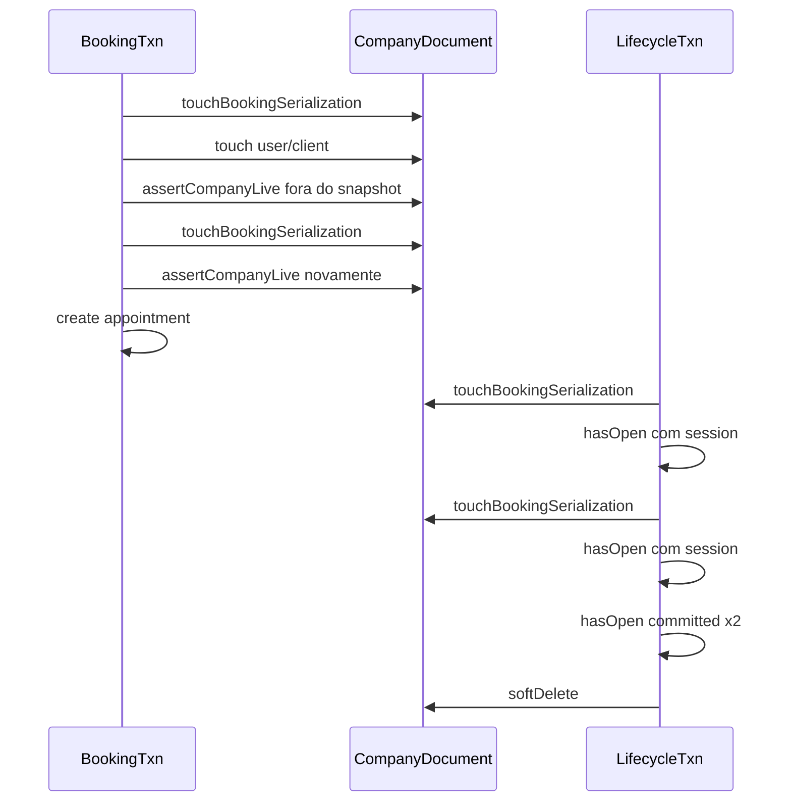

# B2 — Política de exclusão lógica de empresas

**Data:** 2026-11-20  
**Branch de trabalho:** `feat/company-safe-soft-delete` (sem commit/push pelo agente)  
**Relacionado:** [`company-management-b2-soft-delete-implementation.md`](./company-management-b2-soft-delete-implementation.md), [`company-management-b2-soft-delete-audit.md`](./company-management-b2-soft-delete-audit.md)

---

## 1. Objetivo

Garantir soft delete de empresas com bloqueio por agendamentos em aberto (HTTP 409), soft delete atómico (`deletedAt` + `isActive: false`), DELETE permitido com empresa inactiva, e **serialização partilhada** entre exclusão e criação de agendamentos para evitar empresa eliminada com reserva nova concorrente.

---

## 2. Regras de negócio implementadas

| Regra | Implementação |
|-------|----------------|
| Bloqueio | `SCHEDULED` ou `CONFIRMED`, `deletedAt: null`, `endAt > now` (UTC `new Date()` no delete) |
| HTTP | 409 + código `COMPANY_DELETE_BLOCKED_OPEN_APPOINTMENTS` |
| Soft delete | `deletedAt` + `isActive: false`, sem cascata |
| Empresa inactiva | DELETE sem `RequireOperationalCompany`; `COMPANY_DELETE` mantido |
| Tenant | `ensureTenant` inalterado |
| Reativação | Inexistente (`findById` com `deletedAt: null` → 404) |

---

## 3. Ficheiros criados e alterados

**Produção**

- `server/src/modules/companies/repositories/CompanyRepository.ts` — `touchBookingSerialization`, `softDelete` com sessão
- `server/src/modules/companies/services/CompanyService.ts` — fluxo delete endurecido
- `server/src/modules/appointments/services/AppointmentService.ts` — gates transacionais + `assertCompanyLiveForBooking`
- `server/src/modules/appointments/repositories/AppointmentRepository.ts` — `hasOpenAppointmentsForCompany`
- `server/src/modules/appointments/models/Appointment.model.ts` — índice parcial `companyId+status+endAt`
- `server/src/modules/companies/routes/CompanyRoutes.ts` — DELETE sem middleware operacional
- `server/src/constants/http-messages.ts` — mensagem PT do bloqueio
- `client/src/api/errors.ts` (+ testes) — UX 409 (já existente)

**Testes novos**

- `server/tests/integration/companies/company-open-appointments-gate.mongo.test.ts`
- `server/tests/integration/companies/company-delete-booking-concurrency.mongo.test.ts`
- (anteriores) `CompanyService.soft-delete-policy.test.ts`, `company-soft-delete-policy.mongo.test.ts`, `AppointmentRepository.open-for-company-delete.test.ts`

---

## 4. Proteção contra concorrência



**Mecanismos**

1. **`CompanyRepository.touchBookingSerialization`** — `findOneAndUpdate` com `{ deletedAt: null }`, bump `updatedAt`, **obrigatório `session`**. Espelha User/Client; não expõe campo novo na API.
2. **Delete (`withCompanyLifecycleTransaction`)** — touch → hasOpen(session) → touch → hasOpen(session) → hasOpen(sem session) ×2 → softDelete(session). Retry transitório do helper existente reexecuta toda a cadeia.
3. **Booking (`withBookingTransaction` em `schedule`)** — touch empresa → user/client → **`assertCompanyLiveForBooking`** (leitura fora da sessão) → touch empresa → live novamente → create.
4. **Snapshot MongoDB** — transacções de booking não veem soft delete commitado até retry; leituras committed antes do insert impedem persistência após delete.

---

## 5. Repositórios e serviços (resumo)

| Componente | Alteração |
|------------|-----------|
| `AppointmentRepository.hasOpenAppointmentsForCompany` | `Appointment.exists` + `session` opcional |
| `CompanyRepository.touchBookingSerialization` | Serialização partilhada |
| `CompanyRepository.softDelete` | Atómico, retorna doc ou null |
| `CompanyService.delete` | Gate + serialização + revalidações |
| `AppointmentService.schedule` | Touch empresa + live checks antes do create |
| Índice | `{ companyId: 1, status: 1, endAt: 1 }` parcial SCHEDULED/CONFIRMED activos |

---

## 6. Rota e middlewares

- `DELETE /api/companies/:id`: auth, objectId, password change, **`COMPANY_DELETE`** — **sem** `RequireOperationalCompany`.
- Outras rotas operacionais inalteradas.

---

## 7. Testes executados e resultados

```text
cd server && npm run test -- tests/unit/companies tests/unit/appointments/AppointmentRepository.open-for-company-delete.test.ts tests/integration/companies tests/integration/routes/multi-tenant-companies.routes.test.ts
→ 14 ficheiros, 151 testes passed (~41s)

cd server && npm run typecheck && npm run build
→ exit 0

cd client && npm run test -- company errors
→ 11 ficheiros, 131 testes passed (~70s)
```

Inclui matriz mongo `hasOpen`, política soft delete, CDB-01/02/03 (delete ∥ create/createPublic, duplo delete), HTTP 409/inactiva/RBAC.

---

## 8. Testes não executados / não aplicáveis

| Item | Motivo |
|------|--------|
| Suite backend integral (`npm run test` completo) | Fora do âmbito B2; apenas pacotes B2 corridos |
| Teste de rollback transacional determinístico | Não há gancho seguro para forçar abort sem mocks de driver |
| `client` build nesta sessão | Regressão coberta por testes `company errors`; build anterior na entrega B2 OK |

---

## 9. Decisões técnicas

1. Reutilizar `updatedAt` em vez de campo técnico novo na API.
2. Dupla `hasOpen` committed imediatamente antes de `softDelete` para fechar janela pós-reserva commitada.
3. `assertCompanyLiveForBooking` sem sessão para evitar snapshot obsoleto na reserva.
4. Índice parcial dedicado ao gate (consulta `exists`, não scan completo por empresa).

---

## 10. Limitações e riscos residuais

| Risco | Mitigação actual | Notas |
|-------|------------------|-------|
| Corrida delete ↔ booking | Touch empresa + live checks + hasOpen committed | Testes CDB em MongoMemoryReplSet |
| `persistReschedule` | Sem touch empresa | Não cria slot novo; documentar se produto exigir |
| Flake estatístico em CDB | 6 iterações por cenário + invariante global | Correr ficheiro isolado se CI partilhar Mongo |
| Appointment órfão após delete | Janela mínima entre live check e insert | Mitigado por toques e re-leituras committed |

---

## 11. Contexto para continuidade

- Política de “aberto” = só `endAt > now` + SCHEDULED/CONFIRMED (CONFIRMED terminado não bloqueia).
- Dois helpers de transação: `withCompanyLifecycleTransaction` (delete/activate/deactivate) e `withBookingTransaction` (create/reschedule).
- Frontend já mapeia `COMPANY_DELETE_BLOCKED_OPEN_APPOINTMENTS`; sem alterações nesta fase de concorrência.
- **Git:** alterações locais; commit/push fica com o utilizador.

---

*Documento gerado após fecho de concorrência B2 — reflecte código e testes corridos em 2026-11-20.*