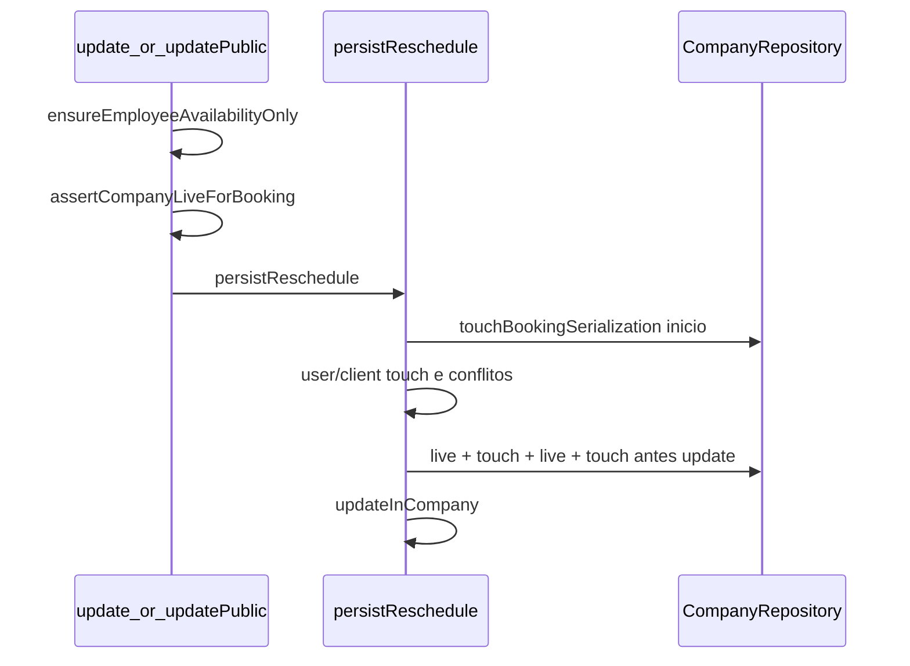

# B2.1 — Concorrência no reagendamento

**Data:** 2026-11-20  
**Branch de trabalho:** `feat/company-safe-soft-delete` (sem commit/push pelo agente)  
**Relacionado:** [`B2-company-soft-delete-policy.md`](./B2-company-soft-delete-policy.md)

---

## 1. Objetivo

Fechar a lacuna em que `persistReschedule()` participava em `withBookingTransaction` mas **não** serializava com o delete da empresa nem revalidava o estado live da empresa. O cenário crítico é um agendamento `SCHEDULED` com `endAt <= now` (não bloqueia delete) que é movido para um slot futuro em paralelo com `CompanyService.delete`.

---

## 2. Fluxos afectados

| Método público | Entrada | Pré-validações (fora da txn) |
|--------------|---------|------------------------------|
| `AppointmentService.update` | Staff/OWNER PATCH | `loadAppointmentForStaffWrite`, `startAt` futuro, `ensureEmployeeAvailabilityOnly` |
| `AppointmentService.updatePublicByToken` | Link público | `assertPublicAppointmentIsEditable`, `PublicBookingEligibility` |

Ambos convergem em `persistReschedule()`.

---

## 3. Solução (espelho de `schedule`)

Dentro de `withBookingTransaction` em `persistReschedule`:

1. **Início** (antes de `userRepository.touchBookingSerialization`): `assertCompanyBookableForBooking(companyId, session)`.
2. **Antes de `updateInCompany`** (após conflitos): `assertCompanyLiveForBooking` → `assertCompanyBookableForBooking` → `assertCompanyLiveForBooking` → **`assertCompanyBookableForBooking`** (toque final imediato à persistência, para fechar a janela pós-live check).
3. **Antes de invocar `persistReschedule`** em `update` / `updatePublicByToken`: `assertCompanyLiveForBooking` após disponibilidade (mesma classe de barreira que reduz a corrida entre disponibilidade e abertura da txn).

Reutilizam `assertCompanyBookableForBooking` / `assertCompanyLiveForBooking` já usados em `schedule` (L177–208). Sem alterações a `CompanyService.delete`, rotas ou contratos HTTP.



---

## 4. Ficheiros alterados

| Ficheiro | Alteração |
|----------|-----------|
| `server/src/modules/appointments/services/AppointmentService.ts` | Gates empresa em `persistReschedule`; live check em `update` e `updatePublicByToken` |
| `server/tests/unit/appointments/AppointmentService.test.ts` | `companyRepository.findById` no mock |
| `server/tests/unit/appointments/AppointmentService.public-link.test.ts` | `touchBookingSerialization` + `findById` (`Europe/Lisbon`) |
| `server/tests/integration/companies/company-delete-reschedule-concurrency.mongo.test.ts` | **Novo** — CDR-01 a CDR-04 |

---

## 5. Testes de integração (CDR)

| ID | Cenário | Paralelo | Invariante |
|----|---------|----------|------------|
| **CDR-01** | `SCHEDULED` vencido → slot futuro (admin) | `delete` ∥ `update` | `!(company.deletedAt && openFuture > 0)`; delete OK → reschedule 404/400; reschedule OK → delete 409 |
| **CDR-02** | Appointment futuro + token público | `delete` ∥ `updatePublicByToken` | Idem |
| **CDR-03** | Empresa eliminada (só passado no gate) | `update` | 404 `COMPANY_NOT_FOUND` |
| **CDR-03b** | `endAt` ajustado no passado para liberar delete; `startAt` futuro | `updatePublicByToken` | 404 `COMPANY_NOT_FOUND` |
| **CDR-04** | Regressão | `update` notas | Sucesso; empresa intacta |

CDR-01/02: 6 iterações cada (`retry: 1` no Vitest para interleavings raros em MongoMemoryReplSet).

---

## 6. Comandos e output real

```bash
cd server && npm run typecheck
```

```text
> scheduler-api@1.0.0 typecheck
> tsc --noEmit
(exit 0)
```

```bash
cd server && npm run test -- --maxWorkers=1 tests/integration/companies tests/unit/companies tests/unit/appointments/AppointmentService.public-link.test.ts
```

```text
 Test Files  14 passed (14)
      Tests  191 passed (191)
   Duration  74.56s
```

```bash
cd server && npm run test -- tests/integration/companies/company-delete-reschedule-concurrency.mongo.test.ts
```

```text
 Test Files  1 passed (1)
      Tests  15 passed (15)
   Duration  ~14–17s (isolado)
```

> Com vários ficheiros mongo em paralelo (worker pool por defeito), CDB/CDR podem falhar intermitentemente na mesma invariante; usar `--maxWorkers=1` para validação local alinhada ao pacote acima.

---

## 7. Riscos residuais

| Risco | Mitigação | Notas |
|-------|-----------|-------|
| Janela entre último live check e `updateInCompany` | Toque empresa logo antes do `updateInCompany` | Mesma classe que B2 em `create` |
| Disponibilidade fora da txn | `assertCompanyLiveForBooking` antes de `persistReschedule` | Não substitui serialização na txn |
| Cancelamentos / outros updates | — | Caminhos que não usam `persistReschedule` ficam fora do âmbito B2.1 |
| Flake estatístico | `retry: 1` em CDR-01/02 + `--maxWorkers=1` no pacote | Ver nota em §6 |

---

## 8. Contexto para continuidade

- B2 (`B2-company-soft-delete-policy.md`) deixou `persistReschedule` explicitamente sem touch empresa; B2.1 fecha essa entrada.
- Política de “aberto” para delete inalterada (`endAt > now`, SCHEDULED/CONFIRMED).
- **Git:** alterações locais; commit/push fica com o utilizador.

---

*Documento gerado após implementação B2.1 — reflecte código e testes corridos em 2026-11-20.*