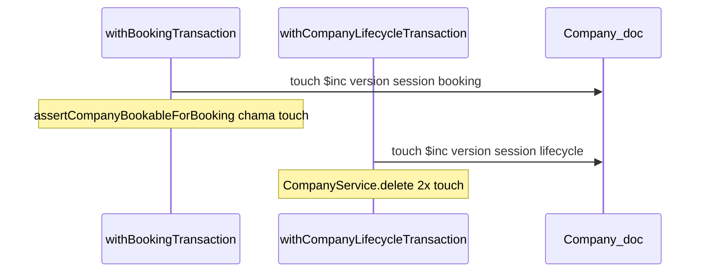

# B2.2 — Contador `bookingSerializationVersion` na serialização da empresa

**Data:** 2026-11-20  
**Branch de trabalho:** `feat/company-safe-soft-delete` (sem commit/push pelo agente)  
**Relacionado:** [`B2-company-soft-delete-policy.md`](./B2-company-soft-delete-policy.md), [`B2.1-company-reschedule-concurrency.md`](./B2.1-company-reschedule-concurrency.md)

---

## 1. Contexto do problema original

B2/B2.1 serializam criação, reagendamento e exclusão lógica da empresa através de `CompanyRepository.touchBookingSerialization()`, partilhado entre `withBookingTransaction` e `withCompanyLifecycleTransaction`.

A implementação inicial fazia:

```ts
{ $set: { updatedAt: new Date() } }
```

Com `timestamps: true`, múltiplas operações no **mesmo milissegundo** (ou com `vi.setSystemTime` nos testes) podiam produzir um update idempotente em `updatedAt`, sem alteração efectiva detectável no documento — enfraquecendo a contenção transaccional sobre o documento `Company`.

---

## 2. Motivo técnico para abandonar `updatedAt`

| Abordagem | Comportamento |
|-----------|----------------|
| `$set updatedAt` | Se o valor for igual ao já persistido (clock ou resolução ms), o Mongo pode não considerar o documento como modificado para efeitos de serialização. |
| `$inc bookingSerializationVersion` | Incremento numérico é **sempre** uma mutação; ausência do campo em documentos legados conta como `0`. |

User e Client mantêm `updatedAt` nos seus `touchBookingSerialization`; apenas **Company** adopta o contador (escopo B2.2).

---

## 3. Ficheiros alterados

| Ficheiro | Responsabilidade |
|----------|------------------|
| [`server/src/modules/companies/models/Company.model.ts`](../../server/src/modules/companies/models/Company.model.ts) | Campo interno `bookingSerializationVersion` (`default: 0`, `select: false`) |
| [`server/src/modules/companies/repositories/CompanyRepository.ts`](../../server/src/modules/companies/repositories/CompanyRepository.ts) | `touchBookingSerialization` → `$inc` |
| [`server/tests/unit/companies/CompanyRepository.test.ts`](../../server/tests/unit/companies/CompanyRepository.test.ts) | Expectativa unitária `$inc` |
| [`server/tests/integration/companies/company-booking-serialization.mongo.test.ts`](../../server/tests/integration/companies/company-booking-serialization.mongo.test.ts) | **Novo** — matriz do contador |
| [`server/tests/integration/companies/company-delete-booking-concurrency.mongo.test.ts`](../../server/tests/integration/companies/company-delete-booking-concurrency.mongo.test.ts) | `toFake: ['Date']`, timeout 60s nos cenários paralelos |
| [`server/tests/integration/companies/company-delete-reschedule-concurrency.mongo.test.ts`](../../server/tests/integration/companies/company-delete-reschedule-concurrency.mongo.test.ts) | Idem + remoção de `retry: 1` (CDR-01/02) |

**Inalterados (regras de negócio B2/B2.1):** `CompanyService.delete`, `AppointmentService.schedule` / `persistReschedule` / gates, HTTP, RBAC, frontend.

---

## 4. Implementação do contador

**Interface `ICompany`:**

```ts
bookingSerializationVersion: number;
```

**Schema:**

```ts
bookingSerializationVersion: {
  type: Number,
  default: 0,
  select: false,
},
```

**API:** [`CompanyMapper.toResponse`](../../server/src/modules/companies/mappers/CompanyMapper.ts) lista explícita de campos — o contador não é exposto.

---

## 5. Como `$inc` garante escrita efectiva

`findOneAndUpdate` com `{ $inc: { bookingSerializationVersion: 1 } }` altera sempre o estado lógico do documento (versão N → N+1). Duas touches consecutivas com relógio congelado incrementam **duas vezes** (validado em mongo).

Filtro inalterado: `{ _id: id, deletedAt: null }`. Sessão obrigatória. Retorno `new: true` ou `null` se eliminada.

---

## 6. Compatibilidade com documentos antigos

- Novas empresas: `default: 0` no schema.
- Legado sem campo: `$inc` trata como 0 → primeira touch deixa o documento em `1`.
- Leitura via Mongoose sem `select('+bookingSerializationVersion')` pode mostrar `0` por default virtual antes da primeira persistência explícita do campo.

---

## 7. Serialização entre criação, reagendamento e exclusão



Ambos os fluxos incrementam o **mesmo** campo na **mesma** coleção, na **sessão** da respetiva transação. Verificações `assertCompanyLiveForBooking` / `isActive` / `hasOpen` permanecem como em B2/B2.1.

---

## 8. Testes executados e resultados

### Contador (novo)

```bash
cd server && npm run test -- tests/integration/companies/company-booking-serialization.mongo.test.ts tests/unit/companies/CompanyRepository.test.ts
```

→ **16 testes** passed.

### Pacote regressão B2 / B2.1 / B2.2

```bash
cd server && npm run test -- --maxWorkers=1 \
  tests/unit/companies \
  tests/unit/appointments/AppointmentService.test.ts \
  tests/unit/appointments/AppointmentService.public.test.ts \
  tests/unit/appointments/AppointmentService.public-link.test.ts \
  tests/unit/appointments/AppointmentPriceHistory.test.ts \
  tests/integration/companies \
  tests/integration/appointments/appointment-booking-concurrency.test.ts
```

```text
 Test Files  19 passed (19)
      Tests  274 passed (274)
   Duration  101.62s
```

Inclui: CDB (delete ∥ create/createPublic, duplo delete), gate `hasOpen`, soft-delete policy, **CDR-01 a CDR-04** sem retry artificial, `appointment-booking-concurrency`.

### TypeScript e build

```bash
cd server && npm run typecheck && npm run build
```

→ **exit 0** (ambos).

---

## 9. Testes não executados

| Item | Motivo |
|------|--------|
| Suite backend completa (`npm run test` global) | Fora do âmbito; pacote companies+appointments acima cobre B2.2 |
| Frontend (`client`) | Sem alterações de contrato ou código client |
| Suite com worker pool paralelo por defeito | Documentado: usar `--maxWorkers=1` para integrações mongo partilhadas |

---

## 10. Riscos e limitações

| Risco | Notas |
|-------|-------|
| User/Client ainda usam `$set updatedAt` | Mesma classe de idempotência ms; fora do âmbito B2.2 |
| Maior contenção real no doc Company | `$inc` pode aumentar `TransientTransactionError` → reintentos em `withBookingTransaction`; testes mongo usam `vi.useFakeTimers({ toFake: ['Date'] })` para não bloquear `setTimeout` de backoff |
| Janela live check ↔ persist | Inalterada face a B2.1 |
| Aprovação B2 | **Não** declarada neste documento; revisão humana pendente |

---

## 11. Estado final da tarefa

| Critério | Estado |
|----------|--------|
| Modelo + repositório `$inc` | Concluído |
| Testes contador + regressão CDB/CDR | Concluído (274/274 no pacote) |
| `retry` removido de CDR-01/02 | Concluído |
| Relatório B2.2 | Este ficheiro |
| Git write | Não aplicado |

**Nota para continuidade:** o diagrama em B2 que menciona “bump `updatedAt`” na empresa deve ser lido como **incremento de `bookingSerializationVersion`** após B2.2.

---

## 12. B2.2.1 — Proteção JSON e validação de legados

### 12.1 Problema na exposição JSON

`select: false` evita que o contador venha em queries normais, mas documentos hidratados (`Company.create()`, `findOneAndUpdate` com `new: true`) podem incluir `bookingSerializationVersion` em `returnedObject` no `toJSON`. A API principal usa `CompanyMapper`, que já omite o campo; o gap era serialização directa do documento (logging, `JSON.stringify`, etc.).

### 12.2 Correção em `toJSON`

Em [`Company.model.ts`](../../server/src/modules/companies/models/Company.model.ts), o `transform` passa a remover explicitamente `bookingSerializationVersion` além de `__v`. `select: false`, `default: 0` e `ICompany` inalterados.

### 12.3 Legados e hidratação Mongoose

No teste de documento legado, `readSerializationVersion()` antes do primeiro `$inc` podia devolver `0` pelo default do schema, **sem** provar ausência do campo no BSON. Passou a usar `Company.collection.findOne` com `not.toHaveProperty("bookingSerializationVersion")` antes do touch, e `collection.findOne` com valor `1` após o touch.

### 12.4 Teste de proteção JSON

Novo caso em [`company-booking-serialization.mongo.test.ts`](../../server/tests/integration/companies/company-booking-serialization.mongo.test.ts): `company.toJSON()` não inclui o contador; inclui `name`, `timezone`, `isActive`.

### 12.5 Resultados (B2.2.1)

```bash
cd server && npm run typecheck && npm run build
```
→ exit 0 (ambos).

```bash
cd server && npm run test -- tests/integration/companies/company-booking-serialization.mongo.test.ts tests/unit/companies/CompanyRepository.test.ts
```

```text
 Test Files  2 passed (2)
      Tests  17 passed (17)
   Duration  10.40s
```

Pacote CDB/CDR **não** reexecutado nesta sub-tarefa (sem alterações em `$inc` ou transacções).

### 12.6 Estado final B2.2.1

| Critério | Estado |
|----------|--------|
| `toJSON` omite contador | Concluído |
| Legado validado na coleção | Concluído |
| Teste JSON | Concluído |
| Git write | Não aplicado |

---

*Implementação e validação em 2026-11-20; B2.2.1 aplicado na mesma data.*