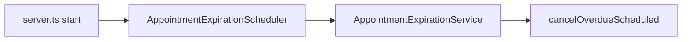

# SchedulerPro — Auditoria geral do roadmap

**Data:** 11/11/2026  
**Tipo:** Somente leitura (código + validação alvo). **Único artefacto criado:** este ficheiro.  
**Branch auditada:** `develop` @ `527a6230f9d535547ff4cc9151146fe690674d9c`  
**HEAD:** `527a623` — Merge pull request #138 `feature/appointment-expiration`  
**Tracking:** `develop...origin/develop` (sem ahead/behind indicado)  
**Working tree:** limpo (sem staged, unstaged ou untracked no momento da auditoria)

**Operações Git de escrita:** nenhuma (commit, push, checkout, etc. não executados).

---

## 1. Resumo executivo

O SchedulerPro em `develop` integra um SaaS multiempresa maduro em agendamentos, com dashboard operacional (O1, O2, O5, O6), visibilidade e escrita de agendamentos por perfil (O6/O7), gestão da própria empresa (Company Management E1+E2+backend), e **expiração automática** por scheduler (E1–E4.1), incluindo teste ponta a ponta Mongo + GET + `scheduler.run()`.

A arquitectura mantém Controller → Service → Repository, isolamento por `req.user.companyId`, RBAC via `RolePermissions` + `hasPermission`, e jobs in-process (`ReminderScheduler`, `AppointmentExpirationScheduler`).

**Riscos residuais baixos em single-node:** código órfão `expireOverdueScheduled` no service; documentação de auditoria anterior desactualizada; `scheduled` vencidos visíveis até o intervalo do scheduler (comportamento intencional pós-E4).

**Não existe** consola administrativa global da plataforma (multi-tenant operator) — fora do produto actual.

**Validação executada nesta auditoria:** build backend + **133 testes** em suítes críticas (todas passaram). Suite completa client **não** executada.

---

## 2. Estado Git inicial

| Item | Valor |
|------|--------|
| Branch | `develop` |
| HEAD | `527a6230f9d535547ff4cc9151146fe690674d9c` |
| Último commit | Merge PR #138 — appointment expiration |
| Working tree | Limpo |
| Divergência | Auditaria feita exactamente na branch indicada |

---

## 3. Funcionalidades concluídas (categoria A) — evidências

### 3.1 Dashboard

| ID | Estado | Evidência |
|----|--------|-----------|
| O1 — KPI clientes ativos | **A** | `server/src/modules/dashboard/repositories/DashboardRepository.ts` (`countActiveClients`); `DashboardService.getSummary`; UI `client/src/pages/dashboard/DashboardPage.tsx` (`showActiveClientsKpi`); testes `DashboardService.test.ts`, `dashboard.routes.test.ts`, `DashboardPage.test.tsx` |
| O2 — Distribuição por estado | **A** | `findStatusCounts`; `client/src/pages/dashboard/DashboardStatusDistribution.tsx` |
| O5 — Refresh ao regressar à aba | **A** | `client/src/hooks/useDashboardVisibilityRefresh.ts`; `client/src/config/dashboardRefresh.ts` (45s); testes `useDashboardVisibilityRefresh.test.ts`, `DashboardPage.test.tsx` |
| O6 — Visibilidade por role | **A** | `server/src/modules/appointments/utils/appointment-read-scope.ts`; `appointment-visibility.routes.test.ts` (18 testes); dashboard escopo EMPLOYEE |

### 3.2 Segurança de agendamentos

| ID | Estado | Evidência |
|----|--------|-----------|
| O6 leitura | **A** | Escopo EMPLOYEE/CLIENT; testes integração HTTP |
| O7 escrita | **A** | `server/src/modules/appointments/utils/appointment-write-access.ts` (`assertEmployeePatchAllowed`); `appointment-write-scope.routes.test.ts`; **Mongo** `appointment-write-scope-mongo.test.ts` |
| Multi-tenant | **A** | `companyId` da sessão nos controllers; testes ignoram `companyId` em query |
| PATCH campos sensíveis | **A** | Testes EMPLOYEE em `AppointmentService.test.ts` |

### 3.3 Appointment Expiration (E1–E4.1)

| ID | Estado | Evidência |
|----|--------|-----------|
| E1 — Service multi-empresa | **A** | `server/src/modules/appointments/services/AppointmentExpirationService.ts`; `CompanyRepository.findAllActiveNotDeleted()` |
| E2 — Scheduler | **A** | `server/src/modules/appointments/scheduler/AppointmentExpirationScheduler.ts`; `server/src/server.ts` L39 `start()` |
| E2.1 — Shutdown | **A** | `server.ts` L58 `await AppointmentExpirationScheduler.stop()` antes de HTTP close e `Database.disconnect()` |
| E3 — Mongo repo | **A** | `cancel-overdue-scheduled.mongo.test.ts` (11 testes) |
| E4 — GET sem expiração | **A** | `AppointmentService.findAll` L720–736 — só `findByCompanyId` + mapper; `void now` |
| E4.1 — Ciclo completo | **A** | `appointment-expiration-full-cycle.mongo.test.ts` (1 teste: GET + Mongo + `scheduler.run()`) |

**Fluxo actual de expiração:**



**GET `/api/appointments`:** não chama expiração (confirmado no código e em `find-all-no-expiration.mongo.test.ts`).

### 3.4 Company Management (tenant — não plataforma global)

| Capacidade | Estado | Evidência |
|------------|--------|-----------|
| GET/PATCH empresa própria | **A** | `server/src/modules/companies/routes/CompanyRoutes.ts` |
| Timezone | **A** | `CompanyService` valida IANA; `TimezonePicker` + `CompanyPage` |
| Logo upload/remoção | **A** | Rotas `/:id/logo` |
| Activate/deactivate | **A** | `/:id/activate`, `/:id/deactivate`; suspensão utilizadores |
| Soft-delete | **A** | `DELETE /:id`; `CompanyRepository.softDelete` |
| RBAC | **A** | `CompanyRoutes.lifecycle-rbac.test.ts`; `companyPermissions.ts` (`canDelete` só OWNER) |
| UI CompanyPage | **A** | `CompanyPage.tsx`, zona perigosa `handleConfirmDelete`, `completeSessionLogout.ts` |
| Redux sync nome/timezone | **A** | `commitCompanyToStore` → `authSlice` + `companySlice`; testes `companySessionSync.test.ts`, `CompanyPage.test.tsx` |

**Registo de empresa:** via fluxo Auth — `CompanyService.create()` é stub vazio (`public async create() {}`) — **intencional**, não é lacuna de produto.

---

## 4. Funcionalidades parcialmente implementadas (categoria C)

| Item | Evidência | Lacuna | Impacto | Prioridade |
|------|-----------|--------|---------|------------|
| UX `scheduled` no passado | E4 removeu cancelamento no GET | Utilizador pode ver `scheduled` vencido até o scheduler | Confusão operacional leve | P2 |
| Integração HTTP + Mongo | E4.1 full-cycle; maioria rotas mockam repo | Regressões só no boundary real em poucos testes | Médio para mudanças em middleware | P2 |
| Documentação roadmap | `docs/audits/roadmap-audit-post-o6.md` L99 ainda cita expiração em `findAll` | Desalinhamento com E4 | Confusão para IAs/devs | P1 (só docs) |

---

## 5. Funcionalidades pendentes (categoria D)

| Item | Evidência de ausência | Prioridade |
|------|----------------------|------------|
| Recuperação de empresa após soft-delete | Sem rota restore/undelete em `CompanyRoutes` | P3 (produto não pediu) |
| Consola admin **global** da plataforma | Sem módulo cross-tenant | N/A |
| E2E browser (Playwright/Cypress) | Sem dependência em `package.json` | P3 |

---

## 6. Melhorias futuras (categoria E)

| Item | Nota |
|------|------|
| Lock distribuído para expiration job | Várias instâncias Node podem duplicar trabalho — idempotente mas redundante |
| Remover `AppointmentService.expireOverdueScheduled` | Órfão (sem callers em `server/`) — P3 |
| Observabilidade do scheduler | Métricas/alertas além de `Logger.system` |
| Suite client completa na auditoria contínua | Opcional `npm test` client em CI já existe (workflow separado no repo) |

---

## 7. Company Management — auditoria dedicada

### Backend (confirmado)

- Rotas: read, update, delete, activate, deactivate, logo — [`CompanyRoutes.ts`](../../server/src/modules/companies/routes/CompanyRoutes.ts).
- Unicidade nome: validação no service/repository (testes `CompanyService.behavior.test.ts`).
- Utilizadores em desactivação: `UserRepository` suspensão/restauro no ciclo de vida — [`CompanyService.ts`](../../server/src/modules/companies/services/CompanyService.ts).
- Testes HTTP: `CompanyRoutes.lifecycle-rbac.test.ts` (+ unit `CompanyService.*`).

### Frontend (confirmado)

- [`CompanyPage.tsx`](../../client/src/pages/company/CompanyPage.tsx): formulário, logo, zona perigosa, delete com logout.
- [`completeSessionLogout.ts`](../../client/src/app/completeSessionLogout.ts): limpeza sessão pós-delete.
- Testes: `CompanyPage.test.tsx`, `CompanyPage.logo.test.tsx`, `LoginPage.test.tsx` (mensagem sucesso).

### Separação produto

- **Gestão da própria empresa (tenant):** entregue.
- **Operador da plataforma (todas as empresas):** não implementado — não confundir com Company Management.

---

## 8. Melhorias técnicas conhecidas

### 8.1 Timezone dinâmico

| Aspeto | Estado |
|--------|--------|
| Backend por empresa | `company.timezone`; `server/src/utils/timezone.ts` |
| Frontend | `selectCompanyTimezone` em `companySlice`; usado em `DashboardPage`, `AppointmentsPage`, `ReportsPage` |
| Actualização pós PATCH | `commitCompanyToStore` actualiza `auth.user.companyTimezone` |
| `Europe/Lisbon` | Fallback **documentado** em `client/src/config/appointmentTime.ts` L12–18 — não tratado como bug isolado |
| Ocorrências em testes | Fixtures usam `Europe/Lisbon` — esperado |

### 8.2 RBAC

- Fonte de verdade backend: [`server/src/constants/rbac.ts`](../../server/src/constants/rbac.ts).
- **MANAGER:** sem `COMPANY_*` write; tem `APPOINTMENT_*`, clients, availability read/update.
- **EMPLOYEE:** leitura appointments/availability; `APPOINTMENT_UPDATE` com escopo O7 na escrita.
- Frontend espelha abilities (ex. `companyPermissions.ts` — delete só OWNER).
- Rotas sensíveis: middleware `authenticate`, `hasPermission`, `RequireOperationalCompany` onde aplicável.

### 8.3 Appointment Expiration

| Verificação | Resultado |
|-------------|-----------|
| GET não expira | **Confirmado** — `findAll` |
| Scheduler responsável | **Confirmado** — `server.ts` + `run()` |
| Idempotência | `cancelOverdueScheduled` `updateMany` só `scheduled` |
| Falha por empresa | `AppointmentExpirationService` try/catch por empresa |
| Shutdown E2.1 | **Confirmado** |
| Código órfão | `expireOverdueScheduled` público sem callers |
| Lock distribuído | **Ausente** — limitação E |

### 8.4 Testes e qualidade

| Tipo | Inventário |
|------|------------|
| Unit server | Vitest — módulos por domínio (`AppointmentService`, `CompanyService`, dashboard, auth, …) |
| Integração HTTP | Supertest + `app`; **repositórios frequentemente mockados** |
| Integração Mongo (`MongoMemoryReplSet`) | 5 ficheiros: `cancel-overdue-scheduled`, `find-all-no-expiration`, `appointment-expiration-full-cycle`, `appointment-write-scope-mongo`, `appointment-booking-concurrency` |
| Client | Vitest + Testing Library — cobertura ampla por página/componente; **não executada nesta auditoria** |
| E2E | Ausente |
| CI backend | [`.github/workflows/ci.yml`](../../.github/workflows/ci.yml) — `npm run test` + `build` em `server/` (inclui suítes mongo na suite completa) |

**Scripts:** `server`: `test`, `build`, `typecheck`; `client`: `test`, `build`, `typecheck`.

---

## 9. Problemas encontrados (com evidência)

| ID | Problema | Severidade | Evidência |
|----|----------|------------|-----------|
| P-DOC-01 | Auditoria pós-O6 desactualizada na expiração | Baixa | `docs/audits/roadmap-audit-post-o6.md` ~L99 |
| P-DOC-02 | Auditoria inicial expiration descreve GET side-effect | Baixa | `docs/audits/appointment-expiration-audit.md` (pré-E4) |
| P-CODE-01 | `expireOverdueScheduled` órfão | Baixa | `AppointmentService.ts` L747; grep sem callers |
| P-UX-01 | `scheduled` passado visível até job | Baixa | Comportamento pós-E4; teste E4.1 comprova não-cancelamento no GET |
| P-OPS-01 | Scheduler sem coordenação multi-instância | Média em escala horizontal | Arquitectura single-process job |

Não foram encontrados `TODO`/`FIXME` em `server/src` ou `client/src` (grep vazio).

---

## 10. Resultados de testes e build (executados 11/11/2026)

### Build

```bash
cd server && npm run build
```

**Resultado:** exit 0 (`tsc`).

### Testes alvo (integração + unit, backend)

| Comando | Ficheiros | Testes | Falhas |
|---------|-----------|--------|--------|
| `npm test -- appointment-expiration-full-cycle.mongo.test find-all-no-expiration.mongo.test cancel-overdue-scheduled.mongo.test` | 3 | 13 | 0 |
| `npm test -- AppointmentExpirationScheduler.test AppointmentExpirationService.test` | 2 | 24 | 0 |
| `npm test -- appointment-visibility.routes.test appointment-write-scope.routes.test` | 2 | 37 | 0 |
| `npm test -- CompanyRoutes.lifecycle-rbac.test CompanyService` | 5 | 44 | 0 |
| `npm test -- DashboardService.test dashboard.routes.test` | 2 | 15 | 0 |
| **Total auditado** | **14** | **133** | **0** |

**Ambiente mongo nos 13 primeiros:** `MongoMemoryReplSet` (wiredTiger), ~38s para o bloco de 3 ficheiros.

**Não executado nesta auditoria:**

- Suite completa `server/npm test` (CI faz na integração).
- Qualquer `client/npm test` ou `client/npm run typecheck`.
- E2E browser.

---

## 11. Roadmap priorizado (A–E consolidado)

| Prioridade | Item | Categoria |
|------------|------|-----------|
| — | Dashboard O1–O6, O7, Expiration E1–E4.1, Company tenant | **A** |
| P1 | Sincronizar documentação expiration/roadmap com E4 | **C** (só docs) |
| P2 | UX copy para `scheduled` vencido (client) | **C** |
| P2 | Expandir smoke integração real (opcional, pós-E4.1) | **C** |
| P3 | Remover método órfão `expireOverdueScheduled` | **E** |
| P3 | E2E smoke login/dashboard | **D** |
| — | Restore empresa soft-deleted | **D** (se produto exigir) |
| — | Admin plataforma global | **N/A** |

---

## 12. Recomendação — próximas tarefas (3–5)

1. **P1 — Sincronização documental do roadmap (primeira)** — Actualizar `appointment-expiration-audit.md` e `roadmap-audit-post-o6.md` para reflectir E4/E4.1 ou adicionar aviso “canónico: ROADMAP_AUDIT_2026-11-11 + tasks E4”.
2. **P2 — UX: estado `scheduled` no passado** — Badge ou tooltip no calendário/listagem (“será cancelado automaticamente”).
3. **P2 — CI visibility** — Confirmar na prática que PRs executam suítes mongo (já na suite `npm test`; documentar tempo/falhas intermitentes se surgirem).
4. **P3 — Limpeza `expireOverdueScheduled`** — Remover método público sem callers após confirmação produto.
5. **P3 — E2E mínimo** — Login + dashboard (novo pacote, fora do stack actual).

### Primeira tarefa — ficha

| Campo | Conteúdo |
|-------|----------|
| **Objectivo** | Eliminar contradições entre auditorias antigas e código pós-E4/E4.1 |
| **Problema** | IAs e devs podem reimplementar expiração no GET ao ler `roadmap-audit-post-o6.md` |
| **Escopo** | Editar apenas ficheiros em `docs/audits/` e cross-links em tasks E4 |
| **Fora de escopo** | Código, testes, scheduler, frontend |
| **Dependências** | Nenhuma |
| **Aceitação** | Secções de expiração descrevem scheduler-only; link para E4.1 e full-cycle test |
| **Testes** | Nenhum |

---

## 13. Limitações da auditoria

- Análise **estática** do client (sem correr vitest/typecheck no frontend).
- Não foram revistos todos os ~169 ficheiros em `docs/` linha a linha.
- Comportamento em produção multi-instância não foi observado em runtime.
- Classificação baseada no HEAD `527a623`; não foram comparadas outras branches (sem operações git).
- Testes alvo passaram no ambiente local Windows do auditor; CI pode diferir em tempo Mongo.

---

## 14. Referências para continuidade

### Appointment expiration (canónico pós-merge)

- [E1](appointment-expiration-e1-multi-company-service.md) · [E2](appointment-expiration-e2-scheduler.md) · [E2.1](appointment-expiration-e2-1-shutdown-hardening.md) · [E3](appointment-expiration-e3-mongodb-integration-tests.md) · [E4](appointment-expiration-e4-remove-get-side-effect.md) · [E4.1](appointment-expiration-e4-1-full-integration-test.md)
- [Auditoria aprovação E4](../audits/appointment-expiration-e4-approval-audit.md)

### Company, dashboard, O6/O7

- [O6](o6-appointment-visibility-by-role.md) · [O7 tasks](o7-appointment-write-scope-by-role.md)
- [Company E1](company-management-e1-api-permissions.md) · [Company E2](company-management-e2-soft-delete-ui.md)
- [Roadmap pós-O6 (histórico — parcialmente desactualizado)](../audits/roadmap-audit-post-o6.md)

### Código chave

- Expiração: `server/src/modules/appointments/services/AppointmentExpirationService.ts`, `scheduler/AppointmentExpirationScheduler.ts`, `server/src/server.ts`
- Listagem: `server/src/modules/appointments/services/AppointmentService.ts` `findAll`
- Teste E2E integração: `server/tests/integration/appointments/appointment-expiration-full-cycle.mongo.test.ts`

---

*Fim do relatório — SchedulerPro roadmap audit 2026-11-11.*
