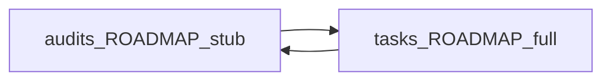

# Appointment Expiration — Validação final da sincronização documental

**Data:** 11/11/2026  
**Tipo:** Auditoria somente leitura (sem alteração de código, testes, build ou operações Git de escrita).  
**Branch:** `develop` @ `438de5ec3a457b5635d6443d53557a8d95627c40`  
**Último commit (mensagem):** `Auditoria geral do roadmap`  
**Relacionado:** [sincronização pós-E4/E4.1](appointment-expiration-documentation-sync.md)

---

## 1. Objetivo

Confirmar, após a tarefa de [sincronização documental](appointment-expiration-documentation-sync.md), que:

- o pacote de docs alterado está coerente com o código em `develop`;
- referências antigas fora do pacote ficam classificadas;
- o par ROADMAP stub/tasks está correcto;
- não há divergências técnicas material entre documentação syncada e implementação.

Este ficheiro regista o resultado da validação complementar e final. **Não substitui** as auditorias históricas; complementa o relatório de sync.

---

## 2. Estado Git (no momento da validação)

| Campo | Valor |
|-------|--------|
| Branch | `develop` |
| HEAD | `438de5ec3a457b5635d6443d53557a8d95627c40` |
| Working tree | Suja — sync documental **ainda não commitada** |
| Staged | Vazio |

**Modificados (7):**

- `docs/audits/appointment-expiration-audit.md`
- `docs/audits/appointment-expiration-e4-approval-audit.md`
- `docs/audits/roadmap-audit-post-o6.md`
- `docs/tasks/ROADMAP_AUDIT_2026-11-11.md`
- `docs/tasks/appointment-expiration-e1-multi-company-service.md`
- `docs/tasks/appointment-expiration-e2-scheduler.md`
- `docs/tasks/appointment-expiration-e3-mongodb-integration-tests.md`

**Untracked (à data da validação):**

- `docs/audits/ROADMAP_AUDIT_2026-11-11.md`
- `docs/tasks/appointment-expiration-documentation-sync.md`
- `docs/tasks/appointment-expiration-documentation-validation.md` (este ficheiro)

**Fora de `docs/`:** nenhum ficheiro no diff tracked da sync. Alterações limitadas a documentação.

**Git write na validação:** não executado.

---

## 3. Referências antigas

### 3.1 [`appointment-visibility-by-role-audit.md`](../audits/appointment-visibility-by-role-audit.md)

| Trecho | Classificação |
|--------|----------------|
| Metadados (2026-11-10, objectivo O6, HEAD antigo) | **Histórico** — snapshot pré-implementação O6 |
| §7.1 — expiração em `findAll` L718–719 | **Desatualizada** — redige como análise actual; sem rótulo pré-E4 |
| Tabela GET `/`, coluna expiração «Não» | **Ambígua** — contradiz §7.1 no mesmo documento |
| Handoff teste 15 (`expireOverdueScheduled` não afecta outros) | **Ambígua** — recomendação de produto válida; implica gatilho em read que já não existe |
| Índice «expiração» em `AppointmentService` | **Desatualizada** se lido como mapa actual |

### 3.2 `docs/reports/` (expiração / `findAll` / `expireOverdueScheduled`)

| Ficheiro | Classificação | Nota |
|----------|----------------|------|
| `schedulerpro-dashboard-technical-audit.md` L85, L223 | **Desatualizada** | Side-effect em cada `findAll` |
| `schedulerpro-global-technical-audit.md` L72, L135–136, L162, L371–372 | **Desatualizada** | «Confirmado» com linhas de código obsoletas |
| `schedulerpro-phase-h-final-consolidation.md` L125 (AUD-004) | **Desatualizada** | Consolida expiração «só em `findAll`» |
| `STAGE_33_PRICE_HISTORY_AND_APPOINTMENT_STATUS_AUDIT.md` L190 | **Histórico** (ressalva) | Regra `scheduled`→`cancelled` válida; entrypoint da época |
| `STAGE_34_1_FORECAST_VALUE_DIAGNOSTIC.md` L180 | **Ambígua** | Menção incidental |
| `schedulerpro-dashboard-v1-implementation.md` L20 | **Histórico / coerente** | Dashboard não invoca expiração |
| `schedulerpro-dashboard-v1-code-review.md` L52 | **Coerente** | Sem expiração no módulo dashboard |

### 3.3 Núcleo syncado

[`appointment-expiration-audit.md`](../audits/appointment-expiration-audit.md): bloco **Estado actual (pós-E4.1)** + **Registo histórico (pré-E4)** — **não contradiz** o código verificado. Corpo abaixo do rótulo = histórico explícito.

[`roadmap-audit-post-o6.md`](../audits/roadmap-audit-post-o6.md): banner pós-E4.1; expiração em listagem marcada `OBSOLETO (pré-E4)` onde aplicável.

---

## 4. ROADMAP duplicado (stub × corpo)

| Papel | Ficheiro |
|-------|----------|
| **Entrada canónica** (`docs/audits`) | [`ROADMAP_AUDIT_2026-11-11.md`](../audits/ROADMAP_AUDIT_2026-11-11.md) (stub) |
| **Relatório completo** | [`ROADMAP_AUDIT_2026-11-11.md`](ROADMAP_AUDIT_2026-11-11.md) (~319 linhas) |

- Links `../tasks/` ↔ `../audits/`: **correctos**.
- [`appointment-expiration-audit.md`](../audits/appointment-expiration-audit.md) L9: aponta para corpo + stub — alinhado.

**Risco para outra IA:** **médio**

- Quem abrir só o corpo em `tasks/` vê metadados de auditoria com HEAD `527a623` e working tree «limpo» (desactualizados face ao Git no momento da validação).
- Quem pesquisar só `docs/reports/` pode ignorar o stub e o bloco «Estado actual».
- [`ROADMAP_AUDIT_2026-11-11.md`](ROADMAP_AUDIT_2026-11-11.md) **L111** ainda lista lacuna em `roadmap-audit-post-o6` já corrigida na sync (**divergência doc↔doc**).

---

## 5. Consistência técnica (código @ HEAD `438de5e`)

Verificação directa no código, sem assumir que a documentação está correcta.

| Afirmação | Evidência | Resultado |
|-----------|-----------|-----------|
| Expiração via scheduler, não `GET /api/appointments` | `server.ts` — `AppointmentExpirationScheduler.start()`; `AppointmentService.findAll` L720–736 só `findByCompanyId`, `void now`; `expireOverdueScheduled` sem chamadores em `server/` | **Confirmado** |
| `scheduled` e `startAt < now` → `cancelled` | `AppointmentRepository.cancelOverdueScheduled` — filtro `SCHEDULED`, `startAt: { $lt: now }`, `deletedAt: null` | **Confirmado** |
| Empresas activas e não eliminadas | `CompanyRepository.findAllActiveNotDeleted`; `AppointmentExpirationService.processOverdueForAllCompanies` | **Confirmado** |
| Falha por empresa não bloqueia lote | `try/catch` por empresa no service | **Confirmado** |
| Shutdown aguarda execução | `AppointmentExpirationScheduler.stop()` — `await` em `inFlight`; `server.ts` — `await stop()` | **Confirmado** |
| Lock distribuído | Scheduler: flag `running` in-process; leases no repositório são para **lembretes**, não expiration | **Ausente** (limitação real) |
| `updatedAt` via Mongoose `timestamps` | `Appointment.model.ts` `timestamps: true`; `updateMany` só `$set: { status }`; testes E3 mongo **não** assertam `updatedAt` | **Provável pelo schema**; não provado por teste de integração |

**Divergência doc↔código no pacote syncado (runtime):** nenhuma nas regras do bloco «Estado actual».

**Divergência doc↔doc:** ROADMAP tasks L111 vs `roadmap-audit-post-o6` actualizado.

---

## 6. Problemas e riscos

| # | Problema | Impacto |
|---|----------|---------|
| 1 | Sync não commitada | Risco de perda ou divergência local |
| 2 | ROADMAP L111 obsoleto | Confusão em priorização documental |
| 3 | O6 §7.1 e relatórios globais | Leitura como comportamento actual (pré-E4) |
| 4 | Metadados Git no ROADMAP tasks | IA pode assumir working tree limpa em `527a623` |
| 5 | `expireOverdueScheduled` órfão no service | Dívida de API/código (fora da sync) |

---

## 7. Correções recomendadas (não executadas nesta validação)

| Prioridade | Acção |
|------------|--------|
| P0 | Commit dos `docs/**` da sync (+ este relatório e sync, quando aprovado) |
| P1 | Actualizar ou fechar linha em `ROADMAP_AUDIT_2026-11-11.md` L111 |
| P1 | Banner pré-E4 + nota em §7.1 de `appointment-visibility-by-role-audit.md` |
| P2 | Rodapé «supersedido por [sync](appointment-expiration-documentation-sync.md) / [validation](appointment-expiration-documentation-validation.md)» em relatórios listados na §3.2 |
| P3 | Actualizar metadados Git no topo do ROADMAP tasks após commit |
| P3 (código) | Remover `expireOverdueScheduled` órfão após confirmação produto |

---

## 8. Parecer final

| Área | Veredicto |
|------|-----------|
| Sincronização documental (pacote E4/E4.1) | **Adequada** — estado actual no topo condiz com implementação |
| Validação técnica vs código | **Aprovada** — sem divergências material no núcleo syncado |
| Documentação global `docs/` | **Parcial** — dívida conhecida em O6 e `docs/reports/` |
| Prontidão para commit documental | **Sim** — apenas ficheiros sob `docs/` |

A validação **não bloqueia** o commit do pacote de sincronização. Recomenda-se follow-up P1–P2 antes de usar relatórios antigos como fonte única para onboarding ou agentes.

---

## 9. Handoff

1. Fonte de verdade runtime: bloco **Estado actual** em [`appointment-expiration-audit.md`](../audits/appointment-expiration-audit.md).
2. Histórico da sync: [`appointment-expiration-documentation-sync.md`](appointment-expiration-documentation-sync.md).
3. Roadmap geral: stub [`../audits/ROADMAP_AUDIT_2026-11-11.md`](../audits/ROADMAP_AUDIT_2026-11-11.md).
4. Não reintroduzir expiração no `GET`.
5. Este relatório: resultado da validação read-only final (complementar à sync).
6. Limpeza de ambiguidades: [appointment-expiration-documentation-cleanup.md](appointment-expiration-documentation-cleanup.md).
