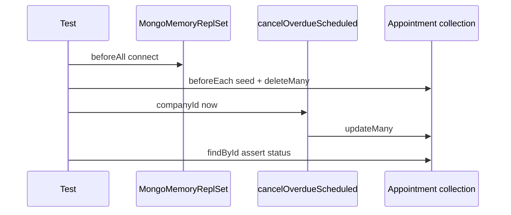

# Appointment Expiration — E3: Testes de integração MongoDB (`cancelOverdueScheduled`)

**Data:** 11/11/2026  
**Branch:** `develop` @ `a605931149b42b353822a78b01ac5dc26909d92d` (sem commit)  
**Dependências:** [Auditoria](../audits/appointment-expiration-audit.md), [E1](appointment-expiration-e1-multi-company-service.md), [E2](appointment-expiration-e2-scheduler.md), [E2.1](appointment-expiration-e2-1-shutdown-hardening.md)

---

## Objetivo

Validar no Mongo real (via `mongodb-memory-server` ou URI externa) o comportamento de [`cancelOverdueScheduled`](../../server/src/modules/appointments/repositories/AppointmentRepository.ts) usado pelo fluxo de expiração — sem mocks do repositório e **sem alterações de código de produção**.

---

## Estado Git — início

| Item | Valor |
|------|--------|
| Branch | `develop` |
| HEAD | `a605931149b42b353822a78b01ac5dc26909d92d` |
| Árvore | E1/E2/E2.1 + ficheiro E3 (untracked) |

**Git write:** não executado.

---

## Ficheiro novo

| Caminho | Descrição |
|---------|-----------|
| [`server/tests/integration/appointments/cancel-overdue-scheduled.mongo.test.ts`](../../server/tests/integration/appointments/cancel-overdue-scheduled.mongo.test.ts) | Integração com `AppointmentRepository` singleton |

### Infraestrutura (reutilizada do projeto)

- **Runner:** Vitest (`server/vitest.config.ts`, `tests/setup.ts`).
- **Mongo:** `MongoMemoryReplSet` (1 nó, `wiredTiger`), `beforeAll` timeout **180s**.
- **Override:** `GW3_TEST_MONGO_URI` → connect externo + `Appointment.syncIndexes()`.
- **Limpeza:** `beforeEach` — `deleteMany` em `Appointment`, `Client`, `Service`, `User`, `Company`.
- **Referência temporal:** `NOW = 2028-06-15T12:00:00.000Z`; `PAST` / `FUTURE` / `EQUAL` derivados.

### Constantes de domínio testadas

Filtro efectivo do repositório:

- `companyId` igual ao argumento
- `deletedAt: null`
- `status: scheduled`
- `startAt: { $lt: now }` → `$set: { status: cancelled }`
- Retorno: `modifiedCount`

---

## Cenários (tabela)

| # | Arrange | Act | Assert |
|---|---------|-----|--------|
| 1 | `scheduled`, `startAt < NOW` | `cancelOverdueScheduled(companyA, NOW)` | Doc `cancelled`; `modifiedCount === 1` |
| 2 | `scheduled`, `startAt > NOW` | idem | `scheduled`; count 0 |
| 3 | `scheduled`, `startAt === NOW` | idem | `scheduled` (limite `$lt`); count 0 |
| 4 | `cancelled`, passado | idem | inalterado; count 0 |
| 5 | `confirmed`, `completed`, `no_show` no passado | idem | status inalterado; count 0 (3 asserts) |
| 6 | `scheduled` passado + `deletedAt` definido | idem | inalterado; count 0 |
| 7 | Vencido só em **company B** | cancel só **company A** | B permanece `scheduled`; count 0 |
| 8 | A: 2 vencidos + 1 futuro; B: 1 vencido | cancel A | 2 cancelled em A; B e futuro inalterados; count 2 |
| 9 | Batch + futuro em A | cancel A | `modifiedCount` === delta de `countDocuments(cancelled)` na empresa |

**Verificação:** sempre leitura pós-update (`findById` / `countDocuments`), não só `modifiedCount`.

---

## Comandos e resultados (executados em 11/11/2026)

```bash
cd server
npm test -- cancel-overdue-scheduled.mongo.test
npm test -- AppointmentExpirationScheduler.test AppointmentExpirationService.test AppointmentService.test
npm test -- CompanyRepository.test
npm run build
```

| Comando | Resultado |
|---------|-----------|
| `cancel-overdue-scheduled.mongo.test` | **1 ficheiro, 11 testes passed** (~13.9s; inclui 3 casos parametrizados em #5) |
| Expiration + AppointmentService | **3 ficheiros, 43 passed** |
| `CompanyRepository.test` | **1 ficheiro, 9 passed** |
| `npm run build` | **exit 0** |

---

## Limitações e escopo E3

| Item | Nota |
|------|------|
| `updatedAt` | Não assertado (fora do contrato atual do método) |
| GET `/api/appointments` | Side-effect de expiração **mantido** — remoção fica para E4 (não autorizado aqui) |
| Helper global Mongo | Não extraído; bloco `connectTestDatabase` copiado do padrão O7/GW3 |
| Falha MMS (CI/rede) | Documentar falha; usar `GW3_TEST_MONGO_URI` em vez de mocks |

---

## Diagrama (fluxo do teste)



---

## Estado Git — fim

| Item | Valor |
|------|--------|
| Branch | `develop` |
| HEAD | `a605931149b42b353822a78b01ac5dc26909d92d` |
| Novos artefactos E3 | `cancel-overdue-scheduled.mongo.test.ts`, este documento |

**Git write:** não executado.

---

## Handoff E4 (não feito nesta etapa)

- Remover expiração implícita no `GET` de appointments quando o produto autorizar.
- Manter este ficheiro de integração como regressão do repositório após qualquer refactor.
