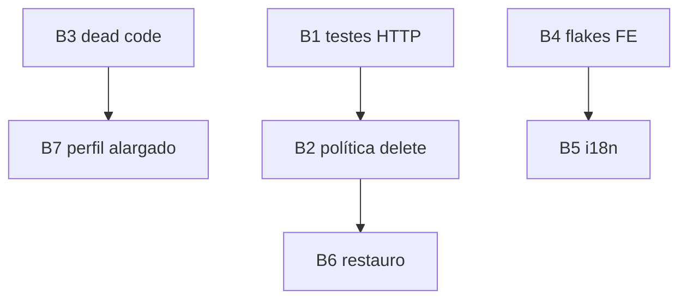
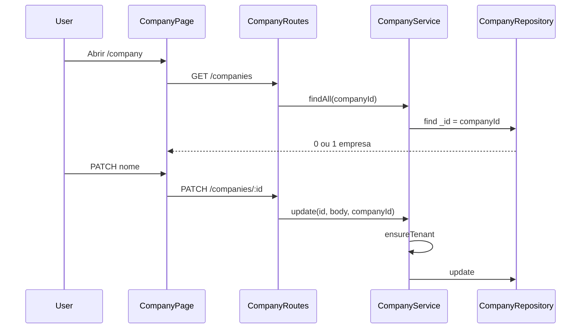

# Auditoria — Company Management | SchedulerPro

**Data:** 2026-11-18  
**Tipo:** auditoria read-only (sem alterações a produção, testes ou outros docs excepto este ficheiro)  
**Branch:** `develop`  
**Commit inicial e final:** `6f35a7716ca14c46188304dbbd59ad8633c1dc6d` (merge PR #146 — testes multi-tenant)  
**Git write:** não executado (sem commit/push)

---

## 1. Resumo executivo

O SchedulerPro implementa **gestão da própria empresa (single-tenant por sessão)**, não uma consola de plataforma multi-empresa. O fluxo está **maduro** no backend (rotas `/api/companies`, isolamento `ensureTenant`, lifecycle activate/deactivate, soft delete, logo Cloudinary) e no frontend (rota `/company`, formulário, zona perigosa, logout pós-delete).

| Dimensão | Veredicto |
|----------|-----------|
| Perfil tenant (nome, timezone, logo) | **COMPLETA** |
| Desactivação / reactivação + impacto em users | **COMPLETA** |
| Soft delete empresa | **COMPLETA** (BE + FE); **sem** restauro na app |
| Criar empresa | **PARCIAL** — só `POST /api/auth/register` + transação `AuthService`; `CompanyService.create()` vazio; `create-company.validator` órfão |
| Listar empresas (plataforma) | **AUSENTE** — `GET /companies` devolve 0–1 registo do token |
| Perfil alargado (morada, contactos, horário na Company) | **AUSENTE** no schema Company |
| i18n PT/EN na UI Company | **AUSENTE** — strings PT hardcoded |
| Testes BE Company | **COMPLETA** (84 testes unitários dedicados + relacionados, 2026-11-18) |
| Testes FE Company | **PARCIAL** — 100/102 pass; 2 timeouts intermitentes |
| Isolamento multi-tenant HTTP Company | **PARCIAL** — unit `CompanyService.isolation`; Task 4 **não** adicionou routes HTTP Companies |

**Vulnerabilidade confirmada (exploração cross-tenant em Company):** nenhuma — `id !== companyId` → 404 antes de tocar no repositório.

**Problemas prioritários:** sem P0/P1; riscos P2 (soft delete sem política de dados órfãos; lacuna testes HTTP integration completos; flakes FE); P3 (dead code, i18n, nome único global).

---

## 2. Estado do Git

### Início da auditoria

| Item | Valor |
|------|--------|
| Branch | `develop` |
| HEAD | `6f35a7716ca14c46188304dbbd59ad8633c1dc6d` |
| Tracking | `origin/develop` (up to date) |
| Working tree | **limpa** |
| `git diff` / `--cached` | vazios |

**Gate:** passou — auditoria prosseguiu.

### Fim da auditoria

| Item | Valor |
|------|--------|
| Branch | `develop` |
| HEAD | `6f35a7716ca14c46188304dbbd59ad8633c1dc6d` |
| Ficheiros tracked alterados | **0** |
| Novo untracked | `docs/tasks/company-management-audit.md` (este relatório) |

---

## 3. Inventário de ficheiros analisados

### Backend — módulo Company

| Ficheiro | Papel |
|----------|--------|
| `server/src/modules/companies/models/Company.model.ts` | Schema Mongoose |
| `server/src/modules/companies/repositories/CompanyRepository.ts` | Persistência |
| `server/src/modules/companies/services/CompanyService.ts` | Regras de negócio |
| `server/src/modules/companies/services/company-lifecycle-transaction.ts` | Transações lifecycle |
| `server/src/modules/companies/controllers/CompanyController.ts` | HTTP |
| `server/src/modules/companies/routes/CompanyRoutes.ts` | Rotas Express |
| `server/src/modules/companies/mappers/CompanyMapper.ts` | Resposta API |
| `server/src/modules/companies/dto/CreateCompany.dto.ts`, `UpdateCompany.dto.ts` | DTOs |
| `server/src/modules/companies/types.ts` | Tipos internos |
| `server/src/modules/companies/validators/create-company.validator.ts` | **Não montado** em rotas |
| `server/src/modules/companies/validators/update-company.validator.ts` | PATCH |
| `server/src/routes/index.ts` | Montagem `/api/companies` |

### Backend — dependências

| Ficheiro | Papel |
|----------|--------|
| `server/src/modules/auth/services/AuthService.ts` | `register` → `createCompany` |
| `server/src/modules/auth/validators/register.validator.ts` | Validação registo |
| `server/src/modules/auth/utils/assert-company-active-for-auth.ts` | Login com empresa inactiva |
| `server/src/middlewares/require-operational-company.middleware.ts` | Bloqueio operações se `!isActive` |
| `server/src/middlewares/auth.middleware.ts`, `permission.middleware.ts` | Auth + RBAC |
| `server/src/constants/rbac.ts`, `permissions.ts` | Matriz COMPANY_* |
| `server/src/utils/timezone.ts` | `DEFAULT_TIMEZONE`, `resolveCompanyTimezone` |
| `server/src/providers/images/*` | Upload logo (Cloudinary) |

### Frontend

| Ficheiro | Papel |
|----------|--------|
| `client/src/pages/company/CompanyPage.tsx` | Página principal |
| `client/src/components/company/CompanyForm.tsx` | Edição nome/timezone/logo |
| `client/src/components/company/CompanyInactiveNotice.tsx` | Aviso empresa inactiva |
| `client/src/components/company/StaffCompanySuspendedView.tsx` | Staff com empresa suspensa |
| `client/src/api/endpoints/company.api.ts` | Cliente HTTP |
| `client/src/config/companyPermissions.ts` | Abilities UX |
| `client/src/types/company.ts` | Tipos |
| `client/src/store/slices/companySlice.ts` | Redux |
| `client/src/store/companySessionSync.ts` | Sync após mutações |
| `client/src/app/loadSessionCompany.ts` | Bootstrap GET `/companies` |
| `client/src/routes/AppRoutes.tsx` | `/company` em `ProtectedRoute` |
| `client/src/config/menu.ts` | Menu "Empresa" OWNER/ADMIN |
| `client/src/pages/RegisterPage.tsx` | Criação empresa no registo |

### Testes

| Área | Ficheiros |
|------|-----------|
| BE unit companies | 8 em `server/tests/unit/companies/` |
| BE relacionados | `assert-company-active-for-auth.test.ts`, `require-operational-company.middleware.test.ts`, `UserRepository.company-lifecycle.test.ts`, `AuthService.test.ts` (registo) |
| FE | `company.api.test.ts`, `companyPermissions.test.ts`, `CompanyForm*.test.tsx`, `CompanyPage*.test.tsx`, `companySlice.test.ts`, `loadSessionCompany.test.ts`, `companySessionSync.test.ts`, `CompanyInactiveNotice.test.tsx` |

### Documentação consultada

| Documento | Nota |
|-----------|------|
| `docs/audits/company-management-backend-audit.md` | 2026-11-11 @ `8fd5f0a` — **desactualizado** (FE delete ausente) |
| `docs/audits/company-management-frontend-audit.md` | Idem |
| `docs/tasks/company-management-e1-api-permissions.md` | DELETE API cliente |
| `docs/tasks/company-management-e2-soft-delete-ui.md` | UI delete |
| `docs/tasks/e2e-multi-tenant-isolation-review.md` | Companies sem HTTP multi-tenant novo |
| `docs/README.md` | Índice Company Management |
| `docs/reports/STAGE_36_AUTH_COMPANY_TIMEZONE_CONTRACT.md` | Contrato timezone auth |

---

## 4. Funcionalidades existentes no backend

Montagem: `router.use("/companies", CompanyRoutes)` em `server/src/routes/index.ts`.

### Matriz de operações

| Operação | Estado | Evidência |
|----------|--------|-----------|
| Criar empresa | **PARCIAL** | `CompanyRepository.create` + `AuthService.createCompany` em transação de registo; **sem** `POST /api/companies`; `CompanyService.create()` corpo vazio (L79) |
| Consultar lista | **COMPLETA** (scoped) | `GET /` → `CompanyService.findAll(companyId)` → `CompanyRepository.findAll` filtra `_id: companyId` |
| Consultar por ID | **COMPLETA** | `GET /:id` + `ensureTenant` |
| Atualizar dados | **COMPLETA** | `PATCH /:id` — só `name`, `timezone`; `RequireOperationalCompany` |
| Alterar estado (isActive) | **COMPLETA** | `PATCH .../activate` e `.../deactivate`; suspend/restore staff via `UserRepository` |
| Activar / desactivar | **COMPLETA** | activate **sem** `RequireOperationalCompany` (OWNER reactiva); deactivate com operational middleware |
| Eliminar empresa | **COMPLETA** | `DELETE /:id` → `softDelete`; OWNER + `COMPANY_DELETE` |
| Empresa autenticada | **PARCIAL** | Sem `/companies/me`; semântica `GET /companies` = array com empresa da sessão |
| Configurações empresa (API) | **PARCIAL** | Apenas name, timezone, logo, isActive expostos em `CompanyMapper` |
| Logo upload/remove | **COMPLETA** | `POST/DELETE /:id/logo`, Cloudinary via `imageProvider` |

### Endpoints (resumo)

| Método | Rota | Permissão | Middlewares notáveis |
|--------|------|-----------|----------------------|
| GET | `/api/companies` | COMPANY_READ | auth, password change |
| GET | `/api/companies/:id` | COMPANY_READ | validateObjectId |
| PATCH | `/api/companies/:id` | COMPANY_UPDATE | operational company |
| DELETE | `/api/companies/:id` | COMPANY_DELETE | operational company |
| PATCH | `/api/companies/:id/activate` | COMPANY_ACTIVATE | **sem** operational |
| PATCH | `/api/companies/:id/deactivate` | COMPANY_DEACTIVATE | operational company |
| POST | `/api/companies/:id/logo` | COMPANY_UPDATE | operational + multipart |
| DELETE | `/api/companies/:id/logo` | COMPANY_UPDATE | operational |

---

## 5. Funcionalidades existentes no frontend

| Operação backend | UI | Estado |
|------------------|-----|--------|
| GET empresa | `CompanyPage` → `companyApi.getCompany()` | **COMPLETA** |
| PATCH | `CompanyForm` se `canEditProfile` | **COMPLETA** |
| Logo | `ImageUploader` em `CompanyForm` | **COMPLETA** |
| Desactivar / reactivar | Modais + botões lifecycle | **COMPLETA** |
| Soft delete | Zona perigosa + `completeSessionLogout` | **COMPLETA** (pós E2) |
| Registo | `RegisterPage` — nome + timezone empresa | **COMPLETA** |
| Menu | `/company` só OWNER/ADMIN | **COMPLETA** |
| Staff sem acesso | `!canView` → alerta permissão | **COMPLETA** |
| Link público | `getPublicBookingUrl(company.id)` | **COMPLETA** |
| i18n EN | — | **AUSENTE** |
| Consola multi-empresa | — | **AUSENTE** |

**Protecção de rota:** `ProtectedRoute` + abilities; não há guard server-side no router React (correcto — API valida).

**Dados da sessão:** `company.id` usado em mutações vem de `GET /companies`, não de input livre do utilizador.

---

## 6. Regras de negócio e multi-tenancy

### Criação e OWNER

1. Registo (`AuthService.register`): valida nome empresa único (`findByName`), timezone IANA opcional (default `DEFAULT_TIMEZONE`).
2. Transação: `CompanyRepository.create` + `UserRepository.create` com `role: OWNER`, `companyId: company._id`.
3. Um OWNER por empresa na criação; gestão de mais users é módulo Users.

### `companyId` na sessão

- JWT/sessão carrega `companyId`; middleware auth sobrescreve com valor da BD (`auth.middleware.test.ts` — forged JWT).
- Controllers passam `req.user!.companyId` aos services.
- **Payload não pode mudar tenant:** `UpdateCompanyDto` só name/timezone; `isActive`/`deletedAt` não aceites no PATCH.

### Isolamento cross-tenant

- `CompanyService.ensureTenant`: `id !== companyId` → `COMPANY_NOT_FOUND` (404), **antes** de query quando ID inválido ou outro tenant.
- `findAll(companyId)` nunca lista outras empresas.
- Tentativa com `:id` de outra empresa: mesmo 404 (não 403).

### Ciclo de vida

| Estado | Efeito |
|--------|--------|
| `isActive: false` | Staff não-OWNER: login bloqueado (`assertUserMayAuthenticateAgainstCompany`); rotas operacionais com `RequireOperationalCompany` → 403 |
| Desactivar | `UserRepository.suspendActiveNonOwnerStaffForCompanyDeactivation` |
| Activar | `restoreUsersSuspendedByCompanyDeactivation` |
| `deletedAt` set | `findById` repo ignora; auth/login deve falhar ao resolver empresa |

### Soft delete

- `CompanyService.delete` só chama `softDelete` — **sem** verificação de appointments/clients/users associados (dados permanecem na BD).
- Frontend informa que não há reversão na aplicação.

### Nome único global

- Schema `name` **unique** (lowercase) — duas empresas **não podem** partilhar o mesmo nome (mesmo em tenants distintos). Evidência: `Company.model.ts` L47-49.

---

## 7. Auditoria de permissões e isolamento

### RBAC backend (`RolePermissions`)

| Role | COMPANY_* |
|------|-----------|
| OWNER | READ, UPDATE, DELETE, ACTIVATE, DEACTIVATE |
| ADMIN | READ, UPDATE |
| MANAGER, EMPLOYEE, CLIENT | nenhuma |

### Espelho frontend (`companyPermissions.ts`)

Alinhado com comentários que citam `rbac.ts` — **consistente**.

### Segurança adicional

| Controlo | Estado |
|----------|--------|
| IDOR `:id` | Mitigado (404) |
| Escalada via body | Mitigado (whitelist DTO + validators) |
| Upload logo | Tamanho middleware; validação provider; `COMPANY_UPDATE` |
| Logo URL arbitrária | Mitigado — só `StoredImage` do provider |
| Empresa inactiva | Operational middleware em mutações; OWNER acede `/company` para reactivar |
| Task 4 multi-tenant | Companies cobertos em **unit** `CompanyService.isolation.test.ts` (11 cases); **sem** `multi-tenant-companies.routes.test.ts` |

### Riscos (não vulnerabilidades confirmadas)

| ID | Descrição | Prioridade |
|----|-----------|------------|
| S1 | Soft delete deixa dados tenant órfãos (sem cascata documentada) | P2 |
| S2 | Sem teste HTTP integration end-to-end do router Company (excepto logo RBAC parcial) | P2 |
| S3 | `create-company.validator.ts` morto — divergência mental com `register.validator` | P3 |

---

## 8. Configurações da empresa

### Implementadas (evidência no código)

| Config | Onde |
|--------|------|
| Nome comercial | `Company.name` + formulários |
| Timezone IANA | `Company.timezone`, default `Europe/Lisbon` em `timezone.ts` |
| Logótipo | `Company.logo` + Cloudinary |
| Estado operacional | `isActive` |
| Link agendamento público | Derivado de `company.id` no FE — não é campo persistido |

### Noutros módulos (não são campos Company)

| Config | Módulo |
|--------|--------|
| Horário / disponibilidade | `availability` (por funcionário) |
| Serviços, preços | `services` |
| Notificações | `notifications` (por user/evento — sem prefs globais empresa no model Company) |
| Agendamento | `appointments` + regras expiration |

### Timezone fixo

- Produção usa `company.timezone` via `resolveCompanyTimezone` quando contexto empresa existe.
- `Europe/Lisbon` aparece como **default** de schema e em testes; não como override fixo na página Company (usa `TimezonePicker` + valor da empresa).

### Futuro (sem evidência de requisito implementado)

Morada, telefone, email comercial, horário de funcionamento agregado ao document Company, preferências de notificação por empresa, segmento (barbearia vs dentista) — **AUSENTE**.

---

## 9. Resultados da auditoria de testes

### Inventário backend (executado 2026-11-18)

```bash
cd server && npm run test -- tests/unit/companies \
  tests/unit/auth/assert-company-active-for-auth.test.ts \
  tests/unit/middlewares/require-operational-company.middleware.test.ts
```

**Resultado:** 10 ficheiros, **84/84** passed (~84s).

| Ficheiro | Foco |
|----------|------|
| `CompanyRepository.test.ts` | Persistência, soft delete filter |
| `CompanyService.behavior.test.ts` | update, validações |
| `CompanyService.lifecycle.test.ts` | activate/deactivate + users |
| `CompanyService.isolation.test.ts` | cross-tenant (mock repo) |
| `CompanyService.logo.test.ts` | Cloudinary paths |
| `CompanyMapper.logo.test.ts` | Mapper |
| `CompanyRoutes.lifecycle-rbac.test.ts` | RBAC rotas lifecycle |
| `company-logo.routes.test.ts` | Router real, auth mock, RBAC real |

### Inventário frontend (executado 2026-11-18)

```bash
cd client && npm run test -- company
```

**Resultado:** 10 ficheiros, **100 passed**, **2 failed** (~127s).

| Falha | Tipo |
|-------|------|
| `CompanyForm.test.tsx` — preserves a legacy backend timezone through ensureOption | **timeout** 5000ms |
| `CompanyPage.test.tsx` — updates the company and shows success feedback | **timeout** 5000ms |

**Classificação:** funcionalidade **COMPLETA** no código; estes dois casos **NÃO VALIDADA** em CI local (flake/timeout — ver `frontend-dashboard-companyform-test-stabilization.md` histórico).

### Lacunas de cobertura

| Cenário | Cobertura |
|---------|-----------|
| Cross-tenant HTTP Companies | **Ausente** (só unit service) |
| Mongo integration Company repository | **Ausente** |
| Soft delete com dados associados | **Ausente** |
| Empresa inactiva + middleware operational E2E | Parcial (unit middleware) |
| Registo cria empresa | Parcial (`AuthService.test.ts`) |

---

## 10. Divergências na documentação

| Documento | Afirma | Código actual (`6f35a77`) |
|-----------|--------|---------------------------|
| `company-management-frontend-audit.md` (11/11) | Soft delete FE **ausente** | **Presente** — `deleteCompany`, zona perigosa, logout |
| `company-management-backend-audit.md` | RESTAURO soft delete ausente | **Ainda verdade** |
| `company-management-backend-audit.md` | `POST /companies` ausente | **Ainda verdade** |
| `docs/README.md` | Aponta para audits 11/11 | Deve acrescentar esta auditoria 2026-11-18 (não alterado nesta tarefa) |
| `create-company.validator.ts` | Existe no módulo | **Não referenciado** em rotas — registo usa `register.validator` |

---

## 11. Problemas encontrados e prioridade

| ID | Problema | Tipo | P |
|----|----------|------|---|
| P1 | — | — | — |
| P2-1 | Soft delete sem política explícita de dados dependentes | Risco operacional / GDPR | P2 |
| P2-2 | Sem integração HTTP multi-tenant para `/api/companies` | Lacuna testes | P2 |
| P2-3 | 2 testes FE company com timeout intermitente | Qualidade CI | P2 |
| P3-1 | `CompanyService.create()` stub + validator órfão | Dead code | P3 |
| P3-2 | UI Company só PT | i18n | P3 |
| P3-3 | Nome empresa globalmente único | Regra produto restritiva | P3 |
| P3-4 | `GET /companies` como array — API pouco intuitiva vs `/me` | DX | P3 |
| P3-5 | Audits `docs/audits/*` desactualizados pós E2 delete | Documentação | P3 |

**P0/P1:** nenhum com evidência de exploração.

---

## 12. Funcionalidades completas, parciais e ausentes

| Classificação | Itens |
|---------------|-------|
| **COMPLETA** | Leitura/update tenant, logo, activate/deactivate, soft delete BE+FE, RBAC, isolamento service, bootstrap Redux, registo com empresa, link público |
| **PARCIAL** | Criação empresa (só auth), listagem (0–1), configurações (subset campos), testes FE (flakes), testes isolamento (unit only) |
| **AUSENTE** | Plataforma admin, restauro pós soft delete, POST /companies, perfil morada/contactos, notificações prefs empresa, i18n EN, `/companies/me` |
| **INCONSISTENTE** | Validator `create-company` vs fluxo real registo |
| **NÃO VALIDADA** | 2 testes Vitest FE (timeouts nesta corrida) |

---

## 13. Recomendações (priorizadas)

1. **P2:** Definir política de soft delete (bloquear delete com appointments activos OU documentar retenção de dados).
2. **P2:** Adicionar testes HTTP integration Companies (padrão `multi-tenant-*.routes` ou supertest logo existente).
3. **P2:** Estabilizar timeouts `CompanyForm`/`CompanyPage` (aumentar timeout test ou mock mais leve).
4. **P3:** Remover ou ligar `create-company.validator`; implementar ou remover `CompanyService.create()`.
5. **P3:** Actualizar `docs/audits/company-management-*` ou marcar como histórico com ponte para este doc.
6. **P3:** i18n quando o projecto globalizar strings Company.
7. **Opcional produto:** endpoint `GET /companies/me` alias — ergonomia API.

---

## 14. Plano de implementação — blocos pequenos

| Bloco | Objectivo | Âmbito |
|-------|-----------|--------|
| **B1** | Testes HTTP `/api/companies` (auth mock + service/repo mock ou memory) | `server/tests/integration/routes/` |
| **B2** | Política soft delete (regras + mensagens HTTP) | `CompanyService.delete`, docs |
| **B3** | Dead code cleanup (`create` stub, validator órfão) | companies module + docs registo |
| **B4** | Estabilização testes FE Company (timeouts) | `CompanyPage.test.tsx`, `CompanyForm.test.tsx` |
| **B5** | i18n chaves Company | `client` locales |
| **B6** | Restauro empresa pós soft delete | repo + rota + política sessões — **decisão produto** |
| **B7** | Perfil empresa alargado | schema migration + API + UI |
| **B8** | `GET /companies/me` (opcional) | routes + FE simplificação |

---

## 15. Dependências entre blocos



- **B1** independente — recomendado antes de **B2**.
- **B6** depende de decisão de produto após **B2**.
- **B7** depende de desenho schema; **B3** reduz confusão antes de expandir DTOs.
- **B5** pode paralelizar com backend após **B4**.

---

## 16. Critérios de aceitação por bloco

| Bloco | Critérios |
|-------|-----------|
| **B1** | ≥1 teste cross-tenant 404 em GET/PATCH/DELETE `:id` errado; RBAC 403 MANAGER em DELETE; suite verde |
| **B2** | Regra documentada; 409 ou 403 quando política violada; testes unitários |
| **B3** | Sem métodos/validators mortos; registo continua coberto por testes |
| **B4** | `npm run test -- company` 0 falhas, 3 corridas consecutivas |
| **B5** | Strings Company em PT+EN; sem regressão testes |
| **B6** | Rota restore só OWNER; empresas `deletedAt` recuperáveis conforme política |
| **B7** | Campos novos no Mapper + validação + CompanyForm + migração |
| **B8** | FE usa `/me` ou mantém compat com array legacy |

---

## 17. Ficheiros prováveis em futuras alterações

| Bloco | Ficheiros |
|-------|-----------|
| B1 | `server/tests/integration/routes/company-*.test.ts` |
| B2, B6 | `CompanyService.ts`, `CompanyRepository.ts`, `CompanyRoutes.ts`, `CompanyController.ts` |
| B3 | `CompanyService.ts`, `create-company.validator.ts`, `AuthRoutes.ts` (só docs se remover) |
| B4 | `client/src/pages/company/CompanyPage.test.tsx`, `CompanyForm.test.tsx` |
| B5 | `client/src/pages/company/*`, `client/src/components/company/*`, locales |
| B7 | `Company.model.ts`, `UpdateCompany.dto.ts`, validators, `CompanyForm.tsx`, `company.ts` |
| B8 | `CompanyRoutes.ts`, `company.api.ts`, `loadSessionCompany.ts` |

---

## Anexo — fluxo resumido



---

*Auditoria concluída sem commit. Próximo passo humano: rever blocos B1–B8 e decidir se soft delete exige gate de dados.*