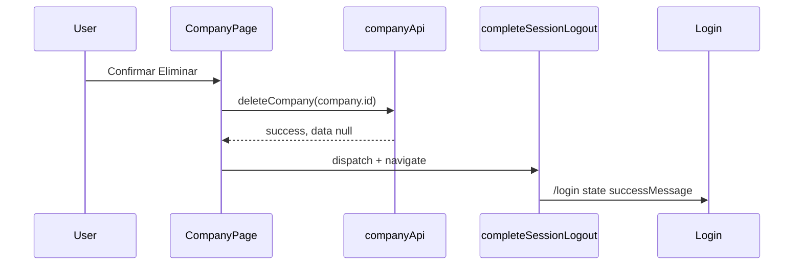

# Company Management — E2: UI de Soft Delete e fluxo pós-eliminação

**Data:** 11/11/2026  
**Branch de trabalho:** `develop` @ `8fd5f0a108515abd8a81ddcfbace18c44fd0a9d1` (sem commit)  
**Âmbito:** UI em `CompanyPage`, feedback no `LoginPage`, helper de logout partilhado, testes. Sem backend, sem alterações em `deleteCompany` (E1), sem E3.

**Pré-requisito:** [E1 — API e permissões](company-management-e1-api-permissions.md) (`deleteCompany`, `canDelete`).

---

## Estado Git

### Início (leitura)

| Item | Valor |
|------|--------|
| Branch | `develop` |
| HEAD | `8fd5f0a108515abd8a81ddcfbace18c44fd0a9d1` |
| Alterações | E1 + ficheiros untracked de auditoria/docs |

**Git write:** não executado.

### Fim (leitura)

| Ficheiro | Estado |
|----------|--------|
| `client/src/app/completeSessionLogout.ts` | novo (untracked) |
| `client/src/pages/company/CompanyPage.tsx` | modificado |
| `client/src/pages/LoginPage.tsx` | modificado |
| `client/src/components/layout/Navbar.tsx` | modificado |
| `client/src/components/company/StaffCompanySuspendedView.tsx` | modificado |
| `client/src/pages/company/CompanyPage.test.tsx` | modificado |
| `client/src/pages/LoginPage.test.tsx` | modificado |
| E1 (`company.api.ts`, `companyPermissions.ts`, testes) | modificado (mesmo working tree) |
| `docs/tasks/company-management-e2-soft-delete-ui.md` | novo |

---

## Ficheiros alterados

| Ficheiro | Alteração |
|----------|-----------|
| [`client/src/pages/company/CompanyPage.tsx`](../../client/src/pages/company/CompanyPage.tsx) | Zona perigosa, modal, `handleConfirmDelete` |
| [`client/src/pages/LoginPage.tsx`](../../client/src/pages/LoginPage.tsx) | `alert-success` via `location.state.successMessage` |
| [`client/src/app/completeSessionLogout.ts`](../../client/src/app/completeSessionLogout.ts) | Logout canónico: API fail-open, limpar Redux, `navigate /login` |
| [`client/src/components/layout/Navbar.tsx`](../../client/src/components/layout/Navbar.tsx) | Delega a `completeSessionLogout` |
| [`client/src/components/company/StaffCompanySuspendedView.tsx`](../../client/src/components/company/StaffCompanySuspendedView.tsx) | Idem |
| [`client/src/pages/company/CompanyPage.test.tsx`](../../client/src/pages/company/CompanyPage.test.tsx) | Suíte `soft delete`, `MemoryRouter`, mocks `auth`/`deleteCompany` |
| [`client/src/pages/LoginPage.test.tsx`](../../client/src/pages/LoginPage.test.tsx) | Banner de sucesso a partir de navigation state |

**Inalterado (por desenho):** `company.api.deleteCompany`, backend, vitest config.

---

## Visibilidade — Zona perigosa

Renderizada quando **`company && canDelete && company.isActive`**:

- `canDelete` → apenas **OWNER** ([`getCompanyAbilities`](../../client/src/config/companyPermissions.ts)).
- Empresa **inactiva** → sem eliminar (alinhado a `requireOperationalCompany` / 403 no `DELETE`).

`data-testid="company-danger-zone"`. Botão **Eliminar empresa** abre `DestructiveConfirmModal` (paralelo ao de desactivar).

---

## Sequência pós-confirmação



1. `await companyApi.deleteCompany(company.id)` — id do tenant carregado por `getCompany()`.
2. Se `response.success` → `completeSessionLogout(dispatch, navigate, { loginState: { successMessage } })`.
3. Em erro → modal permanece aberto, `getFriendlyErrorMessage`, **sem** logout nem redirect.

Mensagem no login: *"Empresa eliminada com sucesso. A sua sessão foi encerrada."*

---

## Decisão — feedback no login

- **Não** reutilizar `sessionExpirationMessage` no Redux (sempre `alert-danger` em `LoginPage`).
- **Sim** `navigate("/login", { replace: true, state: { successMessage } })`.
- `LoginPage` lê o state uma vez, mostra `alert-success`, limpa o history state com `navigate(pathname, { replace: true, state: {} })`.

---

## `completeSessionLogout`

Extracção do fluxo já usado no `Navbar`:

1. `dispatch(setLoading(true))`
2. `try { await authApi.logout() } catch { /* fail-open */ }`
3. `finally`: `clearCredentials`, `clearSessionExpirationMessage`, `clearCompany`, navegação para `/login` (state opcional).

---

## Testes

### `CompanyPage.test.tsx` — `describe("soft delete")`

- OWNER + activa → zona e botão visíveis.
- OWNER + inactiva → sem zona.
- ADMIN → sem zona.
- Abrir modal / cancelar → `deleteCompany` não chamado.
- Sucesso → `deleteCompany(id)`, `authApi.logout`, Redux limpo, rota `/login`.
- 403 → mensagem no modal, sessão mantida, logout não chamado.
- Loading → confirm disabled durante pedido.

`renderPage` passou a envolver `MemoryRouter` + rota `/login` stub.

### `LoginPage.test.tsx`

- Navigation state com `successMessage` → `alert-success`.

---

## Validação executada

```bash
cd client
npm test -- CompanyPage.test LoginPage.test
npm run build
```

| Comando | Resultado |
|---------|-----------|
| `npm test -- CompanyPage.test LoginPage.test` | **52 testes OK** (2 ficheiros) |
| `npm run build` | **exit 0** (`tsc -b && vite build`) |

---

## Limitações

1. Sem **restore** de empresa eliminada na UI.
2. Empresa **inactiva**: não há botão de eliminar; reactivar antes se o produto permitir noutra etapa.
3. `canDelete` é UX; enforcement no servidor (`COMPANY_DELETE`, OWNER).
4. **E3** e backend: fora de âmbito até autorização explícita.

---

## Handoff

E2 encerra a entrega de soft delete no frontend (API E1 + UI + logout + login). Próximos passos (restore, platform admin, etc.) não foram iniciados.
