# TASK 4 — Auditoria E2E e isolamento multiempresa

**Data:** 2026-11-18  
**Tipo:** read-only (produção e testes inalterados)  
**Branch de auditoria:** `audit/e2e-multi-tenant-isolation`  
**Commit analisado:** `98e4f9b80f1dc8cfd77ce3be67501fb6f012b56a` (merge PR #145 — remoção `expireOverdueScheduled`)  
**Referência Git inicial:** `develop` alinhado com `origin/develop`, working tree limpa  

**Git write pelo agente:** criação de branch de auditoria apenas; **sem** commit, push ou PR.

---

## 1. Objetivo

Avaliar, por análise estática e inventário de testes, se o SchedulerPro garante isolamento multiempresa (tenant) e se existem lacunas de cobertura E2E — no sentido de **testes que atravessam a pilha HTTP autenticada com cenários cross-tenant**. Verificar se um utilizador autenticado na empresa A consegue, directa ou indirectamente, ler ou alterar dados da empresa B.

Esta auditoria **não** assume segurança só pela presença de middlewares; documenta o fluxo completo autenticação → autorização → controller → service → repository.

---

## 2. Estado Git e commit analisado

| Campo | Valor |
| --- | --- |
| Branch inicial | `develop` |
| Tracking | `develop...origin/develop` (sincronizado) |
| HEAD analisado | `98e4f9b80f1dc8cfd77ce3be67501fb6f012b56a` |
| Branch de trabalho | `audit/e2e-multi-tenant-isolation` (mesmo HEAD) |
| Working tree (pré-auditoria) | limpa |
| Alterações desta tarefa | apenas este ficheiro (untracked até commit pelo utilizador) |

Integrações recentes relevantes: PR #144 (guard UX agendamentos vencidos), PR #145 (limpeza método legado).

---

## 3. Arquitectura multiempresa

### 3.1 Diagrama do fluxo staff

```mermaid
flowchart LR
  cookie[Cookie accessToken] --> authMW[AuthMiddleware.authenticate]
  authMW --> session[SessionService.validate]
  session --> userDB[UserRepository.findByIdForAccessControl]
  userDB --> reqUser["req.user.companyId from user document"]
  reqUser --> pwdMW[PasswordChangeMiddleware]
  pwdMW --> opCo[RequireOperationalCompany optional]
  opCo --> perm[hasPermission Permission]
  perm --> roleMW[authorize Role optional]
  roleMW --> ctrl[Controller]
  ctrl --> svc[Service with companyId arg]
  svc --> repo[Repository filters companyId]
```

### 3.2 Identificação do tenant

| Pergunta | Evidência |
| --- | --- |
| O JWT transporta `companyId`? | Sim — [`server/src/providers/security/types.ts`](../../server/src/providers/security/types.ts) L18-24 (`JwtPayload.companyId`). |
| Quem define o tenant nas rotas staff? | **`user.companyId` da base de dados**, após validar sessão — [`server/src/middlewares/auth.middleware.ts`](../../server/src/middlewares/auth.middleware.ts) L70-114. O payload JWT **não** é escrito directamente em `req.user.companyId`; o utilizador é recarregado e `companyId: user.companyId.toString()` (L110). |
| Tipo de `req.user` | [`server/src/types/express.d.ts`](../../server/src/types/express.d.ts) L20-28 — `userId`, `companyId`, `role`, `clientId?`, `sessionId`. |
| Relação utilizador ↔ empresa | Conta `User` com `companyId`; validação de empresa activa em [`assert-company-active-for-auth`](../../server/src/modules/auth/utils/assert-company-active-for-auth.ts) (chamada L104). |
| Operações em empresa inactiva | [`require-operational-company.middleware.ts`](../../server/src/middlewares/require-operational-company.middleware.ts) bloqueia mutações em tenants inactivos (onde aplicado nas rotas). |
| `companyId` no body/query staff | Controllers documentados (ex.: [`NotificationController`](../../server/src/modules/notifications/controllers/NotificationController.ts) L11-12, [`ReportController`](../../server/src/modules/reports/controllers/ReportController.ts) L10-12) — **sessão é a fonte**; listagem de agendamentos ignora `companyId` na query (teste L272-286 em [`appointment-visibility.routes.test.ts`](../../server/tests/integration/routes/appointment-visibility.routes.test.ts)). |

### 3.3 Autorização

| Camada | Ficheiro | Comportamento |
| --- | --- | --- |
| Permissões por role | [`server/src/constants/rbac.ts`](../../server/src/constants/rbac.ts) | `RolePermissions` mapeia OWNER → CLIENT. |
| Middleware permissão | [`server/src/middlewares/permission.middleware.ts`](../../server/src/middlewares/permission.middleware.ts) L37-53 | `hasPermission(permission)` consulta `RolePermissions[req.user.role]`. |
| Middleware role (whitelist) | [`server/src/middlewares/role.middleware.ts`](../../server/src/middlewares/role.middleware.ts) L29-57 | `authorize(...roles)` — **lista explícita**, sem hierarquia (código hierárquico comentado L38-47). |

### 3.4 Padrão de isolamento em serviços/repositórios

| Padrão | Exemplo |
| --- | --- |
| `companyId` obrigatório no service | [`AppointmentController`](../../server/src/modules/appointments/controllers/AppointmentController.ts) — todos os handlers usam `req.user!.companyId`. |
| Leitura por ID com tenant | `AppointmentRepository.findByIdInCompany` ([`AppointmentRepository.ts`](../../server/src/modules/appointments/repositories/AppointmentRepository.ts) ~L70); `ClientRepository` updates com `{ _id, companyId }` ([`ClientRepository.ts`](../../server/src/modules/Clients/repositories/ClientRepository.ts) ~L135). |
| FK cross-tenant na criação | `AppointmentService.requireActiveClient` — `client.companyId.toString() !== companyId` → 404 ([`AppointmentService.ts`](../../server/src/modules/appointments/services/AppointmentService.ts) L142-147). |
| Empresa só à própria entidade | `CompanyService.ensureTenant` — `id !== companyId` → erro ([`CompanyService.ts`](../../server/src/modules/companies/services/CompanyService.ts) L41-53). |
| Utilizadores | `UserService.findById` compara `user.companyId` com sessão ([`UserService.ts`](../../server/src/modules/users/services/UserService.ts) L155-161). |
| Disponibilidade | `AvailabilityService.findById` compara `item.companyId` ([`AvailabilityService.ts`](../../server/src/modules/availability/services/AvailabilityService.ts) L216-219). |

### 3.5 Operações “globais”

| Operação | Protecção |
| --- | --- |
| `CompanyRepository.findAllActiveNotDeleted` | Usado pelo scheduler de expiração ([`CompanyRepository.ts`](../../server/src/modules/companies/repositories/CompanyRepository.ts) L75-79) — **não** exposto via HTTP staff; processo interno. |
| `GET /api/companies` | `CompanyService.findAll(companyId)` filtra `_id: companyId` ([`CompanyRepository.findAll`](../../server/src/modules/companies/repositories/CompanyRepository.ts) L59-65) — lista **uma** empresa do tenant, não todas do sistema. |
| Rotas públicas | `companyId` na **URL** (`/public/companies/:companyId/...`) — tenant explícito no canal público; elegibilidade validada em `PublicBookingService` / testes de integração. |

### 3.6 Recursos sem `companyId` directo na rota

Agendamentos referenciam `clientId`, `serviceId`, `employeeId` — validação de pertença ao tenant na criação/actualização via services (ver secção 5 — Appointments).

---

## 4. Inventário de módulos auditados

**Total: 10 áreas** (9 obrigatórias + uploads).

| # | Módulo | Rotas / entrada | Controller → Service |
| --- | --- | --- | --- |
| 1 | Appointments (staff) | [`AppointmentRoutes.ts`](../../server/src/modules/appointments/routes/AppointmentRoutes.ts) | `AppointmentController` → `AppointmentService` |
| 2 | Appointments (público) | [`PublicAppointmentRoutes.ts`](../../server/src/modules/appointments/routes/PublicAppointmentRoutes.ts) | Token público / rate limit |
| 3 | Clients | [`ClientRoutes.ts`](../../server/src/modules/Clients/routes/ClientRoutes.ts) | `ClientController` → `ClientService` |
| 4 | Users | [`UserRoutes.ts`](../../server/src/modules/users/routes/UserRoutes.ts) | `UserController` → `UserService` |
| 5 | Companies | [`CompanyRoutes.ts`](../../server/src/modules/companies/routes/CompanyRoutes.ts) | `CompanyController` → `CompanyService` |
| 6 | Services | [`ServiceRoutes.ts`](../../server/src/modules/services/routes/ServiceRoutes.ts) | `ServiceController` → `ServiceService` |
| 7 | Availability + excepções | [`AvailabilityRoutes.ts`](../../server/src/modules/availability/routes/AvailabilityRoutes.ts), [`AvailabilityExceptionRoutes.ts`](../../server/src/modules/availability/routes/AvailabilityExceptionRoutes.ts) | `AvailabilityService`, `AvailabilityExceptionService` |
| 8 | Dashboard | [`DashboardRoutes.ts`](../../server/src/modules/dashboard/routes/DashboardRoutes.ts) | `DashboardController` → `DashboardService` |
| 9 | Reports | [`ReportRoutes.ts`](../../server/src/modules/reports/routes/ReportRoutes.ts) | `ReportController` → `ReportService` |
| 10 | Notifications | [`NotificationRoutes.ts`](../../server/src/modules/notifications/routes/NotificationRoutes.ts) | `NotificationController` → `NotificationService` |
| 11 | Uploads (logo / fotos) | Rotas em Company, Client, User | Tenant via `companyId` da sessão + `ensureTenant` / `findClientForPhoto` |
| 12 | Public booking + invites | [`PublicBookingRoutes.ts`](../../server/src/modules/public-booking/routes/PublicBookingRoutes.ts), [`PublicClientInviteRoutes.ts`](../../server/src/modules/client-invites/routes/PublicClientInviteRoutes.ts) | Sem cookie staff; `companyId` na rota pública |

---

## 5. Auditoria de isolamento por módulo

Legenda isolamento: **M** = middleware (auth+permission), **S** = service, **R** = repository/query.

| Módulo | List | Get by ID | Create | Update | Delete | Operações especiais | Camadas | Testes cross-tenant |
| --- | --- | --- | --- | --- | --- | --- | --- | --- |
| **Appointments** | `findByCompanyId` + read scope O6 | `findByIdInCompany` | FK validadas no service | `updateInCompany` / escopo O7 | soft delete in company | confirm/complete; `/mine` CLIENT | M+S+R | **Forte:** [`availability-appointment.routes.test.ts`](../../server/tests/integration/availability-appointment.routes.test.ts) L232-249; visibility/write-scope com `companyB`; Mongo `cancel-overdue-scheduled` L262+ |
| **Clients** | `findByCompanyId` | `findById(id, companyId)` repo | sem `companyId` no DTO staff | update com companyId | soft delete | `/me` CLIENT; invite OWNER/ADMIN | M+S+R | Unit: sync/photo; integração invite; **sem** HTTP GET/PATCH id cross-tenant dedicado |
| **Users** | `findByCompanyId` | comparação companyId no service | `create` força companyId sessão | idem | idem | activate/deactivate; foto | M+S+R | Integração `create-user` só validação — **sem** cenário empresa B |
| **Companies** | `findAll(companyId)` 1 doc | `ensureTenant` | N/A (registo auth) | `ensureTenant` | `ensureTenant` | activate/deactivate/logo | M+S | **Unit:** [`CompanyService.isolation.test.ts`](../../server/tests/unit/companies/CompanyService.isolation.test.ts) |
| **Services** | by company | service layer + repo | companyId sessão | idem | idem | categorias no mesmo módulo | M+S+R | Indirectamente via appointments integration |
| **Availability** | by company | compara companyId no item | `validateEmployee` | idem | idem | slots builder | M+S+R | **HTTP:** L174-179, 169-171 outra empresa |
| **Availability exceptions** | — | — | — | — | — | — | M+S+R | [`availability-exception.routes.test.ts`](../../server/tests/integration/availability-exception.routes.test.ts) |
| **Dashboard** | summary scoped | N/A | N/A | N/A | N/A | KPIs + upcoming | M+S+R | [`dashboard.routes.test.ts`](../../server/tests/integration/routes/dashboard.routes.test.ts) — **single-tenant** mocks |
| **Reports** | relatórios scoped | N/A | N/A | N/A | N/A | export limitado | M+S+R | [`report.routes.test.ts`](../../server/tests/integration/routes/report.routes.test.ts) — RBAC, não cross-tenant |
| **Notifications** | `findByUser(companyId, userId)` | mark read triplo filtro | N/A | N/A | N/A | unread count | M+S+R | [`notification.routes.test.ts`](../../server/tests/integration/routes/notification.routes.test.ts) — sem empresa B |
| **Uploads** | — | — | — | foto | remove foto | Cloudinary | M+S | Unit photo routes + `CompanyService.logo` cross-tenant unit |
| **Public booking** | catálogo por URL companyId | disponibilidade pública | POST appointment | token manage | — | rate limits | Validators whitelist | [`public-booking.routes.test.ts`](../../server/tests/integration/public-booking.routes.test.ts), unit eligibility |

### 5.1 Appointments — detalhe

- Staff: `companyId` **nunca** aceite do cliente na criação staff (atribuído no controller).
- Escopo O6/O7: EMPLOYEE restrito a `employeeId === userId`; query `companyId`/`employeeId` maliciosos ignorados ([`appointment-visibility.routes.test.ts`](../../server/tests/integration/routes/appointment-visibility.routes.test.ts) L260-286).
- Internamente `AppointmentService` usa `findById` global em alguns ramos pós-transacção; rotas staff entram por `findByIdInCompany` / `loadAppointmentForStaffWrite` — **risco cross-tenant via HTTP não identificado** na auditoria estática, mas caminho interno merece revisão em hardening (P3).

### 5.2 Companies

- `GET /:id` usa `ensureTenant` — utilizador não lê outra empresa pelo path.
- `COMPANY_DELETE` só OWNER ([`rbac.ts`](../../server/src/constants/rbac.ts) L25-26); ADMIN não apaga empresa.

### 5.3 Public surface

- Validators rejeitam `companyId` injectado no body em fluxos públicos ([`create-public-appointment.validator.ts`](../../server/src/modules/appointments/validators/create-public-appointment.validator.ts), [`public-availability.validator.ts`](../../server/src/modules/public-booking/validators/public-availability.validator.ts) L39+).

---

## 6. Auditoria RBAC

### 6.1 Matriz resumida (backend efectivo)

| Role | Staff CRUD típico | Notas |
| --- | --- | --- |
| **OWNER** | Todas as permissões em `rbac.ts` | Único com `USER_DELETE`, `CLIENT_DELETE`, `COMPANY_DELETE` |
| **ADMIN** | Sem delete user/company/client; com update company | |
| **MANAGER** | Sem USER_CREATE; sem SERVICE_CREATE; AVAILABILITY_READ+UPDATE apenas | Sem convite cliente (rota `authorize(OWNER,ADMIN)` — [`ClientRoutes.ts`](../../server/src/modules/Clients/routes/ClientRoutes.ts) L96-103) |
| **EMPLOYEE** | READ clients/services/appointments/availability; UPDATE appointment | O6 restringe leitura/escrita a próprios agendamentos |
| **CLIENT** | `APPOINTMENT_READ` + rotas `authorize(CLIENT)` (`/mine`, `/clients/me`) | `clientId` obrigatório no auth ([`auth.middleware.ts`](../../server/src/middlewares/auth.middleware.ts) L96-100) |

### 6.2 Middleware vs service

| Tema | Observação |
| --- | --- |
| Permissão na rota | `hasPermission` antes do controller — negação 403 sem atingir service. |
| Escopo fino (O6/O7) | **Service** (`resolveAppointmentReadScope`, write guards) — além do RBAC. |
| Convite cliente | **Rota** mais restrita que `CLIENT_UPDATE` (MANAGER não convida) — intencional. |

### 6.3 Consistência frontend

- [`client/src/config/clientPermissions.ts`](../../client/src/config/clientPermissions.ts) L11-16 documenta `canInvite` só OWNER/ADMIN — **alinhado** com backend.
- [`companyPermissions.ts`](../../client/src/config/companyPermissions.ts) — MANAGER/EMPLOYEE/CLIENT sem gestão de empresa (testes em `companyPermissions.test.ts`).
- Frontend **não substitui** controlos server-side; discrepâncias são UX (ocultar acções), não barreira de segurança.

### 6.4 MANAGER / EMPLOYEE (ponto de revisão histórico)

- Cobertura de escopo de agendamentos: testes dedicados [`appointment-read-scope.test.ts`](../../server/tests/unit/appointments/appointment-read-scope.test.ts), [`appointment-write-scope.routes.test.ts`](../../server/tests/integration/routes/appointment-write-scope.routes.test.ts), [`appointment-write-scope-mongo.test.ts`](../../server/tests/integration/appointments/appointment-write-scope-mongo.test.ts).
- Lacuna: poucos testes HTTP de **Clients/Users/Services** por role MANAGER vs EMPLOYEE fora de appointments.

---

## 7. Inventário de testes existentes

### 7.1 Classificação (backend)

| Tipo | Critério | Quantidade |
| --- | --- | --- |
| **Ficheiros de teste (total)** | `server/tests/**/*.test.ts` | **102** |
| **Unitários** | `server/tests/unit/**` | **80** |
| **Integração HTTP** | `server/tests/integration/**` (sem contar subpastas duplicadas) | **22** ficheiros |
| **Integração MongoDB** | `*.mongo.test.ts` | **3** (`cancel-overdue-scheduled`, `find-all-no-expiration`, `appointment-expiration-full-cycle`) |
| **E2E browser** | Playwright/Cypress em `package.json` | **0** (server e client) |

### 7.2 Frameworks e configuração

- **Vitest** + **Supertest** — [`server/package.json`](../../server/package.json) scripts `test` / `vitest run`.
- Integração típica: mock parcial de `auth.middleware` com `authUser.value` ou stub de sessão; repositórios mockados ou Mongo memory.
- **Client:** centenas de testes Vitest/RTL (~273 ficheiros `*.test.*`); **sem** pasta e2e; testes de permissão em `client/src/config/*.test.ts`.

### 7.3 Autenticação nos testes

| Padrão | Onde |
| --- | --- |
| Mock `authenticate` injecta `req.user` | Maioria dos `server/tests/integration/routes/*.test.ts` |
| `stubSessionUser(Role, userId)` | [`appointment-visibility.routes.test.ts`](../../server/tests/integration/routes/appointment-visibility.routes.test.ts) |
| Seed `tenantA` / `tenantB` | Mongo tests `cancel-overdue-scheduled.mongo.test.ts`, `appointment-booking-concurrency.test.ts` |

### 7.4 Cobertura explícita de isolamento multiempresa

**Ficheiros com asserções cross-tenant / “outra empresa” (amostra — 29 ficheiros no grep):**

- Integração HTTP **forte:** `availability-appointment.routes.test.ts`, `appointment-visibility.routes.test.ts`, `appointment-write-scope.routes.test.ts`, `public-booking.routes.test.ts`, `public-appointment.routes.test.ts`, `availability-exception.routes.test.ts`, `client-invite.routes.test.ts`.
- Mongo **multi-tenant:** `cancel-overdue-scheduled.mongo.test.ts` (empresa A não altera B).
- Unit **isolamento:** `CompanyService.isolation.test.ts`, múltiplos `AppointmentService.*`, `AvailabilityService.test.ts`, `ClientService.*`, `public-catalog-filters.test.ts`.

**Lacuna estrutural:** não existe suite nomeada “multi-tenant” nem testes HTTP com **duas sessões JWT reais** alternadas; a maior parte usa um único `authUser` e mocks de repo com `companyB` em documentos.

### 7.5 E2E “completo”?

Os testes de integração HTTP **exercitam** `app` Express e middlewares, mas com repositórios frequentemente mockados — são **contrato HTTP + encadeamento middleware**, não E2E com Mongo + JWT + mail + browser. **Não** se classificam como E2E completos ao nível produto.

**Nenhum teste da suite completa foi executado nesta auditoria** (conforme brief — inventário estático).

---

## 8. Matriz de cenários de segurança

| Cenário | Esperado | Protecção (camada) | Teste existente | Cobertura | Classificação |
| --- | --- | --- | --- | --- | --- |
| Empresa A lista agendamentos | Permitido | `findByCompanyId(companyId sessão)` | vários integration | Suficiente p/ staff list | OK |
| Empresa A consulta agendamento da B | Bloqueado (404) | `findByIdInCompany` | `availability-appointment` L243-249 | Suficiente HTTP | OK |
| Empresa A altera agendamento da B | Bloqueado | S+`updateInCompany` | idem L243-249 | Suficiente HTTP | OK |
| Empresa A elimina recurso da B | Bloqueado | S+R | idem delete | Suficiente HTTP | OK |
| EMPLOYEE acede agendamento de outro EMPLOYEE | Conforme O6 (403/404) | S read/write scope | visibility + write-scope routes/mongo | Suficiente | OK |
| CLIENT acede admin | Bloqueado 403 | M `hasPermission` | vários `aplica autorização real por role` | Parcial por módulo | Lacuna nalguns módulos |
| Payload com `companyId` | Ignorado / rejeitado | C+S; validators públicos | visibility L272-286; public validators | Parcial | OK staff list |
| ID na URL de outro tenant | 404 | S+R | appointments, availability integration | **Forte** appointments/availability | Lacuna clients/users HTTP |
| Token empresa A em empresa B | N/A — token amarrado a user.companyId BD | auth reload | Não testado troca token | Ausente | Lacuna teste (não vulnerabilidade por si) |
| FK client/service employee outra empresa | 404 create/update | `requireActiveClient` etc. | appointment integration L232-241 | Suficiente | OK |
| Query `?companyId=B` na listagem | Ignorado | Controller usa sessão | visibility L272-286 | Suficiente | OK |
| Dashboard dados empresa B | Não expostos | `DashboardController` L30 | dashboard routes — só A | **Ausente** cross-tenant | Lacuna |
| Notificação de outro user | 404 | `markAsRead(id, companyId, userId)` | notificações — sem caso B | Lacuna | OK desenho |
| Public booking URL companyId | Só dados desse tenant | Public services | public-booking tests | Parcial | OK desenho |

---

## 9. Lacunas de cobertura

1. **HTTP cross-tenant** para Clients, Users, Services, Dashboard, Reports, Notifications — lógica de isolamento presente no código, **poucos ou nenhuns** testes Supertest com documento `companyB`.
2. **E2E browser / dois tenants reais** — inexistente.
3. **JWT staleness** — se `companyId` no JWT divergisse do documento User, sessão ainda revalida user na BD (comportamento seguro); **sem teste de regressão** explícito.
4. **Frontend** — testes de permissão unitários; sem simulação multi-sessão.
5. **Agendamentos** — melhor cobertura relativa; referência para replicar padrão noutros módulos.

---

## 10. Vulnerabilidades confirmadas ou suspeitas

### 10.1 Vulnerabilidades confirmadas

**Nenhuma** vulnerabilidade de isolamento cross-tenant **confirmada** nesta auditoria estática ao HEAD `98e4f9b`.

Evidência: padrão consistente `req.user.companyId` → service → queries com `companyId`; rotas staff não consomem `companyId` do body; FK validadas em appointments e availability; companies com `ensureTenant`.

### 10.2 Suspeitas (exigem teste dinâmico ou revisão focada — não elevadas a P0)

| ID | Descrição | Motivo “suspeita” | Próximo passo sugerido |
| --- | --- | --- | --- |
| S1 | Ramo interno `AppointmentRepository.findById` sem company em métodos internos | Uso pós-escrita/transacção | Confirmar que não há rota HTTP directa |
| S2 | Cobertura HTTP fina em Dashboard/Report | Repositório mockado só com tenant A | Teste integration com duas empresas + Mongo |
| S3 | Superfície pública `/:companyId` | Modelo intencional | Manter testes de eligibility; fuzz companyId |

---

## 11. Classificação de riscos P0–P3

| ID | Item | Nível | Tipo |
| --- | --- | --- | --- |
| — | Cross-tenant read/write confirmado | — | Não aplicável |
| G1 | Ausência testes HTTP cross-tenant em Clients/Users/Services/Dashboard/Reports/Notifications | **P2** | Lacuna cobertura |
| G2 | Sem E2E browser multi-tenant | **P3** | Melhoria qualidade |
| G3 | Testes majoritariamente mocks — confiança limitada em regressão de query Mongo | **P2** | Lacuna |
| G4 | Ramo `findById` global em AppointmentService (interno) | **P3** | Hardening / revisão |
| G5 | MANAGER/EMPLOYEE fora do domínio appointments — poucos testes integração | **P2** | Lacuna RBAC |
| FE1 | Permissões FE documentadas e testadas unitariamente | **P3** | OK com backend como autoridade |

**P0:** nenhum item atribuído.  
**P1:** nenhum item atribuído (sem exploração demonstrada).

---

## 12. Recomendações para fase de implementação (fora desta auditoria)

1. **Pacote de testes de regressão multi-tenant HTTP** (template: `availability-appointment.routes.test.ts`): para cada módulo CRUD, cenário “recurso pertence a `companyB`, sessão `companyA`” → 404/403.
2. **Suite Mongo integration mínima** para Clients e Users com `seedTenant('a'|'b')` (reutilizar padrão de `cancel-overdue-scheduled.mongo.test.ts`).
3. **Teste de sessão** opcional: utilizador com JWT antigo após mudança de `companyId` na BD (se aplicável ao modelo de negócio).
4. **E2E produto** (Playwright): login empresa A vs B, tentativa de deep-link ID do outro tenant — **P3 roadmap**.
5. **Não alterar** regras RBAC sem auditoria de produto; priorizar cobertura antes de refactors.

---

## 13. Ficheiros potencialmente afectados (futura implementação)

| Ficheiro | Motivo |
| --- | --- |
| `server/tests/integration/**` | Novos ficheiros `*.routes.cross-tenant.test.ts` |
| `server/tests/integration/clients/clients-isolation.routes.test.ts` (novo) | Paridade appointments |
| `server/tests/integration/users/users-isolation.routes.test.ts` (novo) | CRUD users |
| `server/tests/integration/routes/dashboard.routes.test.ts` | Assert `companyId` sessão nos mocks |
| `server/src/modules/appointments/services/AppointmentService.ts` | Opcional hardening `findById` interno |
| `client/` | Apenas se testes E2E forem introduzidos |

**Produção:** nenhum ficheiro precisa de alteração urgente com base nesta auditoria (0 P0/P1 confirmados).

---

## 14. Limitações da auditoria

- **Estática:** sem executar suite, sem fuzzing, sem pentest.
- **Mocks:** integração HTTP frequentemente não executa queries Mongo reais.
- **Sem browser E2E:** fluxos Redux/cookies/UI não auditados em runtime.
- **Documentação histórica** em `docs/audits/` pode referir HEADs antigos; código referenciado é o de `98e4f9b`.
- **Não** se investigaram dependências de terceiros além do uso habitual (JWT, mongoose).
- Classificação **não** declara vulnerabilidade só por ausência de teste.

---

## 15. Conclusão técnica

O SchedulerPro implementa **isolamento multiempresa coerente** no desenho actual: tenant derivado do utilizador na base de dados após autenticação, propagação obrigatória de `companyId` nos controllers staff, e validação em services/repositories (com padrão exemplar em **Appointments** e **Availability**).

A **principal fragilidade identificada não é uma falha confirmada de isolamento**, mas a **assimetria de cobertura de testes**: cenários cross-tenant HTTP estão concentrados em agendamentos/disponibilidade e alguns fluxos públicos, enquanto Clients, Users, Dashboard, Reports e Notifications dependem sobretudo de garantias de código e testes unitários.

**Recomendação:** aprovar esta auditoria e abrir uma **fase de implementação focada em testes de regressão multi-tenant (P2)**, sem alteração de regras de negócio até existir matriz verde nos módulos em falta. **Não iniciar alterações de produção** com base apenas em lacunas de teste.

---

## Validação Git (pós-auditoria)

| Item | Resultado |
| --- | --- |
| Produção alterada | **Não** |
| Testes alterados | **Não** |
| Ficheiro criado | `docs/tasks/e2e-multi-tenant-isolation-audit.md` |
| Commit / push | **Não** |