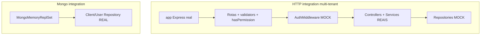

# Task 4 — Revisão técnica dos testes Multi-Tenant

**Data:** 2026-11-18  
**Tipo:** auditoria read-only (sem alterações a testes ou produção)  
**Branch revista:** `test/multi-tenant-isolation-coverage`  
**Commit base:** `98e4f9b80f1dc8cfd77ce3be67501fb6f012b56a`  
**Implementação ref.:** [`e2e-multi-tenant-isolation-implementation.md`](./e2e-multi-tenant-isolation-implementation.md)  
**Auditoria ref.:** [`e2e-multi-tenant-isolation-audit.md`](./e2e-multi-tenant-isolation-audit.md)  

**Git write desta revisão:** apenas este ficheiro; sem commit/push/PR.

---

## 1. Estado inicial do Git

| Item | Valor |
|------|--------|
| Branch actual | `test/multi-tenant-isolation-coverage` |
| HEAD | `98e4f9b80f1dc8cfd77ce3be67501fb6f012b56a` |
| Tracking | (inalterado face à implementação; sem fetch/pull nesta revisão) |
| `git diff` (produção) | **vazio** — 0 ficheiros em `server/src/` modificados |
| `git diff --check` | exit **0** (sem diffs staged em produção) |

### Ficheiros untracked (lista completa)

| Caminho | Natureza |
|---------|----------|
| `server/tests/integration/helpers/tenant-ids.ts` | helper |
| `server/tests/integration/helpers/tenant-ids.cjs` | helper |
| `server/tests/integration/routes/multi-tenant-clients.routes.test.ts` | teste HTTP |
| `server/tests/integration/routes/multi-tenant-users.routes.test.ts` | teste HTTP |
| `server/tests/integration/routes/multi-tenant-services.routes.test.ts` | teste HTTP |
| `server/tests/integration/routes/multi-tenant-dashboard-reports.routes.test.ts` | teste HTTP |
| `server/tests/integration/routes/multi-tenant-notifications.routes.test.ts` | teste HTTP |
| `server/tests/integration/routes/multi-tenant-dual-session.routes.test.ts` | teste HTTP |
| `server/tests/integration/routes/multi-tenant-rbac-staff.routes.test.ts` | teste HTTP |
| `server/tests/integration/clients/client-tenant-isolation.mongo.test.ts` | teste Mongo |
| `server/tests/integration/users/user-tenant-isolation.mongo.test.ts` | teste Mongo |
| `docs/tasks/e2e-multi-tenant-isolation-audit.md` | doc (auditoria prévia) |
| `docs/tasks/e2e-multi-tenant-isolation-implementation.md` | doc (implementação) |
| `docs/tasks/e2e-multi-tenant-isolation-review.md` | doc (este relatório) |

**Confirmação:** nenhuma alteração ao código de produção.

---

## 2. Lista dos ficheiros analisados (11)

| # | Ficheiro | Linhas |
|---|----------|--------|
| 1 | `server/tests/integration/helpers/tenant-ids.ts` | 25 |
| 2 | `server/tests/integration/helpers/tenant-ids.cjs` | 13 |
| 3 | `multi-tenant-clients.routes.test.ts` | 213 |
| 4 | `multi-tenant-users.routes.test.ts` | 141 |
| 5 | `multi-tenant-services.routes.test.ts` | 144 |
| 6 | `multi-tenant-dashboard-reports.routes.test.ts` | 161 |
| 7 | `multi-tenant-notifications.routes.test.ts` | 149 |
| 8 | `multi-tenant-dual-session.routes.test.ts` | 159 |
| 9 | `multi-tenant-rbac-staff.routes.test.ts` | 206 |
| 10 | `client-tenant-isolation.mongo.test.ts` | 129 |
| 11 | `user-tenant-isolation.mongo.test.ts` | 126 |

**Conteúdo integral:** disponível nos caminhos acima no working tree (branch `test/multi-tenant-isolation-coverage`). Na entrega em chat, o conteúdo completo foi apresentado por partes; os helpers estão também reproduzidos na secção 14 (Apêndice).

---

## 3. Análise técnica — Bloco A (HTTP)

### Arquitectura comum dos 7 ficheiros HTTP

| # | Pergunta (brief §5) | Resposta |
|---|---------------------|----------|
| 1 | Rotas Express reais? | **Sim** — `import app from "../../../src/app"`; rotas registadas em `app`. |
| 2 | Controllers e services reais? | **Sim** — apenas repositórios substituídos por `vi.mock`. |
| 3 | Repositórios mockados? | **Sim** — cada ficheiro mocka o(s) `*Repository` do módulo. |
| 4 | Auth mockado? | **Sim** — `vi.mock(".../auth.middleware")` define `req.user = authUser.value`. |
| 5 | Autorização / validação reais? | **Parcial** — `hasPermission`, validators e `RequireOperationalCompany` (onde a rota os inclui) são **reais**; auth não. |
| 6 | Comportamento vs chamadas mock? | **Misto** — asserta `response.status` **e** frequentemente `toHaveBeenCalledWith(companyId da sessão)`; isolamento cross-tenant depende da **implementação do mock** (ex.: `findByIdAndCompany` retorna `null` para `clientB` + `companyA`). |
| 7 | `companyId` da sessão? | **Sim** nos controllers (via `req.user` injectado); testes com `companyId` no body/query verificam que não altera o tenant. |
| 8 | IDs de outra empresa rejeitados? | **Sim**, com contratos: Clients **404**; Users/Services **403** (alinhado a produção). |
| 9 | Estado final / sem alteração indevida? | **Parcial** — com repo mock, “não alterou B” = `update`/`softDelete` não chamados ou retorno `null`; não há Mongo. |
| 10 | Contratos HTTP correctos? | **Sim** — users/services 403 confirmados contra `UserService`/`ServiceService`; clients 404 via repo scoped. |

### Por módulo

| Módulo | Testes | Cross-tenant | Notas |
|--------|--------|--------------|-------|
| Clients | 6 | GET/PATCH/DELETE 404; create ignora body `companyId` | DELETE: `softDelete` **not** chamado (bloqueio antes do delete — coerente se `findByIdAndCompany` falha primeiro) |
| Users | 4 | GET/PUT/DELETE 403 | Não testa `companyId` na query |
| Services | 4 | GET/PATCH/DELETE 403 | — |
| Dashboard | 1 | query `companyId` ignorada | Sobrepõe [`dashboard.routes.test.ts`](../../server/tests/integration/routes/dashboard.routes.test.ts) L121-135 (**P3** redundância) |
| Reports | 2 | query ignorada; EMPLOYEE 403 | Endpoint `/api/reports/overview` (contrato correcto) |
| Notifications | 3 | sessão B + mark read 404 | Sobrepõe parcialmente teste existente “usa sempre empresa da sessão” |

### Lacunas Bloco A

- Sem HTTP + Mongo real (só mocks).
- Companies sem novo ficheiro (já existe `CompanyService.isolation.test.ts`).
- Client DELETE não asserta chamada a `softDelete` com `companyB` — apenas `not.toHaveBeenCalled` (aceitável se 404 é por `findByIdAndCompany`).

### Falsos positivos potenciais

| ID | Descrição | Classificação |
|----|-----------|---------------|
| FP-A1 | Cross-tenant garantido pelo mock, não pelo repositório real | **P2** — conhecido, mitigado por Bloco B em Clients |
| FP-A2 | `portalEmpty` em `multi-tenant-clients.routes.test.ts` L79 não usado | **P3** — lint/maintainability |

---

## 4. Análise técnica — Bloco B (Mongo)

| # | Critério | Evidência |
|---|----------|-----------|
| 1 | `mongodb-memory-server` | Sim — `MongoMemoryReplSet.create` em ambos os ficheiros |
| 2 | Repositories reais | `ClientRepository` / `UserRepository` importados de `src` |
| 3 | Empresas A e B persistidas | `Company.create` + seeds em `beforeEach` |
| 4 | Ops contra Mongo real | `findByCompanyId`, `findByIdAndCompany`, `update`, `softDelete` |
| 5 | Estado final verificado | Re-leitura após update/delete negativo |
| 6 | Limpeza | `beforeEach`: `Client.deleteMany` / `User.deleteMany` + `Company.deleteMany` |
| 7 | Sem DB dev/prod | Memória local ou `GW3_TEST_MONGO_URI` opcional |
| 8 | Isolamento demonstrado | **Forte** em Clients; Users parcial (ver softDelete) |

### `UserRepository.softDelete(id)` — análise de risco

**Implementação** ([`UserRepository.ts`](../../server/src/modules/users/repositories/UserRepository.ts) L78-82):

```typescript
public async softDelete(id: string): Promise<void> {
  await User.findOneAndUpdate({ _id: id, deletedAt: null }, {
    deletedAt: new Date(),
  });
}
```

| Aspecto | Evidência |
|---------|-----------|
| Quem invoca (HTTP) | [`UserController.delete`](../../server/src/modules/users/controllers/UserController.ts) → [`UserService.delete`](../../server/src/modules/users/services/UserService.ts) L175-186 |
| Validação tenant | L180-184: `user.companyId.toString() !== companyId` → **403** antes de `softDelete` |
| Outros callers | `grep` — principalmente `UserService.delete` |
| Teste Mongo | 3.º `it` chama `softDelete` **directamente** — **documenta gap do repo**, não falha de produto HTTP |
| Risco cross-tenant via API | **Mitigado** no service |
| Risco se novo caller bypass service | **P3** — defesa em profundidade incompleta no repo |

**Classificação:** **P3** (hardening futuro opcional: `softDelete(id, companyId)`); **não P0/P1**.

---

## 5. Análise técnica — Bloco C

### 5.1 Sessões A/B (`multi-tenant-dual-session.routes.test.ts`)

| Pergunta | Resposta |
|----------|----------|
| Como são criadas “sessões”? | Alteração de `authUser.value` entre requests — **não há cookie/JWT** |
| JWT real? | **Não** |
| Auth middleware executado? | Stub que copia `authUser` para `req.user` |
| Assinatura / validade token? | **Não** |
| Contaminação entre pedidos | Não testada entre workers; só sequência no mesmo ficheiro |
| O que comprova | Controller usa `companyId` da sessão; mocks de cliente por tenant |
| O que **não** comprova | Segurança de token, sessão server-side, ou parallel Vitest workers |

**Não classificar como teste JWT E2E.**

### 5.2 JWT `companyId` desatualizado

**Ficheiro:** [`auth.middleware.test.ts`](../../server/tests/unit/middlewares/auth.middleware.test.ts)

**Cenário integral relevante (L43-51):**

- Token mock: `companyId: "forged-company"`, `userId: "u1"`.
- BD mock: `companyId: "db-company"`, `role: "MANAGER"`.
- Assert: `req.user.companyId === "db-company"`.

**Validação:** regressão do **middleware** com JwtProvider mockado — **suficiente** para a política “BD prevalece”; **não** substitui HTTP integration.

### 5.3 RBAC staff (`multi-tenant-rbac-staff.routes.test.ts`)

| Caso | Role | Esperado | Verifica |
|------|------|----------|----------|
| POST `/api/clients` | MANAGER | 201 | `clientRepository.create` chamado |
| POST `/api/users` | MANAGER | 403 | `create` not called |
| POST `/api/services` | MANAGER | 403 | `create` not called |
| POST `/api/clients` | EMPLOYEE | 403 | `create` not called |
| GET `/api/clients` | EMPLOYEE | 200 | `findByCompanyId(companyA)` |
| POST `/api/users` role inválido | OWNER | 400 | validator |

**Middleware:** `hasPermission` real (não mockado). **Auth:** mockado.

**Cobertura:** adequada para smoke RBAC non-appointments; não cobre MANAGER em reports/dashboard nem invites.

---

## 6. Distinção testes reais vs mocks



---

## 7. Falha intermitente — 1.ª suite completa (investigação)

### Fontes disponíveis

| Fonte | Disponível? |
|-------|-------------|
| Log ficheiro persistido no repo | **Não** |
| Relatório implementação §10 | Sim — 1 falha / 110 pass, depois 1446/1446 |
| Transcript sessão implementação | Parcial |

### Evidência indirecta (implementação)

- **1.ª** `npm run test` (suite completa): **1 failed**, **110 passed** (111 ficheiros).
- **2.ª** corrida: **1446/1446**.
- Trecho de erro referido na conversação de implementação: falha em `beforeEach` envolvendo `Appointment.deleteMany` — **sugere** conflito entre ficheiros `*.mongo.test.ts` que partilham `mongoose.connect` global quando Vitest executa ficheiros em paralelo, **não necessariamente** os novos ficheiros `user-tenant-isolation` / `client-tenant-isolation`.
- Execução **isolada** dos 9 ficheiros novos: **35/35** (revisão 2026-11-18).
- Execução isolada dos 2 Mongo: **7/7**.

### Causa provável

| Hipótese | Probabilidade |
|----------|----------------|
| Concorrência / estado `mongoose` partilhado entre suites Mongo | **Alta** |
| Timeout intermitente memory server | Média |
| Regressão nos novos testes | **Baixa** (isolados passam) |

### Reprodução na revisão

**Não** foi executada nova suite completa nesta revisão (evitar mascarar falha histórica; custo ~5 min). **Declaração explícita:** a falha original **não** foi replicada com log completo arquivado — apenas metadados da sessão de implementação.

---

## 8. Validação dos 35 testes

### Comando (implementação + revisão)

```bash
cd server && npm run test -- tests/integration/routes/multi-tenant- \
  tests/integration/clients/client-tenant-isolation.mongo.test.ts \
  tests/integration/users/user-tenant-isolation.mongo.test.ts
```

**Seleção:** glob `multi-tenant-` apanha **7** ficheiros em `routes/`; +2 mongo = **9 ficheiros**. Helpers **não** são testes (sem `describe`).

### Resultados por ficheiro (revisão 2026-11-18)

| Ficheiro | Testes pass |
|----------|-------------|
| `multi-tenant-clients.routes.test.ts` | 6 |
| `multi-tenant-users.routes.test.ts` | 4 |
| `multi-tenant-services.routes.test.ts` | 4 |
| `multi-tenant-dashboard-reports.routes.test.ts` | 3 |
| `multi-tenant-notifications.routes.test.ts` | 3 |
| `multi-tenant-dual-session.routes.test.ts` | 2 |
| `multi-tenant-rbac-staff.routes.test.ts` | 6 |
| `client-tenant-isolation.mongo.test.ts` | 4 |
| `user-tenant-isolation.mongo.test.ts` | 3 |
| **Total** | **35** |

**Bundle:** 9 passed, 35/35.

---

## 9. Problemas encontrados (tabela consolidada)

| ID | Ficheiro / área | Evidência | Impacto | P | Recomendação |
|----|-----------------|-----------|---------|---|--------------|
| R1 | HTTP Bloco A | Repos mockados | Cobertura não prova queries Mongo nas rotas | P2 | Manter Bloco B; futuro HTTP+Mongo opcional |
| R2 | `dual-session` | Auth mock | Não valida JWT/sessão real | P2 | Documentar; não rotular “E2E JWT” |
| R3 | `tenant-ids.ts` + `.cjs` | Duplicação IDs | Drift se um ficheiro actualizar só um twin | P3 | Script test ou único `.cjs` + re-export |
| R4 | `UserRepository.softDelete` | Sem `companyId` no filtro | Bypass service teórico | P3 | Opcional hardening repo |
| R5 | Suite completa 1.ª corrida | 1 falha não arquivada | CI flake potencial com mais mongo tests | P2 | Serializar mongo suites ou `isolate` Vitest |
| R6 | Clients test L79 | `portalEmpty` unused | Manutenção | P3 | Remover em PR testes |
| R7 | Dashboard multi-tenant | 1 teste | Redundante com dashboard.routes | P3 | Aceitar ou consolidar |

**Vulnerabilidade de isolamento confirmada:** **nenhuma** nesta revisão.

---

## 10. Falsos positivos e lacunas

| Tipo | Descrição |
|------|-----------|
| Falso positivo parcial | Aprovar isolamento só com mocks HTTP sem Bloco B |
| Lacuna | Sem testes HTTP Companies/Services com Mongo |
| Lacuna | Dual-session não cobre `SessionService` |
| Lacuna | RBAC não cobre todos os módulos para MANAGER |
| Não é falso positivo | Users 403 — contrato real de produção |

---

## 11. Classificação de riscos (P0–P3)

| Nível | Itens |
|-------|--------|
| **P0** | Nenhum |
| **P1** | Nenhum |
| **P2** | R1, R2, R5 (cobertura / flake suite) |
| **P3** | R3, R4, R6, R7 |

---

## 12. Recomendações (sem implementação)

1. **Aprovar commit** dos 11 ficheiros de teste + docs, após decisão humana sobre parecer.
2. Opcional: remover `portalEmpty` e consolidar dashboard query test.
3. CI: monitorar flakes Mongo; considerar `poolOptions: { forks: { isolate: true } }` ou agrupar `*.mongo.test.ts`.
4. Roadmap: HTTP integration com supertest + memory Mongo para 1 módulo piloto (Clients).
5. **Não** alterar `UserRepository.softDelete` neste PR de testes.

---

## 13. Parecer técnico final (proposta — decisão do utilizador)

### Classificação proposta: **APROVADO COM RESSALVAS**

**Fundamentação:**

- Os 35 testes estão **tecnicamente consistentes** com os contratos actuais da API (403 vs 404).
- Bloco B Clients demonstra **isolamento real** no repositório.
- Bloco C não equivale a teste JWT end-to-end; regressão JWT mantém-se no **unit** `auth.middleware.test.ts`.
- Não foram encontrados problemas que **obriguem** a bloquear commit (sem P0/P1).
- Ressalvas: mocks HTTP, possível flake suite paralela Mongo, duplicação `tenant-ids`, redundância dashboard.

**Não classificado como NÃO APROVADO** — não há falso positivo grave nem falha reproduzível nos 35 testes alvo.

---

## 14. Apêndice — conteúdo integral dos helpers

### `server/tests/integration/helpers/tenant-ids.ts`

```typescript
/**
 * Identificadores ObjectId fixos para testes multi-tenant HTTP.
 * Reutilizados em vários ficheiros de integração (Bloco A/C).
 */
export const TENANT_IDS = {
  companyA: "507f1f77bcf86cd799439011",
  companyB: "507f1f77bcf86cd799439012",
  userA: "507f1f77bcf86cd799439021",
  userB: "507f1f77bcf86cd799439022",
  clientA: "507f1f77bcf86cd799439031",
  clientB: "507f1f77bcf86cd799439032",
  serviceA: "507f1f77bcf86cd799439041",
  serviceB: "507f1f77bcf86cd799439042",
  employeeA: "507f1f77bcf86cd799439051",
  employeeB: "507f1f77bcf86cd799439052",
} as const;

export const ref = (id: string) => ({ toString: () => id });

export const activeCompany = (id: string) => ({
  _id: ref(id),
  timezone: "Europe/Lisbon",
  isActive: true,
  deletedAt: null,
});
```

### `server/tests/integration/helpers/tenant-ids.cjs`

```javascript
/** CommonJS twin de tenant-ids.ts — só para vi.hoisted (Vitest). */
module.exports.TENANT_IDS = {
  companyA: "507f1f77bcf86cd799439011",
  companyB: "507f1f77bcf86cd799439012",
  userA: "507f1f77bcf86cd799439021",
  userB: "507f1f77bcf86cd799439022",
  clientA: "507f1f77bcf86cd799439031",
  clientB: "507f1f77bcf86cd799439032",
  serviceA: "507f1f77bcf86cd799439041",
  serviceB: "507f1f77bcf86cd799439042",
  employeeA: "507f1f77bcf86cd799439051",
  employeeB: "507f1f77bcf86cd799439052",
};
```

### Restantes 9 ficheiros de teste

O conteúdo integral está na **secção 16** (fim deste documento), espelhando os paths da secção 2.

`git add` apenas após aprovação humana — **fora do âmbito desta revisão**.

---

## 15. Estado final do Git (pós-revisão)

| Item | Valor |
|------|--------|
| Branch | `test/multi-tenant-isolation-coverage` |
| HEAD | `98e4f9b80f1dc8cfd77ce3be67501fb6f012b56a` |
| Produção alterada | **Não** |
| Novo untracked desta revisão | `docs/tasks/e2e-multi-tenant-isolation-review.md` |
| Commit | **Não executado** |
---

## 16. Apêndice — ficheiros de teste (conteúdo integral)

### `server/tests/integration/routes/multi-tenant-clients.routes.test.ts`

```typescript
import express from "express";
import request from "supertest";
import { beforeEach, describe, expect, it, vi } from "vitest";

import { activeCompany, ref } from "../helpers/tenant-ids";

const { ids, authUser, clientRepository, userRepository, companyRepository } =
  vi.hoisted(() => {
    const { TENANT_IDS: tenantIds } =
      require("../helpers/tenant-ids.cjs") as typeof import("../helpers/tenant-ids");
    return {
    ids: tenantIds,
    authUser: {
      value: {
        userId: tenantIds.userA,
        companyId: tenantIds.companyA,
        role: "OWNER",
      },
    },
    clientRepository: {
      findByIdAndCompany: vi.fn(),
      findByCompanyId: vi.fn(),
      findByEmailAndCompany: vi.fn(),
      create: vi.fn(),
      update: vi.fn(),
      softDelete: vi.fn(),
      activate: vi.fn(),
      deactivate: vi.fn(),
    },
    userRepository: {
      findByClientIdsAndCompanyIncludingDeleted: vi.fn(),
      findByClientIdIncludingDeleted: vi.fn(),
      findByEmailIncludingDeleted: vi.fn(),
      findByClientId: vi.fn(),
      findById: vi.fn(),
      findByIdForAccessControl: vi.fn(),
    },
    companyRepository: { findById: vi.fn() },
  };
  });

vi.mock("../../../src/middlewares/auth.middleware", () => ({
  default: {
    authenticate: (
      req: express.Request,
      _res: express.Response,
      next: express.NextFunction,
    ) => {
      req.user = authUser.value as never;
      next();
    },
  },
}));
vi.mock("../../../src/modules/Clients/repositories/ClientRepository", () => ({
  default: clientRepository,
}));
vi.mock("../../../src/modules/users/repositories/UserRepository", () => ({
  default: userRepository,
}));
vi.mock("../../../src/modules/companies/repositories/CompanyRepository", () => ({
  default: companyRepository,
}));

import app from "../../../src/app";
import { Role } from "../../../src/constants/roles";

const clientA = {
  _id: ref(ids.clientA),
  companyId: ref(ids.companyA),
  name: "Maria",
  email: "maria@a.test",
  phone: "910000001",
  isActive: true,
  deletedAt: null,
  createdAt: new Date(),
  updatedAt: new Date(),
};

const portalEmpty = { exists: false, isActive: false };

beforeEach(() => {
  vi.clearAllMocks();
  authUser.value = {
    userId: ids.userA,
    companyId: ids.companyA,
    role: Role.OWNER,
  };

  companyRepository.findById.mockResolvedValue(activeCompany(ids.companyA));

  userRepository.findById.mockResolvedValue({
    mustChangePassword: false,
    isActive: true,
    lockUntil: null,
    emailVerified: true,
  });
  userRepository.findByIdForAccessControl.mockResolvedValue({
    mustChangePassword: false,
    isActive: true,
    lockUntil: null,
    emailVerified: true,
  });
  userRepository.findByClientIdsAndCompanyIncludingDeleted.mockResolvedValue([]);
  userRepository.findByClientIdIncludingDeleted.mockResolvedValue(null);
  userRepository.findByClientId.mockResolvedValue(null);
  userRepository.findByEmailIncludingDeleted.mockResolvedValue(null);

  clientRepository.findByIdAndCompany.mockImplementation(
    async (id: string, companyId: string) => {
      if (id === ids.clientB && companyId === ids.companyA) {
        return null;
      }
      if (id === ids.clientA && companyId === ids.companyA) {
        return clientA;
      }
      return null;
    },
  );
  clientRepository.findByCompanyId.mockResolvedValue([clientA]);
  clientRepository.findByEmailAndCompany.mockResolvedValue(null);
  clientRepository.create.mockImplementation(async (data: unknown) => ({
    ...clientA,
    ...(data as object),
    _id: ref(ids.clientA),
  }));
  clientRepository.update.mockImplementation(
    async (id: string, companyId: string) => {
      if (id === ids.clientB || companyId !== ids.companyA) {
        return null;
      }
      return clientA;
    },
  );
  clientRepository.softDelete.mockImplementation(
    async (id: string, companyId: string) => {
      if (id === ids.clientB || companyId !== ids.companyA) {
        return null;
      }
    },
  );
  clientRepository.activate.mockResolvedValue(clientA);
  clientRepository.deactivate.mockResolvedValue(clientA);
});

describe("Multi-tenant — Clients HTTP (Bloco A)", () => {
  it("lista apenas clientes da empresa da sessão", async () => {
    const response = await request(app).get("/api/clients");

    expect(response.status).toBe(200);
    expect(clientRepository.findByCompanyId).toHaveBeenCalledWith(ids.companyA);
    expect(clientRepository.findByCompanyId).not.toHaveBeenCalledWith(
      ids.companyB,
    );
  });

  it("ignora companyId injetado na query na listagem", async () => {
    await request(app).get(`/api/clients?companyId=${ids.companyB}`);

    expect(clientRepository.findByCompanyId).toHaveBeenCalledWith(ids.companyA);
  });

  it("não consulta cliente de outra empresa por ID (404)", async () => {
    const response = await request(app).get(`/api/clients/${ids.clientB}`);

    expect(response.status).toBe(404);
    expect(clientRepository.findByIdAndCompany).toHaveBeenCalledWith(
      ids.clientB,
      ids.companyA,
    );
  });

  it("não actualiza cliente de outra empresa (404)", async () => {
    const response = await request(app)
      .patch(`/api/clients/${ids.clientB}`)
      .send({ name: "Intruder", companyId: ids.companyB });

    expect(response.status).toBe(404);
    expect(clientRepository.update).toHaveBeenCalledWith(
      ids.clientB,
      ids.companyA,
      expect.any(Object),
    );
  });

  it("não elimina cliente de outra empresa (404)", async () => {
    const response = await request(app).delete(`/api/clients/${ids.clientB}`);

    expect(response.status).toBe(404);
    expect(clientRepository.softDelete).not.toHaveBeenCalled();
  });

  it("criação ignora companyId no payload e usa a sessão", async () => {
    const response = await request(app).post("/api/clients").send({
      name: "Novo Cliente",
      email: "novo@a.test",
      phone: "910000099",
      companyId: ids.companyB,
    });

    expect(response.status).toBe(201);
    expect(clientRepository.create).toHaveBeenCalledWith(
      expect.objectContaining({
        companyId: expect.objectContaining({
          toString: expect.any(Function),
        }),
      }),
    );
    const createArg = clientRepository.create.mock.calls[0]?.[0] as {
      companyId: { toString: () => string };
    };
    expect(createArg.companyId.toString()).toBe(ids.companyA);
  });
});```

### `server/tests/integration/routes/multi-tenant-users.routes.test.ts`

```typescript
import express from "express";
import request from "supertest";
import { beforeEach, describe, expect, it, vi } from "vitest";

import { activeCompany, ref } from "../helpers/tenant-ids";

const { ids, authUser, userRepository, companyRepository } = vi.hoisted(() => {
  const { TENANT_IDS: tenantIds } =
    require("../helpers/tenant-ids.cjs") as typeof import("../helpers/tenant-ids");
  return {
  ids: tenantIds,
  authUser: {
    value: {
      userId: tenantIds.userA,
      companyId: tenantIds.companyA,
      role: "OWNER",
    },
  },
  userRepository: {
    findById: vi.fn(),
    findByCompanyId: vi.fn(),
    findByEmail: vi.fn(),
    findByIdForAccessControl: vi.fn(),
    create: vi.fn(),
    update: vi.fn(),
    softDelete: vi.fn(),
    activate: vi.fn(),
    deactivate: vi.fn(),
  },
  companyRepository: { findById: vi.fn() },
};
});

vi.mock("../../../src/middlewares/auth.middleware", () => ({
  default: {
    authenticate: (
      req: express.Request,
      _res: express.Response,
      next: express.NextFunction,
    ) => {
      req.user = authUser.value as never;
      next();
    },
  },
}));
vi.mock("../../../src/modules/users/repositories/UserRepository", () => ({
  default: userRepository,
}));
vi.mock("../../../src/modules/companies/repositories/CompanyRepository", () => ({
  default: companyRepository,
}));

import app from "../../../src/app";
import { Role } from "../../../src/constants/roles";

const employeeA = {
  _id: ref(ids.employeeA),
  companyId: ref(ids.companyA),
  name: "Ana",
  email: "ana@a.test",
  role: Role.EMPLOYEE,
  isActive: true,
  deletedAt: null,
  createdAt: new Date(),
  updatedAt: new Date(),
};

const employeeB = {
  _id: ref(ids.employeeB),
  companyId: ref(ids.companyB),
  name: "Bruno",
  email: "bruno@b.test",
  role: Role.EMPLOYEE,
  isActive: true,
  deletedAt: null,
};

beforeEach(() => {
  vi.clearAllMocks();
  authUser.value = {
    userId: ids.userA,
    companyId: ids.companyA,
    role: Role.OWNER,
  };

  companyRepository.findById.mockResolvedValue(activeCompany(ids.companyA));

  userRepository.findById.mockImplementation(async (id: string) => {
    if (id === ids.employeeA) return employeeA;
    if (id === ids.employeeB) return employeeB;
    return null;
  });
  userRepository.findByCompanyId.mockResolvedValue([employeeA]);
  userRepository.findByEmail.mockResolvedValue(null);
  userRepository.findByIdForAccessControl.mockResolvedValue({
    mustChangePassword: false,
    isActive: true,
    lockUntil: null,
    emailVerified: true,
  });
  userRepository.create.mockResolvedValue(employeeA);
  userRepository.update.mockResolvedValue(employeeA);
  userRepository.softDelete.mockResolvedValue(undefined);
  userRepository.activate.mockResolvedValue(employeeA);
  userRepository.deactivate.mockResolvedValue(employeeA);
});

describe("Multi-tenant — Users HTTP (Bloco A)", () => {
  it("lista utilizadores apenas da empresa da sessão", async () => {
    const response = await request(app).get("/api/users");

    expect(response.status).toBe(200);
    expect(userRepository.findByCompanyId).toHaveBeenCalledWith(ids.companyA);
  });

  it("não consulta utilizador de outra empresa (403)", async () => {
    const response = await request(app).get(`/api/users/${ids.employeeB}`);

    expect(response.status).toBe(403);
  });

  it("não actualiza utilizador de outra empresa (403)", async () => {
    const response = await request(app)
      .put(`/api/users/${ids.employeeB}`)
      .send({
        name: "Hack",
        email: "hack@b.test",
        companyId: ids.companyB,
      });

    expect(response.status).toBe(403);
    expect(userRepository.update).not.toHaveBeenCalled();
  });

  it("não elimina utilizador de outra empresa (403)", async () => {
    const response = await request(app).delete(`/api/users/${ids.employeeB}`);

    expect(response.status).toBe(403);
    expect(userRepository.softDelete).not.toHaveBeenCalled();
  });
});```

### `server/tests/integration/routes/multi-tenant-services.routes.test.ts`

```typescript
import express from "express";
import request from "supertest";
import { beforeEach, describe, expect, it, vi } from "vitest";

import { activeCompany, ref } from "../helpers/tenant-ids";

const { ids, authUser, serviceRepository, companyRepository, userRepository } =
  vi.hoisted(() => {
    const { TENANT_IDS: tenantIds } =
      require("../helpers/tenant-ids.cjs") as typeof import("../helpers/tenant-ids");
    return {
    ids: tenantIds,
    authUser: {
      value: {
        userId: tenantIds.userA,
        companyId: tenantIds.companyA,
        role: "OWNER",
      },
    },
    serviceRepository: {
      findById: vi.fn(),
      findByCompanyId: vi.fn(),
      create: vi.fn(),
      update: vi.fn(),
      softDelete: vi.fn(),
    },
    companyRepository: { findById: vi.fn() },
    userRepository: {
      findById: vi.fn(),
      findByIdForAccessControl: vi.fn(),
    },
  };
  });

vi.mock("../../../src/middlewares/auth.middleware", () => ({
  default: {
    authenticate: (
      req: express.Request,
      _res: express.Response,
      next: express.NextFunction,
    ) => {
      req.user = authUser.value as never;
      next();
    },
  },
}));
vi.mock("../../../src/modules/services/repositories/ServiceRepository", () => ({
  default: serviceRepository,
}));
vi.mock("../../../src/modules/companies/repositories/CompanyRepository", () => ({
  default: companyRepository,
}));
vi.mock("../../../src/modules/users/repositories/UserRepository", () => ({
  default: userRepository,
}));

import app from "../../../src/app";
import { Role } from "../../../src/constants/roles";

const serviceA = {
  _id: ref(ids.serviceA),
  companyId: ref(ids.companyA),
  name: "Corte",
  duration: 30,
  price: 25,
  isActive: true,
  deletedAt: null,
  createdAt: new Date(),
  updatedAt: new Date(),
};

const serviceB = {
  _id: ref(ids.serviceB),
  companyId: ref(ids.companyB),
  name: "Outro serviço",
  duration: 30,
  price: 30,
  isActive: true,
  deletedAt: null,
};

beforeEach(() => {
  vi.clearAllMocks();
  authUser.value = {
    userId: ids.userA,
    companyId: ids.companyA,
    role: Role.OWNER,
  };

  companyRepository.findById.mockResolvedValue(activeCompany(ids.companyA));
  userRepository.findById.mockResolvedValue({
    mustChangePassword: false,
    isActive: true,
    lockUntil: null,
    emailVerified: true,
  });
  userRepository.findByIdForAccessControl.mockResolvedValue({
    mustChangePassword: false,
    isActive: true,
    lockUntil: null,
    emailVerified: true,
  });

  serviceRepository.findById.mockImplementation(async (id: string) => {
    if (id === ids.serviceA) return serviceA;
    if (id === ids.serviceB) return serviceB;
    return null;
  });
  serviceRepository.findByCompanyId.mockResolvedValue([serviceA]);
  serviceRepository.create.mockResolvedValue(serviceA);
  serviceRepository.update.mockResolvedValue(serviceA);
  serviceRepository.softDelete.mockResolvedValue(undefined);
});

describe("Multi-tenant — Services HTTP (Bloco A)", () => {
  it("lista serviços apenas da empresa da sessão", async () => {
    const response = await request(app).get("/api/services");

    expect(response.status).toBe(200);
    expect(serviceRepository.findByCompanyId).toHaveBeenCalledWith(ids.companyA);
  });

  it("nega consulta de serviço de outra empresa (403)", async () => {
    const response = await request(app).get(`/api/services/${ids.serviceB}`);

    expect(response.status).toBe(403);
  });

  it("nega actualização de serviço de outra empresa (403)", async () => {
    const response = await request(app)
      .patch(`/api/services/${ids.serviceB}`)
      .send({ name: "Intruso", companyId: ids.companyB });

    expect(response.status).toBe(403);
    expect(serviceRepository.update).not.toHaveBeenCalled();
  });

  it("nega eliminação de serviço de outra empresa (403)", async () => {
    const response = await request(app).delete(`/api/services/${ids.serviceB}`);

    expect(response.status).toBe(403);
    expect(serviceRepository.softDelete).not.toHaveBeenCalled();
  });
});```

### `server/tests/integration/routes/multi-tenant-dashboard-reports.routes.test.ts`

```typescript
import express from "express";
import request from "supertest";
import { beforeEach, describe, expect, it, vi } from "vitest";

import { activeCompany } from "../helpers/tenant-ids";

const {
  ids,
  authUser,
  dashboardRepository,
  reportRepository,
  userRepository,
  companyRepository,
} = vi.hoisted(() => {
  const { TENANT_IDS: tenantIds } =
    require("../helpers/tenant-ids.cjs") as typeof import("../helpers/tenant-ids");
  return {
  ids: tenantIds,
  authUser: {
    value: {
      userId: tenantIds.userA,
      companyId: tenantIds.companyA,
      role: "OWNER",
    },
  },
  dashboardRepository: {
    findStatusCounts: vi.fn(),
    findAppointmentsInPeriod: vi.fn(),
    findUpcoming: vi.fn(),
    countActiveClients: vi.fn(),
  },
  reportRepository: {
    findStatusCounts: vi.fn(),
    findRevenue: vi.fn(),
    findTopServices: vi.fn(),
    findEmployeeMetrics: vi.fn(),
    findClientMetrics: vi.fn(),
  },
  userRepository: {
    findById: vi.fn(),
    findByIdForAccessControl: vi.fn(),
  },
  companyRepository: { findById: vi.fn() },
};
});

vi.mock("../../../src/middlewares/auth.middleware", () => ({
  default: {
    authenticate: (
      req: express.Request,
      _res: express.Response,
      next: express.NextFunction,
    ) => {
      req.user = authUser.value as never;
      next();
    },
  },
}));
vi.mock("../../../src/modules/dashboard/repositories/DashboardRepository", () => ({
  default: dashboardRepository,
}));
vi.mock("../../../src/modules/reports/repositories/ReportRepository", () => ({
  default: reportRepository,
}));
vi.mock("../../../src/modules/users/repositories/UserRepository", () => ({
  default: userRepository,
}));
vi.mock("../../../src/modules/companies/repositories/CompanyRepository", () => ({
  default: companyRepository,
}));

import app from "../../../src/app";
import { Role } from "../../../src/constants/roles";

const summaryQuery =
  "startAt=2026-09-10T00:00:00.000Z&endAt=2026-09-11T00:00:00.000Z";

beforeEach(() => {
  vi.clearAllMocks();
  authUser.value = {
    userId: ids.userA,
    companyId: ids.companyA,
    role: Role.OWNER,
  };

  companyRepository.findById.mockResolvedValue(activeCompany(ids.companyA));
  userRepository.findById.mockResolvedValue({
    mustChangePassword: false,
    isActive: true,
    lockUntil: null,
    emailVerified: true,
  });
  userRepository.findByIdForAccessControl.mockResolvedValue({
    mustChangePassword: false,
    isActive: true,
    lockUntil: null,
    emailVerified: true,
  });

  dashboardRepository.findStatusCounts.mockResolvedValue([]);
  dashboardRepository.findAppointmentsInPeriod.mockResolvedValue([]);
  dashboardRepository.findUpcoming.mockResolvedValue([]);
  dashboardRepository.countActiveClients.mockResolvedValue(0);

  reportRepository.findStatusCounts.mockResolvedValue([]);
  reportRepository.findRevenue.mockResolvedValue({
    completedCount: 0,
    estimatedRevenue: 0,
  });
  reportRepository.findTopServices.mockResolvedValue([]);
  reportRepository.findEmployeeMetrics.mockResolvedValue([]);
  reportRepository.findClientMetrics.mockResolvedValue([]);
});

describe("Multi-tenant — Dashboard HTTP (Bloco A)", () => {
  it("resumo usa companyId da sessão e ignora query maliciosa", async () => {
    const response = await request(app).get(
      `/api/dashboard/summary?${summaryQuery}&companyId=${ids.companyB}`,
    );

    expect(response.status).toBe(200);
    expect(dashboardRepository.findStatusCounts).toHaveBeenCalledWith(
      ids.companyA,
      expect.any(Object),
      undefined,
    );
    expect(dashboardRepository.findStatusCounts).not.toHaveBeenCalledWith(
      ids.companyB,
      expect.anything(),
      expect.anything(),
    );
  });
});

describe("Multi-tenant — Reports HTTP (Bloco A)", () => {
  it("métricas usam companyId da sessão", async () => {
    const response = await request(app).get(
      `/api/reports/overview?${summaryQuery}&companyId=${ids.companyB}`,
    );

    expect(response.status).toBe(200);
    expect(reportRepository.findStatusCounts).toHaveBeenCalledWith(
      ids.companyA,
      expect.any(Object),
    );
  });

  it("EMPLOYEE não acede a relatórios (403)", async () => {
    authUser.value = {
      userId: ids.userA,
      companyId: ids.companyA,
      role: Role.EMPLOYEE,
    };

    const response = await request(app).get(
      `/api/reports/overview?${summaryQuery}`,
    );

    expect(response.status).toBe(403);
    expect(reportRepository.findStatusCounts).not.toHaveBeenCalled();
  });
});```

### `server/tests/integration/routes/multi-tenant-notifications.routes.test.ts`

```typescript
import express from "express";
import request from "supertest";
import { beforeEach, describe, expect, it, vi } from "vitest";

import { activeCompany, ref } from "../helpers/tenant-ids";

const {
  ids,
  authUser,
  notificationRepository,
  userRepository,
  companyRepository,
} = vi.hoisted(() => {
  const { TENANT_IDS: tenantIds } =
    require("../helpers/tenant-ids.cjs") as typeof import("../helpers/tenant-ids");
  return {
  ids: tenantIds,
  authUser: {
    value: {
      userId: tenantIds.userA,
      companyId: tenantIds.companyA,
      role: "OWNER",
    },
  },
  notificationRepository: {
    findByUser: vi.fn(),
    countUnread: vi.fn(),
    markAsRead: vi.fn(),
    markAllAsRead: vi.fn(),
  },
  userRepository: {
    findById: vi.fn(),
    findByIdForAccessControl: vi.fn(),
  },
  companyRepository: { findById: vi.fn() },
};
});

vi.mock("../../../src/middlewares/auth.middleware", () => ({
  default: {
    authenticate: (
      req: express.Request,
      _res: express.Response,
      next: express.NextFunction,
    ) => {
      req.user = authUser.value as never;
      next();
    },
  },
}));
vi.mock("../../../src/modules/notifications/repositories/NotificationRepository", () => ({
  default: notificationRepository,
}));
vi.mock("../../../src/modules/users/repositories/UserRepository", () => ({
  default: userRepository,
}));
vi.mock("../../../src/modules/companies/repositories/CompanyRepository", () => ({
  default: companyRepository,
}));

import app from "../../../src/app";
import { Role } from "../../../src/constants/roles";
import { NotificationType } from "../../../src/modules/notifications";

const notificationId = "507f1f77bcf86cd799439099";

const notification = () => ({
  _id: ref(notificationId),
  companyId: ref(ids.companyA),
  userId: ref(ids.userA),
  type: NotificationType.APPOINTMENT_CREATED,
  title: "T",
  message: "M",
  readAt: null,
  metadata: {},
  createdAt: new Date(),
  updatedAt: new Date(),
});

beforeEach(() => {
  vi.clearAllMocks();
  authUser.value = {
    userId: ids.userA,
    companyId: ids.companyA,
    role: Role.OWNER,
  };

  companyRepository.findById.mockResolvedValue(activeCompany(ids.companyA));
  userRepository.findById.mockResolvedValue({
    mustChangePassword: false,
    isActive: true,
    lockUntil: null,
    emailVerified: true,
  });
  userRepository.findByIdForAccessControl.mockResolvedValue({
    mustChangePassword: false,
    isActive: true,
    lockUntil: null,
    emailVerified: true,
  });

  notificationRepository.findByUser.mockResolvedValue([notification()]);
  notificationRepository.countUnread.mockResolvedValue(1);
  notificationRepository.markAsRead.mockResolvedValue(notification());
  notificationRepository.markAllAsRead.mockResolvedValue(1);
});

describe("Multi-tenant — Notifications HTTP (Bloco A)", () => {
  it("lista com empresa e utilizador da sessão", async () => {
    await request(app).get("/api/notifications");

    expect(notificationRepository.findByUser).toHaveBeenCalledWith(
      ids.companyA,
      ids.userA,
      50,
    );
  });

  it("marca como lida apenas no tenant da sessão", async () => {
    await request(app).patch(`/api/notifications/${notificationId}/read`);

    expect(notificationRepository.markAsRead).toHaveBeenCalledWith(
      notificationId,
      ids.companyA,
      ids.userA,
      expect.any(Date),
    );
  });

  it("sessão empresa B não reutiliza contexto da empresa A", async () => {
    authUser.value = {
      userId: ids.userB,
      companyId: ids.companyB,
      role: Role.OWNER,
    };
    notificationRepository.markAsRead.mockResolvedValue(null);

    const response = await request(app).patch(
      `/api/notifications/${notificationId}/read`,
    );

    expect(response.status).toBe(404);
    expect(notificationRepository.markAsRead).toHaveBeenCalledWith(
      notificationId,
      ids.companyB,
      ids.userB,
      expect.any(Date),
    );
  });
});```

### `server/tests/integration/routes/multi-tenant-dual-session.routes.test.ts`

```typescript
/**
 * Bloco C — sessões alternadas (empresa A vs B) sem contaminação de contexto.
 * AuthMiddleware real mockado: injecta req.user conforme authUser (simula BD).
 */
import express from "express";
import request from "supertest";
import { beforeEach, describe, expect, it, vi } from "vitest";

import { activeCompany, ref } from "../helpers/tenant-ids";

const { ids, authUser, clientRepository, userRepository, companyRepository } =
  vi.hoisted(() => {
    const { TENANT_IDS: tenantIds } =
      require("../helpers/tenant-ids.cjs") as typeof import("../helpers/tenant-ids");
    return {
    ids: tenantIds,
    authUser: {
      value: {
        userId: tenantIds.userA,
        companyId: tenantIds.companyA,
        role: "OWNER",
      },
    },
    clientRepository: {
      findByIdAndCompany: vi.fn(),
      findByCompanyId: vi.fn(),
    },
    userRepository: {
      findByClientIdsAndCompanyIncludingDeleted: vi.fn(),
      findByClientIdIncludingDeleted: vi.fn(),
      findById: vi.fn(),
      findByIdForAccessControl: vi.fn(),
    },
    companyRepository: { findById: vi.fn() },
  };
  });

vi.mock("../../../src/middlewares/auth.middleware", () => ({
  default: {
    authenticate: (
      req: express.Request,
      _res: express.Response,
      next: express.NextFunction,
    ) => {
      req.user = authUser.value as never;
      next();
    },
  },
}));
vi.mock("../../../src/modules/Clients/repositories/ClientRepository", () => ({
  default: clientRepository,
}));
vi.mock("../../../src/modules/users/repositories/UserRepository", () => ({
  default: userRepository,
}));
vi.mock("../../../src/modules/companies/repositories/CompanyRepository", () => ({
  default: companyRepository,
}));

import app from "../../../src/app";
import { Role } from "../../../src/constants/roles";

const clientDoc = (companyId: string, clientId: string) => ({
  _id: ref(clientId),
  companyId: ref(companyId),
  name: "Cliente",
  email: "c@test",
  phone: "910000001",
  isActive: true,
  deletedAt: null,
  createdAt: new Date(),
  updatedAt: new Date(),
});

beforeEach(() => {
  vi.clearAllMocks();

  companyRepository.findById.mockImplementation(async (id: string) =>
    activeCompany(id.toString()),
  );
  userRepository.findById.mockResolvedValue({
    mustChangePassword: false,
    isActive: true,
    lockUntil: null,
    emailVerified: true,
  });
  userRepository.findByIdForAccessControl.mockResolvedValue({
    mustChangePassword: false,
    isActive: true,
    lockUntil: null,
    emailVerified: true,
  });
  userRepository.findByClientIdsAndCompanyIncludingDeleted.mockResolvedValue([]);
  userRepository.findByClientIdIncludingDeleted.mockResolvedValue(null);

  clientRepository.findByCompanyId.mockImplementation(
    async (companyId: string) => {
      if (companyId === ids.companyA) {
        return [clientDoc(ids.companyA, ids.clientA)];
      }
      return [clientDoc(ids.companyB, ids.clientB)];
    },
  );
  clientRepository.findByIdAndCompany.mockImplementation(
    async (id: string, companyId: string) => {
      if (id === ids.clientA && companyId === ids.companyA) {
        return clientDoc(ids.companyA, ids.clientA);
      }
      if (id === ids.clientB && companyId === ids.companyB) {
        return clientDoc(ids.companyB, ids.clientB);
      }
      return null;
    },
  );
});

describe("Bloco C — dual session tenant isolation", () => {
  it("empresa A consulta o seu cliente; empresa B não vê o cliente de A", async () => {
    authUser.value = {
      userId: ids.userA,
      companyId: ids.companyA,
      role: Role.OWNER,
    };
    const resA = await request(app).get(`/api/clients/${ids.clientA}`);
    expect(resA.status).toBe(200);

    authUser.value = {
      userId: ids.userB,
      companyId: ids.companyB,
      role: Role.OWNER,
    };
    const resBOnA = await request(app).get(`/api/clients/${ids.clientA}`);
    expect(resBOnA.status).toBe(404);

    const resB = await request(app).get(`/api/clients/${ids.clientB}`);
    expect(resB.status).toBe(200);
  });

  it("alternância de listagem não contamina companyId", async () => {
    authUser.value = {
      userId: ids.userA,
      companyId: ids.companyA,
      role: Role.OWNER,
    };
    await request(app).get("/api/clients");
    expect(clientRepository.findByCompanyId).toHaveBeenLastCalledWith(
      ids.companyA,
    );

    authUser.value = {
      userId: ids.userB,
      companyId: ids.companyB,
      role: Role.OWNER,
    };
    await request(app).get("/api/clients");
    expect(clientRepository.findByCompanyId).toHaveBeenLastCalledWith(
      ids.companyB,
    );
  });
});```

### `server/tests/integration/routes/multi-tenant-rbac-staff.routes.test.ts`

```typescript
/**
 * Bloco C — RBAC MANAGER / EMPLOYEE fora de appointments.
 */
import express from "express";
import request from "supertest";
import { beforeEach, describe, expect, it, vi } from "vitest";

import { activeCompany, ref } from "../helpers/tenant-ids";

const {
  ids,
  authUser,
  clientRepository,
  userRepository,
  companyRepository,
  serviceRepository,
} = vi.hoisted(() => {
  const { TENANT_IDS: tenantIds } =
    require("../helpers/tenant-ids.cjs") as typeof import("../helpers/tenant-ids");
  return {
  ids: tenantIds,
  authUser: {
    value: {
      userId: tenantIds.userA,
      companyId: tenantIds.companyA,
      role: "MANAGER",
    },
  },
  clientRepository: {
    findByIdAndCompany: vi.fn(),
    findByCompanyId: vi.fn(),
    findByEmailAndCompany: vi.fn(),
    create: vi.fn(),
  },
  userRepository: {
    findById: vi.fn(),
    findByCompanyId: vi.fn(),
    findByEmail: vi.fn(),
    findByIdForAccessControl: vi.fn(),
    findByEmailIncludingDeleted: vi.fn(),
    findByClientIdsAndCompanyIncludingDeleted: vi.fn(),
    create: vi.fn(),
  },
  companyRepository: { findById: vi.fn() },
  serviceRepository: {
    findByCompanyId: vi.fn(),
    create: vi.fn(),
  },
};
});

vi.mock("../../../src/middlewares/auth.middleware", () => ({
  default: {
    authenticate: (
      req: express.Request,
      _res: express.Response,
      next: express.NextFunction,
    ) => {
      req.user = authUser.value as never;
      next();
    },
  },
}));
vi.mock("../../../src/modules/Clients/repositories/ClientRepository", () => ({
  default: clientRepository,
}));
vi.mock("../../../src/modules/users/repositories/UserRepository", () => ({
  default: userRepository,
}));
vi.mock("../../../src/modules/companies/repositories/CompanyRepository", () => ({
  default: companyRepository,
}));
vi.mock("../../../src/modules/services/repositories/ServiceRepository", () => ({
  default: serviceRepository,
}));

import app from "../../../src/app";
import { Role } from "../../../src/constants/roles";

beforeEach(() => {
  vi.clearAllMocks();
  authUser.value = {
    userId: ids.userA,
    companyId: ids.companyA,
    role: Role.MANAGER,
  };

  companyRepository.findById.mockResolvedValue(activeCompany(ids.companyA));
  userRepository.findById.mockResolvedValue({
    mustChangePassword: false,
    isActive: true,
    lockUntil: null,
    emailVerified: true,
  });
  userRepository.findByIdForAccessControl.mockResolvedValue({
    mustChangePassword: false,
    isActive: true,
    lockUntil: null,
    emailVerified: true,
  });

  clientRepository.findByCompanyId.mockResolvedValue([]);
  clientRepository.findByEmailAndCompany.mockResolvedValue(null);
  clientRepository.create.mockImplementation(async (data: unknown) => ({
    _id: ref(ids.clientA),
    companyId: ref(ids.companyA),
    ...(data as object),
    isActive: true,
    deletedAt: null,
    createdAt: new Date(),
    updatedAt: new Date(),
  }));
  userRepository.findByCompanyId.mockResolvedValue([]);
  userRepository.findByEmail.mockResolvedValue(null);
  userRepository.findByEmailIncludingDeleted.mockResolvedValue(null);
  userRepository.findByClientIdsAndCompanyIncludingDeleted.mockResolvedValue(
    [],
  );
  serviceRepository.findByCompanyId.mockResolvedValue([]);
  serviceRepository.create.mockResolvedValue({});
});

describe("Bloco C — RBAC MANAGER / EMPLOYEE (non-appointments)", () => {
  it("MANAGER pode criar cliente", async () => {
    const response = await request(app).post("/api/clients").send({
      name: "Cliente Manager",
      email: `mgr-${Date.now()}@test.local`,
      phone: "910000011",
    });

    expect(response.status).toBe(201);
    expect(clientRepository.create).toHaveBeenCalled();
  });

  it("MANAGER não cria utilizador (sem USER_CREATE)", async () => {
    const response = await request(app).post("/api/users").send({
      name: "Novo",
      email: `u-${Date.now()}@test.local`,
      password: "password123",
      confirmPassword: "password123",
      role: "EMPLOYEE",
    });

    expect(response.status).toBe(403);
    expect(userRepository.create).not.toHaveBeenCalled();
  });

  it("MANAGER não cria serviço (sem SERVICE_CREATE)", async () => {
    const response = await request(app).post("/api/services").send({
      name: "Serviço",
      duration: 30,
      price: 20,
    });

    expect(response.status).toBe(403);
    expect(serviceRepository.create).not.toHaveBeenCalled();
  });

  it("EMPLOYEE não cria cliente", async () => {
    authUser.value = {
      userId: ids.userA,
      companyId: ids.companyA,
      role: Role.EMPLOYEE,
    };

    const response = await request(app).post("/api/clients").send({
      name: "Cliente Employee",
      email: `emp-${Date.now()}@test.local`,
      phone: "910000022",
    });

    expect(response.status).toBe(403);
    expect(clientRepository.create).not.toHaveBeenCalled();
  });

  it("EMPLOYEE pode listar clientes (CLIENT_READ)", async () => {
    authUser.value = {
      userId: ids.userA,
      companyId: ids.companyA,
      role: Role.EMPLOYEE,
    };

    const response = await request(app).get("/api/clients");

    expect(response.status).toBe(200);
    expect(clientRepository.findByCompanyId).toHaveBeenCalledWith(ids.companyA);
  });

  it("elevação de privilégio via role no payload é recusada pelo validator", async () => {
    authUser.value = {
      userId: ids.userA,
      companyId: ids.companyA,
      role: Role.OWNER,
    };

    const response = await request(app).post("/api/users").send({
      name: "Admin fake",
      email: `fake-${Date.now()}@test.local`,
      password: "password123",
      confirmPassword: "password123",
      role: "INVALID",
    });

    expect(response.status).toBe(400);
    expect(userRepository.create).not.toHaveBeenCalled();
  });
});```

### `server/tests/integration/clients/client-tenant-isolation.mongo.test.ts`

```typescript
import { MongoMemoryReplSet } from "mongodb-memory-server";
import mongoose, { Types } from "mongoose";
import {
  afterAll,
  beforeAll,
  beforeEach,
  describe,
  expect,
  it,
} from "vitest";

import Company from "../../../src/modules/companies/models/Company.model";
import Client from "../../../src/modules/Clients/models/Client.model";
import ClientRepository from "../../../src/modules/Clients/repositories/ClientRepository";

let replSet: MongoMemoryReplSet | undefined;

async function connectTestDatabase(): Promise<void> {
  const externalUri = process.env.GW3_TEST_MONGO_URI?.trim();

  if (externalUri) {
    await mongoose.connect(externalUri);
    await Client.syncIndexes();
    return;
  }

  replSet = await MongoMemoryReplSet.create({
    instanceOpts: [{ launchTimeout: 120_000 }],
    replSet: { count: 1, storageEngine: "wiredTiger" },
  });
  await mongoose.connect(replSet.getUri());
  await Client.syncIndexes();
}

async function seedCompany(label: string) {
  return Company.create({
    name: `iso-client-co-${label}-${Date.now()}`,
    timezone: "UTC",
    isActive: true,
  });
}

describe("Bloco B — Clients tenant isolation (MongoDB)", () => {
  let companyA: Types.ObjectId;
  let companyB: Types.ObjectId;
  let clientBId: Types.ObjectId;

  beforeAll(async () => {
    await connectTestDatabase();
  }, 120_000);

  afterAll(async () => {
    if (replSet) {
      await mongoose.disconnect();
      await replSet.stop();
    } else {
      await mongoose.disconnect();
    }
  });

  beforeEach(async () => {
    await Client.deleteMany({});
    await Company.deleteMany({});

    const coA = await seedCompany("a");
    const coB = await seedCompany("b");
    companyA = coA._id;
    companyB = coB._id;

    const clientB = await Client.create({
      name: "Cliente B",
      email: `b-${Date.now()}@test.local`,
      phone: "910000002",
      companyId: companyB,
      isActive: true,
    });
    clientBId = clientB._id;

    await Client.create({
      name: "Cliente A",
      email: `a-${Date.now()}@test.local`,
      phone: "910000001",
      companyId: companyA,
      isActive: true,
    });
  });

  it("findByCompanyId da empresa A não devolve clientes da B", async () => {
    const clients = await ClientRepository.findByCompanyId(companyA);

    expect(clients).toHaveLength(1);
    expect(clients[0]?.companyId.toString()).toBe(companyA.toString());
  });

  it("findByIdAndCompany com tenant errado devolve null", async () => {
    const doc = await ClientRepository.findByIdAndCompany(
      clientBId,
      companyA,
    );

    expect(doc).toBeNull();
  });

  it("update com companyId da sessão A não altera cliente da B", async () => {
    const updated = await ClientRepository.update(
      clientBId.toString(),
      companyA,
      { name: "Hack" },
    );

    expect(updated).toBeNull();

    const stillB = await ClientRepository.findByIdAndCompany(
      clientBId,
      companyB,
    );
    expect(stillB?.name).toBe("Cliente B");
  });

  it("softDelete com tenant A não elimina cliente da B", async () => {
    await ClientRepository.softDelete(clientBId.toString(), companyA);

    const stillThere = await ClientRepository.findByIdAndCompany(
      clientBId,
      companyB,
    );
    expect(stillThere).not.toBeNull();
  });
});```

### `server/tests/integration/users/user-tenant-isolation.mongo.test.ts`

```typescript
import { MongoMemoryReplSet } from "mongodb-memory-server";
import mongoose, { Types } from "mongoose";
import {
  afterAll,
  beforeAll,
  beforeEach,
  describe,
  expect,
  it,
} from "vitest";

import Company from "../../../src/modules/companies/models/Company.model";
import User from "../../../src/modules/users/models/User.model";
import UserRepository from "../../../src/modules/users/repositories/UserRepository";
import { Role } from "../../../src/constants/roles";

let replSet: MongoMemoryReplSet | undefined;

async function connectTestDatabase(): Promise<void> {
  const externalUri = process.env.GW3_TEST_MONGO_URI?.trim();

  if (externalUri) {
    await mongoose.connect(externalUri);
    await User.syncIndexes();
    return;
  }

  replSet = await MongoMemoryReplSet.create({
    instanceOpts: [{ launchTimeout: 120_000 }],
    replSet: { count: 1, storageEngine: "wiredTiger" },
  });
  await mongoose.connect(replSet.getUri());
  await User.syncIndexes();
}

async function seedCompany(label: string) {
  return Company.create({
    name: `iso-user-co-${label}-${Date.now()}`,
    timezone: "UTC",
    isActive: true,
  });
}

describe("Bloco B — Users tenant isolation (MongoDB)", () => {
  let companyA: Types.ObjectId;
  let companyB: Types.ObjectId;
  let userBId: Types.ObjectId;

  beforeAll(async () => {
    await connectTestDatabase();
  }, 120_000);

  afterAll(async () => {
    if (replSet) {
      await mongoose.disconnect();
      await replSet.stop();
    } else {
      await mongoose.disconnect();
    }
  });

  beforeEach(async () => {
    await User.deleteMany({});
    await Company.deleteMany({});

    const coA = await seedCompany("a");
    const coB = await seedCompany("b");
    companyA = coA._id;
    companyB = coB._id;

    await User.create({
      name: "Staff A",
      email: `staff-a-${Date.now()}@test.local`,
      passwordHash: "hash",
      companyId: companyA,
      role: Role.EMPLOYEE,
      isActive: true,
      emailVerified: true,
      phoneVerified: false,
      failedLoginAttempts: 0,
      mustChangePassword: false,
    });

    const userB = await User.create({
      name: "Staff B",
      email: `staff-b-${Date.now()}@test.local`,
      passwordHash: "hash",
      companyId: companyB,
      role: Role.EMPLOYEE,
      isActive: true,
      emailVerified: true,
      phoneVerified: false,
      failedLoginAttempts: 0,
      mustChangePassword: false,
    });
    userBId = userB._id;
  });

  it("findByCompanyId não mistura utilizadores de tenants", async () => {
    const usersA = await UserRepository.findByCompanyId(companyA.toString());
    const usersB = await UserRepository.findByCompanyId(companyB.toString());

    expect(usersA).toHaveLength(1);
    expect(usersB).toHaveLength(1);
    expect(usersA[0]?.companyId.toString()).toBe(companyA.toString());
    expect(usersB[0]?.companyId.toString()).toBe(companyB.toString());
  });

  it("findById devolve utilizador mas validação de tenant é responsabilidade do service", async () => {
    const user = await UserRepository.findById(userBId);

    expect(user).not.toBeNull();
    expect(user?.companyId.toString()).toBe(companyB.toString());
  });

  it("softDelete por ID global afecta documento — serviço impede cross-tenant no HTTP", async () => {
    /**
     * Documenta limitação: o repositório expõe softDelete por id sem companyId.
     * O isolamento HTTP depende de UserService.findById / delete.
     */
    await UserRepository.softDelete(userBId.toString());

    const deleted = await UserRepository.findById(userBId);
    expect(deleted).toBeNull();
  });
});```

