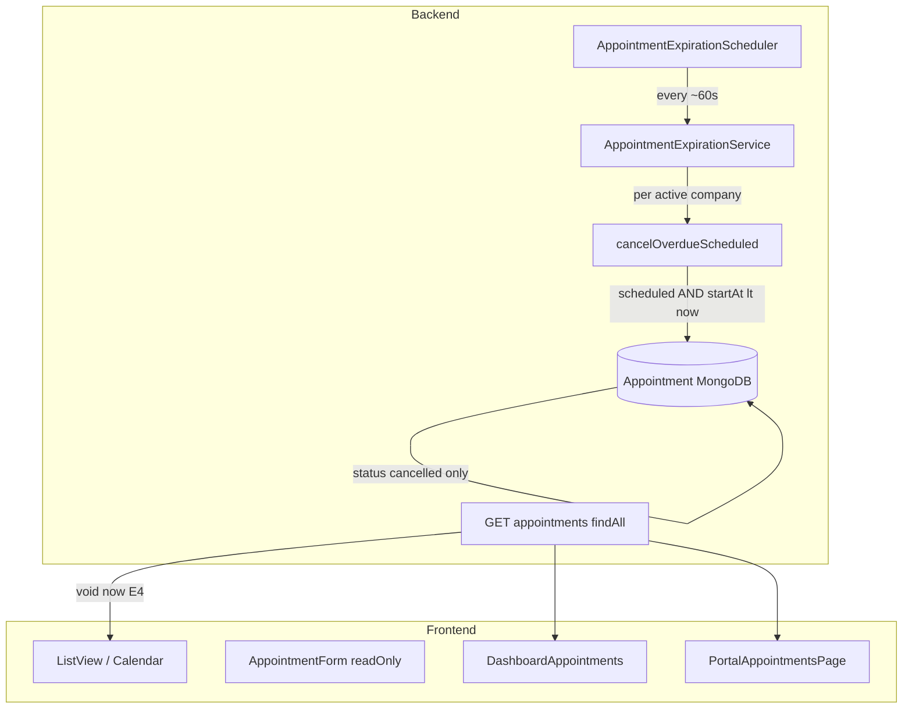

# Auditoria UX — Agendamentos expirados (TASK 2)

**Data:** 2026-11-17  
**Tipo:** Read-only (único ficheiro criado; sem alterações a código, testes, config ou documentação existente)  
**Operações Git de escrita:** apenas criação da branch de auditoria; sem commit, push ou outras operações de histórico

---

## 1. Identificação da tarefa

| Campo | Valor |
|-------|--------|
| Tarefa | TASK 2 — Auditoria UX de agendamentos expirados |
| Âmbito | Apresentação, acções, permissões, mensagens, filtros, dashboard, calendário, portal CLIENT |
| Implementação | **Proibida** nesta tarefa |
| Documentação alterada | Nenhuma (só este relatório novo) |

---

## 2. Branch e HEAD

| Momento | Branch | HEAD |
|---------|--------|------|
| Inicial (gate em `develop`) | `develop` | `d3d56707ab6ef7122b82d9a7c4cacfb091bf0486` |
| Após gate | `audit/expired-appointments-ux` | `d3d56707ab6ef7122b82d9a7c4cacfb091bf0486` |
| Final | `audit/expired-appointments-ux` | **Idêntico** |

| Verificação TASK 1 | Resultado |
|--------------------|-----------|
| PR #143 em `develop` | Sim — `d3d5670 Merge pull request #143` (README + sync documental) |
| `origin/develop` | Igual a `develop` local no gate (sem pull) |

---

## 3. Working tree

| Momento | Estado |
|---------|--------|
| **Inicial** | Limpo (sem modified/staged) |
| **Final** | Apenas `?? docs/tasks/expired-appointments-ux-audit.md` (este ficheiro) |

---

## 4. Resumo executivo

No SchedulerPro, **“expirar”** no backend significa: o job `AppointmentExpirationScheduler` (intervalo predefinido **60 s**) chama `cancelOverdueScheduled`, que faz `updateMany` de registos **`scheduled`** com `startAt < now` para **`cancelled`**, **sem** gravar motivo, origem ou timestamp distinto. **`confirmed`** passado **não** é alterado.

Na UI backoffice, o estado mostrado é sempre a enum (`Agendado`, `Confirmado`, `Cancelado`, …) via [`APPOINTMENT_STATUS_LABELS`](../../client/src/config/appointmentStatus.ts). **Não existe** distinção visual entre cancelamento manual e expiração automática — e **não há** campo no modelo que a suportasse.

O utilizador **não** é informado explicitamente de que um `cancelled` resultou de expiração. O modal de detalhes em modo leitura explica apenas que o agendamento **“já ocorreu”** ([`AppointmentForm.tsx`](../../client/src/components/appointments/AppointmentForm.tsx) L413–416), critério baseado em **`isInstantInPast(startAt)`**, não no estado nem na expiração.

**Lacuna temporal (UX):** entre o fim do horário e a próxima corrida do scheduler, um vencido pode continuar **`scheduled`** na API e mostrar badge **“Agendado”** com acções **Confirmar** / **Cancelar** — coerente com o backend (`changeStatus` não valida `startAt`), mas pode induzir a erro de interpretação.

**Dashboard:** a “Agenda do dia” **exclui** `cancelled` ([`DashboardService.ts`](../../server/src/modules/dashboard/services/DashboardService.ts) L88–90); após expiração, o agendamento deixa de aparecer aí, mas continua contado em O2 como `cancelled`. KPI “Pendentes” usa contagem de `scheduled` no período — inclui `scheduled` vencidos ainda não processados.

**Portal CLIENT:** lista só leitura com badges de estado; filtros `Todos` / `Próximos` / `Passados` por `startAt`, sem explicação de expiração.

**i18n:** interface operacional em **português** (strings fixas); **não** há ficheiros de locale EN — cenário inglês **não verificável**.

**Classificação global desta auditoria:** **APROVADA COM RESSALVAS** — diagnóstico suficiente para uma tarefa de implementação posterior; sem P0 identificado em código revisto.

### Respostas às perguntas do brief §11

| Pergunta | Resposta curta |
|----------|----------------|
| Como a app apresenta agendamentos expirados? | Como **`cancelled`** + label “Cancelado”, ou temporariamente ainda **`scheduled`** / “Agendado” até o job correr |
| O utilizador compreende por que foi cancelado? | **Não** de forma explícita; sem motivo persistido |
| Acções coerentes com regras? | **Em geral sim** no backend; UI pode oferecer confirm/cancel em `scheduled` passado até expirar |
| Permissões FE/BE consistentes? | **Sim** para RBAC espelhado; CLIENT só leitura |
| Problemas i18n? | **EN ausente**; PT consistente nos rótulos de estado |
| Dashboard / filtros / calendário? | Filtro por `cancelled` existe; dashboard oculta cancelados na agenda do dia; calendário não destaca estado (cor do serviço) |
| Correções necessárias? | Ver secção 9 e 11 — sobretudo comunicação de expiração e janela `scheduled` vencido |
| Testes a acrescentar/ajustar? | Ver secção 13 |

---

## 5. Arquitectura e fluxo actual de expiração



| Regra (brief §4) | Evidência |
|------------------|-----------|
| Só `scheduled` + passado → `cancelled` | [`AppointmentRepository.cancelOverdueScheduled`](../../server/src/modules/appointments/repositories/AppointmentRepository.ts) L531–538 |
| `confirmed` não auto-cancelado | Mesma query: `status: SCHEDULED` apenas |
| Por empresa, empresas inactivas ignoradas | [`AppointmentExpirationService`](../../server/src/modules/appointments/services/AppointmentExpirationService.ts) L37–54 + `findAllActiveNotDeleted` |
| GET sem side-effect | [`AppointmentService.findAll`](../../server/src/modules/appointments/services/AppointmentService.ts) L720–726 `void now` |
| Shutdown aguarda rodada | [`AppointmentExpirationScheduler.stop`](../../server/src/modules/appointments/scheduler/AppointmentExpirationScheduler.ts) L58–80 |
| Legado `expireOverdueScheduled` | [`AppointmentService`](../../server/src/modules/appointments/services/AppointmentService.ts) L747–751 (método ainda exposto no service, não usado pelo scheduler actual) |

Documentação de referência (não alterada): [`appointment-expiration-documentation-sync.md`](./appointment-expiration-documentation-sync.md), [`appointment-expiration-audit.md`](../audits/appointment-expiration-audit.md).

---

## 6. Comportamento por página / componente

### 6.1 Lista de agendamentos — `AppointmentsListView`

| Aspecto | Comportamento |
|---------|----------------|
| Estado | Badge [`APPOINTMENT_STATUS_LABELS`](../../client/src/config/appointmentStatus.ts) |
| Editar vs Visualizar | Se `canUpdate` e `isInstantInPast(startAt)` → **Visualizar**; senão **Editar** (L177–196) |
| Acções de status | `getAppointmentStatusActions(status)` — terminal `cancelled` → **nenhuma** (L85–87 em `appointmentStatus.ts`) |
| Expirado auto vs manual | **Indistinguível** — ambos `cancelled` |

### 6.2 Detalhes — `AppointmentForm` (modal)

| Aspecto | Comportamento |
|---------|----------------|
| Título read-only | “Detalhes do agendamento” |
| Alerta | “Este agendamento **já ocorreu** e está em modo somente leitura.” — **não** menciona cancelamento/expiração |
| Campo **status** | **Não** exibido no formulário (auditoria estática do componente) |
| Critério read-only | Definido em [`AppointmentsPage.openDetails`](../../client/src/pages/appointments/AppointmentsPage.tsx) via `formReadOnly`, acionado por `isInstantInPast`, não por `status === cancelled` |

### 6.3 Calendário — `CalendarView` / Month / Week / Day

| Aspecto | Comportamento |
|---------|----------------|
| Cor dos blocos | Predominantemente **cor do serviço**; testes documentam ausência de “status stripe” ([`CalendarView.test.tsx`](../../client/src/components/appointments/CalendarView.test.tsx) “without status stripe”) |
| Clique | [`handleCalendarAppointmentClick`](../../client/src/pages/appointments/AppointmentsPage.tsx) L209–214 — passado → detalhes; futuro → editar |
| Estados `cancelled` | Visíveis no calendário se no período carregado; sem rótulo textual no bloco (inferido por CSS de serviço) |

### 6.4 Filtros — `AppointmentScheduleFilters`

| Aspecto | Comportamento |
|---------|----------------|
| Estados | Toggles para os 5 valores da enum, incl. **Cancelado** |
| “Expirado” | **Não existe** filtro dedicado — usar `cancelled` + interpretação manual |
| Filtragem | Client-side [`filterAppointments`](../../client/src/config/appointmentFilters.ts) |

### 6.5 Dashboard

| Componente | Comportamento relevante |
|------------|-------------------------|
| **Agenda do dia** | Lista após filtro `status !== cancelled` no service (L88–90 `DashboardService`) |
| **Próximos** | Só `scheduled`/`confirmed` com `startAt >= now` ([`DashboardRepository.findUpcoming`](../../server/src/modules/dashboard/repositories/DashboardRepository.ts) L63–69) |
| **O2 distribuição** | Conta por `status` no período — `cancelled` agrega manual + automático |
| **KPI Pendentes** | `period.byStatus.scheduled` ([`DashboardPage.tsx`](../../client/src/pages/dashboard/DashboardPage.tsx) L298) |
| **Badges agenda** | [`DashboardAppointments`](../../client/src/pages/dashboard/DashboardAppointments.tsx) — mesmas labels PT |
| **Mobile** | Lista expansível com badge de estado; `aria-expanded` nos toggles |

### 6.6 Portal CLIENT — `PortalAppointmentsPage`

| Aspecto | Comportamento |
|---------|----------------|
| API | `GET /appointments/mine` — sem mutações na UI |
| Filtros | `all` / `upcoming` / `past` por `startAt` vs agora |
| Estado | Badge partilhado `APPOINTMENT_STATUS_*` |
| Expiração | Sem texto explicativo |

### 6.7 Link público (contexto)

Cancelamento público permitido para `scheduled`/`confirmed` passado com comentário de que expiração trata `scheduled` ([`cancelPublicByToken`](../../server/src/modules/appointments/services/AppointmentService.ts) L1364–1369). Fora do backoffice principal, mas relevante para consistência de mensagens.

---

## 7. Matriz de acções e permissões por perfil

Legenda UI: espelho [`getAppointmentAbilities`](../../client/src/config/appointmentPermissions.ts) + backend [`RolePermissions`](../../server/src/constants/rbac.ts). Escopo O6: CLIENT vê só os seus; EMPLOYEE só os atribuídos ([`appointment-read-scope.ts`](../../server/src/modules/appointments/utils/appointment-read-scope.ts)).

| Acção | OWNER | ADMIN | MANAGER | EMPLOYEE | CLIENT |
|-------|:-----:|:-----:|:-------:|:--------:|:------:|
| Listar agendamentos | Sim | Sim | Sim | Sim (escopo) | Sim (portal / mine) |
| Criar | Sim | Sim | Sim | Não | Não |
| Editar (futuro, PATCH campos) | Sim | Sim | Sim | Sim (notas/`startAt` só) | Não |
| Visualizar detalhes (passado) | Sim | Sim | Sim | Sim | N/A backoffice |
| Confirmar / Cancelar / Concluir / No-show | Sim* | Sim* | Sim* | Sim* | Não |
| Excluir (soft) | Sim | Não | Não | Não | Não |

\*Se `canStatus` / `APPOINTMENT_UPDATE` e estado permitir transição (`getAppointmentStatusActions`).

**Registo `cancelled` (expirado ou manual):**

| Acção | UI backoffice | Backend |
|-------|---------------|---------|
| Confirmar / Cancelar / … | **Ocultas** (estado final) | `STATUS_TRANSITION_NOT_ALLOWED` |
| Editar | **Visualizar** se `startAt` passado; **Editar** se futuro (mesmo cancelado) | PATCH: `startAt` futuro obrigatório se alterado; não reabre status cancelado |
| Excluir | Só OWNER se `canDelete` | `APPOINTMENT_DELETE` |

**`scheduled` vencido (ainda não expirado pelo job):**

| Acção | UI | Backend |
|-------|-----|---------|
| Badge | “Agendado” | `scheduled` |
| Confirmar / Cancelar | **Visíveis** se `canStatus` | **Permitido** — `changeStatus` sem checagem de passado |
| Editar | **Visualizar** (passado) | PATCH corpo bloqueia `startAt` no passado; employee limitado |

---

## 8. Matriz dos cenários avaliados (brief §8)

| # | Cenário | Comportamento observado | Evidência | Classificação |
|---|---------|-------------------------|-----------|---------------|
| 1 | `scheduled` futuro | Badge “Agendado”; acções confirm/cancel; Editar | `appointmentStatus.ts`, `AppointmentsListView` | **OK** |
| 2 | `scheduled` passado (pré-job) | Ainda “Agendado”; Visualizar; confirm/cancel disponíveis | Repo expiration vs `changeStatus` | **Inconsistência UX** (UX-01) |
| 3 | Auto → `cancelled` | “Cancelado”; sem acções; Visualizar se passado | `cancelOverdueScheduled` | **OK** funcional; **melhoria** comunicação (UX-02) |
| 4 | Cancel manual | Idêntico a 3 na UI | Sem `cancellationSource` no model | **OK** + melhoria condicionada (UX-02) |
| 5 | `confirmed` passado | Permanece “Confirmado”; não expira | Repository query | **OK** (regra negócio) |
| 6 | Expirado — OWNER/ADMIN | Como 3–4 | Permissões | **OK** |
| 7 | Expirado — MANAGER | Idem | `APPOINTMENT_UPDATE` | **OK** |
| 8 | Expirado — EMPLOYEE | Idem se no escopo | read-scope | **OK** |
| 9 | Expirado — CLIENT | Vê “Cancelado” no portal; filtro “Passados” | `PortalAppointmentsPage` | **OK** leitura; **melhoria** texto (UX-07) |
| 10 | Acção não permitida | Alerta danger com mensagem API | `AppointmentsPage` `getFriendlyErrorMessage` | **OK** |
| 11 | No Dashboard | Cancelados hoje **não** na agenda do dia; contam em O2 | `DashboardService` L88–90 | **Inconsistência** intencional (UX-05) |
| 12 | Filtros | Filtro “Cancelado” localiza expirados pós-job | `AppointmentScheduleFilters` | **OK** |
| 13 | PT / EN | Só PT | Sem `locales/` | **Não verificável (EN)** |
| 14 | Desktop / mobile | Modais Bootstrap; agenda dashboard mobile com badges | `DashboardAppointments`, testes | **OK** (estático) |

---

## 9. Problemas identificados

### Defeitos confirmados

*Nenhum P0/P1 que comprometa integridade de dados ou permissões de forma contradictória com o RBAC revisto.*

### Inconsistências

#### UX-01 — `scheduled` vencido ainda apresentado como “Agendado” com acções activas

| Campo | Valor |
|-------|--------|
| Prioridade | **P2** |
| Categoria | A (apresentação) + B (acções) |
| Comportamento actual | Entre `startAt` e a corrida do scheduler (~60 s ou mais), UI mostra **Agendado** e permite Confirmar/Cancelar |
| Esperado (produto) | Utilizador pode esperar estado “expirado” ou ausência de confirmação — **não definido** no código |
| Evidência | Scheduler 60 s [`appointment-expiration.config.ts`](../../server/src/modules/appointments/appointment-expiration.config.ts); UI independente de job |
| Ficheiros | `AppointmentExpirationScheduler`, `AppointmentsListView`, `appointmentStatus.ts` |
| Impacto | Confusão operacional; sensação de agendamento ainda “ativo” |
| Recomendação | Na implementação: tratamento UX de “vencido não confirmado” (rótulo, desactivar confirm, ou refresh após job) — **sem alterar regra** sem decisão de produto |
| Risco regressão | Médio se misturar com regras de `changeStatus` |

#### UX-05 — Agenda do dia omite cancelados; O2 ainda contabiliza

| Campo | Valor |
|-------|--------|
| Prioridade | **P2** |
| Categoria | E (filtros/indicadores) |
| Comportamento actual | Expirados no mesmo dia desaparecem da “Agenda do dia” após passarem a `cancelled` |
| Esperado | Coerente com foco operacional, mas utilizador pode não encontrar o slot cancelado no dashboard |
| Evidência | `DashboardService` filter cancelled |
| Impacto | Dificuldade em reconciliar “o que aconteceu hoje” só pelo dashboard |
| Recomendação | Secção opcional “cancelados hoje” ou link para agenda filtrada |
| Risco regressão | Baixo |

#### UX-06 — KPI “Pendentes” inclui `scheduled` vencidos não processados

| Campo | Valor |
|-------|--------|
| Prioridade | **P2** |
| Categoria | E |
| Comportamento actual | Contagem `byStatus.scheduled` no período do dashboard |
| Impacto | KPI inflado até o job correr |
| Recomendação | KPI “agendados futuros” vs “vencidos scheduled” — requer definição produto |
| Risco | Baixo |

### Melhorias recomendadas

#### UX-02 — Sem distinção cancelamento manual vs expiração automática

| Campo | Valor |
|-------|--------|
| Prioridade | **P3** (ou P2 se requisito produto explícito) |
| Categoria | A |
| Comportamento actual | Apenas `status: cancelled` |
| Evidência | `Appointment.model.ts` sem campo origem; `cancelOverdueScheduled` só `$set: { status }` |
| Recomendação | **Não** implementar distinção visual sem persistência (ex. `cancelledReason` / `cancelledBy: system`); avaliar modelo primeiro |
| Risco | Médio em migrações |

#### UX-03 — Modal de detalhes não mostra estado nem motivo de cancelamento

| Campo | Valor |
|-------|--------|
| Prioridade | **P2** |
| Categoria | A + D |
| Comportamento actual | Alerta só “já ocorreu”; sem badge de status no modal |
| Evidência | `AppointmentForm.tsx` L413–416, ausência de campo status |
| Recomendação | Exibir status legível; para `cancelled`, texto neutro (“Cancelado”) até haver metadata de expiração |
| Risco | Baixo |

#### UX-04 — Critério “passado” ≠ “cancelado por expiração”

| Campo | Valor |
|-------|--------|
| Prioridade | **P3** |
| Categoria | B |
| Comportamento actual | `isInstantInPast` governa read-only; `cancelled` futuro (edge) ainda mostraria Editar |
| Evidência | `isInstantInPast`, `getAppointmentStatusActions` |
| Recomendação | Combinar `status` + tempo na decisão de acções |
| Risco | Baixo |

#### UX-07 — Portal CLIENT sem explicação de expiração

| Campo | Valor |
|-------|--------|
| Prioridade | **P3** |
| Categoria | D |
| Comportamento actual | Badge “Cancelado” apenas |
| Recomendação | Copy opcional após suporte a metadata |
| Risco | Baixo |

#### UX-08 — Calendário não codifica estado visualmente

| Campo | Valor |
|-------|--------|
| Prioridade | **P3** |
| Categoria | A + F |
| Evidência | `CalendarView.test` — cor de serviço |
| Recomendação | Opcional: classe `APPOINTMENT_STATUS_CALENDAR_CLASS` nos blocos |
| Risco | Médio visual |

### Não verificáveis nesta auditoria

| ID | Tema |
|----|------|
| NV-01 | Experiência **em inglês** — sem infra i18n |
| NV-02 | Comportamento **em runtime** com Mongo real e timing exacto do scheduler (não executado) |
| NV-03 | Acessibilidade com leitores de ecrã em dispositivos reais (só revisão estática de atributos) |

---

## 10. Comportamentos correctos a preservar

1. **`confirmed` passado não é auto-cancelado** — alinhado com regra de negócio e query de expiração.
2. **GET `/appointments` não dispara expiração** (`void now`).
3. **Transições de estado** restritas em `changeStatus` — frontend espelha com `getAppointmentStatusActions`.
4. **RBAC:** CLIENT só leitura; DELETE só OWNER; EMPLOYEE PATCH limitado.
5. **Dashboard `findUpcoming`** — só futuros `scheduled`/`confirmed` (não mistura expirados cancelados).
6. **Shutdown do scheduler** aguarda rodada em curso.
7. **Filtro por `cancelled`** na agenda permite auditar expirados após processamento.

---

## 11. Recomendações de implementação (não executadas)

Prioridade sugerida para tarefa futura:

1. **P2 — Comunicação de estado vencido `scheduled`:** UX clara antes do job (rótulo, desactivar Confirmar, ou polling leve) — **decisão de produto** primeiro.
2. **P2 — Modal de detalhes:** mostrar badge/linha de **Status**; ajustar copy do alerta read-only (distinguir “passado” vs “cancelado” quando `status === cancelled`).
3. **P2 — Dashboard:** opção de ver cancelados do dia ou tooltip em O2 explicando que inclui expirações.
4. **P3 — Metadata de cancelamento:** se produto exigir distinção manual/automático, adicionar campo(s) no modelo + migração; só então UI diferenciada.
5. **P3 — Calendário:** reforço visual por estado para `cancelled` / vencidos.
6. **Manter** intervalo e job actuais até requisito de SLA diferente.

**Não recomendado sem requisito:** reativar `expireOverdueScheduled` em GET (contraria E4).

---

## 12. Ficheiros candidatos a alteração futura

| Camada | Ficheiros |
|--------|-----------|
| Modelo / API | `Appointment.model.ts`, `AppointmentMapper`, DTOs de resposta (se metadata) |
| Expiração | `AppointmentRepository.cancelOverdueScheduled` (se gravar origem) |
| Frontend config | `appointmentStatus.ts`, `appointmentCalendar.ts` |
| UI | `AppointmentsListView.tsx`, `AppointmentForm.tsx`, `AppointmentsPage.tsx` |
| Dashboard | `DashboardService.ts`, `DashboardPage.tsx`, `DashboardAppointments.tsx` |
| Portal | `PortalAppointmentsPage.tsx` |
| Estilos | `appointments-calendar.css`, calendar views |
| Docs produto | Relatórios O5/E4 existentes (apenas após implementação) |

---

## 13. Testes existentes relevantes

| Área | Ficheiro | Relevância |
|------|----------|------------|
| Expiração service | [`server/tests/unit/appointments/AppointmentExpirationService.test.ts`](../../server/tests/unit/appointments/AppointmentExpirationService.test.ts) | Multi-empresa, falhas isoladas |
| Scheduler | [`server/tests/unit/appointments/AppointmentExpirationScheduler.test.ts`](../../server/tests/unit/appointments/AppointmentExpirationScheduler.test.ts) | Shutdown, concorrência |
| E4 GET | [`server/tests/integration/appointments/find-all-no-expiration.mongo.test.ts`](../../server/tests/integration/appointments/find-all-no-expiration.mongo.test.ts) | GET não cancela |
| Ciclo completo | [`server/tests/integration/appointments/appointment-expiration-full-cycle.mongo.test.ts`](../../server/tests/integration/appointments/appointment-expiration-full-cycle.mongo.test.ts) | Scheduler + estado |
| `findAll` unit | [`AppointmentService.test.ts`](../../server/tests/unit/appointments/AppointmentService.test.ts) | Não chama `cancelOverdueScheduled` em listagens |
| UI estados | [`client/src/config/appointmentStatus.test.ts`](../../client/src/config/appointmentStatus.test.ts) | Transições UI |
| Página agendamentos | [`AppointmentsPage.test.tsx`](../../client/src/pages/appointments/AppointmentsPage.test.tsx) | Acções por role, filtros, terminal statuses |
| Passado | [`appointmentCalendar.test.ts`](../../client/src/config/appointmentCalendar.test.ts) | `isInstantInPast` |
| Dashboard | [`DashboardPage.test.tsx`](../../client/src/pages/dashboard/DashboardPage.test.tsx) | Badges agenda, O2 |
| Portal | *(sem teste dedicado de copy de expiração identificado)* | Lacuna |

**Sugestão para implementação:** testes de componente para modal com `cancelled` + passado; teste de integração UX “scheduled overdue” (mock clock + sem job).

---

## 14. Limitações da auditoria

- **Read-only:** nenhuma execução de `npm test`, browser manual ou dados Mongo.
- **Inglês:** não existe camada i18n — cenário 13 parcial.
- **Distinção manual/automático:** impossível na UI sem dados persistidos — recomendações condicionadas.
- **Timing real** do scheduler depende de `APPOINTMENT_EXPIRATION_INTERVAL_MS` em ambiente.
- **Link público** analisado só ao nível de comentários/código citado, não fluxo E2E completo.

---

## 15. Conclusão e parecer global

A aplicação trata agendamentos **expirados pelo scheduler** como agendamentos **`cancelled` genéricos**, indistinguíveis de cancelamentos manuais. O utilizador **não** recebe explicação de expiração automática. A principal **inconsistência UX** é a janela em que um agendamento **vencido permanece `scheduled`** com aparência e acções de agendamento activo, até o job o cancelar.

As **permissões** entre frontend e backend estão **alinhadas** para os cinco perfis. O **dashboard** e os **filtros** são **coerentes com o modelo de estados**, mas podem **ocultar** cancelados do dia na agenda enquanto os contabilizam em O2.

**Parecer:** auditoria **APROVADA COM RESSALVAS** — material suficiente para planear implementação; **nenhuma** alteração de código foi feita.

**Aguardar aprovação explícita** antes de qualquer tarefa de implementação derivada.

---

## Handoff

```text
Branch: audit/expired-appointments-ux
HEAD:   d3d56707ab6ef7122b82d9a7c4cacfb091bf0486
Novo:   docs/tasks/expired-appointments-ux-audit.md
```