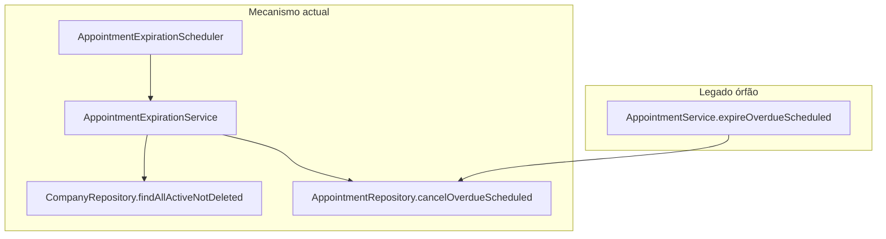

# TASK 3 — Auditoria do método legado `expireOverdueScheduled`

**Data da auditoria:** 2026-11-17  
**Tipo:** read-only (produção e testes inalterados)  
**Branch de auditoria:** `audit/legacy-expiration-method`  
**Base:** `develop` @ `9b925fb8676d024c7477d3c378937d06990b3706` (merge PR #144)

Contexto: PR #144 (guard UX agendamentos expirados) já integrado em `develop`. Expiração automática via scheduler (E1–E4) operacional.

---

## 1. Objectivo da auditoria

Determinar se o método legado `AppointmentService.expireOverdueScheduled` pode ser removido com segurança, mapeando implementação, referências, dependências, testes e diferenças face ao mecanismo actual (`AppointmentExpirationScheduler` / `AppointmentExpirationService`).

---

## 2. Estado do Git e commit analisado

| Campo | Valor |
|-------|--------|
| Branch antes da auditoria | `develop` (alinhada com `origin/develop`) |
| Branch de trabalho | `audit/legacy-expiration-method` |
| HEAD analisado | `9b925fb8676d024c7477d3c378937d06990b3706` |
| Working tree (início) | Limpo |
| Commit analisado | `Merge pull request #144 from WeidsonCordeiro/feat/expired-appointments-confirmation-guard` |

**Comandos de verificação (início):** `git status --porcelain` vazio; `git branch --show-current` → `develop`; `git rev-parse HEAD` → `9b925fb`.

**Alterações desta tarefa:** apenas criação de este relatório (não commitado).

---

## 3. Localização e implementação do método legado

**Ficheiro:** [`server/src/modules/appointments/services/AppointmentService.ts`](../../server/src/modules/appointments/services/AppointmentService.ts)

| Aspecto | Detalhe |
|---------|---------|
| Linhas | L739–753 (comentário + método) |
| Assinatura | `expireOverdueScheduled(companyId: string, now?: Date): Promise<number>` |
| Retorno | `modifiedCount` de `cancelOverdueScheduled` |
| Comportamento | Delegação 1:1 — **sem** lógica adicional |

```748:753:server/src/modules/appointments/services/AppointmentService.ts
  public async expireOverdueScheduled(
    companyId: string,
    now: Date = new Date(),
  ): Promise<number> {
    return this.appointmentRepository.cancelOverdueScheduled(companyId, now);
  }
```

**Repositório invocado:** [`AppointmentRepository.cancelOverdueScheduled`](../../server/src/modules/appointments/repositories/AppointmentRepository.ts) L527–541

- `updateMany` com filtro: `companyId`, `deletedAt: null`, `status: scheduled`, `startAt: { $lt: now }`
- `$set: { status: cancelled }`

**`findAll` (pós-E4):** L721–736 — `void now`; apenas `findByCompanyId`; **não** chama `expireOverdueScheduled`.

---

## 4. Referências encontradas no projecto

### 4.1 Código executável (`.ts` / `.tsx` / `.js` / `.sh`)

Pesquisa: `expireOverdueScheduled` em todo o repositório, filtro ficheiros de código.

| Ficheiro | Linha | Tipo |
|----------|-------|------|
| `server/src/modules/appointments/services/AppointmentService.ts` | 748 | **Definição** |

**Total em código:** **1 ocorrência** (apenas definição).

- **0** chamadas em `server/`, `client/`, scripts ou jobs.
- **0** importações ou referências indirectas pelo identificador.
- **0** referências em controllers, routes ou schedulers.

### 4.2 Testes

- **Nenhum** ficheiro de teste invoca ou asserta `expireOverdueScheduled` pelo nome.
- Testes relacionados com expiração usam `cancelOverdueScheduled` (mock ou integração Mongo) ou `AppointmentExpirationService` / scheduler.

### 4.3 Documentação

**18 ficheiros** com menções a `expireOverdueScheduled` (contexto histórico pré-E4, ROADMAP P3, audits). Exemplos:

- [`docs/audits/appointment-expiration-audit.md`](../audits/appointment-expiration-audit.md)
- [`docs/audits/appointment-expiration-e4-approval-audit.md`](../audits/appointment-expiration-e4-approval-audit.md)
- [`docs/tasks/ROADMAP_AUDIT_2026-11-11.md`](./ROADMAP_AUDIT_2026-11-11.md)
- [`docs/tasks/appointment-expiration-e4-remove-get-side-effect.md`](./appointment-expiration-e4-remove-get-side-effect.md)
- Relatórios `docs/reports/*` (avisos de contexto desactualizado pós-E4)

**Total aproximado:** ~50 linhas de menções em docs (não são dependências de runtime).

---

## 5. Dependências directas e indirectas

| Tipo | Resultado |
|------|-----------|
| Dependência directa (callers) | **Nenhuma** |
| Dependência indirecta (reflection, DI, string names) | **Nenhuma** encontrada |
| Endpoint HTTP / controller | **Não** exposto |
| Scheduler actual | Usa `AppointmentExpirationService`, **não** `AppointmentService.expireOverdueScheduled` |
| Scripts admin / jobs externos no repo | **Nenhum** |
| Cliente frontend | **0** referências |

**Histórico (pré-E4):** `findAll` em escopo empresa inteira chamava expiração antes da listagem — **removido**; testes E4 garantem `cancelOverdueScheduled` **não** chamado em `findAll` ([`AppointmentService.test.ts`](../../server/tests/unit/appointments/AppointmentService.test.ts) L81, L106–107).

---

## 6. Comparação com o mecanismo actual



| Aspecto | Legado `expireOverdueScheduled` | Actual |
|---------|--------------------------------|--------|
| Estados afectados | `scheduled` → `cancelled` | Igual (mesmo repo) |
| Critério temporal | `startAt < now` | Igual |
| Âmbito | Uma `companyId` por invocação | Todas empresas `isActive` + `deletedAt: null` |
| Filtro empresa inactiva | Responsabilidade do caller | `findAllActiveNotDeleted` |
| Transacções Mongo | `updateMany` | Igual |
| Sessões | Não usa transacção multi-doc explícita | Igual |
| Notificações | Não | Não |
| Logs | Nenhum no wrapper | `Logger.system` / `Logger.error` |
| Erros | Propagam ao caller | Por empresa: log + continua |
| GET / listagens | Não (pós-E4) | Não |
| Concorrência scheduler | N/A | `running` guard; overlap ignorado |
| Idempotência | Reexecutar é seguro | Igual |
| Retorno | `number` | `AppointmentExpirationRunSummary` |

**Ficheiros do mecanismo actual:**

- [`server/src/modules/appointments/scheduler/AppointmentExpirationScheduler.ts`](../../server/src/modules/appointments/scheduler/AppointmentExpirationScheduler.ts)
- [`server/src/modules/appointments/services/AppointmentExpirationService.ts`](../../server/src/modules/appointments/services/AppointmentExpirationService.ts)
- Arranque em `server.ts` (scheduler `start()` / shutdown com await in-flight — conforme auditorias E4)

**Diferença funcional relevante:** o legado é um **wrapper single-tenant** sem filtro de empresa activa; o job actual orquestra **multi-empresa elegível**. Não há regra de negócio no wrapper que o scheduler não replique ao chamar `cancelOverdueScheduled(companyId, now)` com os mesmos parâmetros.

---

## 7. Cobertura de testes

| Área | Ficheiro | Relação com legado |
|------|----------|---------------------|
| Repo Mongo | [`cancel-overdue-scheduled.mongo.test.ts`](../../server/tests/integration/appointments/cancel-overdue-scheduled.mongo.test.ts) | Testa **repositório** (comportamento canónico) |
| Service multi-empresa | [`AppointmentExpirationService.test.ts`](../../server/tests/unit/appointments/AppointmentExpirationService.test.ts) | Mock `cancelOverdueScheduled` |
| Scheduler | [`AppointmentExpirationScheduler.test.ts`](../../server/tests/unit/appointments/AppointmentExpirationScheduler.test.ts) | Ciclo de vida / `run` |
| E4 — sem side-effect em GET | [`AppointmentService.test.ts`](../../server/tests/unit/appointments/AppointmentService.test.ts) | `findAll` **não** chama `cancelOverdueScheduled` |
| HTTP integração | `availability-appointment.routes.test.ts`, `appointment-visibility.routes.test.ts`, etc. | Expect **not** `cancelOverdueScheduled` em listagens |

**Testes exclusivos de `expireOverdueScheduled`:** **não existem** (método nunca teve suite dedicada após E4).

**Impacto de remoção do método legado:** **nenhum** teste a eliminar ou adaptar pelo nome; cobertura de expiração mantém-se via repo + expiration service + scheduler.

---

## 8. Diferenças funcionais identificadas

1. **Orquestração multi-empresa e filtro de empresa** — só no mecanismo actual; o legado não substitui o scheduler.
2. **Logging estruturado** — só no mecanismo actual.
3. **Resiliência por empresa** (falha isolada) — só no `AppointmentExpirationService`.
4. **Side-effect em `findAll`** — **removido**; legado não é mais entrypoint de leitura.

Nenhuma destas diferenças constitui **dependência activa** do método legado no código @ `9b925fb`.

---

## 9. Riscos de remoção

| Risco | Classificação | Evidência |
|-------|---------------|-----------|
| Caller em runtime | **Nenhum** | Grep código: 1 definição, 0 chamadas |
| Comportamento exclusivo | **Nenhum** | Wrapper puro |
| Testes que quebram | **Baixo** | Zero testes pelo nome |
| Contrato `public` no service | **Baixo** | Órfão; sem rota HTTP |
| Consumidor externo ao repo (outro pacote/npm) | **Não aplicável** | Monolito |
| Docs desactualizadas pós-remoção | **Médio** | 18 ficheiros docs; actualização opcional em PR de limpeza |
| Regressão de expiração | **Baixo** se repo + scheduler intactos | Mesma `cancelOverdueScheduled` |

---

## 10. Ficheiros que seriam afectados numa eventual remoção

**Código (remoção futura):**

- [`server/src/modules/appointments/services/AppointmentService.ts`](../../server/src/modules/appointments/services/AppointmentService.ts) — bloco L739–753

**Não afectados:**

- `AppointmentRepository.cancelOverdueScheduled`
- `AppointmentExpirationService` / `AppointmentExpirationScheduler`
- Testes listados na secção 7 (excepto eventual comentário JSDoc)

**Documentação (actualização recomendada após remoção, opcional):**

- `docs/audits/appointment-expiration-e4-approval-audit.md`, `ROADMAP_AUDIT_2026-11-11.md`, etc.

---

## 11. Conclusão técnica

**OPÇÃO A — Remoção segura**

Evidências:

1. Uma única ocorrência em código-fonte executável — a própria definição.
2. Zero chamadas no repositório após E4 e após introdução do scheduler.
3. Persistência e regras de negócio canónicas residem em `cancelOverdueScheduled`, continuamente usado pelo job actual.
4. Nenhum teste depende do identificador `expireOverdueScheduled`.
5. Documentação descreve explicitamente o método como órfão (P3 ROADMAP).

Não se identificam comportamentos exclusivos que obriguem a manter o wrapper.

---

## 12. Recomendação fundamentada

1. **Aprovar remoção** de `expireOverdueScheduled` num PR de limpeza (P3), **sem** alterar `cancelOverdueScheduled` nem o scheduler.
2. **Validar** suite `server/` após remoção.
3. **Opcional:** sweep em docs para substituir menções “entrypoint `expireOverdueScheduled`” por “scheduler → repo” (não bloqueante para remoção de código).
4. **Não** reactivar expiração em `findAll` (contradiz E4).

Aguardar aprovação explícita do utilizador antes de qualquer implementação de remoção.

---

## Validação desta auditoria

| Verificação | Resultado |
|-------------|-----------|
| Código de produção alterado | **Não** |
| Testes alterados | **Não** |
| Scheduler alterado | **Não** |
| Apenas relatório criado | **Sim** — este ficheiro |
| Commit / push / PR | **Não** |

**Contagem de referências `expireOverdueScheduled` (pesquisa 2026-11-17):**

- Código: **1**
- Documentação: **18 ficheiros** (~50 menções)
- Client: **0**

---

## Confirmação Git (pós-criação do relatório)

Executar após gravar o relatório:

- `git diff --check`
- `git status --short`

Esperado: `?? docs/tasks/legacy-expiration-method-audit.md` (e branch `audit/legacy-expiration-method`, HEAD `9b925fb`).